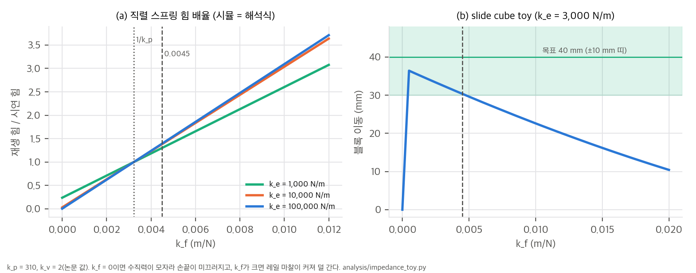
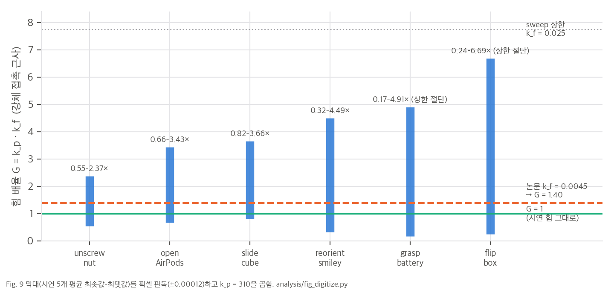
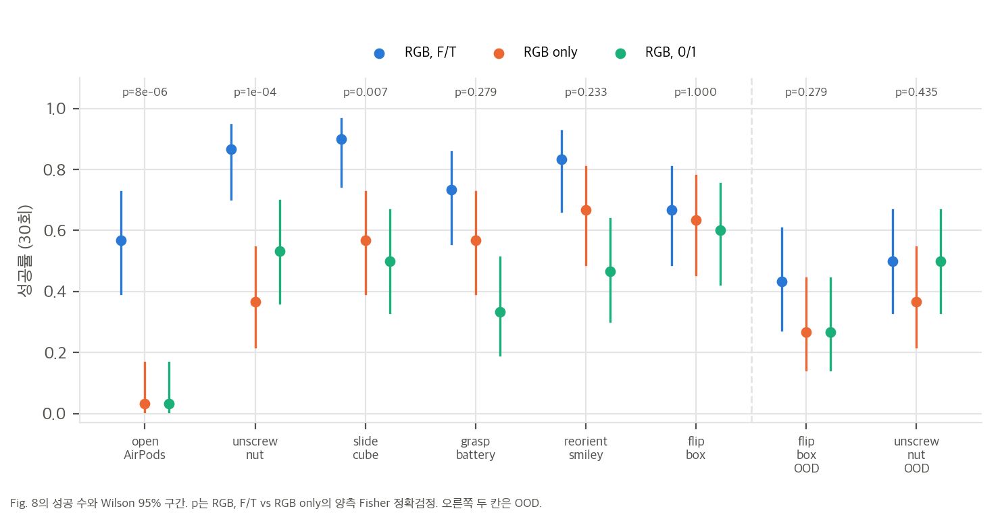

# 03. 핵심 식 해석과 toy 검증

스크립트: `analysis/table_check.py`(그림 수치 재계산, 결과 `table_check_results.json`), `analysis/fig_digitize.py`(Fig. 9 픽셀 판독, `fig9_digitize_results.json`), `analysis/impedance_toy.py`(식 1–3 toy, `impedance_toy_results.json`). 모두 numpy·scipy 단일 스레드로 몇 초 안에 끝납니다.

## 1. 식 1과 식 3을 함께 쓰면 힘은 몇 배가 되는가

### 1.1 강체 접촉
재생할 때 손끝이 접촉면에 막혀 시연 때와 같은 자리(x_c ≈ x_o)에 멈춘다고 하면, 식 1의 정상 상태 힘은 다음과 같습니다.

```
F = k_p (x_f − x_c) = k_p (x_o + k_f f − x_o) = k_p k_f · f
```

v2의 값(k_p = 310, k_f = 0.0045)이면 **G = k_p k_f = 1.395**이고, 재생 힘은 시연 힘의 1.4배입니다. 논문이 식 3을 정당화한 "식 1과 같은 스프링" 논리를 그대로 따르면 k_f = 1/k_p = **0.00323**이어야 G = 1입니다. v1의 K_f = I₃/220(= 0.004545)은 "강성 220의 역수" 꼴이고, v2 k_p와의 곱은 1.41입니다. v1 시점에 다른 k_p를 썼거나, 처음부터 1.4배 증폭을 의도했을 수 있습니다. 논문만으로는 어느 쪽인지 알 수 없습니다(가설).

### 1.2 연한 접촉 (직렬 스프링)
손끝 패드나 물체가 강성 k_e로 변형되면, 시연의 관측 위치 x_o에 이미 침투 f/k_e가 들어 있습니다. 재생에서는 임피던스 스프링(k_p)과 접촉 스프링(k_e)이 직렬로 걸리므로 다음이 성립합니다.

```
G(k_f, k_e) = (1/k_e + k_f) / (1/k_p + 1/k_e)
```

- k_e → ∞(강체)이면 G → k_p k_f입니다.
- k_f = 1/k_p이면 k_e와 상관없이 G = 1입니다. 시연 힘을 그대로 재현하는 유일한 값입니다.
- k_f = 0(관측 위치 그대로)이면 G = k_p/(k_p + k_e)입니다. k_e = 1,000 N/m면 0.24, 10,000이면 0.03, 100,000이면 0.003입니다.

toy T1은 점 질량 손끝을 k_p = 310, k_v = 2로 적분해 정상 상태 힘을 쟀고, 위 식과 소수점 셋째 자리까지 같았습니다.

| k_e (N/m) | k_f = 0 | k_f = 1/k_p | k_f = 0.0045 | k_f = 0.01 |
|---|---|---|---|---|
| 1,000 | 0.237 | 1.000 | 1.302 | 2.603 |
| 3,000 | 0.094 | 1.000 | 1.358 | 2.903 |
| 10,000 | 0.030 | 1.000 | 1.383 | 3.037 |
| 100,000 | 0.003 | 1.000 | 1.394 | 3.094 |



## 2. Fig. 9를 힘 배율로 다시 읽기

Fig. 9의 k_f 범위에 k_p = 310을 곱하면(강체 근사), "재생 힘이 시연 힘의 몇 배일 때 과제가 성공하는가"가 됩니다.



해석:
- **G = 1이 여섯 과제 모두 범위 안에 있습니다.** k_f = 1/k_p로 두면 과제마다 따로 맞추지 않아도 된다는 저자 결론이, 물리적으로 의미 있는 값에서도 성립합니다.
- **범위의 최대/최소 비가 과제의 힘 허용 폭입니다.** 강체 근사에서 과제가 허용하는 수직력이 [N_lo, N_hi]이고 시연자가 f만큼 눌렀다면, 허용 k_f = [N_lo, N_hi]/(k_p f)입니다. 비 k_f,max/k_f,min = N_hi/N_lo는 시연자와 무관하게 과제만으로 정해집니다. 판독값은 unscrew nut 4.3, AirPods 5.2, slide cube 4.5, smiley 13.9, battery 28.8 이상, flip box 27.3 이상입니다.
- **범위의 위치는 시연자가 얼마나 세게 눌렀는지로 정해집니다.** 같은 과제라도 더 세게 누른 시연은 범위 전체가 작은 k_f 쪽으로 이동합니다. grasp battery의 최솟값 0.0006(G = 0.17)은, 이 과제에서 시연자가 필요한 힘의 약 6배로 쥐었다는 뜻으로 읽을 수 있습니다.
- **오차 막대는 시연자 힘의 변동을 담습니다.** toy T3에서 시연 힘의 CV를 0.3으로 두면 k_f 최댓값의 CV(시연 5개 안)가 0.27로 나옵니다. Fig. 9 최댓값의 CV는 절단이 없는 네 과제에서 0.25(slide)–0.46(AirPods, smiley)입니다. 그런데 순수한 "시연자 힘" 모델에서는 최솟값과 최댓값의 CV가 같아야 하는데, AirPods는 최솟값 CV가 0.14로 최댓값(0.46)보다 훨씬 작습니다. 시연마다 과제 조건(물체 배치, 접촉 위치)도 달랐다는 뜻입니다.
- **상한 절단:** battery와 flip box는 최댓값 평균 + SD가 sweep 상한 0.025(G = 7.75)를 넘습니다. 시연 5개 중 일부가 상한에 걸렸다는 뜻이고, 실제 허용 폭은 표보다 넓습니다. "덜 민감한 과제"라는 순위는 바뀌지 않습니다.

## 3. 관측 위치 기준선은 왜 실패하는가 (toy T2)

toy T2는 "위에서 눌러 끌기" 판 slide cube입니다. 손끝이 블록 윗면을 눌러 마찰로 끌고, 블록은 레일 마찰을 받습니다. 블록이 움직이려면 μ_f N > μ_r (N + m g)이어야 합니다(μ_f = 0.8, μ_r = 0.3, m = 50 g, N_min = 0.29 N, 시연 수직력 2 N). 시연을 x_f로 재생하며 k_f를 훑었습니다.

| 접촉 강성 k_e | k_f = 0 블록 이동 | k_f = 0.0045 블록 이동 | 성공 k_f 창 (목표 40 mm ± 10 mm) |
|---|---|---|---|
| 1,000 N/m | 36.1 mm | 30.8 mm | 0 – 0.0050 |
| 3,000 N/m | 0.0 mm | 30.4 mm | 0.0005 – 0.0045 |
| 30,000 N/m | 0.0 mm | 30.1 mm | 0.0005 – 0.0045 |

- **k_f = 0은 접촉이 단단하면 실패합니다.** 수직력이 G(0)·2 N = 0.19 N(k_e = 3,000)으로 N_min보다 작아 손끝이 미끄러집니다. 논문의 관측 위치 정책이 거의 0%인 것과 같은 현상입니다. 반대로 패드가 무르면(k_e = 1,000) x_o 안의 변형만으로 0.47 N이 남아 성공합니다. 관측 위치 기준선이 실패하는지는 접촉 강성과 필요한 힘의 여유에 달려 있습니다.
- **k_f가 너무 커도 실패합니다.** 수직력이 커지면 레일 마찰도 함께 커져서, 같은 접선 목표로는 블록이 덜 갑니다. 논문 보충 영상의 "힘이 너무 크면 slide cube가 실패한다"는 관찰을 설명할 수 있는 기구 하나입니다. 실제로 어떤 기구인지는 영상을 보지 않아 확인하지 못했습니다.
- 창의 상한은 허용 오차(목표 구역 폭)로 정해집니다. ±5 mm로 좁히면 상한이 0.001–0.0015까지 내려옵니다. 즉 k_f 민감도는 힘 자체뿐 아니라 과제의 기하 허용 오차에도 묶여 있습니다.

toy의 질량, 마찰계수, 패드 강성, 목표 허용 오차는 모두 가정입니다. 결과는 경향으로만 읽어야 합니다.

## 4. 통계로 다시 본 Fig. 8 (C3, C4, C6)



- 과제별로 F/T가 RGB-only보다 유의한 것은 AirPods(p = 8×10⁻⁶), unscrew nut(1.4×10⁻⁴), slide cube(0.0074)입니다. Holm 보정(6개 과제) 뒤에도 세 개 모두 0.05 아래입니다.
- 나머지 세 과제와 OOD 두 개는 p = 0.23–1.0입니다. 다만 8개 비교의 방향이 모두 같아서, 부호 검정으로는 "F/T가 RGB-only보다 낮지 않다"는 방향성이 유의합니다(단측 p = 0.004).
- "force-sensitive 과제일수록 힘 관측 이득이 크다"는 관찰은, k_f 범위 너비와 상대 이득의 순위 상관 ρ = −0.89(정확 순열 단측 p = 0.017)입니다. 절대 이득(성공 수 차이)으로 바꾸면 ρ = −0.93(p = 0.008)입니다. 과제 6개라 표본이 작지만 방향은 분명합니다.

## 5. 실험 규모 (C7)

- 시연 550개(80, 60, 150, 110, 80, 70)
- 평가 rollout: Fig. 7·8 합계 900회(관측 위치 180 + 관측 절제 8 × 3 × 30). v1 proprioception 절제는 120회 더
- k_f sweep 재생: 0.0045에서 0.0001씩 위아래 실패까지, 과제당 시연 5개라면 평균 범위 기준 과제당 시연 하나에 61–210회, 합계 **약 3,700회**(우리 추정). 이분 탐색이나 로그 간격을 썼다면 수십 분의 일로 줄일 수 있습니다.
