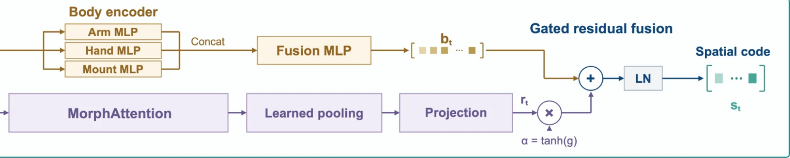
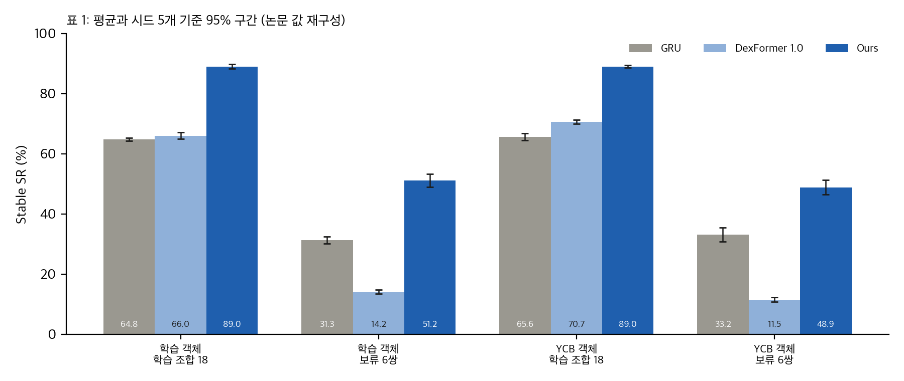
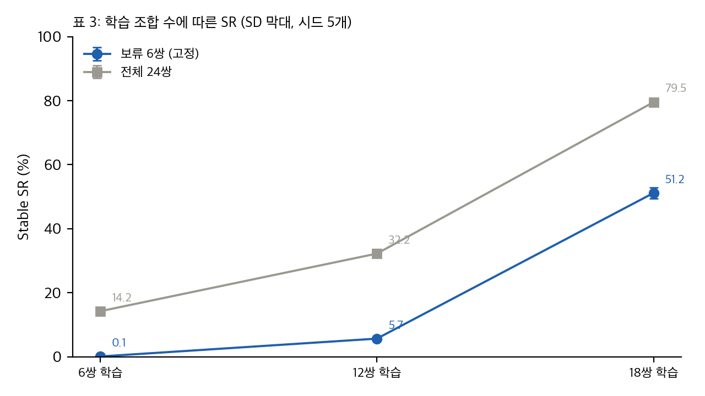
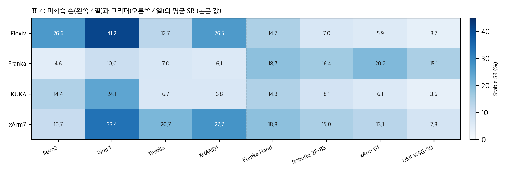

> **논문:** Lixin Xu, Ke Zhang, Xinyu Liu, Jie Tan, Senming Tan, Jiaju Yin, Yating Feng, Xiaoyi Lin, Xiyue Dong, Renjing Xu. *DexFormer 2.0: Towards a Cross-Embodiment Foundation Policy for Dexterous Grasping.* arXiv:2611.20273 (v2, 2026-11-17). 학회 표기는 찾지 못했습니다.
> 공식 저장소는 영상 렌더 코드와 기록 궤적을 담고 있고, 정책 코드와 체크포인트는 아직 없습니다. 이 글의 그림은 논문 그림 2의 MorphNode 블록 발췌(출처 표기)와 우리가 논문 표 값으로 그린 그래프입니다.

## 논문이 묻는 것

로봇 팔과 손을 바꾸면 관절 수, 배치, 축, 한계가 달라집니다. 관측과 행동 공간이 공유되지 않으니 조합마다 정책을 따로 두는 방법이 흔합니다. 팔 4개와 손 6개면 정책이 24개 필요합니다.

DexFormer 2.0은 이 모든 로봇을 **정준 관절 슬롯 29개**(팔 7 + 손 22)로 맞추고, 빈 슬롯은 유효 마스크로 끕니다. 각 관절에는 축, 부착 위치, 한계, 역할, 운동학 깊이를 담은 16차원 descriptor를 붙입니다. 이 descriptor를 입력으로 하는 어텐션은 운동학 트리 거리에 편향을 줍니다. 그 위에 Transformer-XL 메모리(길이 16)를 두고, 모든 조합이 같은 행동 헤드를 씁니다.

*그림 2 발췌 (MorphNode 블록). © 저자, CC BY 4.0, 출처 arXiv:2611.20273. 로봇 그림과 렌더는 뺐습니다.*

## 이 글에서 확인한 것

**1. 보류 조합 전이는 기준선보다 확실히 높습니다.** 학습에 쓰지 않은 6쌍에서 이 정책은 51.18 ± 1.72%를 얻었습니다. GRU는 31.28%, DexFormer 1.0은 14.15%입니다. 시드 5개 기준 Welch 검정 p < 1e-5입니다. 다만 보류 6쌍은 한 번 뽑은 분할이고, 보류 쌍의 팔과 손은 모두 학습에 나타납니다.

**2. 본 적 없는 손은 훨씬 어렵습니다.** 학습에 없던 손 네 종의 평균 SR은 17.45%입니다. 그리퍼 여덟 종 평균은 11.8%이고, 정책이 LEAP 가상 손을 관찰하는 방식이라 그리퍼 전이는 형태 전이가 아닙니다. 본 부품의 새 조합(51%)과 본 적 없는 부품(17%) 사이의 간격이 이 논문에서 가장 큽니다.

*그래프: 우리가 논문 표 1의 평균과 표준편차(시드 5개)로 그린 그래프. 값은 논문 값입니다.*

**3. 메모리와 트리 편향은 각각 보류 SR을 약 절반으로 낮춥니다.** 메모리를 끊으면 보류 SR은 51.18에서 24.45로, 트리 편향을 빼면 24.15로 떨어집니다. 두 요소를 모두 뺀 MLP + TXL은 18.90입니다. 절제 결과도 모두 같은 분할에서 나왔습니다.

**4. 학습 조합을 늘리면 보류 전이가 좋아집니다.** 고정된 보류 6쌍에서 학습 조합 6, 12, 18개의 SR은 0.07, 5.65, 51.18%입니다. 12에서 18로 늘릴 때 45.5 pp가 오릅니다. 다만 중첩 집합의 구성이 본문에 없어 어떤 쌍을 더했는지에 따라 결과가 달라질 수 있습니다.

*그래프: 우리가 논문 표 3의 값(평균, SD 막대)으로 그린 그래프.*

*그래프: 우리가 논문 표 4의 값으로 그린 히트맵. 왼쪽 네 열은 새 손, 오른쪽 네 열은 새 그리퍼.*

**5. 표의 수치는 대부분 맞지만 한 곳은 확인이 필요합니다.** 기준선 대비 차이, 절제 낙폭, 학습 조합 수의 평균은 모두 본문과 맞습니다. 전체 24쌍 열은 다른 열의 가중 평균으로도 정확히 맞습니다. 반면 표 1에서 학습 객체 평가와 YCB 객체 평가가 둘 다 학습 조합 SR 89.01이고 SD만 다릅니다. 우연일 수도 있지만 복사 오류 가능성도 있어 저자 확인이 필요합니다.

**6. 실로봇 결과는 방향만 맞습니다.** Flexiv 팔에서 보류 쌍인 Revo3는 25회 중 17회(68%), 학습 쌍인 LEAP는 25회 중 23회 성공했습니다(92%). 두 값의 차이는 Fisher 검정 p = 0.074로 5% 수준에서 확정되지 않습니다. 학생 정책은 깊이 카메라와 관절 피드백을 쓰고 시뮬레이션에서 증류되며, 보류 쌍도 학생 단계에서는 시뮬로 학습되었습니다(v1 본문에 명시). 그래서 "보류 쌍에 대한 제로샷"이라고 부르기는 어렵습니다. v1은 실로봇 값을 시뮬 37.90%와 비교했지만 v2에서 이 비교가 빠졌습니다.

## 구현할 수 있는가

- **재현은 이 맥에서 불가능합니다.** 논문은 Isaac Lab(NVIDIA GPU 전제)에서 PPO를 돌렸고, 정책 코드와 체크포인트, 손·팔 자산 번들이 공개되지 않았습니다. 실로봇도 없습니다.
- **아키텍처 구현은 가능합니다.** 정준 슬롯, 마스크, 트리 편향 어텐션, Transformer-XL 메모리를 torch로 옮기는 일은 식 (1)–(5)로 정의되어 있습니다. 추정 1–2주입니다. descriptor 세부와 보상 가중치는 보충 자료가 없어 가정해야 합니다.
- **소형 CPU 토이는 가능합니다.** 2–3개 팔·손 조합에 MuJoCo와 PPO를 쓰면 정준 슬롯과 마스크의 효과를 작게 볼 수 있습니다.

## 한계

- **보충 자료가 PDF에 없습니다.** 보상 가중치, 물리 무작위화 범위, 기준선 구현, 그리퍼 매핑을 확인하지 못했습니다.
- **분할 하나, 시드 5개.** 시드 SD(1.72 pp)가 이항 잡음(0.65 pp)의 약 2.7배입니다. 2–3 pp 수준의 차이(예: 객체 효과 2.33 pp, p = 0.080)는 이 설계로 구분하기 어렵습니다.
- **메모리 16 스텝은 60 Hz에서 약 0.27초입니다.** 접촉이 긴 동작에서 동역학을 얼마나 추정하는지 근거가 없습니다.
- **학습 객체는 프리미티브 10종, 고정 크기입니다.** YCB 10종으로 평가했지만 형상 일반화 범위는 좁습니다.

## 출처와 라이선스

- **논문 라이선스:** arXiv abs 페이지의 "view license" 링크는 `creativecommons.org/licenses/by/4.0/`입니다(CC BY 4.0). 원문 PDF에 ©, 저작권, All rights reserved, 회사 고지가 없습니다.
- **그림:** 논문 그림 2의 하단 MorphNode 블록 도식만 발췌했습니다. 로봇 손·팔 그림과 시뮬 렌더는 뺐습니다. 그래프 세 장은 우리가 논문 표 값으로 그렸습니다.
- **공식 저장소:** `github.com/DavidLXu/dexformer2`. LICENSE 파일은 MIT이고 GitHub API는 "Other"로 표시합니다. 3자 자산은 각자 라이선스를 유지합니다. 이 글에서는 저장소를 내려받아 읽기만 했고 실행하거나 설치하지 않았습니다.
- 분석 문서와 재계산 스크립트는 `analysis/`에 있습니다. 재계산은 수 초이고 논문 표의 평균과 표준편차만 씁니다.

## 자료

- [통합 리포트 PDF](report/report_public.pdf)
- [01. 논문 분석: DexFormer 2.0](analysis/01_paper_analysis.md)
- [02. 선행연구, 가까운 대안, 공식 저장소](analysis/02_prior_work.md)
- [03. 수치 재계산과 일관성 검사](analysis/03_analysis.md)
- [04. 주장 검증 (공식 저장소 정적 확인 포함)](analysis/04_claim_verification.md)
