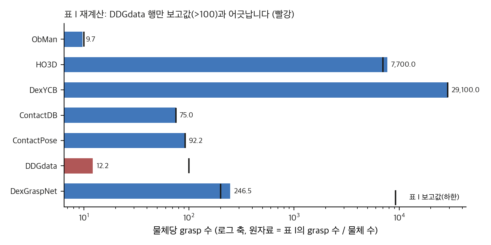
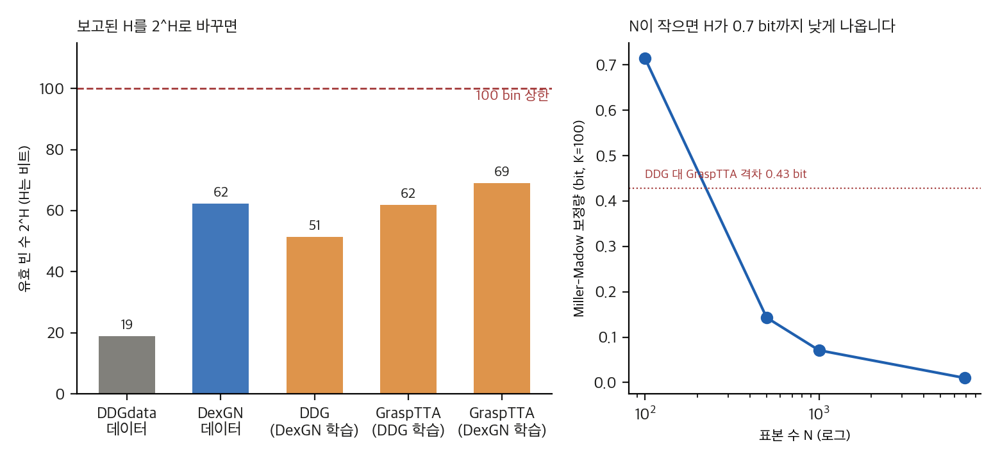
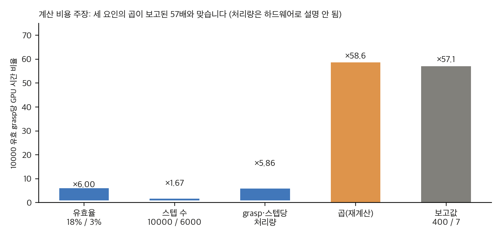

# 03. 수치 재계산과 일관성 검사: DexGraspNet

원자료(파지 데이터, 벤치마크 시도 기록)는 공개되지 않았고 데이터셋도 받지 않았습니다. 따라서 여기서는 **논문이 보고한 수치끼리** 맞는지, 보고된 설정에서 재계산한 값이 본문과 맞는지만 확인합니다. 재계산 코드는 `analysis/recompute.py`, 결과는 `analysis/recompute_results.json`입니다(numpy, scipy, 1초 미만). 검사 항목 번호는 C1–C13입니다.

## 요약

| 번호 | 검사 | 결과 |
|---|---|---|
| C1 | 표 I의 물체당 파지 수 | **DDGdata 행 불일치**: 6900 / 565 = 12.2인데 표는 ">100". 나머지 여섯 행은 일치 |
| C2 | 표 I의 다른 행 | 일치 (ObMan 9.7, ContactDB 75, ContactPose 92.2, DexGraspNet 246.5) |
| C3 | 물체 수 합 (3980 + 1375) | 일치 (5355). 1.32M / 5355 = 246.5 |
| C4 | 계산 비용 (400→7 GPU h, 950 GPU h, 50000 GPU h) | 재계산 6.85, 401.5, 904, 52995. 보고값과 1–6% 안에서 일치 |
| C5 | 계산 비용 57배의 분해 | 유효율 ×6.0 × 스텝 ×1.67 × 처리량 ×5.86 = ×58.6. 처리량 이득은 하드웨어로 설명되지 않음 |
| C6 | 표 III의 방향 (성공률↑, Q1↑, 관통↓) | 8개 비교 모두 성립 |
| C7 | 표 IV의 방향 (평균↑, 표준편차↓) | 8개 비교 모두 성립 |
| C8 | 표 III의 관통과 벤치마크 기준 (5 mm) | GraspTTA (DexGraspNet 학습)의 평균 최대 관통 6.78 mm로 기준 초과 |
| C9 | 엔트로피 단위와 유효 빈 수 | 단위는 bit (100 bin의 상한 6.644 bit). 유효 빈 수 19 대 62 |
| C10 | 임계값 정의 | 표 II(1 mm)와 표 III(1 cm)의 Q1 접촉 임계가 다름. 표 II와 III 값은 직접 비교 불가 |
| C11 | 성공률 차이의 유의성 | 표본 수 미기재. 필요한 최소 n: 46–232 (아래 표) |
| C12 | 표 II의 "유의하게 좋다" | 표준편차, 검정 없음. 비율 1.61배(평균)와 1.11배(상위 10%)만 계산 가능 |
| C13 | 자유도 표기 | 26 (서론), 24 (관련 연구), 22 (방법). 정의가 본문에 없음 |

## 1. 표 I과 물체·파지 규모 (C1–C3)

그림: 표 I의 grasp 수를 물체 수로 나눈 값(막대)과 보고된 하한(세로선)을 비교했습니다. DDGdata 행만 어긋납니다. 우리가 그린 그래프입니다.

- DDGdata: 6,900 / 565 = 12.2. 표 I은 ">100"입니다. 본문 §I은 "only 6.9K grasps and 565 objects"라고 같은 숫자를 씁니다. 따라서 표의 ">100" 또는 본문 숫자 중 하나가 틀렸거나, 물체당 파지 수에 다른 정의가 쓰였을 것입니다. 어느 쪽인지는 원 데이터 없이 확인할 수 없습니다.
- DexGraspNet: 1,320,000 / 5,355 = 246.5. 표 I의 ">200"과 맞습니다. 서론의 "two orders of magnitude larger than DDG"는 1.32M / 6.9K = 191로 맞고, "one order of magnitude" (물체 5355 / 565 = 9.5)도 맞습니다.
- 물체: CAD 3980 + 스캔 1375 = 5355. 본문과 맞습니다. 다섯 크기는 물체 수에 포함되지 않습니다(공식 코드는 파지마다 크기를 무작위로 고름, `04` D9).

## 2. 벤치마크 표의 방향과 기준 (C6–C8)

- 표 III: 네 조합(DDG와 GraspTTA, 두 테스트셋) 모두에서 학습 데이터를 DexGraspNet으로 바꾸면 성공률이 오르고, Q1이 오르고, 관통이 줄어듭니다. 본문의 "no matter which baseline, test set, or metric"과 맞습니다.
- 표 IV: 네 조합 모두 평균이 오르고 표준편차가 줄어듭니다. 본문과 맞습니다.
- C8: 벤치마크 기준은 "최대 관통 5 mm 미만"입니다. 평균 최대 관통은 GraspTTA (DexGraspNet 학습)에서 6.78 mm, DDG (DexGraspNet 학습)에서 1.73 mm입니다. 평균이 기준을 넘어도 성공률이 0이 되지는 않으므로 모순은 아닙니다. 다만 GraspTTA의 관통이 기준 근처에 몰려 있는지는 분포가 없어서 알 수 없습니다.
- 논문은 Q1을 관통 5 mm 초과 시 0으로 둡니다. 관통이 큰 기법(GraspTTA)의 평균 Q1은 이 규칙 때문에 낮게 나옵니다. 기법 간 Q1 비교는 이 점을 감안해야 합니다.

## 3. 엔트로피 단위와 표본 수 (C9)

- 관절 범위를 100 bin으로 나누면 엔트로피의 상한은 log2(100) = **6.644 bit** = ln(100) = 4.605 nat입니다. 표 II의 DexGraspNet H = 5.962는 nat로는 상한을 넘으므로 **단위는 bit**입니다. 본문은 단위를 쓰지 않았습니다.
- 2^H (유효 빈 수): DDGdata 19.0, DexGraspNet 62.3. 표 IV의 DDG (DexGraspNet 학습) 51.4, GraspTTA (DDGdata 학습) 61.9, GraspTTA (DexGraspNet 학습) 69.1.
- 표 IV에서 GraspTTA (DexGraspNet)과 DDG (DexGraspNet)의 격차는 6.111 − 5.683 = 0.43 bit입니다.

그림: 왼쪽은 보고된 H를 2^H로 바꾼 유효 빈 수, 오른쪽은 표본 수 N에 따른 Miller–Madow 보정량(K = 100 bin, (K−1)/(2N ln2) bit)입니다. 우리가 그린 그래프입니다.

- 표본 수 의존성: plug-in 엔트로피는 표본이 적으면 낮게 나오고, 점유 bin이 많은 분포(더 다양한 쪽)에서 그 하향 편향이 더 큽니다. 두 분포의 점유 bin 수 차이를 ΔK라 하면, 격차 0.43 bit가 편향만으로 사라지려면 ΔK / (2N ln2) ≥ 0.43, 즉 N ≤ ΔK / 0.596입니다. ΔK = 50이면 N ≤ 84, ΔK = 99이면 N ≤ 166입니다. 따라서 벤치마크 시도 수가 수백 이상이면 0.43 bit 격차는 편향으로 설명되지 않습니다. 시도 수와 점유 bin 수는 본문에 없습니다.
- 표 II의 DDGdata(6.9K)와 DexGraspNet(1.32M) 값은 표본 수가 커서 편향이 작습니다(0.01 bit 이하). 두 데이터셋 사이의 차이(1.7 bit)는 편향으로 설명되지 않습니다.

## 4. 계산 비용 (C4–C5)

그림: 10000 유효 파지당 GPU 시간 비율을 유효율, 스텝 수, grasp·스텝당 처리량의 곱으로 나눴습니다. 우리가 그린 그래프입니다.

| 항목 | 신 파이프라인 (A100) | 원 알고리즘 (3090) | 비 |
|---|---|---|---|
| 배치 (파지 수) | 10000 | 512 | |
| 스텝 수 | 6000 | 10000 | ×1.67 |
| 소요 시간 | 74 분 | 37 분 | |
| 유효율 | 18% | 3% | ×6.0 |
| grasp·스텝당 시간 | 7.4 × 10⁻⁵ s | 4.3 × 10⁻⁴ s | ×5.86 |
| 10000 유효 파지당 GPU 시간 | **6.85** (보고 7) | **401.5** (보고 400) | ×58.6 (보고 57.1) |
| 1.32M 유효 파지 GPU 시간 | **904** (보고 950) | **52995** (보고 50000) | |

- 세 요인의 곱은 본문의 57배와 맞습니다(C5). 보고된 400 / 7 = 57.1과 재계산 58.6의 차이는 반올림 때문입니다.
- 처리량 ×5.86은 본문이 쓴 이유("smaller memory, bigger batch")와 방향이 맞습니다. 하지만 본문이 명시한 하드웨어 피크는 A100 19.49 TFLOPS, 3090 35.58 TFLOPS(FP32)입니다. 피크 기준으로는 A100이 더 느립니다. 따라서 5.9배는 하드웨어가 아니라 배치 크기와 구현에서 왔을 것입니다. 본문은 이를 분해하지 않았습니다.
- 1.32M 유효 파지의 GPU 시간은 재계산(904)과 보고(950)가 5% 안에서 맞습니다. 원 알고리즘의 50000 GPU 시간은 재계산 52995와 6% 차이이고, 보고값을 반올림한 것으로 보입니다.
- 유효율의 정의: "18% are considered valid under our settings"가 시뮬레이션 검증(Isaac Gym)을 포함하는지 본문에 없습니다. 포함하지 않는다면 실제 유효율은 더 낮을 수 있고, 비용 비교가 달라집니다.

## 5. 성공률 차이의 유의성 (C11)

논문은 표 III과 표 IV에 시도 수를 쓰지 않았습니다. 같은 n을 두 기법에 썼다고 가정하고, 두 비율의 양측 z 검정(α = 0.05)을 만족하는 **기법당 최소 n**을 계산했습니다.

| 비교 | 차이 (%p) | 최소 n (기법당) | 해석 |
|---|---|---|---|
| DDG, DexGraspNet 테스트: 57.4 → 67.5 | 10.1 | 177 | n ≥ 177이면 유의 |
| GraspTTA, DexGraspNet 테스트: 17.1 → 24.5 | 7.4 | 232 | 더 많은 시도 필요 |
| DDG, DDGdata 테스트: 56.4 → 75.9 | 19.5 | 46 | 거의 항상 유의 |
| GraspTTA, DDGdata 테스트: 23.7 → 39.3 | 15.6 | 69 | 대부분 유의 |

- 성공률 17.1%와 24.5%의 Wilson 95% 신뢰구간: n = 100이면 11.0–25.7%와 17.1–33.8%로 겹칩니다. n = 1000이면 14.9–19.6%와 21.9–27.3%로 구분됩니다.
- 결론: 방향은 대부분의 조합에서 유의할 가능성이 높지만, GraspTTA의 DexGraspNet 테스트 결과는 시도 수가 232 미만이면 검정력이 부족합니다. 반복 실험의 분산은 본문에 없어서 어떤 n이 실제였는지 판단할 수 없습니다.
- 표 III의 Q1과 관통, 표 IV의 엔트로피 평균은 분산이 없어서 검정할 수 없습니다.

## 6. 표 II의 "유의하게 좋다" (C12)

- 100% Q1 평균: 0.1145 / 0.0712 = **1.61배**. 상위 10% Q1 평균: 0.2533 / 0.2277 = **1.11배**. 엔트로피 평균 차이: 1.72 bit (2^H 기준 3.3배).
- 상위 10%의 격차(1.11배)는 작습니다. 전체 평균 차이가 큰 이유가 소수의 나쁜 파지가 DDGdata에 많아서인지, 분포 전체가 옮겨졌는지는 분포 자료 없이 구분할 수 없습니다.
- 본문의 "significantly"는 검정 없이 쓰였습니다.

## 7. 임계값과 정의 (C10)

| 기준 | 값 | 위치 |
|---|---|---|
| 생성 후 검증: 관통 | 1 mm (0.1 cm) | §III-C |
| 벤치마크 성공: 관통 | 5 mm | §V-B |
| Q1 접촉 임계 (표 II) | 1 mm | §IV |
| Q1 접촉 임계 (표 III) | 1 cm | §V-B |
| 자기 관통 키포인트 구 반지름 δ | 1 cm | 그림 2a, 식 (4) |

- Q1 접촉 임계가 1 mm와 1 cm로 다르므로 표 II의 0.1145와 표 III의 0.0582는 직접 비교할 수 없습니다. 논문은 두 표를 같은 "Q1"으로 부릅니다.
- 식 (4)의 δ가 키포인트 구 반지름(1 cm)인지 쌍 거리의 기준(2 cm)인지 본문에 명시되지 않았습니다. 공식 코드는 쌍 거리 기준 0.02 m를 씁니다(`04` D10).

## 8. 자유도 표기 (C13)

- 서론: ShadowHand "26 for ShadowHand". 관련 연구: "sometimes up to 24DoF as in ShadowHand". 방법: d = 22.
- 세 값이 서로 다른 개념(전체 자유도, 손목 포함, 손가락 관절)을 가리키는 것으로 보이지만, 본문에 정의가 없습니다. 공식 코드는 관절 22개를 씁니다(`04` §2).

## 9. 재계산하지 못한 것

- 표 II의 Q1 평균과 표 III의 Q1·관통 평균: 파지 데이터가 없어 재계산 불가.
- 표 III의 성공률: 시도 수가 없어 신뢰구간을 정확히 줄 수 없음.
- 표 IV의 엔트로피: 관절별 분포와 표본 수가 없어 재계산 불가. 단위와 편향만 확인.
- 벤치마크 기법의 학습·평가: 이 저장소에 코드가 없음(`04` §3).
