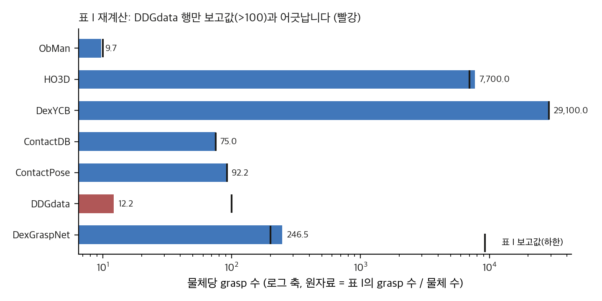
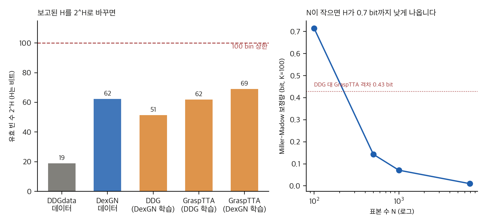
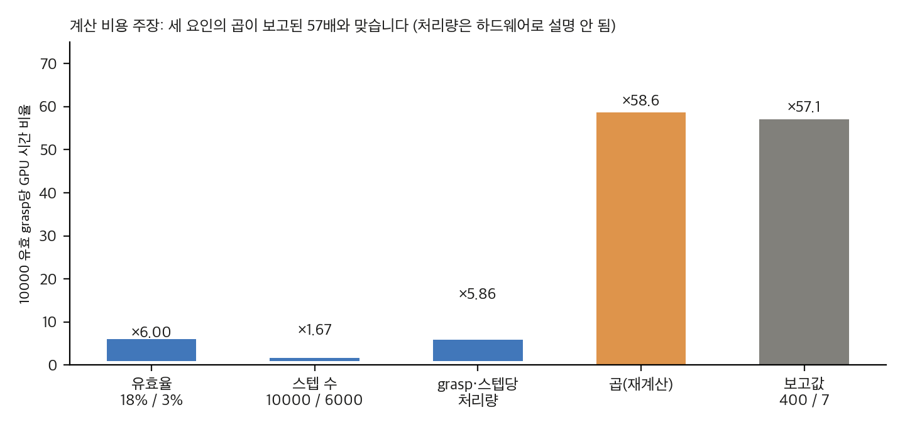

> **논문:** Ruicheng Wang, Jialiang Zhang, Jiayi Chen, Yinzhen Xu, Puhao Li, Tengyu Liu, He Wang. *DexGraspNet: A Large-Scale Robotic Dexterous Grasp Dataset for General Objects Based on Simulation.* IEEE ICRA 2023, arXiv:2210.02697 (v2, 2023-03-08).
> 공식 코드(PKU-EPIC/DexGraspNet)는 정적으로만 읽었고 실행하지 않았습니다. 데이터셋은 받지 않았습니다. 논문 그림은 싣지 않고, 우리가 만든 그래프만 씁니다.

## 논문이 묻는 것

손으로 물체를 잡는 파지 데이터는 평행 그리퍼에 비해 아주 적습니다. 다지 손은 자유도가 많아서 사람이 주석을 달기 어렵고, 기존 시뮬레이션 데이터(DDGdata, GraspIt!로 만든 6.9K 파지)는 포즈가 좁게 몰려 있습니다.

이 논문은 두 가지를 합니다. 하나는 **미분 가능 힘 폐쇄 추정기**로 파지를 최적화하는 방법을 개선해서 대량으로 만드는 것입니다. 다른 하나는 만든 파지를 **Isaac Gym**에서 6방향 중력 아래 검증해 통과한 것만 남기는 것입니다. 결과는 1.32M 파지, 물체 5355개(133 범주), 물체당 200개 이상입니다.

## 이 글에서 확인한 것

**규모는 맞습니다.** 1.32M을 5355로 나누면 물체당 246.5개로 "200개 이상"과 맞습니다. 물체 수 3980 + 1375도 5355와 맞습니다.

**표 I의 한 행이 맞지 않습니다.** DDGdata는 6.9K 파지와 565 물체입니다. 6900을 565로 나누면 12.2인데, 표는 "100개 이상"이라고 씁니다. 다른 여섯 행은 모두 맞습니다.

그래프: 표 I의 파지 수를 물체 수로 나눈 값(막대)과 보고된 하한(세로선). DDGdata 행만 어긋납니다. 우리가 그린 그래프입니다.

**벤치마크 표는 방향이 맞지만 근거가 얇습니다.** 표 III과 IV에서 학습 데이터를 DexGraspNet으로 바꾸면 여덟 개 비교가 모두 성공률, Q1, 다양성에서 좋아집니다. 그러나 시도 수와 표준편차가 없습니다. DDG의 성공률 57.4%와 67.5%는 기법당 177회 이상이면 유의하고, GraspTTA의 17.1%와 24.5%는 232회 이상이어야 유의합니다. 본문은 검정을 하지 않았습니다.

**엔트로피는 bit입니다.** 관절 범위를 100 bin으로 나누면 엔트로피의 상한은 6.644 bit입니다. 표 II의 5.962는 nat로는 상한을 넘으므로 bit입니다. 2^H로 바꾸면 유효 빈 수는 DDGdata 19개, DexGraspNet 62개입니다. 표본 수가 적으면 plug-in 엔트로피가 낮게 나오므로 벤치마크의 샘플 수가 중요합니다.

그래프: 왼쪽은 보고된 엔트로피를 2^H로 바꾼 유효 빈 수, 오른쪽은 표본 수에 따른 Miller–Madow 보정량(100 bin). 우리가 그린 그래프입니다.

**계산 비용 57배는 세 요인의 곱으로 맞습니다.** 유효율이 3%에서 18%로 6배, 스텝 수가 10000에서 6000으로 1.67배, 스텝당 파지 처리량이 5.9배입니다. 곱은 58.6으로 보고된 57과 맞습니다. 다만 처리량 이득은 A100이 3090보다 FP32 피크가 낮다는 본문 수치와 반대 방향입니다. 배치 크기와 구현에서 왔을 것입니다.

그래프: 10000 유효 파지당 GPU 시간 비율을 유효율, 스텝 수, 처리량으로 나눈 값. 우리가 그린 그래프입니다.

## 공식 코드와 논문의 차이

공식 저장소(main, 2025-01-06 마지막 커밋)는 에너지 식(식 1–6)과 가중치, 접촉 후보 140개, 6000 반복, 초기화 방식을 논문대로 씁니다. 그러나 다음은 다릅니다.

- **최적화:** 논문은 MALA를 "단순 경사 하강"으로 줄였다고 씁니다. 코드는 RMSProp형 갱신에 Metropolis 수락과 온도 스케줄을 씁니다.
- **관통 기준:** 논문은 최대 관통 깊이 1 mm 이하를 씁니다. 코드는 생성 때 계산한 에너지 합이 1 mm 미만인지 봅니다.
- **검증 자세:** 시뮬레이션 전에 관절을 한 번 바꿉니다. 저장되는 자세는 바꾸기 전 값입니다.
- **빠진 코드:** Q1 계산, 엔트로피, DDG와 GraspTTA 학습·평가 코드는 저장소에 없습니다. 표 II–IV는 이 저장소로 다시 만들 수 없습니다.
- **분기:** MANO와 Allegro 결과는 별도 분기에 있습니다(이 글에서는 클론하지 않았습니다).

## 이 맥에서 구현할 수 있는가

**공식 파이프라인은 이 맥에서 돌지 않습니다.** 파지 생성 코드에 `cuda`가 하드코딩되어 있고, 검증은 NVIDIA GPU와 Linux에서 돌아가는 Isaac Gym이 필요합니다. 논문 설정으로 1.32M 파지를 만드는 데는 A100 약 950 GPU 시간이 듭니다.

**에너지 식과 최적화는 torch로 옮길 수 있습니다.** 저장소에 ShadowHand MJCF가 있고, 검증을 MuJoCo로 바꾸면 축소판을 만들 수 있습니다. 노력은 2–4주로 봅니다(추정). 다만 물리 엔진이 다르므로 성공률 수치는 논문과 비교할 수 없습니다.

## 읽을 때 조심할 것

- 표 I의 DDGdata 행과 본문 숫자가 맞지 않는 이유는 확인하지 못했습니다. 저자에게 물을 질문입니다.
- 벤치마크의 성공률, Q1, 다양성에는 시도 수와 분산이 없습니다. 방법 사이의 차이를 주장하기 전에 확인이 필요합니다.
- 검증 기준이 세 가지(§III-C의 6방향 기준, 벤치마크의 1방향 기준, Q1의 1 mm와 1 cm)입니다. 어떤 기준인지 표마다 확인해야 합니다.

## 정리

DexGraspNet은 파지 데이터의 규모와 품질 기준을 한 단계 올린 데이터셋입니다. 다만 숫자 몇 개는 본문과 맞지 않고, 벤치마크는 통계 근거가 약합니다. 데이터셋을 쓰거나 비교할 때는 물체당 파지 수, 검증 기준, 표본 수를 직접 확인하는 것이 안전합니다.

## 자료

- [통합 리포트 PDF](report/report_public.pdf)
- [01. 논문 분석: DexGraspNet](analysis/01_paper_analysis.md)
- [02. 선행연구와 관련 자료: DexGraspNet](analysis/02_prior_work.md)
- [03. 수치 재계산과 일관성 검사: DexGraspNet](analysis/03_analysis.md)
- [04. 논문 ↔ 공식 코드 대조: DexGraspNet](analysis/04_code_verification.md)
