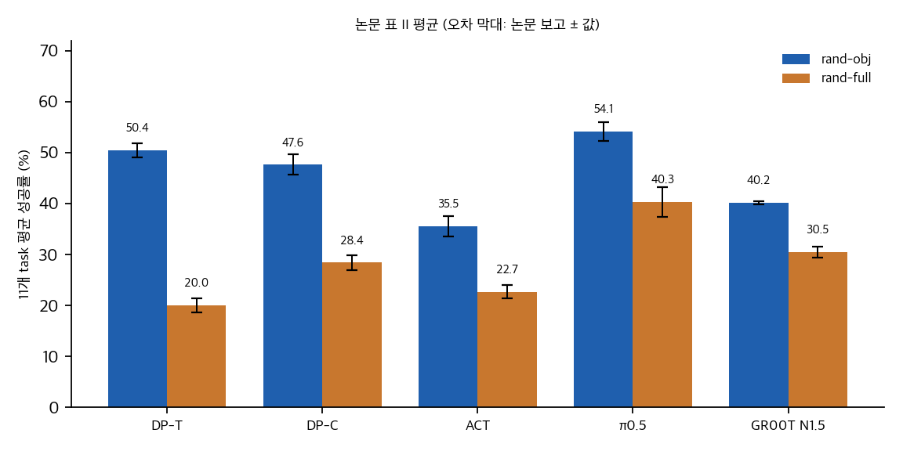
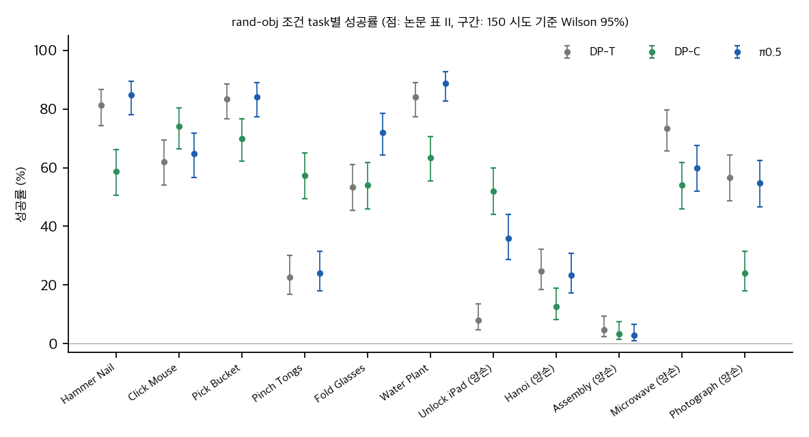

> **논문:** Hanwen Wang 외. *DexJoCo: A Benchmark and Toolkit for Task-Oriented Dexterous Manipulation on MuJoCo.* arXiv:2605.16257 (v2, 2026-09-22). 학회 표기는 찾지 못했습니다.
> 공식 코드는 GitHub brave-eai/dexjoco(MIT)에 있습니다. 이 글의 그래프는 논문 표 II 값으로 우리가 그린 것입니다. 논문 그림은 넣지 않았습니다(arXiv 비독점 배포).

## 논문이 묻는 것

손 달린 로봇을 평가할 표준 벤치마크가 부족합니다. 기존 벤치마크는 손만 쓰거나 손 안에서 돌리기와 단순 집기에 치우쳐 있고, 사람 시연과 VLA용 언어 지시도 부족합니다. DexJoCo는 MuJoCo에서 Franka Panda와 Allegro 손으로 **11개 기능 중심 과제**(도구 사용, 양손 협응, 장기 과제, 추론)를 만들고, 저비용 수집 장치(Rokoko 장갑, HTC Vive 트래커, 재타깃팅)로 시연 1.1K개를 모읍니다. 이 시연으로 DP-T, DP-C, ACT, π0.5, GR00T N1.5를 두 가지 무작위화 조건에서 평가합니다.

## 평균은 맞지만 ±의 정의가 빠져 있습니다

논문 표 II를 다시 계산했습니다. 과제당 시도는 3시드 × 50회 = 150회입니다. 11개 과제 평균은 보고값과 0.06 이내로 맞습니다. 그래프 오차 막대는 논문이 적은 ± 값입니다. 다만 캡션은 이것이 "11개 과제의 표준편차"라고 쓰는데, 그 값은 과제 간 SD(20–31)보다 훨씬 작습니다. 시드 간 변동으로 보입니다. 정의를 본문에 적어야 합니다.

*그래프 (우리가 그림). 데이터: 논문 표 II. 오차 막대는 논문 보고 ± 값이며 정의는 본문에 없습니다.*

## 시각 무작위화는 모든 정책을 떨어뜨립니다

카메라 포즈, 조명, 테이블 텍스처를 바꾸면(rand-full) 다섯 모델 모두 평균이 떨어집니다. DP-T는 50.4에서 20.0으로, π0.5는 54.1에서 40.3으로 떨어집니다. 이 하락은 과제 전체에서 일관됩니다.

하지만 "π0.5가 가장 높다"는 주장은 조건에 따라 다릅니다.

- rand-full에서 π0.5가 DP-T보다 낫다는 것은 과제 단위 부호 검정에서 9:1, p = 0.02로 뒷받침됩니다.
- rand-obj에서의 차이 3.7 pp는 과제 단위에서 7:4(p = 0.55)입니다. 시드 단위 Welch t도 p ≈ 0.05 안팎으로 경계입니다.

## 과제별로 보면 판정이 갈립니다

rand-obj 조건에서 과제별 성공률에 150회 기준 Wilson 95% 구간을 그렸습니다. 시드 분산은 반영하지 않은 구간입니다.

*그래프 (우리가 그림). 점은 논문 표 II 값이고 구간은 과제당 150회 기준 Wilson 95%입니다.*

- **Pinch Tongs**: DP-C 57.3 대 π0.5 24.0. 시드 단위 Welch t = 6.1로 뚜렷합니다.
- **Unlock iPad**: DP-C 52.0 대 π0.5 36.0. 시드 단위 t = 1.9(자유도 2)로 판정할 수 없습니다. π0.5 시드 SD가 14.4로 커서 한 시드의 차이에 따라 결론이 바뀝니다.
- **Assembly**: 모든 정책이 거의 실패합니다(rand-obj 최고 4.7%).

## 바뀐 판본: v1과 v2의 π0.5 수치

v1(2026-05-15)과 v2(2026-09-22)를 비교하니 실험 수치가 바뀌었습니다. π0.5의 평균 rand-full은 34.1에서 40.3으로 올랐고, 다중 과제 학습 평균은 45.5에서 35.0으로 내려갔습니다. 행동 헤드 사전학습 비교의 차이는 3.8에서 0.5로 줄었습니다. v2 본문에는 바뀐 이유가 없습니다. 결론의 방향은 대부분 유지되지만, 인용하려면 판본을 명시해야 합니다.

## 공식 코드: 대부분 맞고, 충돌 항이 빠져 있습니다

환경, 과제 이름, 행동 차원(22/44), 무작위화 범위(카메라 50포즈, 테이블 높이 U(0, 0.05) m, 질량과 마찰 범위)는 논문과 맞습니다. 재생 기반 시각 증강도 코드로 확인했습니다.

차이는 두 가지입니다.

- **GeoRT 충돌 항.** 논문 식 (1)에는 자기 충돌을 피하는 항 λ4 L_col이 있습니다. 공개 학습 코드에서 이 항은 `# Collision Loss integration pending.` 주석과 함께 0으로 고정되어 있고, 기본 가중치도 0입니다.
- **기준선 공개 범위.** π0.5의 학습과 평가만 전체가 공개되어 있습니다. ACT와 GR00T는 평가 클라이언트만, DP는 평가 참고 코드만 있습니다. 논문이 말한 "released codebase"보다 좁습니다.

## 이 맥에서 할 수 있는 것

- **재현은 불가능합니다.** π0.5 학습은 CUDA가 필요합니다. 시연 수집은 Rokoko 장갑과 Vive 트래커가 필요합니다.
- **환경 실행은 조건부입니다.** MuJoCo 3.4.0으로 공식 과제 하나를 띄우는 것은 가능할 것으로 보지만, 헤드리스 렌더링은 확인하지 않았습니다. 공식 코드 실행을 먼저 승인받아야 합니다.
- **재계산과 검정은 끝냈습니다.** 논문 값을 다시 계산하고 검정하는 것은 CPU에서 수 초면 됩니다.

## 정리

DexJoCo는 손 조작 벤치마크로서 과제 설계와 무작위화 프로토콜이 잘 짜여 있습니다. 다만 평가 통계는 3시드와 과제당 50회라서 차이가 작은 주장은 판정하기 어렵습니다. 특히 π0.5의 우위와 DP-C의 Unlock iPad 우위는 조건과 검정에 따라 뒷받침 정도가 다릅니다. 인용할 때는 판본(v2)과 ± 정의를 함께 적으시길 권합니다.

## 자료

- [통합 리포트 PDF](report/report_public.pdf)
- [01. DexJoCo 논문 분석](analysis/01_paper_analysis.md)
- [02. 선행연구, 공식 저장소, 이 저장소의 관련 분석](analysis/02_prior_work.md)
- [03. 수치 재계산, 신뢰구간, 검정, 일관성 검사](analysis/03_analysis.md)
- [04. 공식 코드 대조 (정적 읽기)](analysis/04_code_verification.md)
