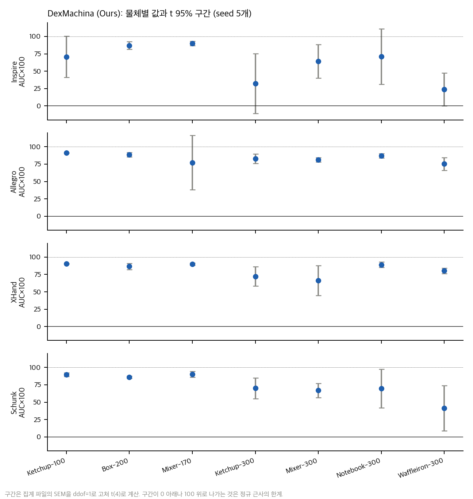
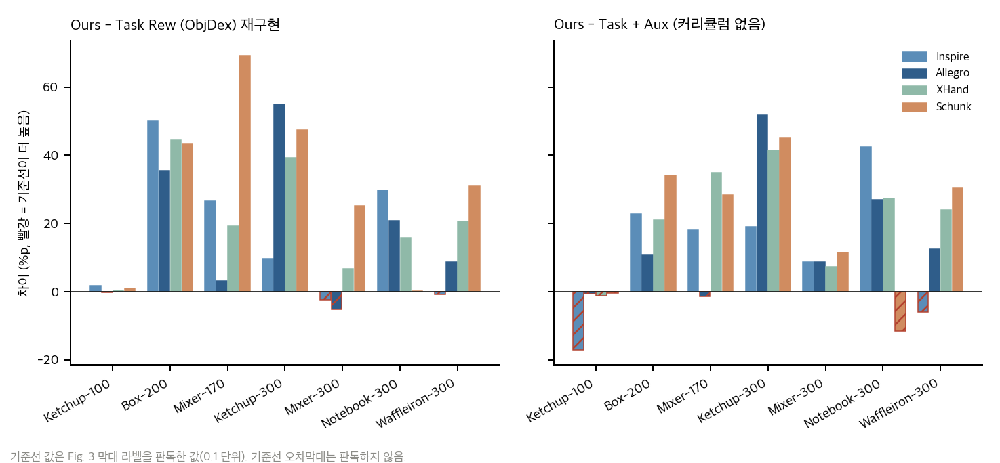

> **논문:** Zhao Mandi, Yifan Hou, Dieter Fox, Yashraj Narang, Ajay Mandlekar, Shuran Song. *DexMachina: Functional Retargeting for Bimanual Dexterous Manipulation.* ICML 2026 포스터, arXiv:2505.24853 (v1, 2025-05-30).
> 공식 코드는 GitHub MandiZhao/dexmachina(MIT)에 있습니다. 이 글의 그래프 두 장은 우리가 집계 파일로 다시 계산해 그린 것입니다. 논문 그림은 싣지 않았습니다.

## 논문이 하려는 것

사람 손과 물체가 함께 움직인 시연 한 개가 있습니다. 이를 로봇 손 여러 종류에 옮겨, 물체가 시연과 같은 궤적을 따라가도록 정책을 배우는 것이 목표입니다. 저자들은 이를 **기능적 리타겟팅**이라고 부릅니다. 손 자세를 흉내 내는 운동학 리타겟팅과 달리, 물체의 상태를 실제로 맞추는 것이 기준입니다.

긴 양손 조작에서 탐색은 어렵습니다. 저자들의 장치는 세 가지입니다.

1. **가상 물체 제어기 커리큘럼.** 학습 초기에는 물체를 시연 궤적으로 끌어당기는 PD 힘을 주고, 정책이 익숙해지면 힘을 줄입니다.
2. **혼합 행동.** 손목은 기준 자세에 작은 잔차를 더하고, 손가락은 관절 한계에 맞춘 절대 목표를 씁니다.
3. **모방과 접촉 보상.** 손 키포인트와 시연의 접촉 위치를 맞추는 보상을 더합니다.

## 우리가 본 것

**그림 3의 수치는 공식 집계 파일과 맞습니다.** DexMachina의 28셀(손 4개 × 물체 7개)을 공식 파일의 값과 비교하면 0.1 단위까지 같습니다. 다만 그림의 y축은 "Success Rate (%)"인데, 값은 1–9 cm 허용 오차에서 계산한 ADD-AUC를 100배 한 것입니다. 성공률로 읽으면 안 됩니다.

그래프: 물체별 DexMachina 값과 95% 구간. 집계 파일의 표준오차(seed 5개)를 표본 기준으로 고쳐 t 분포로 계산했습니다. 구간이 0 아래나 100 위로 나가는 것은 정규 근사의 한계입니다.

**손 사이 차이는 대부분 확인되지 않습니다.** 같은 물체 7개로 짝지은 검정에서 Allegro와 XHand의 차이는 p = 0.72입니다. Schunk와 Inspire의 차이는 p = 0.11입니다. 논문이 말하는 "크고 완전 구동된 손이 낫다"는 방향은 맞지만 이 자료로는 강하게 말하기 어렵습니다.

**기준선 대비 우위는 일관되지 않습니다.** 커리큘럼 없이 같은 보상을 쓴 기준선과 ObjDex 재구현에 대해서는 28셀 중 9셀에서 DexMachina가 낮습니다. 가장 큰 두 차이는 Inspire의 Ketchup-100(−17.1 %p)과 Schunk의 Notebook-300(−11.5 %p)입니다. 운동학 재생과 ManipTrans 재구현에 대해서는 모든 셀에서 앞섭니다.

그래프: DexMachina에서 기준선을 뺀 차이. 빨간 빗금은 기준선이 더 높은 셀입니다. 기준선 값은 논문 그림 3의 막대 라벨을 눈으로 읽은 값(0.1 단위)이고, 기준선의 오차막대는 읽지 않았습니다.

## 공식 코드와 논문의 차이

공식 코드를 읽어 보니 논문 설명과 다른 부분이 있습니다.

- 논문의 알고리즘 1은 하나의 이득을 지수적으로 줄입니다. 공식 메인 설정은 **환경마다 무작위로 뽑는 이득 구간**을 씁니다. 상한과 하한이 함께 줄어듭니다.
- 감쇠를 막는 게이트가 여러 개 있습니다. 대기 에폭, 최소 에피소드 길이, 기울기 조건, 되돌림, 강제 종료입니다. 논문에는 보상 평균 조건 하나만 나옵니다.
- 보상 가중치, 혼합 행동 스케일, β 값이 논문에 없습니다. 공식 설정도 조건마다 다릅니다. 부록이 "정확한 가중치는 A.4에 있다"고 하지만 A.4에는 없습니다.

## 통계와 표현

논문은 "significantly outperforms"라고 쓰지만 검정, p-값, 오차막대의 정의가 본문에 없습니다. 셀마다 seed가 5개뿐입니다. 부록 B.3은 ObjDex 재구현이 Ketchup-100에서 "모든 손이 90%를 넘는다"고 쓰는데, 그림 3의 막대는 한 손만 90을 넘습니다. 이 문장은 저자 확인이 필요합니다.

## 구현 가능성

이 맥(M4 Pro, MPS, CUDA 없음)에서 전체 재현은 어렵습니다. 학습은 환경 12,000개와 GPU를 전제로 하고, 공식 코드는 전처리 단계까지 CUDA를 직접 호출합니다. 할 수 있는 일은 집계 재계산, 기준선 검정, 코드 대조까지입니다. 포팅과 설정 확정에는 수 주가 걸릴 것으로 보지만, 이는 측정한 값이 아닙니다.

## 정리

DexMachina의 핵심 아이디어인 "물체에 시간에 따라 약해지는 가상 힘을 준다"는 긴 양손 과제에서 학습을 돕는 방향으로 보입니다. 다만 논문의 "모든 손과 과제에서 일관된 개선"은 이 자료로 확인되지 않습니다. 설정이 논문과 다르므로, 결과를 쓰기 전에 공식 설정이 어느 것인지 확인해야 합니다.

## 자료

- [통합 리포트 PDF](report/report_public.pdf)
- [01. 논문 분석: DexMachina](analysis/01_paper_analysis.md)
- [02. 선행연구와 계보](analysis/02_prior_work.md)
- [03. 수치 재계산과 일관성 검사](analysis/03_analysis.md)
- [04. 공식 코드 대조와 구현 가능성](analysis/04_code_verification.md)
