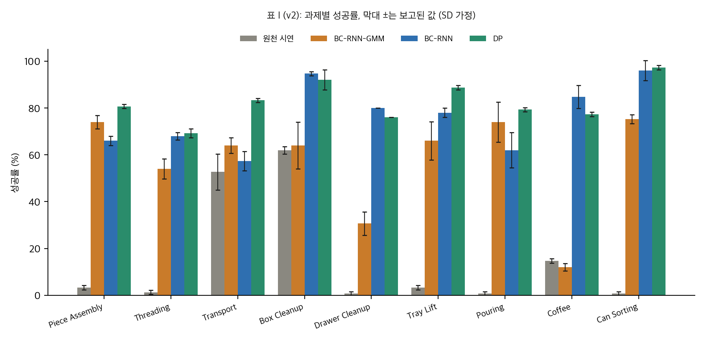
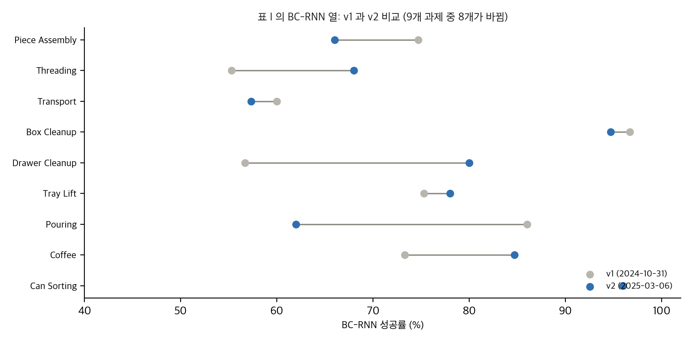
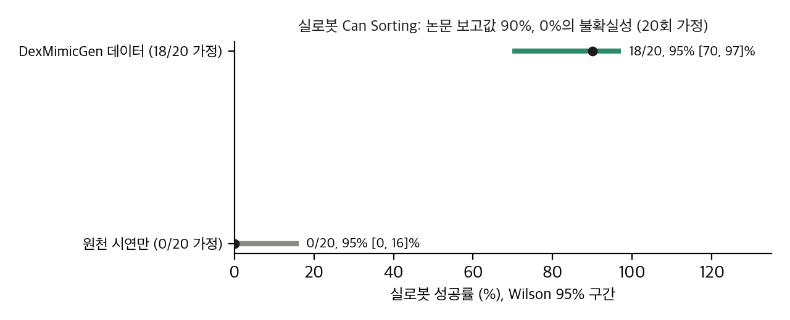

> **논문:** Zhenyu Jiang, Yuqi Xie, Kevin Lin, Zhenjia Xu, Weikang Wan, Ajay Mandlekar, Linxi Fan, Yuke Zhu. *DexMimicGen: Automated Data Generation for Bimanual Dexterous Manipulation via Imitation Learning.* ICRA 2025, arXiv:2410.24185 (v2, 2025-03-06).
> 공식 코드(NVlabs/dexmimicgen)는 정적으로만 읽었고 실행하지 않았습니다. 논문 그림은 싣지 않고, 우리가 표 값으로 그린 그래프 세 장만 씁니다. 논문 라이선스는 arXiv non-exclusive입니다.

## 논문이 묻는 것

양팔 다지 손 로봇을 모방학습으로 가르치려면 시연이 많이 필요합니다. 원격 조작으로 모으기에는 두 팔과 여러 손가락을 동시에 조작하는 것이 어렵습니다. DexMimicGen은 질문을 바꿉니다. **사람 시연 5개에서 시뮬레이션으로 시연을 대량 생성할 수 있을까요?**

MimicGen이 단일 팔과 평행 잡이에서 한 방식을 양팔과 다지 손으로 옮깁니다. 같은 틀에서 세 가지 문제를 새로 다룹니다.

1. **병렬:** 두 팔이 서로 다른 목표를 독립적으로 수행합니다. 팔마다 하위과제 열을 따로 두고, 팔마다 행동 큐를 둡니다.
2. **조정:** 두 손의 상대 자세가 중요합니다(뚜껑, 트레이, 핸드오버). 두 팔의 하위과제가 같은 타임스텝에서 끝나도록 동기화하고, 두 팔에 같은 변환을 씁니다. 변환 방식은 객체 자세를 적용하는 Transform과 원천 궤적을 그대로 쓰는 Replay 두 가지입니다.
3. **순차:** 한 팔의 작업이 끝나야 다른 팔이 시작합니다. 선행과 후행 하위과제를 지정해 순서 제약을 둡니다.

과제는 9개이고, 평행 잡이 Panda, 다지 손 Panda, GR-1 휴머노이드의 세 구성에 세 개씩 배정했습니다. 원천 시연은 평행 잡이 과제마다 10개, 다지 손 과제마다 5개로 합계 60개입니다. 논문은 이것으로 21K 데모를 만들었다고 합니다.

## 공개 코드에서 확인한 것

- **과제 9개와 구성 3종은 맞습니다.** 환경 파일 9개가 있고, 로봇 매핑도 논문 설명과 같습니다.
- **생성 방법은 공개되지 않았습니다.** 팔별 큐, 조정 동기화, 순서 제약, Transform·Replay는 코드에 없습니다. 공개 저장소는 환경, 재생 스크립트, BC-RNN 학습 설정 생성기입니다. 공식 MimicGen 저장소(NVlabs/mimicgen)의 기본 브랜치에도 양팔 코드가 없습니다.
- **학습 설정은 BC-RNN뿐입니다.** BC-RNN-GMM과 Diffusion Policy 설정은 없고, 평가 절차(체크포인트 최댓값, 시도 수)도 없습니다.
- **성공 판정에 주석과 로직의 불일치가 있습니다.** Pouring 파일에는 "구현 필요"라는 TODO가 있는데, 바로 아래에 판정 로직이 있습니다. Threading은 바늘 중심과 고리 중심의 3차원 거리만 봅니다. 바늘이 구멍을 실제로 통과했는지는 보지 않으므로 확인이 필요합니다.
- **재생 스크립트에 버그가 하나 있습니다.** `"env_name" == "TwoArnCanSortRandom"`은 문자열끼리 비교해서 항상 거짓입니다.
- **의존성 버전이 고정되지 않았습니다.** robosuite가 requirements에 없고, README는 최신 버전을 설치하라고 합니다.

## 표 재계산에서 나온 것

**v2에서 표 I의 BC-RNN 열이 바뀌었습니다.** 9개 과제 중 8개의 평균이 바뀌었습니다. Pouring은 86.0에서 62.0으로, Drawer는 56.7에서 80.0으로 바뀌었습니다. 논문은 이유를 적지 않았습니다. 표 II와 III, 그리고 본문은 v1 값을 그대로 씁니다.

같은 종류의 불일치가 두 곳 더 있습니다. Box Cleanup의 BC-RNN은 표 II에서 96.7이고 표 I에서는 94.7입니다. Tray Lift의 BC-RNN은 표 III에서 75.3이고 표 I에서는 78.0입니다.

**방향성 주장은 버전과 상관없이 성립합니다.** DP가 BC-RNN-GMM보다 9개 과제 모두에서 높습니다. BC-RNN-GMM이 BC-RNN보다 낮은 것은 v2에서 9개 중 6개, v1에서 8개입니다.

**통계에서는 조심할 점이 있습니다.** ±가 정의되어 있지 않습니다. 3 시드의 SD로 보면 27개 셀 중 21개가 롤아웃 50회의 이항 표준오차보다 작습니다. 체크포인트 최댓값을 보고하는 방식까지 합치면, 보고된 불확실성이 실제보다 작을 가능성이 큽니다. 정확한 시도 수는 논문에 없어서 50회는 가정입니다.

## 실로봇 결과

Can Sorting 실로봇 실험에서 디지털 트윈으로 생성한 40개 시연으로 학습한 확산 정책은 90%, 원천 4개 시연으로 학습한 정책은 0%입니다. 논문은 컵 두 개에 각 10회를 시도했다고 씁니다. 그러면 20회 중 18회 성공입니다. 95% 구간은 [0.70, 0.97]이고, 원천 0/20의 구간은 [0.00, 0.16]입니다. Fisher 검정은 p가 약 3 × 10⁻⁹입니다. 차이는 분명하지만, 실험 한 가지(객체 하나, 원천 4개)에 머문다는 점은 기억해야 합니다.

## 이 맥에서 할 수 있는 것

- **환경 설치와 재생 확인: 조건부 가능.** robosuite 버전을 고정해야 하고, 설치는 승인 후에 합니다.
- **생성기 재구현: 조건부 가능.** 공개 코드가 없으므로 논문 설명으로 다시 짜야 합니다. 노력은 1–2주로 추정합니다(측정 전). 보간 시작점, 조정 구간 종료 맞춤, 충돌 처리가 논문에 없어서, 재구현이 논문과 같은 결과를 낸다는 보장은 없습니다.
- **BC-RNN, DP 학습: 불가.** GPU 전제입니다.
- **실로봇, BiGym 생성: 불가.** 하드웨어와 코드가 없습니다.

## 열린 질문

1. 표 I의 BC-RNN 열은 어떤 실험으로 바뀌었는지.
2. ±는 SD인지 SEM인지, 시도 수와 체크포인트 선택은 어떻게 했는지.
3. 순서 제약 실험의 기본 조건이 표 I의 기본 값과 같은지.
4. 21K 데모 중 블록으로 설명되지 않는 약 3K는 어디에서 왔는지.
5. 생성기 코드를 공개할 계획이 있는지.
6. 데이터셋 라이선스가 카드(CC BY-NC-SA 4.0)와 README(CC-BY 4.0) 중 무엇인지.

데이터셋 파일은 과제 9개에 약 60 GB입니다. 이 분석에서는 내려받지 않았습니다.

## 자료

- [통합 리포트 PDF](report/report_public.pdf)
- [DexMimicGen (arXiv:2410.24185) 논문 분석](analysis/01_paper_analysis.md)
- [DexMimicGen 선행연구, 대안, 자료 (02)](analysis/02_prior_work.md)
- [재계산과 일치 검사 (03)](analysis/03_analysis.md)
- [논문과 공식 코드 대조 (04)](analysis/04_code_verification.md)
