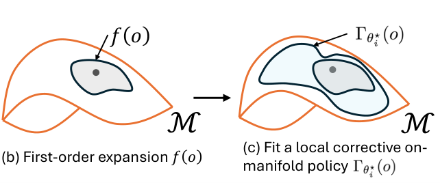

# 01. 논문 분석: DexNinja (arXiv:2610.17208)

## 0. 메타와 버전 기록

| 항목 | 내용 |
|---|---|
| 제목 | DexNinja: Learning Robust Dexterous Cutting Policy with a Real-to-Sim-to-Real Data Engine |
| 저자 | Haozhe Lou, Runyi Yang(공동 1저자), Wanqi Zhong, Caiyun Liu, Yicheng Liu, Wenhao Liu, Wenlong Ma, Jiawei Xia, Kanzhi Wu, Danda Pani Paudel, Luc Van Gool, Hang Zhao, Yiming Li (Tsinghua, INSAIT, PKU, USC, BIT, UC Berkeley 등) |
| arXiv | 2610.17208, cs.RO (cs.CV 교차), 2026-10-12 제출 |
| 분석 대상 판 | **v1 하나.** arXiv 초록 페이지에 v2 이상이 없고 `arxiv.org/abs/2610.17208v2`는 404를 반환합니다(2026-11-26 확인). 판 사이 차이는 없습니다 |
| 학회 | **CoRL 2026 포스터.** corl.org 공식 채택 목록(2026-11-14 수집본, 포스터 세션 post-p3, 11/11 수 10:30, 포스터 117번)에 제목이 있습니다. 논문 첫 쪽 하단에도 "10th Conference on Robot Learning (CoRL 2026), Austin, Texas, USA"가 적혀 있고 프로젝트 페이지 BibTeX도 CoRL 2026입니다. arXiv comments 칸은 비어 있습니다 |
| 원문 | 28쪽(본문 9쪽 + 참고문헌 + 부록 "Supplementary Material" 14쪽), `paper/paper.txt`는 `pdftotext -layout` 결과 |
| 라이선스 | arXiv 초록 페이지의 license 링크는 `http://creativecommons.org/licenses/by/4.0/`(CC BY 4.0)입니다. PDF 첫·마지막 쪽과 본문에서 ©, copyright, All rights reserved, 기업·출판사 고지를 찾지 못했습니다. 감사의 글에 공동 과제 지원이 적혀 있으나 권리 고지는 아닙니다 |
| 프로젝트 페이지 | https://dex-ninja.github.io/ (영상, 요약 표, 시뮬레이션 에셋 링크. 코드 칸은 "Coming soon") |
| 공식 코드 | **없음.** 프로젝트 페이지가 "Code Coming soon"이라고 적고, GitHub 검색에도 저장소가 없습니다(`02` §2) |

## 1. 한 문단 요약

과일을 칼로 자르는 양손 조작은 시도마다 음식이 망가져 실세계 데이터를 모으기 어렵습니다. DexNinja는 사람이 원격 조종한 시연 몇 개에서 음식 형상을 복원하고(real2sim), 같은 범주(딸기, 사과, 바나나, 감자)의 형상·질량·마찰·탄성을 바꾼 에셋을 만들어(생성 모델 + 품질 검사), 변형체 절단 시뮬레이터에서 칼 궤적을 정제·실행해 시각·촉각·고유감각이 정렬된 에피소드를 대량으로 만듭니다(sim2real). 이 데이터로 팔과 손을 따로 예측하고 단계(접근·칼 위치 잡기·절단)에 따라 청크 길이를 바꾸는 ACT 계열 정책을 학습합니다. 식품당 25회, 총 100회 실로봇 시험에서 Sim+Real은 성공 50/100으로 Real-only 31/100, Sim-only 34/100보다 높습니다(표 1). 부록에서는 시뮬레이션 에피소드를 늘리면 36%에서 63%로 오르고(부록 표 3), 기준선 RoboNinja에 23/40 대 12/40으로 앞섭니다(부록 표 2). 한계로 카메라 고정과 범주별 정책을 인정합니다(§8).

## 2. 문제 설정과 방법

### 2.1 문제 설정 (§3, 식 1–6)

- **관측.** 고정 RGB-D 카메라의 점군 o_vis, 손가락 촉각 배열 o_tac(taxel마다 법선 압력 p, 접선 전단 γ ∈ R², 국소 변형 δ), 팔·손 고유감각 o_prop = (q, q̇, h)를 씁니다(식 1, 4).
- **물체 파라미터.** ϑ = (m, μ_f, E, ν, G(t))로 질량, 쿨롱 마찰, 영률, 푸아송비, 형상을 둡니다(식 2). 식 3은 표준 Lamé 변환(λ = Eν/((1+ν)(1−2ν)), G = E/(2(1+ν)))이고 맞습니다. 칼은 알려진 강체입니다.
- **행동.** a_t = (a_kin, a_tac): a_kin은 두 팔의 큰 운동, a_tac는 접촉에 민감한 손 제어입니다(식 5). 운동학 정책 f_φ는 시각만 보고, 촉각 정책 π_θ는 촉각과 고유감각의 이력을 봅니다(식 6). 실제로는 f_φ를 "물체 중심 운동 명세"로 구현해 칼날과 과일의 기하를 유지한다고 합니다(§3).

### 2.2 세 단계 파이프라인 (§4, 그림 1, 부록 1)

| 단계 | 하는 일 | 쓰는 도구(논문 인용) |
|---|---|---|
| I | 성공한 원격 조종 시연 하나를 기록하고, 음식 메시를 복원하고 포즈를 추정해 물체 좌표계에서 칼 궤적 {ˢT_K(t)}를 뽑음(부록 식 1–2). 손-칼 변환은 시연 로그에서 상수로 추정 | Robo-GS 계열 메시 복원 [31], FoundationPose [79] |
| II | 복원 에셋을 변형체·위상 변화 절단 시뮬레이터에 넣고 형상·물리 파라미터를 뽑아, 시작 오프셋·접근각·작은 자세 잡음을 준 칼 경로를 만들고 IK로 관절 궤적으로 바꿔 실행(부록 식 3). 충돌·특이점·절단 성공 검사를 통과한 롤아웃만 보관 | RoboNinja(MPM, Warp 기반) [8], Genesis [72], cuRobo IK [82] |
| III | 증강 데이터 D_aug로 ACT 계열 정책 학습 | ACT [83] |

시뮬레이터가 둘로 나뉩니다. Genesis는 관절 로봇 장면을 지원하지만 변형체 절단을 기본 지원하지 않고, RoboNinja·DiSECt류는 절단을 하지만 관절 로봇 스택이 없습니다. 그래서 칼을 공통 경계로 삼는 "국소-장면 등록 다리"를 둡니다. 국소 MPM 절단 시뮬레이션이 칼에 걸리는 접촉점, 힘, 모멘트(합성 렌치)를 계산하고, 장면 시뮬레이터가 같은 칼 운동을 로봇 운동학 제약 아래 실행하면서 그 렌치를 외란·피드백으로 받습니다(부록 1.4).

### 2.3 궤적 정제 손실 (부록 식 4–11)

칼날 폭 위의 K개 점 p_{i,k}를 바닥 부호거리장(SDF) d(p)에서 평가합니다. 매끄러운 힌지 srelu(x) = (x + √(x²+ε))/2로 칼-바닥 간격 g_i = (1/K)Σ_k srelu(d(p_{i,k}))를 만들고(식 6), 절단 목적은 L_cut = (1/(T+1))Σ w_i g_i² + (λ_prog/T)Σ[srelu(g_i − (1−ρ)g_{i−1})]², w_i = ((i+1)/(T+1))²입니다(식 7–8). 충돌 항은 관통의 4제곱(식 9), 회전·이동 매끄러움 항(식 10)을 더해 L = w_cut L_cut + w_col L_col + w_rot L_rot + w_move L_move를 최소화합니다(식 11). 이 식에 들어가는 양은 칼의 위치·각도와 바닥 SDF뿐이고 음식 상태는 들어 있지 않습니다. 논문 본문은 이 목적이 "롤아웃 필터링과 정제"에 쓰인다고만 합니다(§4 Stage II).

### 2.4 형상 다양체 위의 연속과 데이터 증강 (§5, 식 9–12)

범주마다 학습된 기하 사전이 만드는 형상 가족을 둡니다. 생성기 G: Z → M(식 9)이 국소적으로 규칙적(립시츠)이라고 가정하고, 복원한 인스턴스의 잠재 코드 z₀ 근방에서 z를 뽑아 "서로 관련된 인스턴스의 연속체"를 만듭니다(그림 4). 시각 관측에서 행동으로 가는 사상 f(o_vis)가 성공 앵커 o* 근방에서 미분 가능하면 1차 전개 f(o) = f(o*) + J_f(o*)(o − o*) + r(o)가 되고(식 10), 작은 인스턴스 변화에는 비례해서 작은 행동 보정이면 된다는 것이 "연속" 논거입니다.

앵커 (o_i, a_i)마다 국소 교정 정책 Γ_θi를 맞춥니다.

θ_i* = argmax_θ E_{o∼µ_i}[ S(o, Γ_θ(o)) − β‖Γ_θ(o) − a_i‖² ] (식 11)

S는 "국소(물체 수준)·전역(장면 수준) 제약, 즉 절단과 충돌 검사를 통과하는가"의 이진 가능성 술어이고, µ_i는 (i) 작은 상태 섭동, (ii) 물리 무작위화, (iii) 국소 형상 변화 z ∼ ν_i가 만드는 관측 분포입니다. 증강 데이터는 D_aug = D₀ ∪ ⋃_i {(o, a): o ∼ µ_i, a = Γ_θi*(o), S(o, a) = 1}(식 12)로, 성공한 결과만 남깁니다.

그림 4의 패널 (b), (c)는 이 두 단계(1차 전개, 국소 교정 정책)를 도식으로 보여 줍니다.

*그림: 논문 그림 4의 패널 (b), (c) (1차 전개와 국소 교정 정책). © 저자, CC BY 4.0, 출처 arXiv:2610.17208. 같은 그림의 패널 (a), (f)는 사진이 있어 싣지 않았습니다.*

**지식 기반 에셋 생성(부록 4, 알고리즘 1).** 검출기가 범주 y를 예측하고, 요약 에이전트가 모양·표면·색·숙성도 속성 s를 뽑고, 생성 에이전트가 템플릿 문장 p를 만들고, 인페인팅으로 투명 배경의 단일 물체 영상을 만들고, 비전-언어 판정기가 2D 품질(q_2D)을 보고, 영상-3D 백본(예: Trellis)이 3DGS 또는 메시를 만들고, 여러 시점 렌더링을 판정기가 3D 품질(q_3D)로 검사합니다. 시뮬레이션 수락에는 미터 척도, 기하 유효성, 시뮬레이터 호환성, 안정 초기화 검사가 추가됩니다(§5 끝, 부록 4).

### 2.5 정책과 학습 (§4 Stage III, 부록 2)

- **구조.** 팔 상태와 손 상태를 각각 받는 두 트랜스포머(일반 ACT형, 손 전용 ACT형) 출력 머리를 따로 둡니다(그림 3). 촉각 입력은 손·칼별 토큰 묶음으로 인코딩합니다.
- **단계 토큰.** z ∈ {z_app(접근·파지), z_knife(칼 위치 잡기), z_cut(촉각 유도 절단)}. 실제 배포에서 단계는 칼과 사전 절단 영역 사이 거리 d_geo와 평균 촉각 압력 p̄_t로 정해집니다: d_geo > ε_app이면 app, d_geo ≤ ε_app이고 p̄_t < p_on이면 knife, p̄_t ≥ p_on이면 cut이고, 접촉이 K_lost 스텝 연속 사라져 p̄_t < p_off(< p_on)이면 knife로 돌아갑니다(부록 식 19).
- **가변 청크 (식 8, 13).** H_t ∼ λ·Unif[H_min(z), H̄(z)] + (1−λ)·Unif[H̄(z), H_max(z)], 공칭 길이 H̄ = 64(접근), 128(칼 위치), 16(절단). 접촉 구간은 짧게, 자유 공간은 길게 둡니다.
- **그룹별 정규화 (식 14–16).** 행동 그룹(kin, tac)마다 단계별 평균·표준편차로 정규화하고 [−1, 1]로 자릅니다. 실행에서는 그룹별 스텝 크기 s_g를 곱해 관절 증분을 만들고, 관절·속도·작업공간·충돌 제약 사영 Π_Q를 거칩니다. s_kin이 s_tac보다 작다고만 적혀 있고 값은 없습니다.
- **손실 (식 17–18).** 청크 L1에 단계별 가중 ω_kin(z), ω_tac(z)를 곱하고, 실행 관절 증분의 속도 정규화 L_rate를 더합니다. 가중치 값은 없습니다.
- **촉각 시뮬레이션(부록 1.3).** MPM 입자가 센서 SDF 근접 대에 들어오면 침투 깊이와 접선 상대속도로 접촉 충격량을 계산해 센서 면에 공간 비닝합니다. 시뮬레이션에서 미끄러짐 조짐이 보이면 손가락의 작은 교정 운동을 넣어 적응 데이터를 만듭니다. 시뮬 힘과 실제 센서 판독 사이에 "스케일, 오프셋, 잡음 모델"의 가벼운 사상을 보정한다고 하나 값은 없습니다.
- **손 파지 사전.** 칼 사전 파지와 오른손 파지에 DexGraspNet 2.0 [87]을 씁니다(부록 1.3, 6).

### 2.6 하드웨어 (부록 3, 부록 표 1)

| | 실시 A (주 실험) | 실시 B (이식 시험, 정성) |
|---|---|---|
| 팔 | DR3/DR5 양팔 | 듀얼 Franka |
| 손 | LinkerHand L10 | LinkerBot L20 |
| 촉각 | 양손 압력식 센서 | 양손 압력식 센서 |
| 시각 | 고정 RGB-D (Orbbec 435Le) | 고정 RGB-D, 외부 파라미터 재보정 |
| 역할 | 주 정량 실험 | 정성 확인(수치 없음) |

시연은 데이터 수집 장갑으로 모읍니다. 비용: 단일 절단 시뮬레이션 에피소드 1개가 NVIDIA H200에서 GPU 메모리 약 20 GB, 약 10분이고, M회 절단이면 약 (10 + 10M) GB와 M/6 GPU시간입니다(부록 5.2).

## 3. 실험 결과

### 3.1 설정 (§6.1)

- 식품 4종(딸기, 사과, 바나나, 감자). "각 인스턴스에 대해 실세계 시연 5개와 시뮬레이션 시퀀스 50개"로 학습하고, 식품마다 평가용 25개를 고릅니다. 평가 과제는 음식을 부스러지지 않게 반으로 자르기입니다([47]을 따름).
- 지표 3개(25회 중 만족 횟수): **Progress**(칼이 사전 절단 상태에 도달해 초기 접촉 형성), **Success**(칼이 완전히 통과해 두 조각으로 깨끗이 분리되고 안전 종료·후퇴), **Integrity**(눈에 띄는 뭉개짐, 찢김, 과도한 압착, 조각 손실 없음; 사람이 이진 판정).
- 평가는 "같은 held-out 실세계 설정"에서 정책 사이 비교입니다. 시행 수, 인스턴스 수는 식품당 25로 같고 총 300회(3 학습 방식 x 100회)라고 적습니다(§6.2).

### 3.2 표 1: 학습 방식 비교 (식품당 25회)

| 학습 방식 | 식품 | Progress | Success | Integrity |
|---|---|---|---|---|
| Sim-only | 딸기 / 사과 / 바나나 / 감자 | 10 / 5 / 16 / 15 | 6 / 4 / 12 / 12 | 10 / 5 / 14 / 11 |
| | 합계 (/100) | 46 | 34 | 40 |
| Real-only | 딸기 / 사과 / 바나나 / 감자 | 12 / 6 / 17 / 9 | 8 / 4 / 12 / 7 | 10 / 4 / 14 / 9 |
| | 합계 (/100) | 44 | 31 | 37 |
| Sim+Real (제안) | 딸기 / 사과 / 바나나 / 감자 | 19 / 14 / 24 / 19 | 12 / 8 / 18 / 12 | 14 / 7 / 23 / 16 |
| | 합계 (/100) | 76 | 50 | 60 |

본문은 Sim-only와 Real-only가 보지 못한 실세계 설정에 "잘 일반화하지 못하고", Sim+Real이 세 지표를 모두 높인다고 해석합니다(§6.2). 평균열은 모두 열 합과 같습니다(`03` V1).

### 3.3 복잡한 동작: 레몬 (§6.3, 그림 5)

단일 절단 8/10, 2회 절단 7/10, 다중 절단 3/10. 훈련 세부 사항은 표 1과 같다고 합니다. 다중 절단의 실패는 과일 위치 조정 단계에서 오차가 쌓여 일어난다고 설명합니다(부록 6).

### 3.4 표 2: 구성요소 절제 (§6.4, 각 100회, P/S/I)

| 변형 | P / S / I | ΔP / ΔS / ΔI |
|---|---|---|
| Full DexNinja (표 1) | 76 / 50 / 60 | – |
| w/o Quality Control | 72 / 46 / 55 | −4 / −4 / −5 |
| w/o Physical Randomization | 72 / 44 / 51 | −4 / −6 / −9 |
| w/o Trajectory Refinement | 65 / 39 / 53 | −11 / −11 / −7 |
| w/o Tactile Observation | 73 / 43 / 45 | −3 / −7 / −15 |
| w/o Generated Assets (재구성만) | 67 / 42 / 50 | −9 / −8 / −10 |

본문 해석: 궤적 정제 제거가 Progress와 Success를 가장 크게 낮추고, 촉각 관측 제거가 Integrity를 가장 크게 낮추며, "매칭된 예산의 절제가 표본 수만으로는 설명되지 않는 기여를 지지한다"(§6.4).

### 3.5 표 3·4(본문): 실패 분석과 에셋 깔때기

- **실패 분석(표 3).** Sim+Real의 실패 50회를 영상·로그로 "가장 이른 원인"에 배정: 지각·등록 8, 파지·접촉 제어 19, 절단 물리 불일치 17, 운동학·안전·충돌 6. "절단 물리 불일치"는 등록·파지·추종이 안정한데 칼 정지, 압착 등 시뮬레이션에 없는 재료 응답이 나온 경우입니다.
- **에셋 깔때기(표 4).** 제안 1,670 → 2D 검사 통과 1,513 → 3D 검사 통과 1,344 → 수락 1,200(식품당 300).

### 3.6 부록 실험 (부록 5)

| 실험 | 내용 | 결과 |
|---|---|---|
| 표 2 (기준선) | RoboNinja 대 DexNinja, 식품당 10회 | RoboNinja 1/2/2/7(딸기·감자·바나나·사과), Ours 6/5/9/3, 합 12/40 대 23/40, "+27.5 %p, 1.92배". 사과는 기준선이 높고, 기준선은 칼을 손에 강체로 고정하고 접촉 피드백을 촉각에서 스칼라로 근사해 "프로토콜을 맞춘 재현" |
| 표 3 (규모) | 실데이터 고정, 추가 시뮬레이션 N = 10/50/100/300, 식품당 25회 | 합 36 / 50 / 56 / 63 (/100). N=50이 표 1 Sim+Real과 같음 |
| 표 4 (구조) | 범용 머리 11/40, 분리 머리 21/40, 고정 청크 13/40, 전체 24/40 | 식품당 10회 |
| 그림 3 | 구아바 접촉 촉각 지도(정상 대 고힘) | 정성. 촉각은 "더 세게 쥐기"가 아니라 미끄러짐과 과압착 사이를 조절 |
| 그림 4–5 | 실세계 정성 롤아웃(두 하드웨어, 2·3회 절단) | 정성 |

### 3.7 저자가 인정한 한계 (§8)

(1) 고정 카메라 구성(손목 카메라는 향후), (2) 기본 정책이 물체별(범주별)이어서 새 범주는 새 에셋과 재학습 또는 미세조정이 필요.

## 4. 주장과 근거의 간격 (요약, 상세는 `03`, `04`)

| 번호 | 논문의 서술 | 확인된 것 |
|---|---|---|
| a | 초록 (2) "실데이터만 쓸 때보다 20% 넘게 개선" | 표 1 Success 50/100 대 31/100은 +19 %p입니다(구간 5.4–31.7, p = 0.009). 상대 증가는 +61%입니다. 부록 표 3의 N=300은 +32 %p입니다 (`03` K2) |
| b | 초록 (1) "수십 개 실시연과 수백 개 증강 데이터로 60% 이상" | 주 실험은 50/100입니다. 63/100은 N=300 행(부록 표 3)이고 Wilson 구간이 53–72%입니다 (`03` K1) |
| c | 초록 (3) "분포 밖 물체의 다양한 형상과 크기로 일반화" | 평가는 같은 네 범주 안의 held-out 인스턴스입니다. 범주 밖 일반화나 크기별 분석은 보고되지 않았고 한계 절은 정책이 범주별이라고 적습니다 (`03` K3) |
| d | 절제의 구성요소별 기여 | 15개 차이는 모두 음수이나 성공 지표의 단독 차이는 Holm 보정 후 모두 p ≥ 0.775입니다. 절제 순위는 시행 잡음에 약합니다 (`03` V5, 토이 §3) |
| e | 미분 가능한 시뮬레이터가 재구성·파라미터 추정·정책 학습을 한 루프로 묶음 | 공개된 손실(식 4–11)에 음식 상태 항이 없고, 파라미터 추정 정확도·시뮬 충실도 지표는 없습니다 (`03` K9, `04` C14) |
| f | 구성요소 효과는 표본 수가 아닌 기여 | 절제 변형의 데이터 양·시뮬 에피소드 수는 표에 없습니다 |

## 5. 재현에 필요한 정보와 빠진 정보

- **있는 것:** 단계 수와 공칭 청크 길이 (64/128/16), 손실의 형태(식 7–11, 14–18), 지표 정의, 식품 4종, 하드웨어 모델명, 시뮬 비용, 에셋 깔때기 수.
- **없는 것(본문·부록에서 찾지 못함):** 학습 인스턴스 수와 총 시연 수, 학습 에폭·학습률·모델 크기, λ, H_min, H_max, ω 가중치, s_kin/s_tac, p_on, p_off, ε_app, K_lost, 손실 가중 w_cut 등, 물리 파라미터 (m, μ, E, ν)의 범주별 범위, MPM 격자·입자 수, 촉각 센서 모델과 보정 값, 사용한 검출기·요약·생성·판정 모델, 렌더링 시점 수 K, Sim-only 학습에 쓴 에피소드 수, 평가 인스턴스의 선정과 시행 간 대응.
- **공개된 것:** 시뮬레이션 에셋(프로젝트 페이지가 가리키는 Hugging Face 데이터셋, `02` §2). 코드, 체크포인트, 정책 학습 데이터, 평가 로그는 확인되지 않았습니다.
