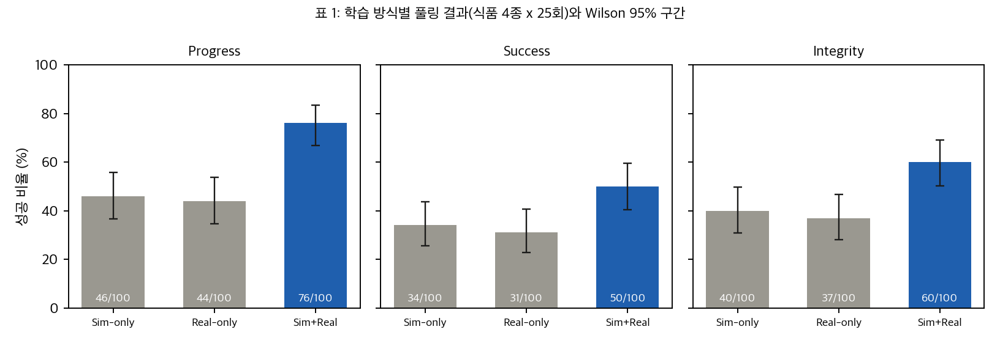
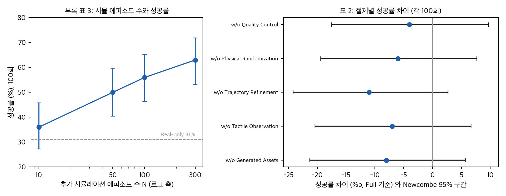
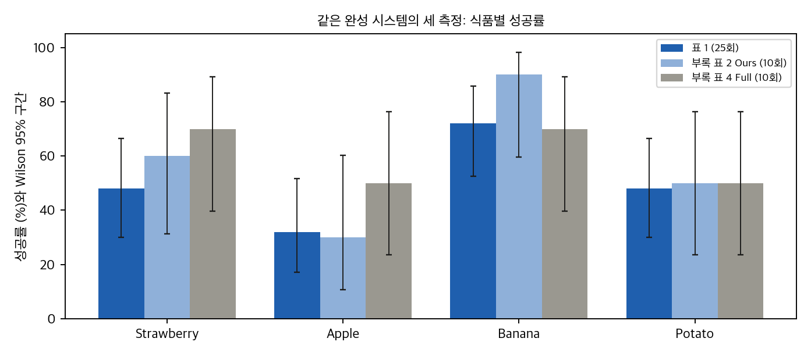
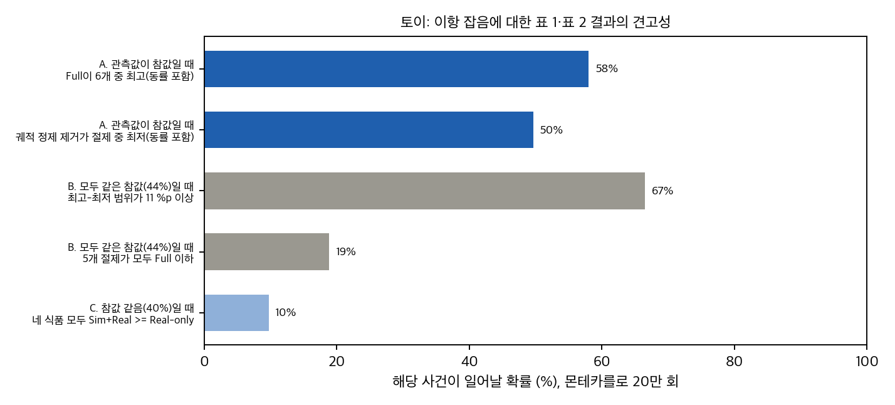

# 03. 수치 재계산, 일관성 검사, 시행 잡음 토이

재계산 스크립트는 `analysis/recompute.py`(수 초), 토이는 `analysis/toy_ranking_mc.py`(수 초)입니다. 결과는 `recompute_results.json`, `toy_ranking_mc_results.json`에 있습니다. 번호는 재계산 V, 일관성 K입니다.

## 0. 가정

- 논문이 밝힌 시행 수를 분모로 씁니다: 표 1과 표 2·부록 표 3은 식품당 25회(조건당 100회), 부록 표 2·4는 식품당 10회(조건당 40회), 레몬은 10회씩입니다.
- 시행은 독립인 이항 시행으로 보고 Fisher 정확 검정(양측)과 Newcombe 차이 구간, Wilson 구간을 씁니다. 논문은 정책을 "같은 held-out 실세계 설정"에서 비교한다고 쓰지만 시행별 짝 자료가 없어 짝 검정(McNemar)을 할 수 없습니다. 짝 구조가 있으면 실제 검정력은 아래 결과보다 높을 수 있습니다.
- 표 1과 부록 표 2·4의 "Full/Ours" 행은 서로 다른 시행 묶음이라고 가정합니다(논문은 같은 시행인지 밝히지 않습니다).
- 부록 표 3의 N은 표 1의 "시퀀스 50개"와 같은 단위로 읽습니다(N=50 행이 표 1 Sim+Real과 식품별로 같습니다).
- 다중 비교는 Holm(표 2의 5개 절제 변형 x 지표 3개를 지표별로)을 씁니다.

## 1. 재계산 결과

### 1.1 표 1: 합계와 풀링 비교 (V1–V4)

**V1. 표 1의 합계 9개는 모두 맞습니다.** Sim-only 46/34/40, Real-only 44/31/37, Sim+Real 76/50/60이 식품별 25회 값의 합과 같습니다. Progress ≥ Success, Progress ≥ Integrity는 36개 셀 모두에서 성립합니다. Success > Integrity인 셀이 두 곳 있습니다(`K5`).

**V2. 풀링 100회의 Wilson 95% 구간.**

| 학습 방식 | Progress | Success | Integrity |
|---|---|---|---|
| Sim-only | 46 [36.6, 55.7] | 34 [25.5, 43.7] | 40 [30.9, 49.8] |
| Real-only | 44 [34.7, 53.8] | 31 [22.8, 40.6] | 37 [28.2, 46.8] |
| Sim+Real | 76 [66.8, 83.3] | 50 [40.4, 59.6] | 60 [50.2, 69.1] |



**V3. 풀링 비교 (Fisher 양측, 차이는 %p와 Newcombe 95%).**

| 비교 | 지표 | 차이 | 구간 | p |
|---|---|---|---|---|
| Sim+Real 대 Real-only | Progress | +32.0 | [18.6, 43.9] | 6.3e-6 |
| | **Success** | **+19.0** | [5.4, 31.7] | **0.0093** |
| | Integrity | +23.0 | [9.2, 35.6] | 0.0018 |
| Sim+Real 대 Sim-only | Progress | +30.0 | [16.6, 41.9] | 2.2e-5 |
| | **Success** | **+16.0** | [2.3, 28.9] | **0.031** |
| | Integrity | +20.0 | [6.1, 32.8] | 0.0071 |
| Sim-only 대 Real-only | Success | +3.0 | [−9.9, 15.7] | 0.76 |

제안 방식이 두 단일 출처 기준선보다 높다는 결론은 시행 100회 규모에서 지지됩니다. Sim-only와 Real-only 사이에는 차이가 보이지 않습니다(세 지표 모두 p ≥ 0.76).

**V4. 식품별 Success (n = 25), Sim+Real 대 Real-only.**

| 식품 | Sim+Real | Real-only | 차이 | 구간 | Fisher p | Holm p |
|---|---|---|---|---|---|---|
| 딸기 | 12 | 8 | +16.0 | [−10.6, 39.7] | 0.39 | 0.73 |
| 사과 | 8 | 4 | +16.0 | [−7.8, 37.8] | 0.32 | 0.73 |
| 바나나 | 18 | 12 | +24.0 | [−2.9, 46.6] | 0.15 | 0.59 |
| 감자 | 12 | 7 | +20.0 | [−6.6, 43.0] | 0.24 | 0.73 |

식품 하나하나로는 25회에서 구분되지 않습니다. 식품으로 층화한 Mantel-Haenszel 공통 오즈비는 2.37(95% [1.30, 4.33], p = 0.005)이고 식품 사이 이질성은 보이지 않습니다(Breslow-Day p = 0.98). 네 식품 모두에서 Sim+Real이 같거나 높은 것을 부호 검정으로 보면 양측 p = 0.125입니다. Progress는 사과(p = 0.042), 바나나(0.023), 감자(0.0096)에서, Integrity는 바나나(0.0083)에서 식품 단독으로도 차이가 보입니다(보정 전).

검정력: 25회 두 군에서 48% 대 32%를 80%로 가르려면 군당 약 146회, 100회 두 군에서 50% 대 31%의 검정력은 약 0.79입니다(군당 약 104회가 필요). 식품별 분리 결론은 이 설계에서 어렵습니다.

### 1.2 표 2: 절제 (V5)

**V5-a. Δ 열은 15개 모두 Full과의 뺄셈과 일치합니다.**

**V5-b. 각 절제 대 Full (n = 100씩, Fisher 양측, Holm은 지표별 5개).**

| 변형 | ΔSuccess | Success 구간 | p | Holm p | ΔIntegrity | p | Holm p |
|---|---|---|---|---|---|---|---|
| w/o Quality Control | −4 | [−17.5, 9.7] | 0.67 | 1.0 | −5 | 0.57 | 0.80 |
| w/o Physical Randomization | −6 | [−19.4, 7.7] | 0.48 | 1.0 | −9 | 0.26 | 0.80 |
| w/o Trajectory Refinement | −11 | [−24.2, 2.7] | 0.15 | 0.78 | −7 | 0.39 | 0.80 |
| w/o Tactile Observation | −7 | [−20.4, 6.7] | 0.40 | 1.0 | −15 | **0.047** | 0.24 |
| w/o Generated Assets | −8 | [−21.3, 5.7] | 0.32 | 1.0 | −10 | 0.20 | 0.80 |



(왼쪽 패널은 V6, 오른쪽은 이 표의 Success 열입니다.)

절제 15개 차이는 모두 음수이지만, 단독 차이의 95% 구간은 Integrity의 촉각 제거(−15 %p, 구간 [−28.0, −1.2], 보정 전 p = 0.047) 하나를 빼고 모두 0을 포함합니다. 지표별 Holm 보정 후에는 어떤 절제도 p < 0.2 수준에 이르지 못합니다(촉각 제거 Integrity 0.24가 최소). 이 표는 "각 구성요소를 빼면 성능이 낮아지는 방향"을 보여 주고, "어느 구성요소가 가장 크게 기여하는가"의 순위를 시행 100회로 가르기는 어렵습니다(토이 §3).

절제 변형과 Real-only(31/100)를 비교하면 w/o Quality Control만 보정 전 p = 0.042이고, w/o Trajectory Refinement(39/100)는 Real-only와 +8 %p, p = 0.30입니다. 이 결과는 "궤적 정제가 가장 중요하다"는 서술과 방향이 같지만, 정제 없이도 Real-only보다 높은 방향이라는 점은 시행 수 안에서 구분되지 않습니다.

### 1.3 부록 표 3: 시뮬레이션 에피소드 수 (V6)

- 합계 36 / 50 / 56 / 63이 식품별 값(딸기 9/12/14/16, 바나나 14/18/20/22, 감자 8/12/13/15, 사과 5/8/9/10)의 합과 같습니다. N=50 행은 표 1 Sim+Real과 식품별로 같습니다(딸기 12, 바나나 18, 감자 12, 사과 8). 식품별로 N에 대해 단조 증가합니다. 열 순서(딸기, 바나나, 감자, 사과)가 표 1과 다릅니다.
- Wilson 95%: N=10 [27.3, 45.8], 50 [40.4, 59.6], 100 [46.2, 65.3], 300 [53.2, 71.8].
- 로그 N 추세 검정(Cochran-Armitage, 점수 log10 N): z = 3.96, p = 7.4e-5.
- **구간별 증가는 로그 N에서 거의 직선입니다.** 10→50에서 +14 %p(10배당 20.0), 50→100에서 +6 %p(10배당 19.9), 100→300에서 +7 %p(10배당 14.7). 논문은 "수익 체감"과 "포화"를 말하지만(부록 5.2, 5.5) 10배당 증가량은 20, 20, 15 %p로 마지막 구간에서만 낮고, 구간 비교는 100회로 구분되지 않습니다(N=300 대 N=100 +7 %p, p = 0.39; N=300 대 N=50 +13 %p, p = 0.087).
- N=10(36/100)은 Real-only(31/100, p = 0.55)와도 Sim-only(34/100, p = 0.88)와도 구분되지 않습니다. N=300(63/100)은 Real-only보다 +32 %p입니다(p = 9.6e-6).
- 초록의 "60% 이상"은 N=300의 점추정입니다(Wilson 하한 53.2%, `K1`).

### 1.4 부록 표 2: RoboNinja 대 DexNinja (V7)

- 합계 12/40(RoboNinja), 23/40(Ours)이 맞고, 차이 +27.5 %p, 비 1.917(논문 "1.92배")도 맞습니다. Wilson 95%: RoboNinja [18.1, 45.4], Ours [42.2, 71.5].
- 풀링 Fisher p = 0.024, Newcombe [5.8, 45.9].
- 식품별(10회씩): 딸기 6 대 1 (p = 0.057, Holm 0.17), 감자 5 대 2 (0.35), **바나나 9 대 2 (0.0055, Holm 0.022)**, **사과 3 대 7 (0.18, 기준선이 높음)**. Mantel-Haenszel p = 0.014이고 Breslow-Day 이질성 p = 0.002(10회 셀이라 근사)입니다. 즉 풀링 이득은 바나나에서 가장 크게 나오고 사과에서는 방향이 반대입니다. 본문(부록 5.1)이 사과의 역전을 이미 적고 있고 "범주별 기하·표면·접촉 영역 변화"를 가능한 이유로 듭니다.
- 검정력: 57.5% 대 30%를 40회씩으로 가르는 검정력은 약 0.71입니다.

### 1.5 부록 표 4: 머리 구조와 청크 (V8)

- 합계 11, 21, 13, 24 (/40)이 식품별 값의 합과 같습니다. Wilson 95%: 범용 [16.1, 42.8], 분리 [37.5, 67.1], 고정 청크 [20.1, 48.0], 전체 [44.6, 73.7].
- 전체 대 범용 +32.5 %p (p = 0.0065), 전체 대 고정 청크 +27.5 %p (p = 0.024), 분리 대 범용 +25.0 %p (p = 0.039), **전체 대 분리 +7.5 %p (p = 0.65)**, 분리 대 고정 청크 +20 %p (p = 0.11).
- 어느 행이 어느 조합인지가 본문에 완전히 적혀 있지 않습니다(`K7`).

### 1.6 레몬 (V9, 그림 5)

단일 8/10 [49.0, 94.3], 2회 7/10 [39.7, 89.2], 다중 3/10 [10.8, 60.3]. 단일 대 2회 p = 1.0, 2회 대 다중 p = 0.18, 단일 대 다중 p = 0.070. "복잡도가 늘수록 감소"라는 서술은 방향만 확인됩니다.

### 1.7 에셋 깔때기, 실패 표, 비용 식 (V10–V12)

- **V10 에셋 깔때기(본문 표 4).** 열 합 1,670 / 1,513 / 1,344 / 1,200이 맞습니다. 단계 통과율은 전체 90.6% → 88.8% → 89.3%이고 제안 대비 수락은 71.9%입니다. 수락 수는 4개 범주 모두 정확히 300이고, 3D 검사 통과 수는 326, 321, 354, 343이라 범주마다 수락 수보다 26, 21, 54, 43개 많습니다. 즉 마지막 칸은 선별 목표(범주당 300)에 맞춘 값으로 읽히고, 3D 검사와 수락 사이의 추가 검사(미터 척도, 기하 유효성, 시뮬 호환, 안정 초기화) 통과율은 표에서 알 수 없습니다(`K8`).
- **V11 실패 표(본문 표 3).** 8 + 19 + 17 + 6 = 50으로 Sim+Real의 실패 100 − 50과 같습니다. Progress 실패 24회와 "Progress 통과 후 Success 실패" 26회를 원인에 배정하는 데 모순이 없습니다(절단 물리 불일치 17회는 26회 안에 들어갈 수 있음).
- **V12 비용 식(부록 5.2).** 에피소드 1개 10분 = 1/6 GPU시간이므로 N개가 N/6 GPU시간(N = 300이면 50 GPU시간)이고, M회 절단의 (10 + 10M) GB가 M = 1, 2에서 20 GB, 30 GB로 본문과 같습니다. 식은 내적으로 맞으며 실측 로그는 없습니다. N이 "인스턴스당"인지 "식품당"인지 정의되지 않아 주 실험의 총 GPU시간은 계산할 수 없습니다.

### 1.8 시행 수 예산 (V13)

본문은 "300회의 실세계 실험"이라고 적는데(§6.2) 이는 표 1(3 x 100)만 센 값입니다. 논문 전체의 서로 다른 시행 묶음을 모두 더하면 표 1 300 + 표 2 절제 500 + 부록 표 3(N=10, 100, 300) 300 + 부록 표 2 80 + 부록 표 4 160 + 레몬 30 = 1,370회입니다(모두 별개 시행이라고 가정). 같은 25개 인스턴스를 모든 조건이 공유한다면 음식이 소모되는 과제 특성상 "같은 설정"의 정의(같은 물리 개체인지, 같은 품종과 배치인지)가 비교 설계에 중요합니다. 논문은 이를 적지 않았습니다.

## 2. 일관성 검사 (K 항목)

| 번호 | 위치 | 관측 | 해석 |
|---|---|---|---|
| K1 | 초록 (1) 대 표 1, 부록 표 3 | 초록은 "수십 개 실시연과 수백 개 증강 데이터로 60% 이상". 주 실험(실 5개, 시뮬 50개)은 50/100이고 63/100은 N=300 행 | 63%는 부록 표 3의 N=300 점추정(Wilson [53.2, 71.8])입니다. 프로젝트 페이지 초록은 두 값을 "주 실험 50%"와 "별도 규모 실험 63%"로 나누어 적습니다 |
| K2 | 초록 (2) | "실데이터만 쓸 때보다 20% 넘게 개선" | 표 1은 31 → 50으로 +19 %p입니다(구간 [5.4, 31.7]). "20%"가 상대 증가이면 +61%이고, %p이면 +19입니다. N=300에서는 +32 %p. 프로젝트 페이지는 "+19 pp"로 적습니다 |
| K3 | 초록 (3), §1, §8 | "분포 밖 물체"로 일반화한다고 적지만 §6.1의 평가는 같은 네 범주의 held-out 인스턴스이고, §8은 정책이 범주별이라고 인정 | 범주 안 일반화(미지 인스턴스)는 시험했고 범주 밖과 크기·형상 축별 결과는 보고되지 않았습니다 |
| K4 | §4 Stage I 대 §6.1 | Stage I은 "각 원격 조종 시연에서 디지털 음식 에셋 하나를 복원"하고 §5는 "성공한 단일 시연"에서 시작한다고 적음. §6.1은 "각 인스턴스당 실시연 5개, 시뮬 50개" | 학습 인스턴스 수와 총 시연 수(식품당 5 x ?)가 없어, 초록의 "수십 개 실시연"을 확인할 수 없습니다 |
| K5 | 표 1, §6.1 | Success가 Integrity보다 큰 셀이 둘: Sim-only 감자(12 대 11), Sim+Real 사과(8 대 7). §6.1은 과제를 "부스러지지 않게 반으로 자르기"로 정의 | Success 정의에 부스러짐 없음이 들어 있으면 Integrity가 더 느슨한 조건이어야 하지만, 두 지표가 서로 다른 판정자·기준일 가능성도 있어 정의를 확인할 필요가 있습니다 |
| K6 | 표 1, 부록 표 2, 표 4 | 같은 완성 시스템의 세 측정: 50/100(25회씩), 23/40, 24/40(10회씩). 식품별 성공률: 딸기 48% / 60% / 70%, 사과 32% / 30% / 50%, 바나나 72% / 90% / 70%, 감자 48% / 50% / 50% | 식품별 동질성 검정(카이제곱)은 모두 p ≥ 0.47이라 모순으로 보이지 않습니다. 합 47/80(58.8%) 대 50/100은 p = 0.29입니다. 식품별 시행 수가 25와 10으로 달라 구간 폭이 다르고(10회 셀의 Wilson 구간은 약 ±30 %p), 이 범위의 차이는 우연 변동과 구분되지 않습니다 |
| K7 | 부록 표 4, §5.3 | 행 4개(범용 머리, 분리 머리, 고정 청크, 전체)가 각각 어떤 조합인지 본문이 완전히 적지 않음. 청크 절제는 "고정 크기 64 대 단계 조건 적응형", 머리 절제는 "범용 대 분리" | 고정 청크 행이 분리 머리 + 고정 청크 64라면 분리 머리 행(21/40)과 다른 설정인지 같은 설정(청크만 다름)인지 불분명합니다. 21/40 대 13/40은 p = 0.11입니다 |
| K8 | 본문 표 4, 프로젝트 페이지, Hugging Face 메타데이터 | 표는 4개 범주 x 300 = 1,200 수락. 프로젝트 페이지가 가리키는 데이터셋 목록에는 레몬 300개가 더 있음(5 x 300 = 1,500) | 레몬은 다중 절단 시험(§6.3)에 쓰였으나 표 4 항목에 없습니다. 수락 수가 범주마다 정확히 300인 것은 선별 목표로 읽힙니다 |
| K9 | §1, 결론, 부록 식 4–11 | "미분 가능성이 재구성·파라미터 추정·시뮬레이션을 한 루프로 묶어 정책 학습을 유도"(§1), "물리 해석 가능 파라미터를 추정"(결론). 부록 손실 L_cut, L_col, L_rot, L_move는 칼 위치·각도와 바닥 SDF만의 함수 | 식 4–11 자체에는 음식(MPM) 상태 항이 없습니다. 식 11의 S는 이진 술어라 θ에 대한 기울기가 정의되지 않습니다. 파라미터 추정 결과(값, 오차)와 시뮬 충실도 지표(실제 힘·궤적과의 거리)는 보고되지 않았습니다 |
| K10 | 식 2, 3, 8, 9, 부록 식 7, 9–11 | 같은 기호가 여러 뜻으로 쓰임: G(형상, 식 2 / 전단 탄성률, 식 3 / 생성기, 식 9), m(질량, 식 2 / 관통 허용 오차, 부록 식 9), λ(Lamé 상수, 식 3 / 혼합 비율, 식 8 / λ_prog, 부록 식 7), θ(칼 각도, 부록 식 5·10 / 정책 파라미터 식 6, 11 / 물리 파라미터 §5), µ(마찰 / 관측 분포 / 정규화 평균). 부록 식 10의 θ^k_i, θ^v_i는 정의 없음 | 읽기와 구현을 어렵게 하며 식의 정확한 해석을 단정하기 어렵습니다 |
| K11 | §5 식 10 | "미분 가능하면 1차 전개, 평균값 정리로 근방과 상수 L_f가 존재" | 한 점에서의 미분 가능성만으로는 근방에서의 립시츠 상수가 보장되지 않고 도함수가 근방에서 유계(예: C¹)여야 합니다. 접촉 전이(절단 시작, 위상 변화) 근처에서 f의 매끄러움 가정이 성립하는지는 실험으로 확인되지 않았습니다 |
| K12 | §6.2 | "총 300회의 실세계 실험" | 표 1만 센 값입니다. 논문 전체 시행은 최대 1,370회로 계산됩니다(`V13`) |
| K13 | 표 1, §6.1 | Sim-only 학습의 시뮬 에피소드 수, Real-only 대비 데이터 양이 표 1 설명에 없음. 단순 섭동 증강(같은 양의 자세 섭동만) 대조도 없음 | 개선이 "물리 조밀화"의 몫인지 데이터 양의 몫인지는 표 3(N 증가)와 표 2의 절제로만 간접 확인됩니다 |
| K14 | §5.4, 그림 3 | "촉각은 세게 쥐기가 아니라 접촉 영역 조절"이라는 서술의 근거는 구아바 한 개의 촉각 지도(정성) | 구아바는 학습 식품 4종에 없고, 힘 수준 대 성공률 같은 정량 비교는 없습니다. 표 2의 촉각 제거는 입력을 없앤 절제이지 "더 세게 쥐기"와의 대조가 아닙니다 |



(K6의 그래프: 같은 완성 시스템의 세 측정을 식품별로 나란히 놓았습니다. 막대 위의 선은 Wilson 95% 구간입니다.)

## 3. 토이: 시행 잡음에 대한 표 1·표 2 결과의 견고성

**목적.** 본문 6.4절은 "궤적 정제를 빼면 Progress와 Success가 가장 크게 떨어진다"고 서술하고 표 2의 15개 차이는 모두 음수입니다. 이 결과가 이항 잡음 안에서 얼마나 재현되는지를 몬테카를로로 셉니다(20만 회, numpy, 수 초, `toy_ranking_mc.py`). 독립 이항 시행을 가정하고 짝 구조는 두지 않았습니다.

| 설정 | 사건 | 확률 |
|---|---|---|
| A. 관측 성공률(50, 46, 44, 39, 43, 42)이 참값일 때 | Full이 6개 중 최고(동률 포함) | 58% |
| | 5개 절제가 모두 Full보다 낮음(엄격) | 52% |
| | w/o TrajRef가 절제 중 최저(동률 포함) | 50% |
| | w/o TrajRef가 절제 중 단독 최저 | 43% |
| B. 6개가 모두 같은 참값(44%)일 때 | 최고와 최저의 범위가 11 %p 이상 | 67% |
| | 5개 절제가 모두 Full 이하 | 19% |
| C. 식품당 25회, 두 방식의 참값이 같음(40%) | 네 식품 모두 Sim+Real ≥ Real-only | 10% |



**읽는 법.** (1) A는 "관측된 순위가 참이라 해도 같은 실험을 다시 하면 순위는 반 정도만 유지된다"는 뜻입니다. 절제 사이의 크기 순서(궤적 정제 −11, 에셋 −8, 촉각 −7, 물리 무작위화 −6, 품질 검사 −4)는 100회 규모에서 확정하기 어렵습니다. (2) B에서 "최고와 최저가 11 %p 벌어지는 것"은 모두 같은 효과일 때도 67% 나오므로 11 %p 차이 하나로 구성요소 효과를 단정할 수 없습니다. 반면 "5개 절제가 모두 Full 이하"는 우연히 19% 나오므로 15개 부호가 모두 같은 방향이라는 점은 약한 방향 증거입니다. (3) C는 표 1에서 식품 네 개가 모두 같은 방향으로 나온 것이 우연일 확률이 약 10%(같거나 높음)임을 보여 줍니다. 풀링 p = 0.009와 일관되지만 단독 증거로는 약합니다. 이 토이는 논문 결과를 재현한 것이 아니라 보고된 횟수가 가질 수 있는 잡음 크기를 본 것입니다.

## 4. 재실행

```bash
python3 analysis/recompute.py          # 표 재계산과 검정 (수 초)
python3 analysis/toy_ranking_mc.py     # 시행 잡음 토이 (수 초)
python3 analysis/plot_figures.py       # 그래프 네 장
```
