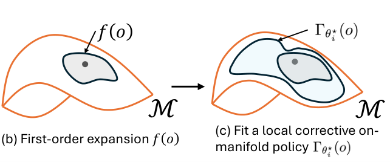
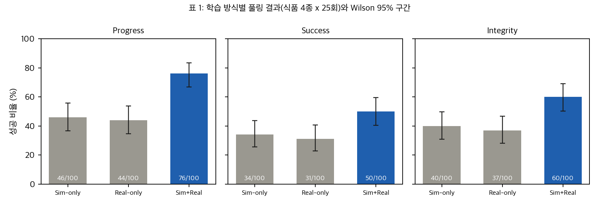
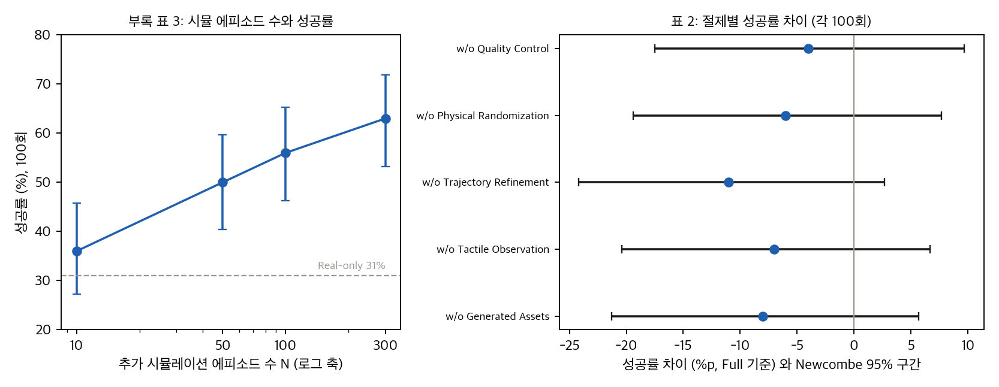
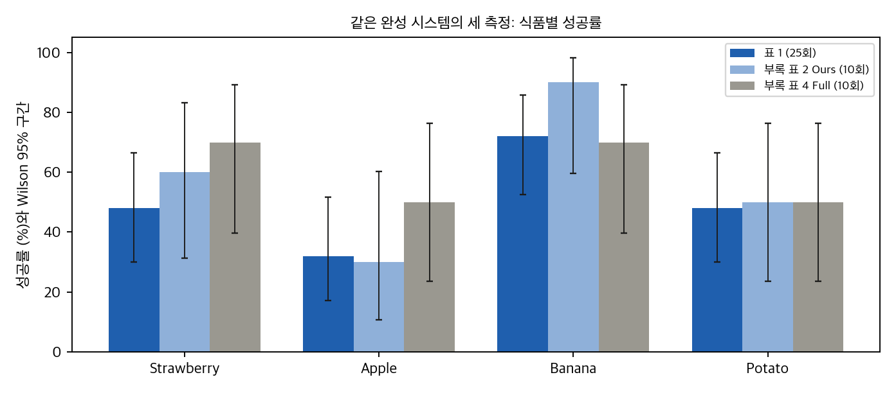
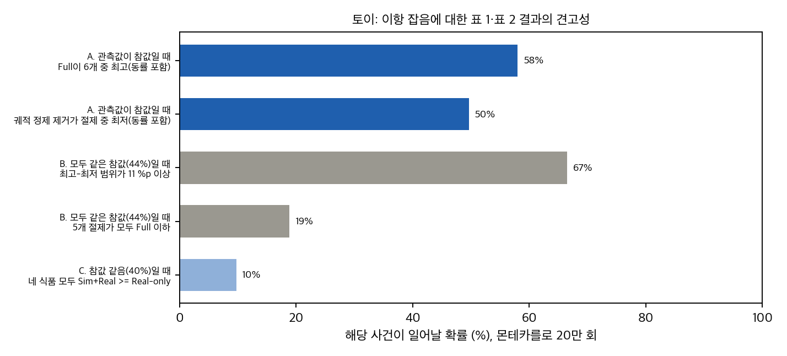

> **논문:** Haozhe Lou, Runyi Yang 외. *DexNinja: Learning Robust Dexterous Cutting Policy with a Real-to-Sim-to-Real Data Engine.* CoRL 2026 포스터, arXiv:2610.17208 (v1, 2026-10-12).
> 프로젝트 페이지는 코드를 "Coming soon"이라고 적고 있어 이 글은 공식 코드 없이 논문의 표와 식만 읽었습니다. 그림은 우리가 그린 그래프 네 장과 논문 그림 4의 일부입니다.

## 논문이 묻는 것

과일을 칼로 자르는 일은 한 번 시도할 때마다 음식이 망가져 실세계 데이터를 모으기 어렵습니다. DexNinja는 원격 조종 시연 몇 개에서 음식 형상을 복원하고, 같은 범주(딸기, 사과, 바나나, 감자)의 형상·질량·마찰·탄성을 바꾼 에셋을 생성해, 변형체 절단 시뮬레이터에서 칼 궤적을 다듬어 시각·촉각·고유감각이 맞춰진 에피소드를 대량으로 만듭니다. 이 데이터로 팔과 손을 따로 예측하고 단계(접근, 칼 위치 잡기, 절단)마다 청크 길이를 바꾸는 ACT 계열 정책을 학습합니다.

학습 데이터의 핵심 가정은 "성공한 시연 근처에서는 인스턴스가 조금 달라져도 행동을 조금만 고치면 된다"는 국소 연속성입니다(§5). 그림 4의 (b), (c)가 이 두 단계를 보여 줍니다.

*그림 4의 (b), (c) (논문 원문). © 저자, CC BY 4.0, 출처 arXiv:2610.17208. 같은 그림의 (a), (f)에는 사진이 있어 싣지 않았습니다.*

## 이 글에서 확인한 것

**1. 풀링 100회에서는 개선이 구분됩니다.** 식품 네 종을 25회씩 시험한 표 1에서 성공은 Sim+Real 50/100, Real-only 31/100, Sim-only 34/100입니다. Sim+Real 대 Real-only는 +19 %p(95% 구간 5.4–31.7, Fisher p = 0.0093), 대 Sim-only는 +16 %p(p = 0.031)입니다. Sim-only와 Real-only 사이는 구분되지 않습니다(p = 0.76). 시행은 독립이라고 가정했습니다.

*그래프 (우리가 그림). 표 1의 값(식품 4종 x 25회)을 합쳐 Wilson 구간을 그렸습니다.*

**2. 식품별 25회로는 구분되지 않습니다.** 식품 단독 성공 비교는 p = 0.15–0.39이고 Holm 보정 후 0.59 이상입니다. 식품으로 층화한 Mantel-Haenszel 검정은 p = 0.005입니다. 25회 두 군에서 48% 대 32%를 80% 검정력으로 가르려면 군당 약 146회가 필요합니다. 식품별 결론은 이 시행 수에서 내기 어렵습니다.

**3. 초록의 두 수치는 서로 다른 행에서 옵니다.** 초록은 "수십 개 실시연과 수백 개 증강 데이터로 60% 이상"이라고 적습니다. 주 실험(실시연 5개, 시뮬 50개)은 50/100이고, 63/100은 부록 표 3의 N=300 행입니다(Wilson 구간 53.2–71.8). "실데이터만 쓸 때보다 20% 넘게 개선"은 주 실험에서 +19 %p이고 상대 증가로는 +61%입니다. 프로젝트 페이지의 초록은 "주 실험 50%"와 "별도 규모 실험 63%"로 나누어 적습니다.

**4. 절제 결과는 방향은 같고 순위는 가르기 어렵습니다.** 표 2의 절제 15개 차이는 모두 음수입니다. 다만 성공 지표의 단독 차이는 Holm 보정 후 p 0.775 이상입니다. 촉각 관측 제거의 Integrity −15 %p만 단독 구간이 0을 제외합니다(보정 전 p = 0.047, Holm 0.24). 본문은 "궤적 정제를 빼면 Progress와 Success가 가장 크게 떨어진다"고 읽는데(−11 %p), 관측값이 참값이라고 해도 같은 실험을 반복하면 이 변형이 절제 중 최저로 나오는 비율은 43–50%입니다(몬테카를로 20만 회, 독립 이항 가정).

**5. 시뮬레이션을 늘린 효과는 로그 축에서 거의 직선입니다.** 추가 시뮬 에피소드 N이 10, 50, 100, 300일 때 성공은 36, 50, 56, 63(/100)입니다. 10배당 증가량은 20, 20, 15 %p입니다(로그 N 추세 검정 p = 7.4e-5). 본문은 "수익 체감"과 "포화"를 말하지만 이 시행 수에서는 로그 직선과 구분되지 않습니다. N=10(36/100)은 Real-only(31/100)와 구분되지 않습니다(p = 0.55).

*그래프 (우리가 그림). 왼쪽은 부록 표 3(로그 축, Wilson 구간), 오른쪽은 표 2의 성공률 차이(Full 기준, Newcombe 95% 구간)입니다.*

**6. RoboNinja 대비 이득은 식품마다 다릅니다.** 부록 표 2는 10회씩 4종, 합 23/40 대 12/40(+27.5 %p, 1.92배는 맞음, p = 0.024)입니다. 바나나 9 대 2(Holm 0.022), 사과 3 대 7로 사과에서는 기준선이 높습니다(식품 이질성 Breslow-Day p = 0.002, 10회 셀 근사). 기준선은 저자가 칼을 손에 강체로 고정하고 접촉 피드백을 촉각에서 스칼라로 근사해 다시 구현했다고 부록이 밝힙니다.

**7. 같은 완성 시스템의 측정이 세 번 있습니다.** 표 1은 50/100(식품 25회씩), 부록 표 2는 23/40, 부록 표 4는 24/40(식품 10회씩)입니다. 식품별 성공률은 딸기 48%, 60%, 70%, 사과 32%, 30%, 50%, 바나나 72%, 90%, 70%, 감자 48%, 50%, 50%입니다. 식품별 동질성 검정은 모두 p 0.47 이상이라 모순으로 보이지 않고, 10회 셀의 Wilson 구간이 약 ±30 %p라는 점이 이 범위를 설명합니다.

*그래프 (우리가 그림). 표 1(25회), 부록 표 2의 Ours(10회), 부록 표 4의 Full System(10회)을 식품별로 비교했습니다.*

**8. 식 4–11의 궤적 정제 손실에는 음식 상태가 들어 있지 않습니다.** 부록의 L_cut, L_col, L_rot, L_move는 칼 위치·각도와 바닥 부호거리장의 함수이고, 식 11의 가능성 술어 S는 이진입니다. 서론은 "미분 가능성이 재구성, 파라미터 추정, 시뮬레이션을 한 루프로 묶는다"고 적는데, 파라미터 추정의 정확도나 시뮬레이션과 실제 접촉의 거리를 재는 지표는 보고되지 않았습니다. 코드가 공개되면 이 부분부터 확인할 만합니다.

**9. "분포 밖 물체" 서술은 범주 안 평가에 해당합니다.** 초록의 세 번째 주장(분포 밖 물체의 다양한 형상과 크기로 일반화)에 대해 평가는 같은 네 범주의 held-out 인스턴스이고, 한계 절은 정책이 범주별이라고 적습니다. 범주 밖이나 크기·형상 축별 결과는 없습니다. 에셋 표 4의 수락 수도 범주마다 정확히 300이어서 선별 목표로 읽히고, 프로젝트 페이지의 에셋 목록에는 표 4에 없는 레몬 300개가 더 있습니다.

## 시행 잡음 토이

표 1과 표 2의 보고 횟수가 이항 잡음 안에서 얼마나 견디는지 몬테카를로로 봤습니다(numpy, 수 초, 짝 구조 없음 가정). 관측 성공률이 참값이어도 "Full이 6개 변형 중 최고"는 58%만 반복됩니다. 6개 변형이 모두 같은 참값이어도 최고와 최저가 11 %p 이상 벌어질 확률이 67%입니다. 반면 "5개 절제가 모두 Full 이하"는 같은 효과일 때 19%라서 15개 부호의 일관성은 약한 방향 증거입니다. 표 1에서 네 식품이 모두 같은 방향이라는 점은 같은 참값에서 약 10%입니다.

*그래프 (우리가 그림). 논문 결과의 재현이 아니라 보고된 시행 수가 가질 수 있는 잡음의 크기를 본 것입니다.*

## 구현 가능성 (Apple M4 Pro, CUDA 없음)

- **실로봇 실험: 불가.** 양팔 DR3/DR5, LinkerHand L10, 압력식 촉각, 데이터 수집 장갑과 소모되는 음식이 필요합니다.
- **공식 파이프라인: 불가.** 코드가 없습니다. 시뮬레이션은 에피소드 하나에 H200에서 GPU 메모리 약 20 GB, 약 10분입니다(부록 5.2).
- **공개 시뮬레이션 에셋: 조건부.** 목록 기준 1,500개, 약 140 GB입니다. 이 글에서는 받지 않았습니다.
- **표 재계산과 토이: 가능, 완료.**
- **정책 구조 소형 재구현: 가능.** 가변 청크와 그룹별 정규화는 합성 접촉 과제에서 1–2주 규모(추정, 측정 전).

이 글은 재현 실험을 하지 않았습니다.

## 한계

- 시행은 독립이라고 가정했습니다. 논문이 "같은 held-out 설정"에서 정책을 비교한다고 하지만 시행별 짝 자료가 없어 짝 검정을 하지 못했고, 짝 구조가 있으면 실제 검정력은 더 높을 수 있습니다.
- 부록 표 2와 표 4의 "Full" 행이 표 1과 같은 시행인지 논문이 밝히지 않아 서로 다른 시행 묶음이라고 가정했습니다.
- 부록 표 3의 N은 표 1의 "시퀀스 50개"와 같은 단위라고 읽었습니다(N=50 행이 표 1 Sim+Real과 식품별로 같습니다).
- 학습 인스턴스 수, 총 시연 수, Sim-only 학습량, 하이퍼파라미터 값이 논문에 없어 확인하지 못한 항목이 많습니다. 저자 확인이 필요합니다.

## 출처와 라이선스

- 논문: arXiv:2610.17208, CC BY 4.0(arXiv 라이선스 링크 확인). 원문 PDF에서 저작권 표시는 찾지 못했습니다.
- 그림 4의 패널 (b), (c)는 논문 원문에서 잘라 실었습니다(© 저자, CC BY 4.0). 나머지 논문 그림은 실로봇 사진, 시뮬레이션 화면, 생성 영상이 들어 있어 싣지 않았습니다.
- 표 값은 인용과 재계산을 위해 옮겼습니다. 그래프, 토이, 분석 문서와 스크립트는 이 저장소 작성자가 만들었습니다.
- 공식 코드와 체크포인트는 확인되지 않았고, 에셋 데이터는 받지 않았습니다. 에셋 크기는 목록 메타데이터에서 읽었습니다.

## 자료

- [통합 리포트 PDF](report/report_public.pdf)
- [01. 논문 분석: DexNinja (arXiv:2610.17208)](analysis/01_paper_analysis.md)
- [02. 선행연구와 관련 저장소](analysis/02_prior_work.md)
- [03. 수치 재계산, 일관성 검사, 시행 잡음 토이](analysis/03_analysis.md)
- [04. 주장 검증과 구현 가능성](analysis/04_claim_verification.md)
