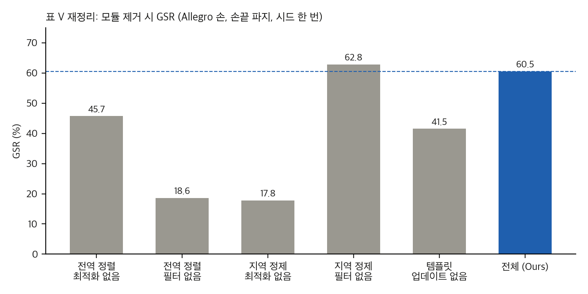
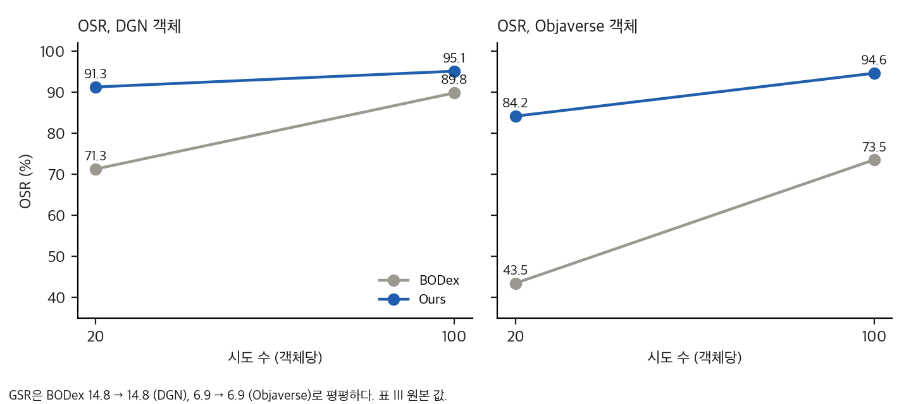
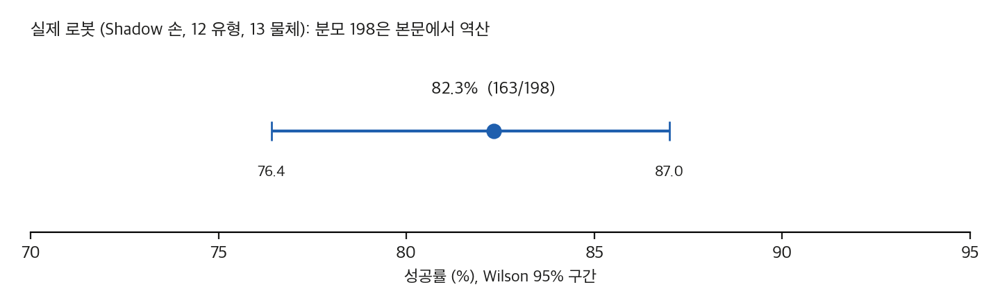

> **논문:** Jiayi Chen, Yubin Ke, Lin Peng, He Wang. *Dexonomy: Synthesizing All Dexterous Grasp Types in a Grasp Taxonomy.* RSS 2025, arXiv:2504.18829 (v2, 2025-09-03).
> 공식 코드는 GitHub JYChen18/Dexonomy에 있습니다 (README는 CC BY-NC 4.0, LICENSE 파일은 없음). 이 글의 그림은 모두 우리가 논문 표의 숫자로 다시 그린 그래프입니다. 논문 그림은 쓰지 않았습니다.

## 논문이 묻는 것

파지를 학습으로 생성하려면 대규모 데이터가 필요합니다. 그런데 "잡을 수 있는가"보다 "어떤 방식으로 잡는가"가 중요합니다. 같은 물체라도 동력 파지와 정밀 파지는 쓰임이 다릅니다. 그래서 GRASP 분류의 33개 유형을 모두 덮는 데이터가 필요하다는 것이 논문의 출발점입니다.

Dexonomy는 **유형마다 사람이 주석한 손 템플릿 하나**에서 시작합니다. 물체를 템플릿의 접촉점에 먼저 맞추고, 그다음 MuJoCo에서 손 관절을 가상 힘으로 조금씩 정제합니다. 결과가 여섯 방향 외력 시험을 통과하면 성공 파지로 저장하고, 그 파지를 새 템플릿으로 되돌립니다.

## 이 글에서 확인한 것

**1. 표 숫자는 대부분 맞습니다.** 표 II의 Ours 행과 표 V의 Ours 행이 같고, 표 VIII·X·XI의 공유 값도 일치합니다.

**2. 본문의 '약간의 개선'은 표와 맞지 않습니다.** 전역 최적화를 빼면 성공률은 60.5%에서 45.7%로 떨어집니다. 14.8 pp입니다.

*그래프: 우리가 그린 표 V 재정리. 논문 값 그대로이며 시드 한 번의 결과입니다.*

**3. BODex의 "변하지 않음"은 성공률에만 맞습니다.** 시도를 20에서 100으로 늘리면 BODex의 성공률(GSR)은 그대로지만, 물체 단위 성공률(OSR)은 Objaverse에서 43.5%에서 73.5%로 오릅니다.

*그래프: 우리가 그린 표 III 재정리. GSR은 평평하고, OSR은 BODex와 Ours 모두 오릅니다.*

**4. 실제 로봇 82.3%는 198회 중 163회입니다.** 분모는 본문의 "3회씩 약 200회"에서 역산했습니다. 95% 구간은 76.4–87.0%입니다.

*그래프: 우리가 그린 Wilson 95% 구간. 객체 군집은 반영하지 않았습니다.*

**5. 공식 코드는 논문과 다른 설정이 많습니다.** 데이터 초기화 epoch는 논문 10, 공식 설정 5입니다. 사전 파지 여유는 논문 2 cm, 공식 설정 4.5 cm입니다. 평가 경로에는 논문이 말하는 관통 1 cm 기준이 보이지 않았습니다. 이런 차이는 재현할 때 맞춰야 합니다.

## 구현 가능성

이 맥(M4 Pro, CUDA 없음)에서는 데이터 생성 규모와 유형 조건부 학습, 실물 실험이 불가능합니다. MuJoCo로 접촉 정제와 여섯 방향 시험을 소규모로 해 보는 것은 가능하고, 설치 승인 후 시작하는 것이 맞습니다. 노력은 1–2주로 추정합니다 (측정 전).

## 남은 질문

- 유형 선택이 가장 큰 병목입니다. 평균 28.9%, 오라클 78.2%입니다.
- 실물 손의 커플링 모델은 저장소에 이미 있습니다. 이 모델이 J1 굽힘을 재현하는지는 확인해 볼 항목입니다.
- 통계 근거가 부족합니다. 시드 분산 없이 1–2 pp 차이를 인용하기 어렵습니다.

## 자료

- [통합 리포트 PDF](report/report_public.pdf)
- [01. 논문 분석: Dexonomy (arXiv:2504.18829)](analysis/01_paper_analysis.md)
- [02. 선행연구와 자료 계보: Dexonomy](analysis/02_prior_work.md)
- [03. 수치 재계산과 일관성 검사: Dexonomy](analysis/03_analysis.md)
- [04. 공식 코드 정적 대조: Dexonomy](analysis/04_code_verification.md)
