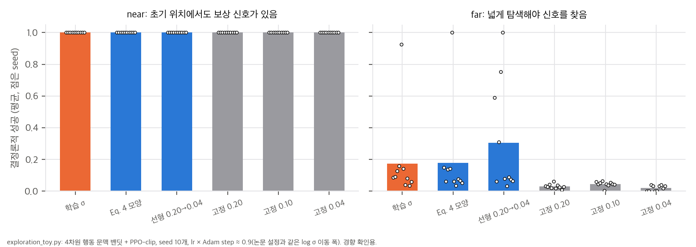

# 03. 핵심 식 해석과 toy 검증

스크립트는 `analysis/table_check.py`(표·본문 재계산), `analysis/exploration_toy.py`(잡음 스케줄 toy), `analysis/grpo_credit_toy.py`(GRPO advantage 대조)입니다. 결과는 같은 이름의 `*_results.json`에 있습니다. 모두 numpy만 쓰고 CPU에서 각 20초 안에 끝납니다.

## 1. 잡음 크기에는 왜 "넓게 시작해 좁히기"가 맞는가

### 1.1 가우시안 보상 모형에서의 최적 σ
보상이 목표 근처에서만 큰 경우를 가우시안 bump r(a) = exp(−‖a − a*‖² / 2w²)로 단순화합니다. 행동이 N(μ, σ²I_d)를 따르고 평균이 목표에서 Δ = ‖μ − a*‖만큼 떨어져 있으면, 기대 보상은 닫힌 꼴입니다.

```
E[r] = ( w² / (w² + σ²) )^{d/2} · exp( −Δ² / (2(w² + σ²)) )
```

v = w² + σ²로 두고 log E[r] = −(d/2) log v − Δ²/(2v) + 상수를 v로 미분해 0으로 놓으면 다음을 얻습니다.

```
σ*² = Δ² / d − w²     (음수면 σ* = 0)
```

해석:
- **최적 탐색 크기는 평균이 목표에 다가갈수록 줄어듭니다.** 학습이 진행되며 Δ가 줄면 σ*도 줄어야 합니다. "넓게 시작해 좁히기"가 이 모형에서는 최적 경로입니다.
- **차원이 크면 차원당 σ는 작아야 합니다.** 잡음 벡터의 크기는 대략 σ√d입니다. ViViDex 행동은 22차원이므로 σ = 0.20이면 잡음 벡터 크기가 약 0.94, σ = 0.04이면 0.19입니다(정규화 행동 단위). 예를 들어 Δ = 0.5, w = 0.05, d = 22이면 σ* ≈ 0.094이고, Δ = 0.3이면 0.040입니다. 논문 스케줄의 범위(0.20 → 0.04)와 자릿수가 맞습니다.
- 이 모형은 실제 dexterous 보상(접촉, 들어 올리기 보너스, 추적 오차)을 크게 단순화합니다. 수치가 아니라 방향만 읽어야 합니다.

### 1.2 정책 기울기의 신호 대 잡음
Gaussian 정책의 score는 ∇_μ log π = (a − μ)/σ²이므로 크기가 대략 √d/σ입니다. σ가 작으면 평균에 대한 기울기 신호가 커지고, 목표 근처에서 정밀하게 맞출 수 있습니다. 대신 목표에서 멀 때는 보상을 받는 표본 자체가 없어서 신호가 사라집니다. §1.1과 같은 결론입니다.

## 2. 학습된 σ는 5M step 안에 얼마나 움직일 수 있는가

PPO 기준선은 log σ를 다른 매개변수와 같은 Adam(lr 1e-5)으로 학습합니다. Adam의 한 step 변화량은 대략 lr 이하이고, 기울기 부호가 일정할 때 lr에 가깝습니다. 5M step 동안의 Adam step 수는 rollout 크기와 관계없이 다음과 같습니다.

```
(5,000,000 / 256 minibatch) × 5 epoch = 97,656 step
→ log σ 최대 이동 ≈ 97,656 × 1e-5 ≈ 0.98
```

| 양 | log σ 변화 |
|---|---|
| 5M step 동안 가능한 최대 이동(근사) | ±0.98 |
| 실제 기준선 변화(0.202 → 0.185, Sec. I) | −0.085 (최대의 9%) |
| DexPolicy 최종값(0.04)까지 필요한 변화 | −1.62 |

- **학습된 σ는 이 예산 안에서 0.04에 원리상 도달할 수 없습니다.** 최대 이동 폭 0.98보다 필요한 변화 1.62가 큽니다. 엔트로피 보너스(계수 0.001)는 σ를 오히려 키우는 방향입니다.
- **실제 이동은 최대치의 9%뿐입니다.** 최적화기 상한만의 문제가 아니라 log σ에 대한 기울기가 약하거나 부호가 자주 바뀐다는 뜻입니다. toy(§4)에서는 신호가 강하면 같은 lr × step(0.9)으로 σ가 0.20 → 0.07까지 줄었습니다.
- **ViViDex 원래 예산이면 결론이 달라질 수 있습니다.** 공개 설정의 기본 학습량은 1억 step이라 최대 이동 폭이 약 19.5입니다. "학습된 σ가 줄지 않는다"는 동기 관찰은 5M step이라는 예산 조건에서의 관찰입니다.
- **GRPO 연속 학습은 학습률이 커서 사정이 다릅니다.** 1e-4로 9,920 step, 5e-5로 4,960 step이라 최대 이동 폭이 약 1.24입니다.

## 3. GRPO advantage: 논문 Eq. 5와 공개 코드

| | 논문 Eq. 5 | 공개 코드 `trajectory_group_advantages` |
|---|---|---|
| 신호 | 단계 t의 할인 reward-to-go G_{i,t} (γ = 0.95) | 궤적 전체의 할인 없는 총 보상 |
| 그룹 | 같은 에피소드 나이 t에 도달한 완료 궤적 | rollout의 모든 완료 궤적 |
| 궤적 안의 값 | 단계마다 다름 | 모든 단계에 같은 값 |
| 잘린 조각 | 0 | 0 |

가상 rollout(환경 16 × 512 step, 에피소드 길이 120–200 step, 성공률 40%, 성공 궤적만 후반 보너스)을 20번 만들어 비교했습니다. 결과는 20회 평균입니다.

| 지표 | 값 |
|---|---|
| rollout당 완료 궤적 | 34.2개 |
| advantage가 0이 아닌 전이 비율 | 65.5% (잘린 조각 때문에 약 35%가 버려짐) |
| 두 advantage의 Pearson 상관 | 0.735 (0.65–0.80) |
| 부호가 다른 전이 | 7.6% (4.1–13.6%) |
| 에피소드 앞 0–20% 구간 advantage 부호가 궤적 성공과 일치 | 코드 100%, Eq. 5 84.9% |
| 같은 지표, 20–40% 구간 | 코드 100%, Eq. 5 95.0% |

해석:
- **공개 코드는 결과만 보는 Monte Carlo credit입니다.** 궤적이 성공했으면 첫 step부터 마지막 step까지 모두 같은 양수 advantage를 받습니다. 시간에 따른 credit assignment가 없습니다.
- **Eq. 5는 시간 국소적입니다.** γ = 0.95면 실효 시야가 1/(1 − γ) = 20 step이고, 60 step 뒤 보상의 가중치는 γ⁶⁰ ≈ 0.046입니다. 에피소드 초반의 advantage는 후반 결과를 약하게만 반영합니다.
- 두 방식은 같은 학습 동역학을 만들지 않습니다. 논문의 GRPO 결과(Table I·II)를 공개 코드로 재현하려면, Hugging Face 메타데이터가 말하는 `grpo_rtg` 모듈이 필요합니다(`04` D1).
- toy의 에피소드 길이와 보상 모양은 내가 정한 가정입니다. ViViDex 재배치 에피소드 길이(사전 파지 step + 레퍼런스 길이)는 물체·시퀀스마다 다르고 확인하지 못했습니다.

## 4. 잡음 스케줄 toy

4차원 행동 문맥 밴딧에서 PPO-clip을 돌렸습니다(`exploration_toy.py`). 평균은 관측의 선형 함수이고, 보상은 §1.1의 bump입니다. Adam lr × step 수를 0.9로 두어 log σ가 움직일 수 있는 폭을 논문 설정(0.98)과 맞췄습니다. seed 10개입니다.



| 조건 | near: 결정론적 성공 | far: 결정론적 성공 | far: 평균 오차 | far: 최종 σ |
|---|---|---|---|---|
| 학습 σ (초기 0.20) | 1.00 | 0.175 | 0.133 | 0.114 |
| Eq. 4 모양 스케줄 | 1.00 | 0.178 | 0.166 | 0.04 |
| 선형 0.20 → 0.04 | 1.00 | **0.305** | 0.132 | 0.041 |
| 고정 0.20 | 1.00 | 0.030 | 0.235 | 0.20 |
| 고정 0.10 | 1.00 | 0.045 | 0.285 | 0.10 |
| 고정 0.04 | 1.00 | 0.020 | 0.523 | 0.04 |

해석:
- **탐색이 필요 없는 과제(near)에서는 스케줄이 아무 차이를 만들지 않습니다.** 모든 조건이 100%입니다. 차이는 학습 중 reward(AUC)와 확률적 실행 성공에서만 납니다. 이 점은 "학습 return과 결정론적 성공이 어긋난다"는 논문 주장과 맞습니다.
- **탐색이 필요한 과제(far)에서는 σ를 줄이는 방식이 고정 σ보다 낫습니다.** 고정 0.04는 신호를 찾지 못하고(평균 오차 0.52), 고정 0.20은 정밀도가 모자랍니다.
- **Eq. 4 모양 자체가 특별하지는 않습니다.** 학습 σ와 거의 같고(쌍 비교 4승 6패), 이 toy에서는 선형 감쇠가 가장 좋았습니다. 논문 Table V에서는 선형 0.20 → 0.05가 탈락했습니다. 최적 모양은 과제에 따라 다르다는 논문의 단서와 맞습니다.
- **toy의 학습 σ는 실제로 줄었습니다**(far 0.114, near 0.068). 논문 기준선이 0.185에 머문 것과 대조됩니다. 그래서 논문의 PPO 비교는 "학습 σ 대 스케줄"이라기보다 "거의 고정된 큰 σ 대 스케줄"에 가깝습니다. toy에서 그 비교(고정 0.20 대 스케줄)는 큰 차이를 보였습니다.
- far 결과는 예산 안에서 대부분 수렴하지 못한 상태라 분산이 큽니다. 한 seed(4번)는 감쇠 방식 셋 모두 90% 이상을 풀었습니다. 경향 확인용입니다.

## 5. 통계적으로 얼마나 확실한가

**시뮬레이션 (seed 수준 평균 ± SD로 계산한 Welch 근사, 비대응):**

| 방법 | 차이 | t | 자유도 | p |
|---|---|---|---|---|
| PPO | +3.7%p | 0.97 | 3.7 | 0.39 |
| GRPO | +31.3%p | 3.24 | 3.2 | 0.043 |
| FPO | +18.7%p | 1.33 | 3.0 | 0.27 |

같은 seed끼리 짝지은 대응 검정이 더 민감할 수 있지만, seed별 Overall이 없어서 계산할 수 없습니다. 논문도 유의성은 주장하지 않는다고 밝힙니다.

**하드웨어 (Table III, 물체 3개 합산 60회):**

| 방법 | Target 기준선 → DexPolicy | Wilson 95% | Fisher p |
|---|---|---|---|
| PPO | 5/60 → 26/60 | [3.6, 18.1] → [31.6, 55.9] | 1.7×10⁻⁵ |
| GRPO | 6/60 → 38/60 | [4.7, 20.1] → [50.7, 74.4] | 1.1×10⁻⁹ |
| FPO | 15/60 → 51/60 | [15.8, 37.2] → [73.9, 91.9] | 3.1×10⁻¹¹ |

이 검정은 "모델 하나를 20번 돌린 시행 잡음"만 다룹니다. 조건마다 모델이 하나라서 학습 seed 사이의 분산은 들어가지 않습니다. 시뮬레이션 seed 분포로 예를 들면, FPO 머그에서 기준선과 DexPolicy 모델을 하나씩 뽑을 때 DexPolicy가 높을 확률은 33%, 낮을 확률은 44%입니다(`04` C8). 하드웨어 정책은 다른 embodiment로 학습했으므로 이 분포와 같지 않지만, 단일 모델 비교가 seed 운에 얼마나 열려 있는지는 보여 줍니다.
