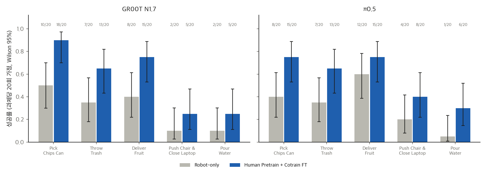
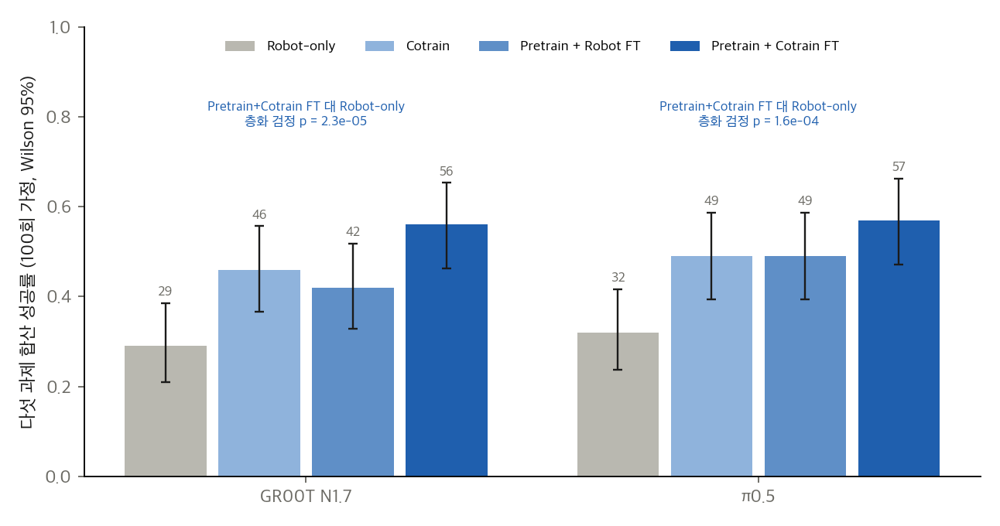
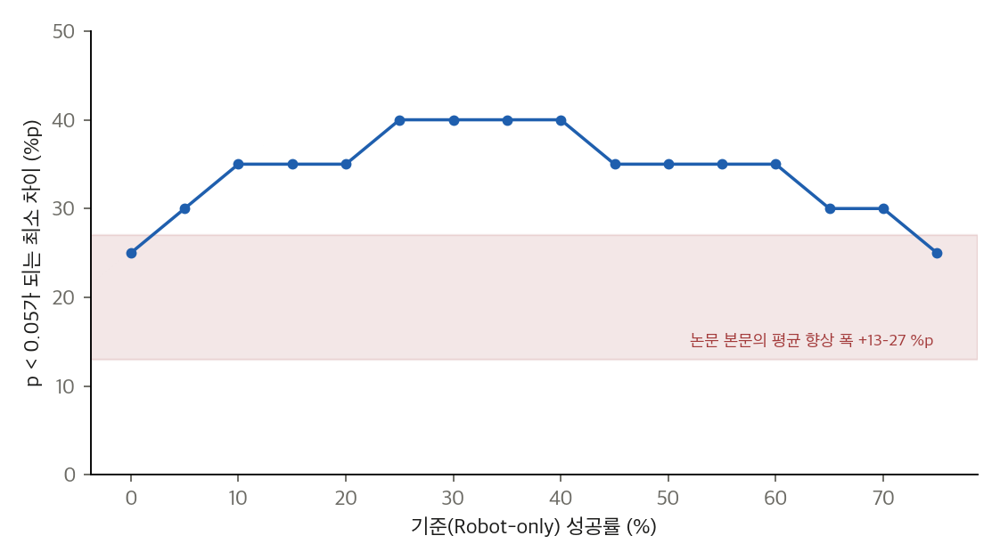
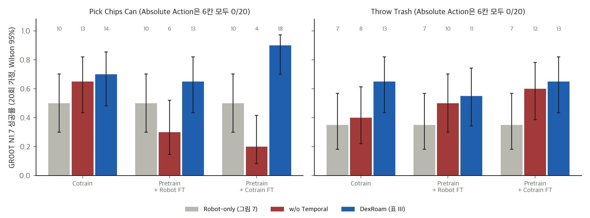
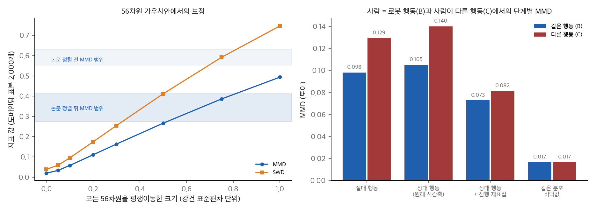

# 03. 수치 재계산과 토이 검증: DexRoam (arXiv:2609.35761 v1)

재현 실험(학습, 실로봇)은 하지 않았습니다. 이 문서는 (a) 논문 표와 그림 라벨의 재계산과 일관성 검사 V1–V15, (b) CPU 토이 하나로 이루어집니다. 재계산은 `analysis/recompute.py`(결과 `recompute_results.json`), 토이는 `analysis/toy_alignment_metric.py`(결과 `toy_alignment_metric_results.json`)입니다. 정책 평가의 시행 수는 논문 본문 §IV-A2의 "과제당 20회"를 따랐고, 설정별로 다른 값이 있을 수 있다는 점은 저자 확인이 필요합니다. 그림에서 읽은 값은 "(그림 판독 값)"으로 표시했습니다. 그림 7의 막대 라벨은 숫자이므로 판독이 아니라 옮긴 값입니다.

## 0. 결과 요약

| ID | 검사 | 결과 |
|---|---|---|
| V1 | 표 I, IV 평균, 표 II와의 대응 | 14개 평균 중 13개 일치, 하나(PICO 오른팔 위치)는 5.64로 계산되는데 5.63. 표 II는 표 I, IV 평균과 같음 |
| V2 | 그림 6의 MMD, SWD 평균 감소율 | 논문 41.7%, 31.1%. 라벨 반올림 범위로 계산하면 41.8–42.0%, 30.9–31.1% (0.1 %p 이내) |
| V3 | 그림 7의 평균과 본문 %p 향상 | 평균 16개 일치, 본문 %p 6개와 "Push 15, 20 %p" 일치 |
| V4 | 그림 7 서술 검사 | "모든 과제·백본에서 개선"은 SR, TCS 모두 성립. "Pretrain + Cotrain FT가 최선 또는 동률"은 SR 10칸 모두 성립, TCS는 π0.5의 Pick, Deliver 두 칸에서 성립하지 않음 |
| V5 | TCS 대 SR 경계 | 40칸(2 백본 x 5 과제 x 4 설정) 위반 0건 |
| V6 | 정책 개선의 유의성(과제당 20회 가정) | 과제별 30개 비교 중 raw p < 0.05는 1개, Holm 후 0개. 다섯 과제 합산(100 대 100)에서는 P+C 대 Robot-only가 확실. 전략 간 차이는 구분되지 않음 |
| V7 | 표 III 평균과 칸별 검정 | 평균 68.33 대 44.17 (차이 24.2 %p, 본문 24.1). Throw Cotrain의 DexRoam 값(.65)이 그림 7(.60)과 다름. 절대 행동 0/20의 Wilson 상한 16.1% |
| V8 | 그림 8의 판독과 그림 7 대조, 25개 시연 주장 | π0.5 Throw Trash의 50개 로봇 칸이 그림 7과 다름(60·50 대 65·55). GR00T는 25개 6칸이 Robot-only 50개 이상 |
| V9 | 그림 9의 상대 하락과 원점 값 | 상대 하락 8개 모두 라벨과 일치. 원점 값이 그림 7과 다른 칸이 있음 (GR00T 4칸 중 2칸이 다르고, π0.5는 4칸 모두 다름) |
| V10 | 표 V 평균과 서술 | 평균 일치. SPARC는 5과제 모두 사람이 높고, LDLJ는 5과제 중 2과제만 사람이 높음 |
| V11 | 표 VI, VII 차원 합, 표 VIII, IX 정합 | 53, 56 일치. 전역 배치(2 x 2, 4 x 6), 웜업 비율(1000/30000, 2000/40000) 일치 |
| V12 | 학습량 | 스텝 x 전역 배치 = GR00T 960,000, π0.5 120,000 (8배) |
| V13 | 20회 대 20회의 최소 구분 차이 | 기준 성공 횟수에 따라 25–40 %p |
| V14 | 시연 수의 명시 | Q2(주 결과)의 로봇·사람 시연 수는 본문에 없음 |
| V15 | 공식 코드와 표 IX | GR00T 학습 스크립트는 1 GPU, 전역 배치 12 (표 IX는 4 GPU, 24) (`04` D10) |

## 1. 표 I, II, IV, 그림 6 (Q1 전이 품질)

### 1.1 평균과 표 간 대응 (V1)

세 과제(Pick, Pour, Throw)의 값으로 평균을 다시 구하면 표 I의 평균 7개가 모두 소수 둘째 자리에서 일치합니다(예: 토르소 위치 (13.49 + 11.82 + 12.31) / 3 = 12.5400). 부록 표 IV(PICO + 트래커) 평균은 7개 중 6개가 일치하고 오른팔 위치만 (5.44 + 5.45 + 6.02) / 3 = 5.637로 5.64가 되는데 5.63으로 적혀 있습니다. 본문 표 II의 두 행은 각각 표 I, 표 IV의 평균과 같습니다.

추적기 없음에서 PICO를 뺀 차이(mm 또는 도)는 토르소 위치 −0.62, 토르소 회전 −0.22, 왼팔 −0.11, −0.02, 오른팔 위치 +0.67, 회전 +0.11, 머리 +0.14입니다. 7개 지표 중 4개는 추적기 없음이 작고 3개는 PICO가 작아서 "체계적 차이 없음"이라는 서술과 맞습니다. 다만 과제당 5개 궤적이므로 동등성을 보였다기보다 두 시스템에서 같은 크기의 오차가 관측되었다는 정도입니다.

### 1.2 그림 6 감소율 (V2)

| 과제 | MMD 정렬 전 → 후 | 감소 | SWD 정렬 전 → 후 | 감소 |
|---|---|---|---|---|
| Pick Chips Can | .598 → .313 | 47.7% | .926 → .563 | 39.2% |
| Pour Water | .631 → .384 | 39.1% | 1.277 → .860 | 32.7% |
| Throw Trash | .628 → .359 | 42.8% | 1.004 → .729 | 27.4% |
| Deliver Fruit | .585 → .413 | 29.4% | 1.008 → .684 | 32.1% |
| Push Chair & Close Laptop | .553 → .274 | 50.5% | .940 → .719 | 23.5% |
| 과제별 감소의 평균 | | 41.9% | | 31.0% |
| 평균값의 감소 | .599 → .349 | 41.8% | 1.031 → .711 | 31.0% |

논문 본문은 41.7%, 31.1%입니다. 라벨이 소수 셋째 자리로 반올림된 것을 고려한 평균 감소율 범위는 MMD 41.8–42.0%, SWD 30.9–31.1%여서 논문 값과 0.1 %p 이내입니다. 계산 방식(과제별 평균 대 평균값)이나 반올림 전 값에 따른 차이로 볼 수 있습니다. 모든 과제에서 정렬 뒤가 작다는 서술은 성립하고, Deliver Fruit의 MMD(29%)와 Push Chair의 SWD(24%)가 가장 작은 감소입니다.

해석에 필요한 것은 눈금입니다. 정렬 뒤 MMD .27–.41과 SWD .56–.86이 "작은 값"인지는 §6의 토이가 보여 줍니다. 56차원 가우시안에서 같은 분포의 바닥값은 MMD 약 .02, SWD 약 .04이고, 모든 차원을 강건 표준편차 0.5–0.8만큼 옮기면 MMD가 .27–.39입니다.

## 2. 정책 성능 (그림 7)

### 2.1 평균, 본문 %p, 격자 (V3)

네 설정의 SR 평균 8개와 TCS 평균 8개가 모두 5개 과제 평균과 소수 둘째 자리에서 일치합니다(예: GR00T 29, 46, 42, 56 %). 본문 IV-C의 평균 향상 GR00T +17, +13, +27 %p, π0.5 +17, +17, +25 %p, Push Chair의 +15, +20 %p도 일치합니다. SR 라벨은 모두 0.05의 배수로, 과제당 20회와 정수로 맞습니다.

### 2.2 서술 검사 (V4, V5)

- "세 가지 사람 보조 전략이 두 백본, 다섯 과제에서 모두 Robot-only보다 높다": SR 30개 비교, TCS 30개 비교 모두 성립합니다.
- "Pretrain + Cotrain FT는 모든 과제-백본 칸에서 최선 또는 동률": SR은 10칸 모두 성립합니다(동률 4칸: GR00T Pour = Cotrain, π0.5 Pick = Pretrain+FT, Throw = Cotrain, Pour = Cotrain). TCS는 π0.5의 Pick Chips Can(.84 대 Pretrain+FT .85), Deliver Fruit(.89 대 .90)에서 성립하지 않습니다. 본문 문장이 SR을 가리키면 성립하고, 그림 캡션의 문장은 SR과 TCS를 함께 읽게 되어 있어 TCS에서는 두 칸이 예외입니다.
- TCS와 SR의 정합: 성공 시행은 TCS 1.0이므로 TCS ≥ SR이어야 하고, 실패 시행은 마지막 단계 가중치만큼은 모자라므로 TCS ≤ SR + (1 − SR)(1 − w_last)입니다. 40칸 모두 이 경계 안입니다. 단 Throw Trash는 5단계(가중치 0.1)가 "쓰레기통을 건드리지 않음"이어서 성공이 4단계에서 정해지면 상한이 달라지고, 표 X에서 그 정의가 분명하지 않습니다.

### 2.3 유의성 (V6)

시행 수를 과제당 20회로 두고 Robot-only 대 각 사람 보조 전략을 Fisher 정확 검정으로 비교했습니다.

| 백본, 과제 | Robot-only | P+C (Pretrain + Cotrain FT) | p (Fisher) |
|---|---|---|---|
| GR00T Pick | 10/20 | 18/20 | 0.014 |
| GR00T Throw | 7/20 | 13/20 | 0.113 |
| GR00T Deliver | 8/20 | 15/20 | 0.054 |
| GR00T Push | 2/20 | 5/20 | 0.41 |
| GR00T Pour | 2/20 | 5/20 | 0.41 |
| π0.5 Pick | 8/20 | 15/20 | 0.054 |
| π0.5 Throw | 7/20 | 13/20 | 0.113 |
| π0.5 Deliver | 12/20 | 15/20 | 0.50 |
| π0.5 Push | 4/20 | 8/20 | 0.30 |
| π0.5 Pour | 1/20 | 6/20 | 0.091 |

전체 30개 과제별 비교(백본 2 x 과제 5 x 전략 3)에서 raw p < 0.05는 위 표의 GR00T Pick(P+C) 하나이고 Holm 보정(30개 중 최소 p 0.014)을 하면 0개입니다. 과제당 20회로는 개별 과제의 차이를 구분하기 어렵습니다(§2.4). 반면 방향은 30개 모두 같고, 다섯 과제를 합치면(Robot-only와 비교, 100 대 100) 다음과 같습니다.

| 백본 | Robot-only | Cotrain | Pretrain + Robot FT | Pretrain + Cotrain FT |
|---|---|---|---|---|
| GR00T N1.7 | 29/100 [0.21, 0.39] | 46/100, p = 0.019 | 42/100, p = 0.076 | 56/100 [0.46, 0.65], p = 1.8e-4 |
| π0.5 | 32/100 [0.24, 0.42] | 49/100, p = 0.021 | 49/100, p = 0.021 | 57/100 [0.47, 0.66], p = 6.0e-4 |

(대괄호는 Wilson 95% 구간, p는 Robot-only 대 해당 전략의 Fisher 정확 검정.) 과제를 층으로 둔 Cochran-Mantel-Haenszel 검정에서도 P+C 대 Robot-only는 GR00T p = 2.3e-5, π0.5 p = 1.6e-4입니다. 두 백본을 합치면 113/200 대 61/200, p = 2.3e-7입니다. 합산 검정은 과제 간 난이도가 다르다는 점은 CMH로 고려하지만, 설정마다 시행이 독립이라는 가정을 합니다.

전략 간 서열은 합산에서도 구분되지 않습니다. P+C 대 Cotrain은 GR00T p = 0.20, π0.5 p = 0.32, P+C 대 Pretrain + Robot FT는 GR00T p = 0.066, π0.5 p = 0.32입니다. 본문 §IV-C의 "Pretrain + Cotrain FT가 사람 데이터를 가장 효과적으로 쓴다"는 서술은 SR 점추정의 서열과는 일치하지만 이 시행 수로는 확정되지 않습니다.

### 2.4 최소 구분 차이 (V13)

20회 대 20회 Fisher 정확 검정에서 p < 0.05가 되려면 기준 성공 횟수가 2–12회일 때 35–40 %p, 0–1회와 13회 이상일 때 25–30 %p의 차이가 필요합니다(아래 그림).

논문 본문의 평균 향상(+13–27 %p)은 이 크기보다 작습니다. 과제별 Pretrain + Cotrain FT의 향상은 +15–+40 %p 범위이고, 문턱을 넘는 것은 GR00T Pick(+40 %p, 10/20 → 18/20) 하나입니다. 합산에서만 뚜렷한 이유입니다.

## 3. 정렬 절제 (표 III, V7)

### 3.1 숫자 일관성

표 III의 6개 "DexRoam" 값 중 5개는 그림 7 GR00T N1.7과 같고, 하나는 다릅니다. Throw Trash의 Cotrain이 표 III에서 .65, 그림 7과 그림 8(50개 로봇 칸, 그림 판독 값 60%)에서는 .60입니다. 이 값 하나로 6칸 평균은 68.33(표 III 값 기준)에서 67.5(그림 7 값 기준)로 바뀝니다. 본문의 68.3%는 표 III 값을 쓴 평균입니다. 정확한 평균은 DexRoam 68.33%, w/o Temporal 44.17%이고 차이는 24.17 %p입니다. 본문은 반올림한 값끼리 빼서 24.1 %p로 적었고(68.3 − 44.2), 정확한 차이로는 24.2 %p입니다.

### 3.2 칸별과 합산

| 과제, 전략 | Robot-only(그림 7) | w/o Temporal | DexRoam | DexRoam − w/o (%p) |
|---|---|---|---|---|
| Pick, Cotrain | 10/20 | 13/20 | 14/20 | +5 |
| Pick, Pretrain + Robot FT | 10/20 | **6/20** | 13/20 | +35 |
| Pick, Pretrain + Cotrain FT | 10/20 | **4/20** | 18/20 | +70 |
| Throw, Cotrain | 7/20 | 8/20 | 13/20 | +25 |
| Throw, Pretrain + Robot FT | 7/20 | 10/20 | 11/20 | +5 |
| Throw, Pretrain + Cotrain FT | 7/20 | 12/20 | 13/20 | +5 |

- 6칸 합산(120 대 120): DexRoam 82/120 [0.60, 0.76] 대 w/o Temporal 53/120 [0.36, 0.53], Fisher p = 2.5e-4. 과제 층화 CMH도 p < 0.001입니다.
- 칸별로는 차이가 고르지 않습니다. Pick의 Pretrain 두 설정(+35, +70 %p)과 Throw Cotrain(+25 %p)이 합산을 이끌고, 나머지 3칸은 +5 %p입니다(한 번의 시행 차이). 칸별 Fisher p는 Pick P+C의 1.7e-5만 0.05 미만이고, Pick Pretrain + Robot FT가 0.056입니다.
- Pick Chips Can의 Pretrain 두 설정은 시간 재표집을 빼면 Robot-only(10/20)보다 낮은 6/20, 4/20입니다(Robot-only 대비 칸별 p는 0.33, 0.096이라 구분되지는 않음). 시간 정렬이 없을 때 사람 사전학습이 성능을 떨어뜨릴 수 있음을 시사하는 방향입니다.
- 절대 행동 6칸은 모두 0/20입니다. Wilson 95% 상한은 칸당 16.1%, 6칸을 합치면(0/120) 3.1%입니다. 실패가 "완전"하다는 서술은 이 격자에서 성립합니다.

### 3.3 서술과 증거의 간격

절대 행동이 0%가 되는 이유(시연자별 구성에 끌려가는 지도 + 폐루프 오차 증폭, IV-E1)와 시간 정렬이 필요한 이유(같은 진행에 다른 미래 청크, IV-E2)는 가설로 제시되고 직접 측정은 없습니다. 예를 들어 절대 행동 정책의 오프라인 행동 오차나 폐루프 중 오차 곡선, 시간 재표집 전후의 행동 크기 분포(사람 에피소드가 짧으면 상대 행동의 스텝당 크기가 커짐)는 보고되지 않았습니다. 또 두 절제는 6칸(과제 2개)이고 GR00T N1.7만 대상입니다. π0.5와 나머지 3과제에서의 절제는 없습니다.

## 4. 데이터 효율 (그림 8, V8)

그림 8의 곡선에는 숫자 라벨이 없습니다. PDF의 벡터 경로 좌표를 축 눈금(5% 단위의 20회 격자)으로 환산한 값을 씁니다(그림 판독 값).

| 백본, 과제 | 전략 | 로봇 0 / 10 / 25 / 50 | Robot-only 50 |
|---|---|---|---|
| GR00T Pick | Cotrain | 0 / 40 / 50 / 70 | 50 |
| GR00T Pick | Pretrain + Robot FT | 0 / 35 / 50 / 65 | 50 |
| GR00T Throw | Cotrain | 0 / 40 / 50 / 60 | 35 |
| GR00T Throw | Pretrain + Robot FT | 0 / 50 / 70 / 55 | 35 |
| GR00T Deliver | Cotrain | 0 / 20 / 50 / 55 | 40 |
| GR00T Deliver | Pretrain + Robot FT | 0 / 25 / 65 / 60 | 40 |
| π0.5 Pick | Cotrain | 0 / 20 / 40 / 50 | 40 |
| π0.5 Pick | Pretrain + Robot FT | 0 / 50 / 35 / 75 | 40 |
| π0.5 Throw | Cotrain | 0 / 50 / 45 / 60 | 35 |
| π0.5 Throw | Pretrain + Robot FT | 0 / 20 / 30 / 50 | 35 |
| π0.5 Deliver | Cotrain | 0 / 50 / 55 / 70 | 60 |
| π0.5 Deliver | Pretrain + Robot FT | 0 / 35 / 60 / 70 | 60 |

- **그림 7과 맞는 칸:** 로봇 50개 곡선의 끝점 12개 중 10개가 그림 7과 같고, π0.5 Throw Trash의 Cotrain(그림 8 판독 60, 그림 7 65), Pretrain + Robot FT(판독 50, 그림 7 55)가 한 시행 차이로 다릅니다.
- **"25개로 50개를 맞춘다":** GR00T는 6칸 모두 25개 값 ≥ Robot-only 50개(차이 0, 0, +15, +35, +10, +25 %p, 칸별 Fisher p는 0.056–1.0). π0.5는 −5, −5, −5, 0, 0, +10 %p로 5 %p 이내입니다. 본문 서술과 일치합니다. 효과는 점추정이며 칸당 20회이므로 "맞춘다"는 "구분되지 않는다"의 뜻입니다.
- **"로봇 50% 절감"의 분모:** 비교는 로봇 50개 대 로봇 25개 + 사람 50개(총 75개)입니다. 사람 시연의 수집 비용은 로봇보다 낮다는 전제를 두지만, 이 논문에는 사람·로봇 시연당 수집 시간이 적혀 있지 않아 비용 절감으로 바꿀 수 없습니다. 총 시연 수로는 오히려 많습니다.
- **로봇 0개:** 모든 칸이 0%입니다. 사람 데이터만으로는 과제 성공이 0이라는 서술과 맞습니다.

## 5. 분포 이동 (그림 9, V9)

| 전략 | 원점 | 새 배경 (상대 하락) | 새 지시문 (상대 하락) |
|---|---|---|---|
| Robot-only | 10/20 | 4/20 (60%) | 7/20 (30%) |
| Cotrain | 17/20 | 7/20 (59%) | 13/20 (24%) |
| Pretrain + Robot FT | 12/20 | 6/20 (50%) | 10/20 (17%) |
| Pretrain + Cotrain FT | 18/20 | 11/20 (39%) | 17/20 (6%) |

- 괄호의 상대 하락 8개는 값에서 다시 계산하면 모두 라벨(반올림 1 %p 이내)과 일치합니다.
- 새 배경에서 Cotrain의 상대 하락(59%)은 Robot-only(60%)와 같은 수준이고, 절대 값이 높아서 유리해 보입니다. Pretrain + Cotrain FT만 상대 하락이 작습니다(39%). 새 배경에서 Robot-only 4/20 대 P+C 11/20은 Fisher p = 0.048, 새 지시문 7/20 대 17/20은 p = 0.003입니다(20회 가정). Cotrain 대 Robot-only(새 배경)는 7/20 대 4/20, p = 0.48입니다. 그림 캡션의 "두 이동 모두에서 Robot-only보다 훨씬 덜 떨어진다"는 P+C에서 성립하고 Cotrain은 새 지시문에서 성립합니다.
- **원점 값과 그림 7의 관계:** 그림 9는 백본을 밝히지 않습니다. 원점 값 50, 85, 60, 90은 그림 7의 GR00T Pick Chips Can(50, 70, 65, 90)과 두 칸(Robot-only, P+C)에서만 같고, π0.5(40, 50, 75, 75)와는 4칸 모두 다릅니다. 다른 평가 세션을 쓴 값일 가능성이 있고, 그 경우 같은 설정의 반복 측정 변동(예: Cotrain 85% 대 70%의 15 %p)이 20회 평가의 우연 변동 범위를 가늠하는 단서가 됩니다.

## 6. 토이: 그림 6의 지표가 재는 것 (`analysis/toy_alignment_metric.py`)

논문 부록 E.1의 지표(차원별 강건 정규화, 도메인당 표본, 가우시안 RBF 편향 V-통계량 MMD, 슬라이스 W1 SWD, L = 128)를 그대로 구현했습니다. 우리 모형이므로 절대 값은 논문 데이터에 옮길 수 없고, 표본은 도메인당 2,000개(논문은 최대 4,000개), 시드 3개 평균, 약 15초입니다.

**A) 눈금.** 56차원 표준 가우시안 두 집합을 모든 차원에서 s만큼 평행이동했을 때(강건 표준편차 단위):

| s | 0 | 0.1 | 0.2 | 0.3 | 0.5 | 0.75 | 1.0 |
|---|---|---|---|---|---|---|---|
| MMD | .020 | .058 | .110 | .163 | .266 | .386 | .494 |
| SWD | .039 | .095 | .174 | .255 | .412 | .592 | .747 |

논문의 정렬 뒤 MMD .274–.413은 이 모형에서 모든 차원이 0.5–0.8 표준편차 어긋난 크기이고, 정렬 전 MMD .553–.631은 1 표준편차를 넘는 크기에 해당합니다. 같은 분포의 바닥값(.02)과 비교하면 정렬 뒤에도 간격이 남아 있습니다. 가우시안 평행이동은 실제 분포의 모양을 반영하지 않으므로 "차원당 몇 표준편차"로 읽을 수는 없고, 지표 값을 가늠하는 눈금 정도입니다.

**B) 같은 행동 + 시연자 오프셋 + 절반 길이.** 사람과 로봇이 같은 과제 진행 곡선을 따르되, 사람 절대 자세에 시연자별 상수 오프셋(표준편차 0.5)이 있고 사람 에피소드가 절반 길이일 때, 56차원 중 30차원(팔, 몸통, 베이스)을 변화량으로 바꾸고 손과 머리 26차원은 절대로 두는 세 단계(논문 표 VII의 구성):

| 단계 | MMD | SWD |
|---|---|---|
| 절대 행동 | .098 | .193 |
| 상대 행동 (원래 시간축) | .105 | .175 |
| 상대 행동 + 진행 재표집 | .073 | .154 |
| 같은 분포 바닥값 | .017 | .035 |

상대 행동으로 바꾸기만 해서는 MMD가 줄지 않고(사람이 2배 빠른 만큼 변화량이 2배 커서), 진행 재표집을 더해야 줄어듭니다. 이 모형에서 절대 → 정렬 감소율은 MMD 26%, SWD 20%입니다. 논문의 두 단계 절제(절대 행동과 시간 재표집 제거 각각이 중요)와 방향이 같습니다.

**C) 사람이 다른 행동을 하는 경우.** B와 같지만 사람 곡선에 독립적인 부드러운 성분(크기 0.35)을 더합니다. 정렬 뒤 MMD는 .082(B는 .073)로 B와 거의 같고, 절대 → 정렬 감소율은 MMD 37%, SWD 34%로 B보다 큽니다.

**읽는 법.** (1) 정렬의 감소율(논문 41.7%, 31.1%)은 표현 변경(오프셋 제거, 시간축 맞춤)만으로도 나올 수 있는 크기입니다. (2) 정렬 뒤 지표는 이 모형에서 행동 차이에는 둔감하고(.073 대 .082), 정렬 전 값이 큰 설정에서 감소율이 더 커집니다. 따라서 감소율은 사람이 로봇과 같은 행동을 하는지가 아니라 정렬이 얼마나 많은 표현 차이를 없앴는지를 반영합니다. 이는 논문이 그림 6으로 주장한 "정렬이 사람 감독을 실제 로봇 행동에 더 가깝게 만든다"와 모순되지 않지만, 정렬 뒤 간격이 로봇 행동과 가까운지는 이 지표만으로 판단하기 어렵습니다. (3) 이 토이는 논문 데이터가 아니라 우리 모형이며, 행동 차이 크기(0.35)와 오프셋 크기(0.5)가 실제와 다를 수 있습니다.

## 7. 기타 검사

- **표 V (V10):** LDLJ 평균(사람 −20.5139, 로봇 −20.3172)과 SPARC 평균(−6.2196, −7.0522)은 5과제 평균과 일치합니다. SPARC는 5과제 모두 사람이 높고(부드러움), LDLJ는 사람이 높은 과제가 2개(Pick, Push)뿐이며 평균 차이는 −0.20입니다. 본문은 "LDLJ는 비슷한 범위"라고 적었으므로 서술과 맞습니다. 단, 사람 궤적은 과제 진행으로 재표집된 뒤의 값이라 두 데이터의 시간 눈금이 같아진 것과 SPARC가 높은 것의 관계는 분리되지 않습니다.
- **표 VI–IX (V11, V12):** 상태 53 = 9 + 9 + 9 + 12 + 12 + 2, 행동 56 = 12 + 12 + 9 + 9 + 9 + 2 + 3으로 맞습니다. π0.5: 2 GPU x 배치 2 x 누적 1 = 4(표 VIII의 전역 4), 웜업 1000/30000 = 0.033. GR00T: 4 x 6 x 1 = 24, 웜업 2000/40000 = 0.05. 두 백본의 학습량(스텝 x 전역 배치)은 GR00T 960,000, π0.5 120,000 표본으로 8배 차이가 납니다. 같은 로봇 시연으로 두 백본의 절대 성공률을 비교할 때는 이 차이도 같이 봐야 합니다.
- **시연 수 (V14):** Q3(그림 8)은 "사람 50개/과제"를 명시하지만 Q2(그림 7, 주 결과)의 로봇·사람 시연 수는 본문에 없습니다. 그림 7과 그림 8의 50개 칸이 대부분 같아서 같은 50/50으로 보이지만(V8), 단정하려면 저자 확인이 필요합니다. 부록 표 X의 단계 문구에서 Pick Chips Can은 "바구니", 본문 IV-A1은 "트레이"라고 쓰고, Throw Trash의 첫 단계 문구에 "chips can"이 나옵니다. 사소한 서술 불일치입니다.
- **공식 코드 상수 (V15):** `04`에서 다룹니다. 표 IX의 GPU 4개, 전역 배치 24에 대해 공개 스크립트는 1 GPU, 전역 배치 12입니다.

## 8. 한계

- 정책 평가의 시행 수(과제당 20회)는 본문의 서술을 따른 가정입니다. 설정 간 쌍체 정보(같은 초기 조건)가 있으면 검정이 더 날카로울 수 있고, 시행이 독립이 아니면(같은 물체 배치 재사용 등) 위 p 값이 낙관적입니다.
- 그림 8의 값은 그림 판독 값입니다(축 눈금 기준 5% 격자, 벡터 경로 좌표).
- 토이는 우리가 만든 모형이고 논문의 행동 분포와 다릅니다. 눈금 표는 지표 값을 가늠하는 용도입니다.
- 이 문서는 논문의 방법이 틀렸다고 주장하지 않습니다. 보고된 수치가 어디까지 구분되는지, 어떤 값이 서로 다른지를 정리한 것이며, 판단에는 저자 확인이 필요한 항목이 있습니다(시연 수, 그림 9의 백본, 표 III의 Throw Cotrain 값, 그림 8의 π0.5 Throw 값).
