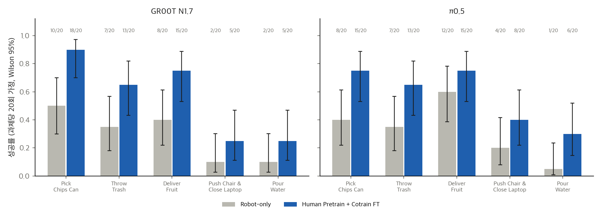
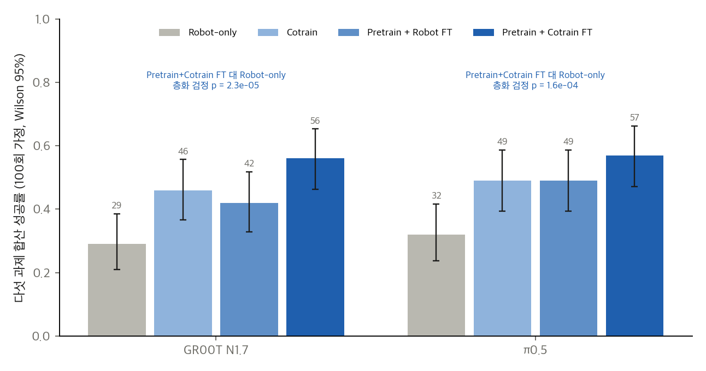
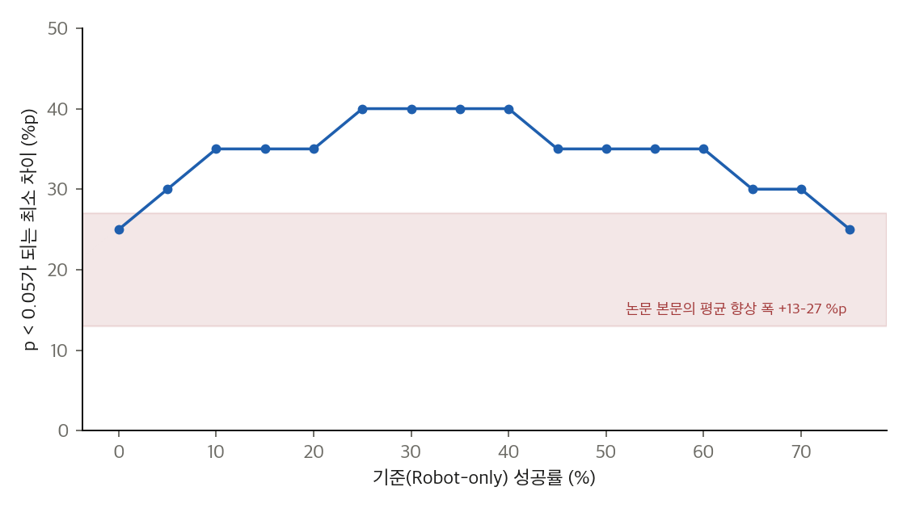
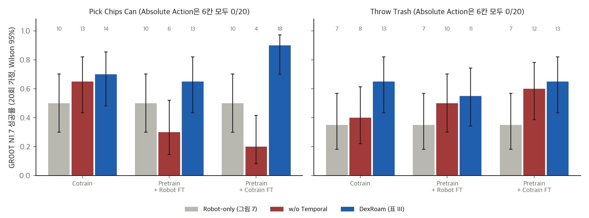
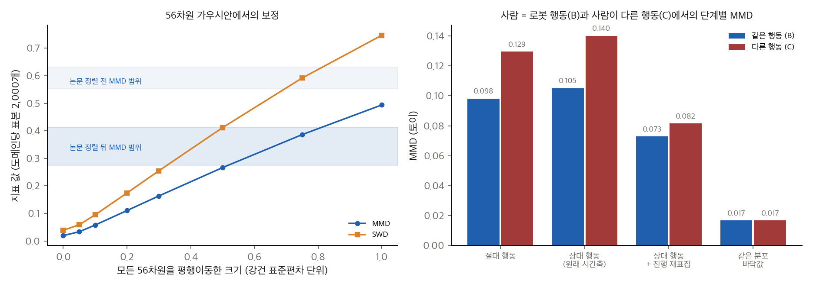

> **논문:** Rui Zhou, Yibo Yuan, Junkai Zhao 외. *DexRoam: Learning Mobile Bimanual Dexterous Manipulation from Egocentric Whole-Body Human Demonstrations.* CoRL 2026 포스터, arXiv:2609.35761 (v1, 2026-09-28).
> 공식 코드(MIT, 수집·정렬과 정책 학습 두 저장소)는 정적으로만 읽었고 실행하지 않았습니다. 논문 그림은 싣지 않고 우리가 만든 그래프만 씁니다.

## 논문이 묻는 것

모바일 양팔 다지 손 조작은 이동, 몸통, 팔, 머리, 손가락을 한 궤적에서 함께 제어해야 해서 로봇 시연을 모으기 어렵습니다. DexRoam은 VR 헤드셋과 머리 장착 스테레오 카메라만으로 사람의 전신 시연을 모으고, 몸체 정렬, 행동 의미 정렬(부위별 상대 변환), 시간 정렬(과제 진행 재표집)을 거쳐 같은 56차원 행동 공간으로 옮겨 GR00T N1.7과 π0.5에 로봇 데이터와 함께 학습시킵니다. 보고된 평균 성공률은 GR00T 29% → 56%, π0.5 32% → 57%입니다.

## 이 글에서 확인한 것

**정책 개선의 방향은 일관되고, 과제별 크기는 구분되지 않습니다.** 정책 평가는 과제당 20회로 적혀 있습니다(시행 수 20 가정). 다섯 과제 x 세 전략 x 두 백본의 30개 비교가 모두 Robot-only보다 높지만, 과제별 Fisher 검정에서 p < 0.05는 1개(GR00T Pick Chips Can, 10/20 대 18/20, p = 0.014)이고 Holm 보정 후에는 0개입니다. 다섯 과제를 합치면 Pretrain + Cotrain FT 대 Robot-only가 GR00T 56/100 대 29/100(p = 1.8e-4), π0.5 57/100 대 32/100(p = 6.0e-4)입니다. 전략 사이의 서열(Pretrain + Cotrain FT가 최고)은 합산에서도 구분되지 않습니다(대 Cotrain p = 0.20, 0.32).

그래프: 그림 7의 성공률 라벨을 옮기고 과제당 20회를 가정해 Wilson 95% 구간을 그렸습니다. 우리가 그린 그래프입니다.

그래프: 다섯 과제를 합친 성공률(100회 가정)과 Wilson 95% 구간. 우리가 그린 그래프입니다.

20회 대 20회 Fisher 검정에서 p < 0.05가 되려면 기준 성공이 2–12회일 때 35–40 %p의 차이가 필요합니다. 본문이 보고한 평균 향상(+13–27 %p)은 이보다 작아서, 합산에서만 뚜렷하게 나타나는 것이 자연스럽습니다.

그래프: 기준 성공률별로 20회 대 20회에서 p &lt; 0.05가 되는 최소 차이(Fisher 정확 검정). 우리가 그린 그래프입니다.

**절제 효과는 크지만 칸마다 고르지 않습니다.** 절대 행동은 6칸 모두 0/20입니다(Wilson 상한 칸당 16%). 시간 재표집을 빼면 6칸 합산이 82/120에서 53/120으로 내려갑니다(p = 2.5e-4). 칸별로는 Pick Chips Can의 Pretrain 두 설정(−35, −70 %p)과 Throw Trash Cotrain(−25 %p)이 합산을 이끌고, 나머지 3칸은 −5 %p 이내입니다. Pick의 Pretrain 두 설정은 시간 재표집을 빼면 Robot-only(10/20)보다 낮은 6/20, 4/20입니다. 평균 68.3% 대 44.2%의 차이는 정확한 값으로 24.2 %p입니다.

그래프: GR00T N1.7의 Robot-only(그림 7), 시간 재표집 제거, DexRoam(표 III) 성공 횟수와 Wilson 95% 구간(20회 가정). 우리가 그린 그래프입니다.

**같은 설정의 값이 표와 그림 사이에서 한 시행 정도 다른 곳이 있습니다.** 표 III의 Throw Trash Cotrain은 .65, 그림 7에서는 .60입니다. 그림 8의 π0.5 Throw Trash 50개 로봇 칸은 판독 값 60, 50이고 그림 7은 65, 55입니다(그림 판독 값). 그림 9의 원점 값은 그림 7의 GR00T와 두 칸만 같고 백본이 명시되지 않습니다. 평가 세션이 달랐을 가능성이 있으며 저자 확인이 필요합니다.

**"로봇 시연 50% 절감"의 비교는 로봇 25개 + 사람 50개 대 로봇 50개입니다.** GR00T에서는 6칸 모두 Robot-only 50개 이상이고(그림 판독 값), π0.5에서는 −5–+10 %p입니다. 총 시연은 75개 대 50개이고 사람 시연의 수집 비용은 논문에 없어서 비용 절감으로 옮길 수는 없습니다.

## 정렬 지표는 무엇을 재는가: 작은 토이

그림 6은 정렬 전후 MMD와 SWD가 평균 41.7%, 31.1% 줄었다고 보고합니다. 논문 부록의 정의대로 지표를 구현해, 56차원 가우시안에서 모든 차원을 옮겼을 때의 값(눈금)과, 사람과 로봇이 같은 행동을 하되 시연자 오프셋과 절반 길이가 있는 합성 데이터(우리 모형)에서의 단계별 값을 봤습니다. 같은 분포의 바닥값은 MMD 약 0.02이고, 논문의 정렬 뒤 MMD 0.27–0.41은 이 모형에서 모든 차원이 0.5–0.8 표준편차 어긋난 크기입니다. 합성 데이터에서는 상대 행동으로 바꾸기만 해서는 MMD가 줄지 않고 진행 재표집을 더해야 줄었으며(26%), 사람이 다른 행동을 하는 경우에도 정렬 뒤 값(0.073 대 0.082)은 크게 달라지지 않았습니다. 감소율은 표현 차이를 얼마나 없앴는지를 보여 주고, 정렬 뒤 행동이 얼마나 가까운지는 이 지표만으로 판단하기 어렵다는 뜻입니다. 토이는 우리가 만든 모형이어서 논문 값으로 옮겨 읽으면 안 됩니다.

그래프: 왼쪽은 56차원 가우시안 평행이동에 따른 MMD와 SWD, 오른쪽은 합성 데이터의 단계별 MMD. 우리가 그린 그래프입니다.

## 공식 코드와 논문의 차이

공식 저장소 두 개(수집·정렬 `e539387`, 정책 학습 `a82d2c9`)를 논문과 대조했습니다.

- 정렬 패키지의 출력은 절대 자세와 절대 베이스이고, 변환기는 이미 있어야 하는 상대 행동 키(`fk_poses_relative_action`, `relative_position`)를 읽습니다. 상대 행동을 만드는 코드는 두 저장소 어디에서도 찾지 못했습니다. 절제에서 0%가 나온 단계에 해당합니다.
- 변환기의 손 행동은 두 데이터에서 같은 키를 쓰지만 로봇은 관절 피드백, 사람은 리타게팅 명령입니다. 논문의 한계 절이 가리키는 지점입니다.
- π0.5 입력은 오른쪽 눈 영상을 `left_wrist_0_rgb` 슬롯에 넣습니다.
- GR00T 학습 스크립트는 GPU 1개, 전역 배치 12이고 표 IX는 4개, 24입니다. 학습률, 가중치 감쇠, 웜업, 스텝 수, 동결 구성과 π0.5의 값은 표와 같습니다.
- 평가(MMD, SWD, TCS), 세 훈련 전략의 데이터 혼합, 실로봇 코드는 공개되지 않았습니다. 공개 데이터는 한 과제의 로봇 에피소드 50개입니다.

## 구현 가능성

논문 수치의 재현은 Apple M4 Pro(24 GiB, CUDA 없음) 맥에서 불가능합니다. 수집은 Quest 3와 ZED Mini, 학습은 CUDA GPU, 평가는 Astribot + XHand 로봇이 필요합니다. 정렬의 기하와 시간 재표집은 CPU에서 구현·검증할 수 있고, 소규모 폐루프 시뮬레이션은 2–4주 규모로 추정합니다(측정 전).

## 한계와 맺음

이 글의 정책 검정은 본문의 "과제당 20회"를 가정했고 쌍체 정보가 없어 독립 검정을 썼습니다. 그림 8의 값은 그림 판독 값입니다. 주 결과의 로봇·사람 시연 수, 그림 9의 백본, 표 III과 그림 7의 값 차이, 상대 행동 생성 코드의 위치는 저자 확인이 필요합니다.

## 자료

- [통합 리포트 PDF](report/report_public.pdf)
- [DexRoam: Learning Mobile Bimanual Dexterous Manipulation from Egocentric Whole-Body Human Demonstrations 분석](analysis/01_paper_analysis.md)
- [02. 선행연구와 관련 자료: DexRoam](analysis/02_prior_work.md)
- [03. 수치 재계산과 토이 검증: DexRoam (arXiv:2609.35761 v1)](analysis/03_analysis.md)
- [04. 논문 ↔ 공식 코드 대조: DexRoam (정적 읽기만)](analysis/04_code_verification.md)
