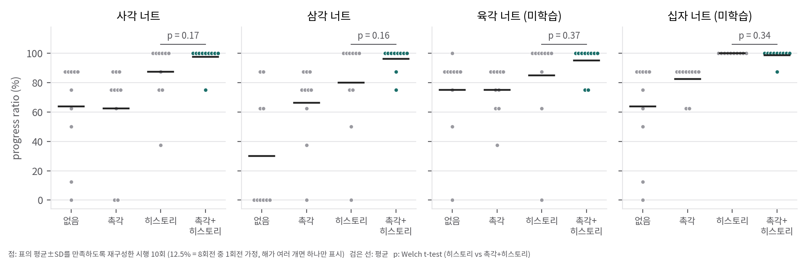

# 03. 재계산과 구조 분석

GPU 없이 할 수 있는 검증만 했습니다. 스크립트와 결과 파일은 다음과 같습니다.
- `analysis/stats_check.py` → `stats_check_results.json`
- `analysis/plot_stats.py` → `report/figures/stats_nut_dots.png`
- `analysis/priv_layout_check.py` → `priv_layout_{screwdriver,nutbolt}.json`

---

## 1. 실험 표의 통계 재계산

### 1.1 표 값은 내부적으로 일관된다 (GRIMMER식 재구성)
- **방법:** 시행 10회의 진행률이 g% 단위 값만 가질 수 있다고 가정합니다. 그런 값 10개를 고르는 모든 조합을 전수 탐색해서, 표의 (평균, 표본 표준편차)를 소수 둘째 자리까지 재현하는 조합이 있는지 확인했습니다.
- **결과:** Table I의 16칸이 **모두 g = 12.5%(8회전 중 k회전)로 재구성됩니다.** 그중 촉각+히스토리 4칸과 히스토리/십자 1칸은 해가 **유일**합니다. 예를 들어 사각 너트의 촉각+히스토리(97.5±7.91)는 "100% 9회, 75% 1회"로만 만들어집니다.
- **해석:** 숫자가 만들어진 흔적은 없습니다. 다만 논문은 "필요한 회전 수"를 적지 않았고, 여기서 8회전은 추론한 값입니다.
- **드라이버 표(Table II):** 한 가지 단위로 맞지 않으므로(예: 41.6과 87.5) 연속값으로 측정한 것으로 보고 재구성하지 않았습니다.

### 1.2 유의성

| 비교 | 너트별 Welch p | 4종 합산 (n=40) |
|---|---|---|
| 촉각+히스토리 vs 히스토리 | 0.17 / 0.16 / 0.37 / 0.34 | 순열 p 0.042–0.046, Mann-Whitney p 0.10–0.36 |
| 촉각 vs 없음 | 0.93 / **0.03** / 1.00 / 0.12 | |
| 히스토리 vs 없음 | 0.07 / **0.007** / 0.48 / **0.007** | |
| 드라이버: 촉각+히스토리 vs 히스토리 | 0.31 | |
| 드라이버: BC(없음) vs expert replay | 0.17 | |

- p값에 범위가 있는 이유는 재구성이 유일하지 않은 칸이 있어서, 가능한 조합 18개를 모두 계산했기 때문입니다.
- **실패 꼬리:** 진행률 75% 미만인 시행 수는 촉각+히스토리가 **0/40**, 히스토리가 **5–8/40**입니다(Fisher p 0.005–0.055).

**결론:**
- 촉각은 평균적인 성능보다 **최악의 경우(접촉을 잃고 회전이 멈추는 시행)** 를 없애는 데 기여합니다. 논문 Fig. 5의 정성적 설명(촉각이 있으면 엄지와 검지가 번갈아 닿는 패턴이 유지됨)과도 맞습니다.
- 히스토리는 더 큰 폭으로, 더 일관되게 기여합니다.
- "촉각이 필수적"이라는 주장은 현재 표본 크기로는 통계적으로 뒷받침되지 않습니다. 평균 차이 10%p를 80% 검정력으로 검출하려면 조건당 약 63회(σ=20 기준)가 필요하고, σ=13·차이 7.5%p라면 약 48회가 필요합니다.

---

## 2. Privileged info 인덱스 겹침의 영향

코드의 규칙을 그대로 재현해 보면, oracle 정책이 실제로 받는 벡터에서 각 항목이 살아남는 비율은 다음과 같습니다(`04` D1).

| 항목 | 드라이버 | 너트 |
|---|---|---|
| 물체 위치, 스케일, 질량, 마찰 | **0 / 6** | **0 / 6** |
| 물체 무게중심 | 2 / 3 | 2 / 3 |
| 물체 각속도, hand scale, 너트 접촉 | **0 / 5** (값을 쓰는 코드가 아예 없음) | **0 / 5** |
| 물체 자세·선속도, 손끝 상태(5개), 너트 위치·회전각·회전속도, 반발계수, 나사 마찰 | 전부 보임 | 전부 보임 |
| PD 게인, 손 관절·자세·위치 | 사용 안 함 | 전부 보임 |

**함의:**
- 논문은 privileged info의 대표 예로 "질량, 마찰, 무게중심"을 들고 RMA·Hora 계열의 설명을 따르지만, 공개 코드의 oracle은 **도메인 랜덤화한 동역학 파라미터 대부분을 보지 못합니다.**
- 그럼에도 oracle이 잘 학습된다는 것(Fig. 7)은, 성능 차이의 원천이 **너트 회전각·속도 같은 과제 진행 상태와 손끝 상태**라는 뜻일 가능성이 큽니다.
- 그렇다면 sensorimotor 정책이 30스텝 히스토리로 추정해야 하는 것도 "물리 파라미터"가 아니라 "현재 회전 진행 상황"입니다. 이 해석은 BC에서 히스토리 효과가 크게 나온 것과도 맞습니다.

---

## 3. 단순화 시뮬레이션이 실제로 빼먹은 것: 회전-하강 결합

- **나사의 운동학:** 실제 나사는 z = (p / 2π)·θ (p는 피치) 관계로 회전과 축 방향 이동이 묶여 있습니다. 회전 관절 모델은 이 결합을 끊어 버리므로, 시뮬레이션 정책은 제자리 회전만 배웁니다.
- **역할 분담:** 논문의 설계는 이 결합 하나를 **사람(텔레옵)과 BC가 대신 맡게** 한 것입니다. 사람이 손목을 내리면, BC는 촉각 패턴을 보고 언제 내릴지를 학습합니다.
- **대안:** 이 결합은 시뮬레이터에서 아주 싸게 넣을 수 있습니다. 예를 들어 MuJoCo는 `<equality><joint joint1="nut_z" joint2="nut_rot" polycoef="0 k 0 0 0"/>` 한 줄로 직선형 결합을 표현합니다. 그러면 "회전 + 하강"까지 시뮬레이션에서 학습한 정책을 텔레옵 기술로 쓸 수 있어, 사람의 부담이 더 줄어들 것으로 예상합니다(검증되지 않은 가설).
- **"불완전한 시뮬레이션"의 정확한 의미:** 정리하면 이 논문은 "모든 것이 부정확해도 된다"가 아니라, **"동작을 결정하는 운동학만 맞으면, 접촉 세부와 센서는 실제 데이터로 채울 수 있다"** 는 주장에 가깝습니다.

---

## 4. 행동 파라미터화와 텔레옵 데이터의 의미

- **RL 행동:** a_t = η·f(o) + a_{t−1}은 목표 관절각을 적분하는 형태입니다. |f| ≤ 1이므로 목표 속도는 η × 20 Hz로 묶입니다(드라이버 1.0 rad/s, 너트 0.83 rad/s). 이 상한이 실제 하드웨어에서 안전 장치 역할도 합니다.
- **BC 레이블:** BC가 기록하는 a^Hand는 **절대 목표 관절각**(π_RL의 출력, 정책이 꺼져 있으면 현재 관절각)입니다. 따라서 BC는 RL 정책의 증분 구조를 그대로 상속하지 않고 절대 위치 chunk를 예측합니다. 배포할 때 겹치는 chunk를 균등 평균하므로, 출력이 RL 정책보다 매끄러워지는 효과가 있을 것입니다.
- **"BC > expert replay"의 해석:** 논문은 filtered BC를 근거로 들지만, 공개된 변환 스크립트에는 성공 여부로 거르는 단계가 없습니다(앞뒤 구간 자르기만 있음). 가장 단순한 설명은 **open-loop 재생과 closed-loop 정책의 차이**입니다. replay는 같은 행동열을 다른 초기 상태에서 재생하므로 오차가 누적되고, BC는 관측에 반응합니다. 다만 두 값의 차이 자체도 p=0.17로 유의하지 않습니다.
