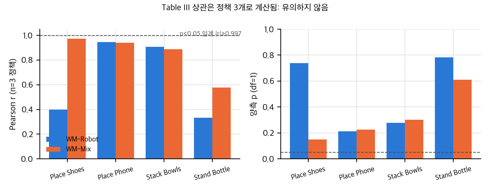
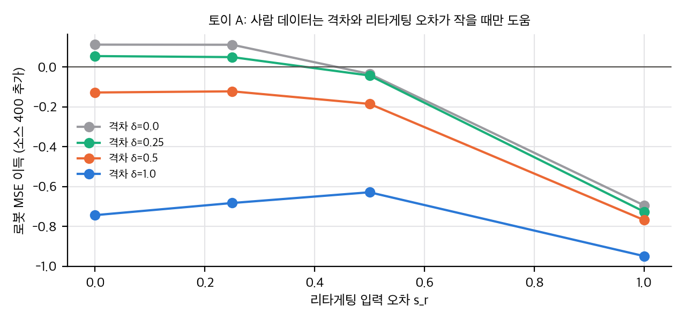
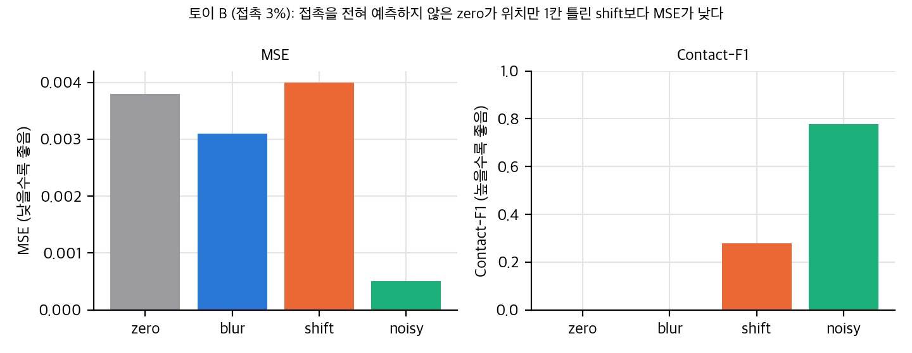

# DexTouch-WM: 사람 촉각 데이터는 로봇 세계모델을 돕는가

DexTouch-WM(arXiv:2609.20649 v2)은 사람 손과 로봇 손에 같은 압전저항 촉각 배치를 달고, 사람 손 motion을 로봇 행동 공간으로 리타게팅해서 세계모델을 학습하는 연구입니다. 로봇 데이터는 5시간으로 고정하고 사람 데이터를 0에서 100시간까지 늘렸을 때 로봇 도메인 예측이 좋아진다고 보고합니다.

이 글에서는 논문 표를 다시 계산하고, 정책 평가와 합성 데이터 실험의 통계를 점검했습니다. 결론부터 말하면, 스케일링 방향은 분명하지만 크기와 정책 평가는 확정하기 어렵습니다.

## 논문이 한 일

- 사람 장갑 촉각 360 taxel 중 320개를 쓰고(손끝 5개 4×4, 손바닥 15×16), 로봇 손에도 같은 배치를 달았습니다.
- 사전학습 비디오 DiT(Wan2.2-TI2V-5B)에 촉각 전문가를 Mixture-of-Transformers 방식으로 붙였습니다.
- 촉각은 초기 상태 대비 잔차로 예측하고, 행동은 첫 프레임 기준 상대 손목 motion과 손 관절로 표현했습니다.

## 재계산에서 확인한 것

- **스케일링 (Table I):** 로봇 5시간 고정, 사람 0→100시간에서 PSNR은 23.47→27.10 dB, Contact-IoU는 0.415→0.588로 올라갑니다. 표 값은 본문과 일치합니다. 다만 한 번만 학습한 값이고 시드나 분산이 없어 차이의 크기를 확정할 수 없습니다.
- **포화:** 시각 지표 PSNR은 +50시간에서 거의 포화합니다(+3.40 dB → +0.22 dB). 접촉 지표는 +100시간에서도 올라갑니다.
- **정책 평가 상관 (Table III):** 정책 3개로 계산한 Pearson은 p<0.05가 되려면 |r|≥0.997이어야 합니다. 본문 최댓값 0.972도 양측 p≈0.15입니다. 평균 0.844와 0.646의 차이는 검정할 수 없습니다.
- **시뮬레이터 편향:** 같은 정책과 과제 12셀에서 시뮬레이터 점수는 실제보다 평균 0.12~0.18 높습니다. 순위는 맞아도 성공률 절대값은 과대평가됩니다.
- **합성 데이터 (Table IV):** 실제 200개 대조와 실제 100 + 합성 100 비교라서 합성의 순효과가 아닙니다. FTP-1은 거의 같고, π0.5(−0.131)와 X-VLA(−0.100)는 떨어집니다.

그래프: Table III의 과제별 Pearson(정책 3개)과 양측 p값. 직접 계산.

## 사람 데이터가 도움이 되는 조건

사람 데이터는 도메인 격차가 작고 리타게팅 오차가 작을 때만 로봇 예측을 돕습니다. 간단한 선형 토이에서 소스 데이터를 400개 더했을 때 로봇 MSE 이득은 격차가 작고 입력 오차가 작은 경우에만 양수입니다. 논문은 리타게팅 오차를 측정하지 않았기 때문에 이 조건이 실제로 충족되는지 판단할 수 없습니다.

그래프: 토이. 소스 데이터 400개 추가의 로봇 MSE 이득을 격차와 리타게팅 오차에 따라 나타냄. 직접 계산.

## 희소 촉각에서 MSE를 믿으면 안 되는 이유

접촉이 3%뿐인 촉각 맵에서는 아무것도 예측하지 않는 zero 예측의 MSE가 0.0038입니다. 접촉 위치를 한 칸 틀린 예측은 MSE가 0.0040으로 zero보다 나쁘지만, 접촉 F1은 0.28입니다. MSE는 배경을 0으로 맞추는 능력을 크게 보상합니다. 그래서 접촉 지표를 함께 봐야 합니다. 논문이 Contact-IoU와 F1을 추가한 이유가 여기에 있습니다. 다만 논문은 접촉 임계값을 밝히지 않았습니다.

그래프: 토이(접촉 3%). MSE는 zero가 shift보다 낮지만 접촉 F1은 shift가 높음. 직접 계산.

## 구현 가능성

- 공식 재현은 불가능합니다. 코드, 가중치, 데이터가 공개되지 않았고, 촉각 장갑 두 벌과 사람 데이터 100시간이 필요합니다.
- 설계 아이디어(분할 촉각 토크나이저, 잔차 잠재, dual-rate 조건)는 논문만으로 새로 구현할 수 있습니다. 가장 큰 병목은 사람 장갑 데이터 수집과 리타게팅 파이프라인입니다.
- 학습 세부(스텝, 시드, λ_tac, 접촉 마스크 기준)가 빠져 있어 같은 수치를 재현하기는 어렵습니다.

## 한계와 주의점

- 워크숍 논문(라이트닝 토크)이라 실험 규모가 작습니다. 정책은 3개, 평가 과제는 4개입니다.
- 한 실행 결과이고 시드 분산이 없습니다.
- 사람 과제 수가 본문 두 곳에서 다릅니다(50과 54).
- 논문 그림은 라이선스(arXiv 비독점 배포)상 이 글에 넣지 않았습니다. 그래프는 모두 직접 계산한 결과입니다.

## 출처

- Qin et al., "DexTouch-WM: Learning Action-Conditioned Tactile World Models from Human Touch for Dexterous Robot Manipulation", arXiv:2609.20649 v2 (2026-09-18), IROS 2026 Workshop RoBoWoMo (Lightning Talk).
- 재계산과 토이 코드는 이 글과 함께 게시된 `git/` 폴더에 있습니다.

## 자료

- [통합 리포트 PDF](report/report_public.pdf)
- [DexTouch-WM 논문 분석 (arXiv:2609.20649)](analysis/01_paper_analysis.md)
- [DexTouch-WM 선행연구와 관련 저장소 (02)](analysis/02_prior_work.md)
- [DexTouch-WM 재계산, 유도, 토이 (03)](analysis/03_analysis.md)
- [DexTouch-WM 주장 검증 (04)](analysis/04_claim_verification.md)
