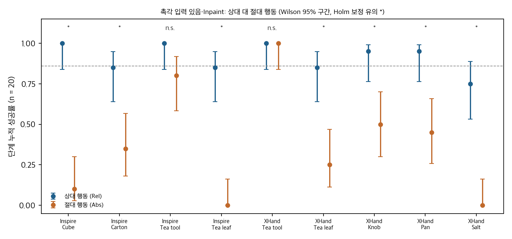
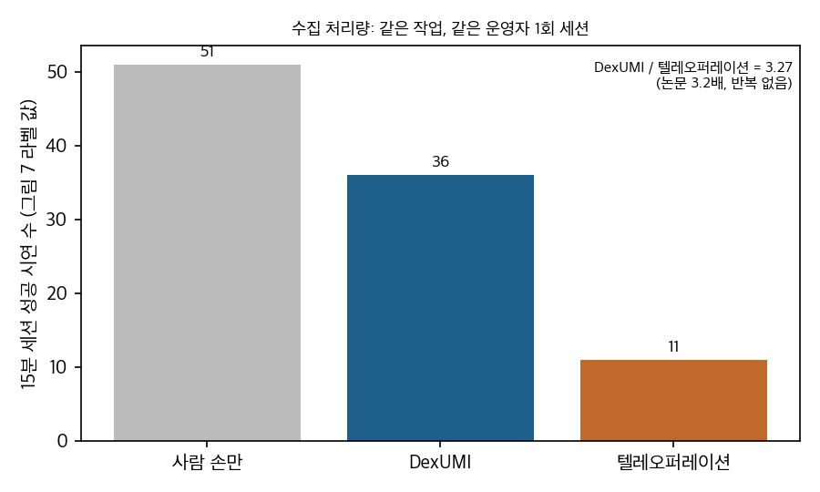

> **논문:** Mengda Xu, Han Zhang, Yifan Hou, Zhenjia Xu, Linxi Fan, Manuela Veloso, Shuran Song. *DexUMI: Using Human Hand as the Universal Manipulation Interface for Dexterous Manipulation.* CoRL 2025 (PMLR 305), arXiv:2505.21864 (v3, 2025-10-02).
> 공식 코드는 `real-stanford/DexUMI` (MIT)입니다. 이 글의 그림은 우리가 그린 그래프 두 장뿐입니다. 논문 그림은 arXiv 비독점 라이선스라서 싣지 않았습니다.

## 논문이 묻는 것

사람 손으로 보여 준 손재주를 로봇 손 데이터로 바꾸는 일은 어렵습니다. 원격조작은 공간이 어긋나고 힘 피드백이 없습니다. 손 재타겟팅은 접촉을 왜곡합니다.

DexUMI는 사람 손에 끼우는 외골격을 씁니다. 외골격은 로봇 손의 손끝 작업공간에 맞춰 설계합니다. 관절 엔코더로 손 행동을 읽고, 손목 자세는 iPhone으로 읽습니다. 영상에서는 사람 손과 외골격을 지우고 로봇 손을 그려 넣습니다. 그래서 로봇 없이 모은 데이터를 로봇 손 정책에 씁니다.

## 이 글에서 확인한 것

- **초록의 86%는 표 1에서 나옵니다.** 최종 단계 다섯 셀 (Inspire 큐브 1.00, 카턴 0.85, 차 잎 0.85, XHand 차 잎 0.85, 소금 0.75)의 평균이 0.86입니다. 논문은 이 평균의 정의를 쓰지 않았습니다.
- **상대 행동의 우위는 촉각이 있을 때 뚜렷합니다.** 촉각이 있으면 아홉 열 중 일곱 열에서 상대 행동이 유의하게 높습니다 (Holm 보정, 열별 Fisher 검정). 촉각이 없으면 유의한 열이 없습니다. 본문의 "모든 과제에서 일관되게 더 좋다"는 촉각이 없는 조건의 결과(유의한 열 없음, 한 열은 절대 행동이 높음)와 맞지 않습니다.
- **촉각 서술이 표와 맞지 않는 곳이 있습니다.** XHand의 열 개 셀 중 촉각 때문에 나빠진 셀은 세 개뿐이어서 "대부분 나쁘게 한다"는 서술과 맞지 않습니다. 소금 집기에서 촉각의 효과는 가장 큽니다 (15/20 대 3/20).
- **시각 적응의 효과는 확실합니다.** 배경 복원과 로봇 손 합성은 마스크만 쓰는 방법보다 Inspire 큐브와 카턴에서 훨씬 높습니다 (37/40 대 14/40).
- **통계는 약합니다.** 셀마다 20회 평가이고, 학습 반복과 시드 보고가 없습니다. 20회로는 0.25–0.30보다 작은 차이를 가려내기 어렵습니다.

그림: 표 1의 상대 대 절대 행동 (촉각 있음, Inpaint, 최종 단계 열). 점은 성공률, 세로선은 Wilson 95% 구간, 점선은 초록의 86%. 우리가 그린 그래프입니다.

## 코드와 논문이 다른 곳

공식 저장소를 읽었습니다 (실행하지 않았습니다).

- **외골격 설계 식 (1):** 논문은 두 방향의 작업공간 유사도를 씁니다. 코드는 한 방향의 궤적 손실이고 거리 척도도 다릅니다.
- **XHand 설계:** 최적화 코드와 결과는 Inspire만 있습니다. XHand 외골격은 저장소에서 재현할 수 없습니다.
- **촉각 입력:** 코드는 FSR을 임계값으로 0과 1로 바꿉니다. 논문 본문에는 이 내용이 없습니다.
- **기본 설정:** 저장소의 기본 설정은 절대 행동이고 촉각이 꺼져 있습니다. 논문의 주 설정은 상대 행동과 촉각을 씁니다. 설정 파일의 에폭은 10000이고, 논문은 400이라고 씁니다.

상대 행동 계산, 분할과 복원의 순서, 교집합 마스크로 가림을 처리하는 규칙은 코드에서도 확인했습니다.

## 수집 효율과 한계

그림 7에서 15분 세션의 성공 시연 수는 사람 손 51, DexUMI 36, 텔레오퍼레이션 11입니다. 36/11 = 3.27이므로 논문의 3.2배와 맞습니다. 다만 과제 하나, 세션 하나의 결과입니다.

그림: 그림 7의 막대 값 (텍스트 레이어에서 추출). 세션 반복이 없어서 구간은 없습니다. 우리가 그린 그래프입니다.

논문이 스스로 밝힌 한계도 중요합니다. 손마다 외골격을 다시 설계해야 하고, 엔코더는 3D 프린트 재료가 변형되면 손의 움직임을 놓치며, 촉각 센서는 드리프트합니다.

## 이 맥에서 할 수 있는 것

외골격 제작, 두 손, 실로봇 평가는 이 맥에서 할 수 없습니다. 식 (1) 최적화를 Inspire 기준으로 CPU에서 다시 돌리는 일은 가능합니다. 정책 학습은 무거워서 MPS에서 시간을 재 본 뒤 판단해야 합니다.

## 정리

DexUMI의 핵심 주장, 즉 상대 행동과 촉각의 조합과 시각 적응은 표에서 확인됩니다. 다만 촉각에 대한 서술, 시드 없는 통계, 식 (1)의 구현 차이는 읽을 때 조심해야 합니다.

## 자료

- [통합 리포트 PDF](report/report_public.pdf)
- [01. 논문 분석: DexUMI](analysis/01_paper_analysis.md)
- [02. 선행 연구와 공식 저장소](analysis/02_prior_work.md)
- [03. 수치 재계산, 통계 검정, 일관성 검사](analysis/03_analysis.md)
- [04. 논문 ↔ 공식 코드 대조와 구현 가능성](analysis/04_code_verification.md)
