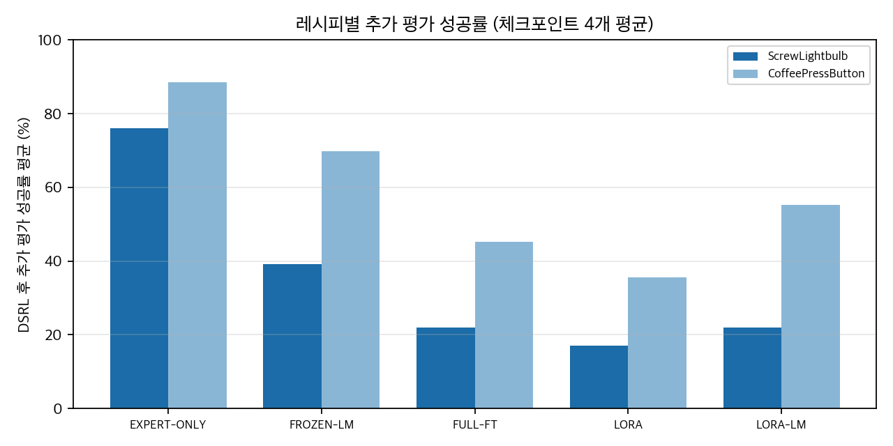
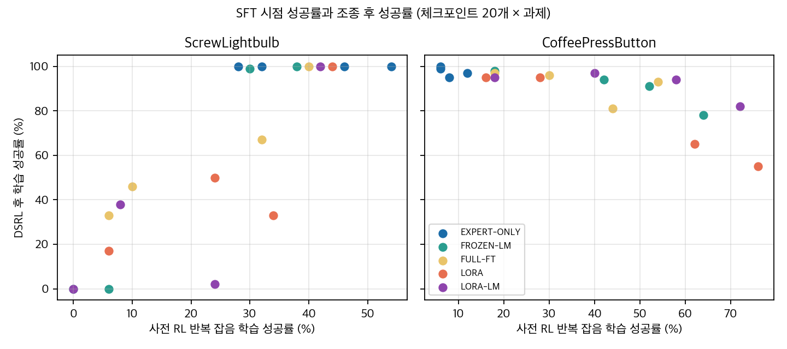
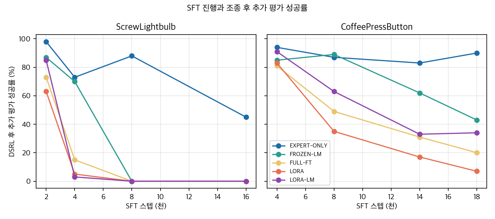

*Finetuning VLAs for Dexterous Manipulation: The Right Checkpoint Is All You Need* (Kuramshin, Cloutier, Przystupa, Ellis, Akhter, Berseth; arXiv:2611.23676, 2026-11-18). 이 글은 논문 표를 다시 계산하고 주장을 대조한 검토입니다. 학습이나 시뮬레이션은 돌리지 않았습니다.

## 한 줄 요약

SFT 성공률과 조종 후 성공률의 관계는 과제마다 다릅니다. 논문의 권고(VLM 동결, 액션 전문가 학습, SFT 성공률로 고르지 않기)는 표 수치로 대체로 뒷받침되지만, 일부 문장은 표와 맞지 않고 근거는 레시피당 한 번의 SFT 실행입니다.

## 논문이 한 것

- 세 가지 미세조정 축을 조합한 다섯 레시피를 π0.5에 적용했습니다: VLM을 얼림(EXPERT-ONLY), 시각 인코더만 풀음(FROZEN-LM), 전부 학습(FULL-FT), LoRA 두 종류(LORA, LORA-LM).
- 각 SFT 체크포인트 4개를 DSRL (잠재 잡음 공간에서 SAC로 행위자를 학습)로 조종하고, 조종 전후 성공률을 두 과제(LEAP 손 시뮬레이션: 커피머신 버튼 누르기, 전구 나사 돌리기)에서 비교했습니다.

## 재계산해서 확인한 것

그래프: 레시피별 DSRL 후 추가 평가 성공률 평균 (체크포인트 4개, 논문 표 5의 값으로 다시 계산). 우리가 그린 그래프입니다.

- **EXPERT-ONLY가 가장 조종하기 좋습니다.** 학습 배치 성공률은 두 과제 모두 95–100%이고, 추가 평가 평균은 82%입니다. 가장 낮은 LoRA는 26%입니다.
- **SFT 성공률의 예측력은 과제마다 다릅니다.** 커피 과제에서는 반복 잡음 SFT 성공률과 조종 후 성공률이 강하게 음의 상관입니다(r = −0.75, p < 0.001). 전구 과제에서는 같은 열이 강하게 양의 상관입니다(r = +0.84, p < 0.001). 논문의 "양의 상관 없음"은 전구 과제 반복 잡음 열에서 맞지 않습니다.

그래프: SFT 시점 반복 잡음 학습 성공률 대 DSRL 후 학습 성공률 (체크포인트 20개 × 과제). 우리가 그린 그래프입니다.

## 표와 맞지 않는 문장

- "커피 과제에서 FROZEN-LM이 SFT 성공률이 가장 높다"는 문장은 어느 측정에서도 맞지 않습니다. 최고는 LoRA-LM(i.i.d. 88%)과 LoRA(반복 잡음 76%)입니다.
- "LoRA가 가장 덜 조종 가능하다"는 추가 평가 기준으로만 성립합니다. 학습 평가에서는 LoRA와 LoRA-LM이 63.8%와 63.5%로 구별되지 않습니다.
- 부록의 "EXPERT-ONLY의 반복 잡음 성공률 6–12%"는 커피 과제에만 맞고, 전구 과제에서는 28–54%입니다.

## 분모와 불확실성

사전 RL 수치의 분모(학습 50회, 전구 추가 평가 40회)는 부록 D와 맞습니다. 사후 RL 수치는 3시드 평균뿐이고 분모와 시드별 값이 없어 구간을 만들 수 없습니다. 레시피당 SFT가 한 번뿐이라 레시피 효과와 실행 효과를 나눌 수 없습니다. 이 점은 논문 스스로 밝힌 한계입니다.

그래프: 체크포인트별 DSRL 후 추가 평가 성공률 (논문 표 5 값). 우리가 그린 그래프입니다.

## 재현할 수 있는가

이 맥(Apple M4 Pro, 24 GiB, CUDA 없음)에서 원 실험은 재현할 수 없습니다. π0.5 SFT와 DSRL 120회 실행은 GPU 클러스터가 필요합니다. 시뮬레이션 자산과 데모 데이터도 공개되지 않았습니다. 공식 코드는 아직 찾지 못했습니다. 표 재계산과 통계 검사는 CPU로 끝냈습니다.

## 정리

체크포인트를 고를 때 SFT 롤아웃 성공률만 보면 조종 후 성능을 놓칠 수 있다는 논문의 문제 제기는 설득력이 있습니다. 다만 권고를 따르기 전에 레시피당 여러 SFT 시드와 시드별 조종 결과가 필요합니다. 공식 코드가 공개되면 정적 대조를 다시 하겠습니다.

## 자료

- [통합 리포트 PDF](report/report_public.pdf)
- [01. 논문 분석](analysis/01_paper_analysis.md)
- [02. 선행연구, 코드, 관련 분석](analysis/02_prior_work.md)
- [03. 재계산과 일관성 검사](analysis/03_analysis.md)
- [04. 주장 검증 (공식 코드 없음)](analysis/04_claim_verification.md)
