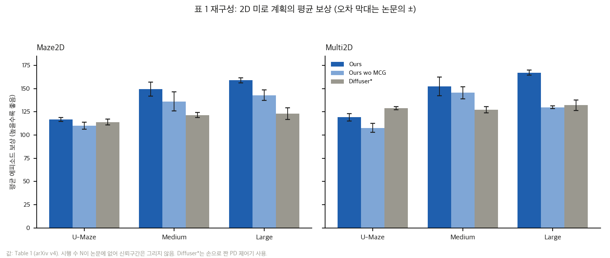
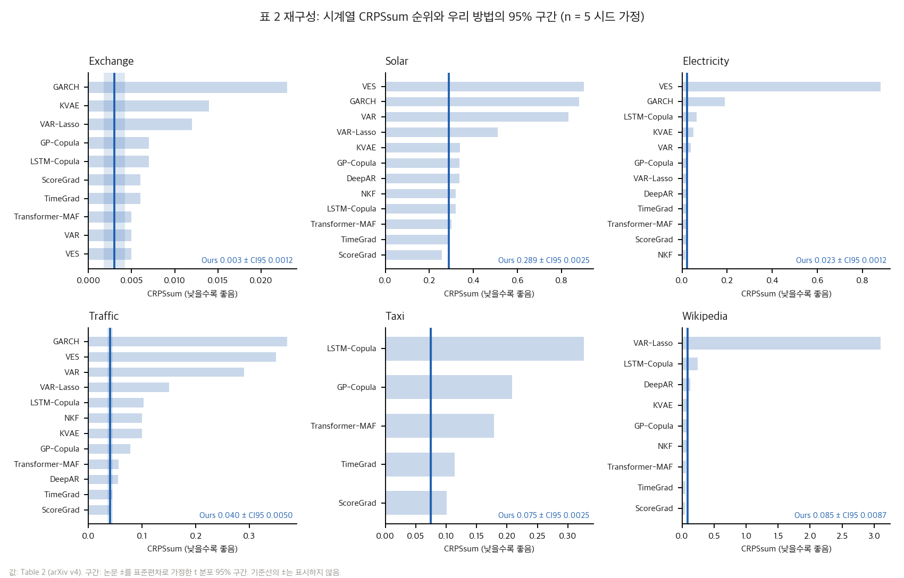

> **논문:** Boyuan Chen, Diego Martí Monsó, Yilun Du, Max Simchowitz, Russ Tedrake, Vincent Sitzmann. *Diffusion Forcing: Next-token Prediction Meets Full-Sequence Diffusion.* NeurIPS 2024, arXiv:2407.01392 (v4, 2024-12-10).
> 공식 코드는 GitHub buoyancy99/diffusion-forcing(MIT)에 있습니다. 이 글의 그림은 우리가 표 값으로 그린 그래프뿐입니다. 논문 그림은 넣지 않았습니다.

## 논문이 묻는 것

다음 토큰 예측은 길이가 자유롭고 조건을 주기 쉽습니다. 그런데 샘플링을 목표에 맞게 유도하기 어렵고, 영상처럼 연속 데이터에서는 학습 길이를 넘어서면 오차가 쌓여 발산합니다. 전체 시퀀스 확산은 궤적을 목표에 맞게 유도하기 쉽지만 길이와 조건을 유연하게 다루기 어렵습니다.

Diffusion Forcing(DF)은 두 장점을 하나의 모델로 합칩니다. 핵심은 **시퀀스의 토큰마다 다른 잡음 수준을 주고, 잡음 섞인 토큰들을 함께 복원하도록 학습하는 것**입니다. 잡음 수준이 0이면 깨끗한 토큰이고 최댓값이면 완전히 가려진 토큰입니다. 그래서 잡음 수준은 마스크처럼 쓸 수 있습니다. 샘플링할 때 토큰마다 잡음 수준을 정하는 스케줄 행렬을 바꾸면, 같은 모델로 다음 토큰 예측, 전체 시퀀스 확산, 그 사이의 조합을 고를 수 있습니다.

## 공식 코드와 맞는 부분

코드를 얕게 받아 정적으로 읽었습니다(실행하지 않았습니다). 프레임마다 독립 잡음을 `randint`로 뽑고, 관측이 없는 토큰은 최대 잡음으로 두며, 샘플링은 확산 DDIM을 씁니다. 노이즈 스케줄(영상 sigmoid, 미로 linear, 나머지 cosine)과 DDIM 단계 수(영상 100, 나머지 50)도 논문 부록과 맞습니다.

다만 공식 저장소는 두 브랜치로 나뉩니다. 최신 `main`은 트랜스포머 재구현이고, 논문 실험 코드(미로 계획, 시계열, 로봇)는 `paper` 브랜치에 있습니다. 논문 표를 맞춰 보려면 `paper` 브랜치를 기준으로 봐야 합니다.

## 표를 다시 계산하니

**계획 실험(표 1).** 평균 행은 원자료와 맞습니다. 평균 보상 1위는 DF입니다. MCG를 빼면 대부분 환경에서 성능이 떨어집니다. 그런데 본문이 말하는 "모든 6개 환경에서 기준선보다 낫다"는 맞지 않습니다. 다중 목표 U-Maze에서 Diffuser*(128.9)가 DF(119.1)보다 높습니다. Diffuser*는 PD 제어기를 손으로 붙인 조건이라 비교 조건이 다르다는 점도 함께 봐야 합니다.

*그림 1. 표 1의 2D 미로 계획 평균 보상과 논문의 ±. 우리가 그린 그래프입니다. 시행 수가 논문에 없어 신뢰구간은 그리지 않았습니다.*

**시계열(표 2).** 다섯 번 시드를 돌린 평균 ± 표준편차로 95% 구간을 다시 계산했습니다. 본문은 Wikipedia에서 DF가 4위라고 씁니다. 표를 세면 5위입니다. Solar, Electricity, Wikipedia에서는 ScoreGrad가 확실히 낫습니다. Exchange와 Taxi에서는 DF가 확실히 낫습니다.

*그림 2. 표 2의 CRPSsum 순위와 DF의 95% 구간(n = 5 가정). 우리가 그린 그래프입니다.*

**로봇 성공률.** 본문은 DF 80%, 가림 시 76%, 기준선 48%를 보고합니다. 그런데 시행 수가 없습니다. 시행 수를 20으로 가정하면 두 구간이 0.53–0.70에서 겹칩니다. 50으로 가정하면 겹치지 않습니다. 시행 수를 밝히지 않은 결과는 판단을 어렵게 합니다.

**영상.** 학습 길이를 넘어 안정적으로 롤아웃한다는 주장은 그림으로만 보여 줍니다. FVD나 LPIPS 같은 정량 지표는 없습니다.

## 재현할 수 있는가

이 맥(Apple M4 Pro, MPS)에서는 **구조 재구현은 가능하고, 표 수치를 다시 얻는 것은 대부분 불가능**합니다.

- 미로와 시계열은 논문 기준 2080Ti에서 4–8시간입니다. 작은 데이터셋이나 체크포인트 평가는 시간을 재어 본 뒤 정할 수 있습니다.
- 영상은 A100 8장에서 12시간입니다. 실로봇 데이터와 코드는 공개되지 않았습니다.

## 정리

Diffusion Forcing은 잡음을 마스크로 쓰는 간단한 아이디어에 샘플링 스케줄을 얹어 여러 방식을 한 모델로 묶습니다. 구조는 공식 코드와 맞고, 계획 실험의 주장은 대부분 맞습니다. 반면 시계열 순위 한 곳과 계획 기준선 한 곳은 본문과 표가 다릅니다. 영상과 로봇 주장은 정량 근거를 더 봐야 합니다.

## 출처

- 논문: arXiv:2407.01392 (CC BY 4.0). 학회: NeurIPS 2024, proceedings.neurips.cc.
- 코드: github.com/buoyancy99/diffusion-forcing (MIT).
- 재계산 스크립트와 결과: `analysis/recompute.py`, `analysis/recompute_results.json` (게시 패키지 `git/` 안).

## 자료

- [통합 리포트 PDF](report/report_public.pdf)
- [01. 논문 분석: Diffusion Forcing](analysis/01_paper_analysis.md)
- [02. 선행연구, 공식 코드, 이 저장소와의 관계](analysis/02_prior_work.md)
- [03. 수치 재계산과 일관성 검사](analysis/03_analysis.md)
- [04. 논문과 공식 코드 대조](analysis/04_code_verification.md)
