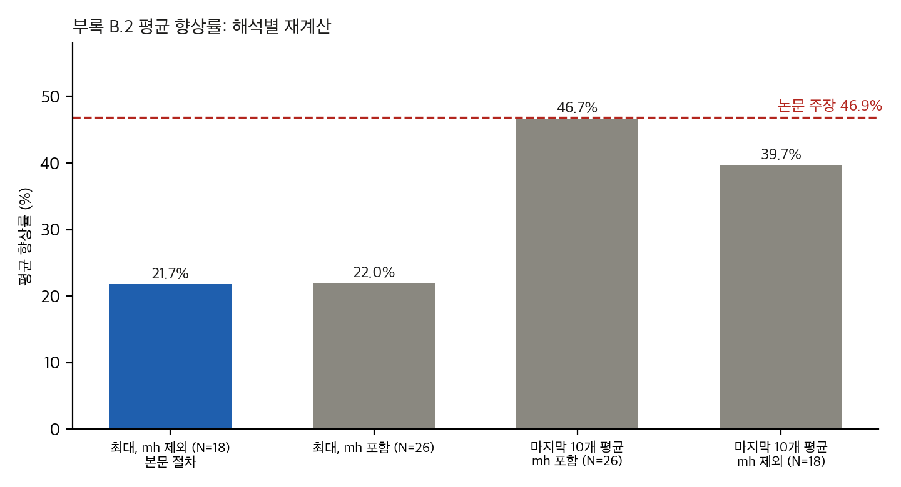
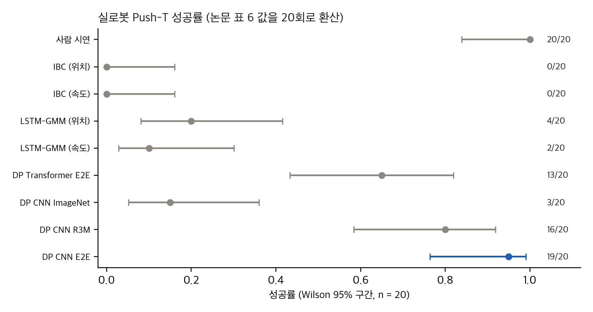

# 03. 재계산과 일관성 검사

이 문서는 논문 표 값을 다시 계산하고 본문과 맞춰 본 결과입니다. 재현 실험은 하지 않았습니다. 시뮬레이션과 학습은 돌리지 않았고, 표 값과 본문만 씁니다. 계산은 `analysis/recompute.py`(수 초, numpy와 scipy)이고 결과는 `analysis/recompute_results.json`입니다. 점검 번호 V1–V26은 이 문서의 내부 번호입니다.

## 0. 입력 값과 전제

- 표 1, 2, 4는 `paper/paper.txt`의 레이아웃 텍스트(`pdftotext -layout`)에서 옮겼습니다. 표 6과 표 5도 같은 방식입니다. 열 머리글과 값의 대응은 쪽별 레이아웃으로 다시 확인했습니다.
- 표 1과 2의 값은 (최대 성능 / 마지막 10개 체크포인트 평균) 두 개입니다. 표 4는 한 개입니다.
- 표 6의 성공률은 n = 20으로 환산했습니다 (0.95 → 19/20 등). 본문의 시도 수 20회와 맞습니다. 사람 시연의 성공률 1.00도 20/20으로 두었습니다. 이것은 가정입니다.
- 시뮬레이션의 n은 표 1 주석에 따라 3 시드 × 50 초기 조건 = 150입니다. 하지만 본문 각주는 로봇믹 과제에서 **22개 초기 조건만** 썼다고 합니다. 그러면 n = 3 × 22 = 66입니다 (V19). 이 불일치 때문에 시뮬 구간은 두 가정 중 보수적인 쪽을 씁니다.

## 1. 부록 B.2 평균 향상률 46.9% (V1)

부록 B.2의 절차는 다음과 같습니다. 각 과제 열 i에서 기준선의 최대 성능 `max baseline_i`와 DP의 최대 성능 `max ours_i`를 찾고, `(ours − base) / base`를 평균합니다. "mh 결과는 무시한다"고 적혀 있습니다.

| 해석 | N | 평균 향상률 |
|---|---|---|
| **본문 절차 그대로**: 최대 성능, mh 제외 (표 1 ph 6열 + 표 2 ph 6열 + 표 4 6열) | 18 | **21.7%** |
| 최대 성능, mh 포함 (표 1·2 각 10열 + 표 4 6열) | 26 | 22.0% |
| 마지막 10개 평균, mh 제외 | 18 | 39.7% |
| 마지막 10개 평균, mh 포함 | 26 | 46.7% |
| **논문 주장** | - | **46.9%** (0.46858) |

- **판정: 본문 절차로는 재현되지 않습니다 (V1).** 최대 성능 기준이면 평균 향상률이 22% 안팎입니다. 46.9%에 가장 가까운 값은 마지막 10개 평균에 mh를 넣은 46.7%입니다. 그런데 이 방식은 B.2 문장과 맞지 않습니다.
- 가능한 설명: (a) B.2 문장이 실제 계산과 다르다, (b) 열 구성이 다르다 (예: 과제 수 12 또는 15와 다른 평균), (c) 표 값이 최종본과 다르다. 확정하지 못했습니다. 공식 저장소의 `multirun_metrics.py` 집계 키 (`max`, `k_min_train_loss`)와 비교해야 하지만, 로그는 받지 않았습니다 (`04` D8).
- 해석: "평균 46.9%"는 **집계 방식에 따라 22%에서 47%까지 바뀌는 숫자**입니다. 인용할 때는 집계 방식을 밝혀야 합니다.

## 2. 본문의 개별 향상률 (V2)

| 주장 (본문) | 계산 | 결과 |
|---|---|---|
| BlockPush p2 +32% (§5.3) | DP-T 0.94 대 BET 0.71 → (0.94 − 0.71) / 0.71 | **+32.4%, 일치** |
| Kitchen p4 +213% (§5.3) | DP-C 0.99 대 BET 0.44 → +125%. 대 LSTM-GMM 0.34 → +191% | **재현 안 됨** (두 기준선 모두 213%보다 낮음) |

- Kitchen p4에서 213%를 맞추려면 기준선 값이 약 0.32여야 합니다. 표 4에서는 그런 값이 없습니다. 본문 또는 표에 오류가 있을 가능성이 있습니다.

## 3. 실로봇 성공률 통계 (V3–V5)

표 6 Push-T (20회 기준). Wilson 95% 구간과 두 집단 Fisher 정확 검정입니다. 다중 비교는 Holm으로 보정했습니다.

| 방법 | 성공 | 률 | Wilson 95% | 대 DP E2E (Fisher p) | Holm 보정 |
|---|---|---|---|---|---|
| 사람 시연 | 20/20* | 1.00 | [0.84, 1.00] | - | - |
| **DP CNN E2E** | **19/20** | **0.95** | **[0.76, 0.99]** | - | - |
| DP CNN R3M | 16/20 | 0.80 | [0.58, 0.92] | 0.34 | 0.34 |
| DP Transformer E2E | 13/20 | 0.65 | [0.43, 0.82] | 0.044 | 0.087 |
| DP CNN ImageNet | 3/20 | 0.15 | [0.05, 0.36] | 4e-7 | < 0.001 |
| LSTM-GMM (위치) | 4/20 | 0.20 | [0.08, 0.42] | 2e-6 | < 0.001 |
| LSTM-GMM (속도) | 2/20 | 0.10 | [0.03, 0.30] | - | - |
| IBC (위치, 속도) | 0/20 | 0.00 | [0.00, 0.16] | 3e-10 | < 0.001 |

\* 사람 시연 20/20은 표의 1.00을 환산한 가정입니다.

- **V3–V4 판정.** 엔드투엔드 CNN이 기준선 (IBC, LSTM-GMM)과 다른 인코더 (ImageNet, Transformer E2E)보다 높다는 방향은 맞습니다. 그러나 **R3M 대비 차이는 통계적으로 확인되지 않습니다 (p = 0.34)**. Transformer E2E 대비는 보정 후 0.087이라 0.05에서 유의하지 않습니다. "엔드투엔드가 최고"라는 본문은 방향만 맞습니다.
- 사람과의 비교 (IoU 0.80 대 0.84)는 n = 20이라 결론을 내리기 어렵습니다. 19/20의 구간 하한은 0.76입니다.
- 실로봇 과제 성공률 (본문 절)은 모두 20회입니다.
  - Egg Beater 11/20 = 0.55, Wilson [0.34, 0.74]
  - Mat Unrolling 15/20 = 0.75, Wilson [0.53, 0.89]
  - Shirt Folding 15/20 = 0.75, Wilson [0.53, 0.89]
  - Mug Flip 18/20 = 0.90, Wilson [0.70, 0.97]. LSTM-GMM 0/20 대 비교 Fisher p = 3.4e-9.
  - 소스 붓기와 펴기는 시도 수가 없습니다. 커버리지 0.74 대 0.79, 0.77 대 0.79는 구간을 계산하지 못합니다 (V20).
- 해석: 20회 실험에서 차이를 0.1 이내로 가리는 것은 불가능합니다. 실로봇 표가 "상당한 차이"를 주장하는 곳은 기준선과의 차이이고, 기준선 사이의 차이는 실험 규모가 부족합니다.

## 4. 시뮬레이션 표의 근사 구간 (V6, V19)

표 1은 "마지막 10개 체크포인트의 평균"입니다. 평균된 값은 독립 이항 표본이 아니라서, 아래 Wilson 구간은 **시드 간 분산을 빼고 계산한 근사**입니다. 구간이 실제보다 좁게 나옵니다.

| 열 (마지막 10개 평균) | DP-T | 기준선 | 근사 Wilson (DP-T) | 근사 Wilson (기준선) |
|---|---|---|---|---|
| Transport mh (n = 66) | 0.35 | LSTM-GMM 0.20 | [0.25, 0.47] | [0.12, 0.31] |
| Square mh (n = 66) | 0.81 | LSTM-GMM 0.59 | [0.69, 0.88] | [0.47, 0.70] |
| Lift mh (n = 66) | 1.00 | BET 0.99 | [0.95, 1.00] | [0.92, 1.00] |

- Transport mh와 Square mh의 구간은 겹칩니다. 시드 분산을 넣으면 더 넓어집니다. 이 값으로 "확실한 우위"를 말할 수 없습니다.
- 표 2 ToolHang (시각, 마지막 10개 평균): DP-T 0.47 대 LSTM-GMM 0.49 (V9). DP-T가 LSTM-GMM보다 낮습니다. 최대 성능은 DP-T 0.76 대 0.68로 높습니다. 본문 §5.3의 "모든 과제에서 일관된 개선"과 맞지 않는 점입니다.

## 5. 일관성 검사 (본문과 표, 본문과 본문)

| ID | 확인 항목 | 본문 | 표 또는 다른 곳 | 판정 |
|---|---|---|---|---|
| V1 | 평균 향상률 46.9% | §1, §5.3, 초록, B.2 | 본문 절차 재계산 21.7% | **불일치** (§1) |
| V2 | Kitchen p4 +213% | §5.3 | 표 4: +125% (BET), +191% (LSTM) | **불일치** (§2) |
| V2b | BlockPush p2 +32% | §5.3 | 표 4: +32.4% | 일치 |
| V7 | "모든 과제와 변형에서 우위" | §5.3 | 최대 성능 기준 DP (최고 변형)가 기준선보다 낮은 열: 없음. 표 1 동률 4열 (Lift·Can ph/mh, 1.00), 표 2 동률 3열 (Lift ph/mh, Can ph, 1.00). 평균 기준 DP-T가 낮은 열: 표 2 ToolHang (V9) | **부분 일치** |
| V8 | DP 전 변형이 기준선보다 낫다 | §5.3 | 표 4 DP-C가 BlockPush p1 (0.36 대 BET 0.96), p2 (0.11 대 0.71)에서 낮음. 표 1 DP-C ToolHang (0.50/0.30 대 LSTM 0.67/0.31)도 낮음 | **불일치 (DP-C)**. DP-T로 한정하면 맞음 |
| V9 | 표 2 ToolHang 평균 | 캡션 "특히 Transport와 ToolHang에서 개선" | DP-T 0.47 < LSTM 0.49 (평균), DP-C 0.73 > 0.49 | 변형에 따라 다름 |
| V10 | 비전 인코더 (표 5) | "미세조정이 전체적으로 최고", "동결 사전학습은 성능 낮음" | ResNet-18은 처음부터 0.94 > 미세조정 0.92. ResNet-34는 미세조정 0.94 > 처음부터 0.92. ViT 동결 0.70 > ViT 처음부터 0.22 | **부분 일치**. "전체적으로"는 ViT에서만 뚜렷함 |
| V11 | 실로봇 과제 수 | §6 "4 tasks across 2 hardware setups" | §6 이후 절은 7개 (Push-T, 머그, 붓기, 펴기, Egg Beater, Mat, Shirt). 시뮬 8 + 실로봇 7 = 15 (초록과 일치) | **§6 첫 문장이 v4 기준으로 남은 문장** (v4 텍스트에 같은 문장 있음, `01` §0) |
| V12 | 과제 수 메타데이터 | arXiv 초록 페이지 "12" | PDF 초록 "15", v4 "12", v1 "11" | **메타데이터 불일치** (arXiv 웹 초록이 v4 기준) |
| V13 | BlockPush 제어 방식 | §5.2 "DP는 위치 제어" | 표 7 CNN: Pos, 표 8 Transformer: Vel | **표 사이 불일치** |
| V14 | Kitchen 시연 수 | §5.1 "566 demonstrations" | 표 3 #PH = 656 | **불일치** |
| V15 | DDIM 추론 단계 | §3.4 "학습 100, 추론 10, 0.1초" | 표 7 시뮬 추론 100, 실로봇 16 | **불일치** (설정이 과제별로 다름) |
| V16 | 실로봇 Push-T 성공률 | §6 "95%, IoU 0.80 대 0.84" | 표 6: 19/20 = 0.95, IoU 0.80 대 0.84 | 일치 |
| V17 | 기준선 실패 | §6 "IBC 0%, LSTM-GMM 20%" | 표 6: 0.00, 0.20 | 일치 |
| V18 | 기준선 실패 횟수 | §6 "LSTM 8/20, IBC 6/20" | 표 6 성공률과 충돌 없음 (실패 유형 빈도는 표에 없음) | 확인 불가 (표 없음) |
| V19 | 시뮬 시도 수 | 표 1 캡션 "50 초기 조건 × 3 시드 = 150" | 본문 각주 "로봇믹 과제는 22 초기 조건만 사용" | **불일치**. 로봇믹 n = 66 (§0) |
| V20 | 소스 붓기와 펴기 커버리지 | §6 "0.74 대 0.79, 0.77 대 0.79" | 시도 수 없음 | 확인 불가 |
| V21 | 머그 뒤집기 | "90% (20회)" | 표에 없음. 18/20 | 일치 (계산) |
| V22 | 양손 작업 성공률 | "55%, 75%, 75% (20회)" | 표에 없음 | 일치 (계산) |
| V23 | 촉각 피드백 없는 Egg Beater | "10회 중 완료 0회" | 표에 없음 | 확인 불가 (본문 서술만) |
| V24 | 학습 시간 | 부록 C.1.2 "Push-T 실로봇 12시간" | 저장소 설정 `num_epochs 600` (실로봇) | 설정 기준으로는 확인 불가 (`04` D9) |
| V25 | 에폭 수 | §5.2 "상태 기반 4500, 이미지 3000" | 저장소 설정 3050, 5000, 8000 | **불일치** (`04` D3) |

## 6. 주장 판정

| 주장 | 판정 | 근거 |
|---|---|---|
| 시뮬 평균 46.9% 향상 | **재현 안 됨** (본문 절차 22%, 마지막 10개 평균 + mh 포함 47%) | §1 |
| 다중 모드 확산 정책 (Push-T, BlockPush) | 일치 (BlockPush p2 +32%), Push-T는 그림 중심 | §2, 표 4 |
| Kitchen p4 +213% | **재현 안 됨** (+125% 또는 +191%) | §2 |
| 실로봇 Push-T 95%, 사람과 근접 | 수치 일치, 사람과 비교는 n = 20으로 약함 | §3 |
| 엔드투엔드 인코더가 최고 | 방향 일치, R3M 대비 유의하지 않음 (p = 0.34) | §3 |
| 머그 뒤집기 90%, LSTM-GMM 실패 | 일치 (p = 3e-9) | §3 |
| 양손 작업 55/75/75% | 일치 (n = 20, 구간 넓음) | §3 |
| 위치 제어가 속도 제어보다 낫다 | **확인 불가** (그림 4만, 수치 없음) | 표 없음 |
| 행동 지평선 8이 최적 | **확인 불가** (그림 5만) | 표 없음 |
| 시뮬 과제 15개 (초록) | 일치 (PDF) | V11, V12 |
| 추론 10단계, 0.1초 | **불일치** (표 7은 100 또는 16) | V15 |

## 7. 재현 여부와 이유

- 재현 실험은 하지 않았습니다. 학습과 시뮬레이션은 GPU가 필요하고, 이 분석은 표 수치의 재계산으로 한정했습니다.
- 논문 표 수치의 재계산만 했습니다. 계산은 CPU에서 수 초 안에 끝납니다.
- 저장소의 실험 로그 (프로젝트 페이지 아래)는 받지 않았습니다. 그 로그로 V1 (집계 방식)을 확정할 수 있습니다. 로그는 데이터이므로 이번 분석에서는 받지 않았습니다.
