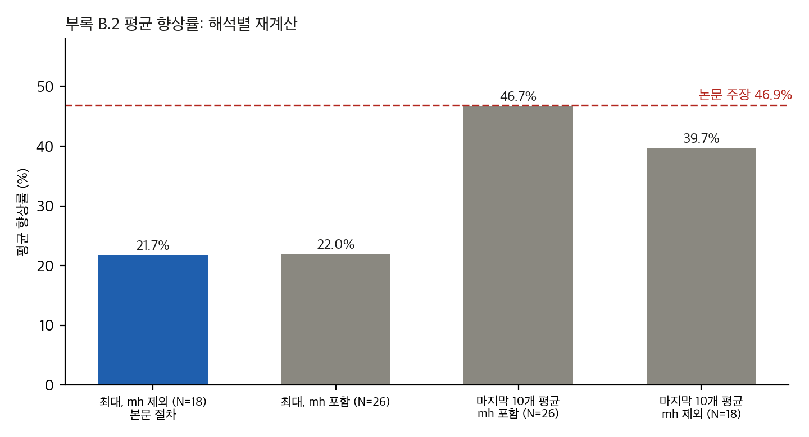
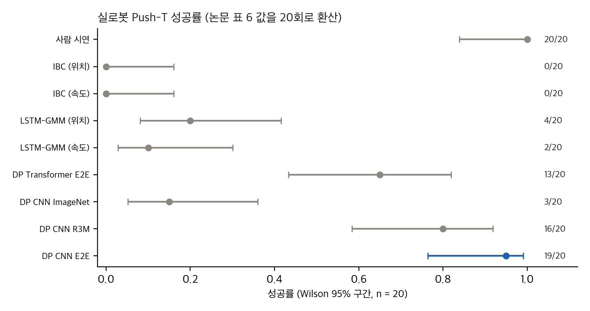

> **논문:** Cheng Chi, Zhenjia Xu, Siyuan Feng, Eric Cousineau, Yilun Du, Benjamin Burchfiel, Russ Tedrake, Shuran Song. *Diffusion Policy: Visuomotor Policy Learning via Action Diffusion.* IJRR 2024, arXiv:2303.04137 (v5, 2024-03-14). 원판은 RSS 2023입니다.
> 공식 코드는 GitHub real-stanford/diffusion_policy에 있고 MIT 라이선스입니다. 논문은 arXiv 비독점 배포 라이선스라서 이 글에는 논문 그림을 넣지 않았습니다. 그림 두 장은 우리가 표 값으로 그린 것입니다.

## 논문이 묻는 것

로봇 정책을 시연에서 배울 때 행동 분포에는 여러 모드가 있고, 연속된 행동 사이에는 상관이 있으며, 정밀도도 요구됩니다. 회귀 정책은 여러 모드를 평균내고, 음의 샘플에 의존하는 암묵 정책은 학습이 불안정합니다.

Diffusion Policy는 정책 출력을 행동 자체가 아니라 **행동 점수의 기울기**로 두고, 관측을 조건으로 한 DDPM으로 행동 시퀀스를 생성합니다. 최근 두 관측으로 16스텝을 예측하고 8스텝을 실행하는 수용 지평선 제어를 씁니다. 관측 인코더는 노이즈 제거 반복 밖에서 한 번만 돌립니다. 이 글에서는 IJRR 확장판 (v5)을 기준으로 씁니다.

## 이 글에서 확인한 것

표 값을 옮겨 다시 계산했습니다. 학습은 돌리지 않았습니다.

**평균 향상률 46.9%.** 부록 B.2의 절차 (각 과제의 최대 성능, mh 제외)로 계산하면 **21.7%**입니다. 마지막 10개 체크포인트 평균에 mh를 넣은 계산에서만 46.7%가 나옵니다. 이 값은 본문 문장과 맞지 않습니다. 인용할 때 집계 방식을 함께 적어야 합니다.

그림: 우리가 그린 그래프. 논문 부록 B.2 표 값에서 계산했습니다. 논문 표 1, 2, 4의 값을 사용했고 논문 그림은 쓰지 않았습니다.

**개별 향상률.** BlockPush p2 +32%는 맞습니다 (0.94 대 0.71). Kitchen p4 +213%는 표에서 +125% (BET 대비) 또는 +191% (LSTM-GMM 대비)입니다. 213%는 맞지 않습니다.

**실로봇 Push-T.** 엔드투엔드 CNN은 20회 중 19회 성공 (0.95, Wilson 95% 구간 0.76–0.99)입니다. 기준선은 IBC 0/20, LSTM-GMM 4/20입니다. 사전학습 ImageNet 인코더를 쓴 DP (3/20)보다도 낮습니다. 이 차이는 Fisher 검정으로 뚜렷합니다. R3M (16/20)과의 차이는 p = 0.34로 확인되지 않았습니다. 그래프는 두 구간의 겹침을 보여 줍니다.

그림: 우리가 그린 그래프. 논문 표 6의 성공률을 20회 시도로 환산했습니다. 사람 시연 1.00은 20/20으로 두었습니다 (가정).

**표와 본문이 맞지 않는 곳.** 실로봇 절이 "4 tasks"라고 시작하지만 실제로는 7개 과제가 나옵니다 (v4 문장이 남은 것으로 보입니다). Kitchen 시연 수는 본문 566, 표 656입니다. BlockPush 제어 방식은 표 7에 Pos, 표 8에 Vel로 나옵니다. DDIM 추론 단계는 본문 10, 표 7 시뮬 100, 실로봇 16입니다.

**"모든 변형에서 우위".** 최고 성능 DP 변형은 모든 열에서 기준선과 같거나 높습니다. 하지만 DP-C 변형은 BlockPush에서 BET보다 낮고 (p1 0.36 대 0.96), 시뮬 ToolHang에서도 낮습니다. 마지막 10개 평균 기준으로 DP-T는 시각 ToolHang에서 LSTM-GMM (0.47 대 0.49)보다 낮습니다.

## 공식 코드와 논문의 차이

공식 저장소를 얕게 복제해 정적으로만 읽었습니다. 실행하지 않았습니다.

- **공간 소프트맥스.** 논문 §3.2는 전역 평균 풀링을 공간 소프트맥스로 바꾼다고 씁니다. 저장소 코드에는 공간 소프트맥스 정의가 없고, 전역 평균 풀링이 남아 있습니다.
- **에폭.** 논문 §5.2는 상태 기반 4500, 이미지 3000 에폭이라고 씁니다. 설정 파일은 3050, 5000, 8000 등을 씁니다.
- **평가 초기 조건.** 논문 각주는 로봇믹 과제에서 22개만 썼다고 합니다. 저장소 기본값은 50입니다.
- **집계.** 논문은 마지막 10개 체크포인트 평균이라고 씁니다. 저장소 README는 `k_min_train_loss` 집계라고 씁니다.
- **Push-T 학습 에피소드.** 논문 표 3은 200개, 설정은 90개입니다.

재현하려면 이 값을 하나씩 고정해야 합니다.

## 구현 가능성 (Apple M4 Pro, CUDA 없음)

- **논문 표 재현은 이 맥에서 불가능합니다.** 시뮬 전체 학습은 CUDA GPU와 수천 에폭을 전제합니다. 실로봇 실험은 UR5나 Franka 같은 하드웨어가 필요합니다.
- **조건부:** Push-T 상태 기반 한 시드 학습. 맥용 환경은 Python 3.9와 torch 1.12.1 고정이라 새 환경과 MPS 포팅이 먼저 필요합니다. 속도는 측정 전입니다.
- **가능:** 1D U-Net 확산 정책, 행동 지평선, 추론 단계 수를 2차원 토이로 검사하는 것. 노력은 1–2일 정도로 추정합니다.

## 한계

- 실로봇 표본이 20회입니다. 95%의 구간 폭은 약 0.23입니다. 과제 사이의 0.1 단위 차이는 이 규모로 말하기 어렵습니다.
- 위치 대 속도 제어 우위 (Fig. 4)와 행동 지평선 최적값 (Fig. 5)은 그림만 있어 확인하지 못했습니다.
- 공간 소프트맥스 차이가 결과에 주는 영향은 실험 없이 알 수 없습니다.
- 집계 방식을 확정하려면 공개된 학습 로그가 필요합니다. 이번 분석에서는 받지 않았습니다.

## 출처와 라이선스

- 논문: arXiv:2303.04137 v5 (2024-03-14), IJRR DOI 10.1177/02783649241273668. arXiv 라이선스는 비독점 배포 1.0입니다 (CC BY 아님). 논문 그림은 쓰지 않았습니다.
- 공식 코드: github.com/real-stanford/diffusion_policy, MIT 라이선스 (LICENSE 파일 있음). 정적 읽기만 했습니다.
- 이 글의 그래프 두 장과 재계산 스크립트는 이 글의 작성자가 만들었습니다. 표 값은 인용과 재계산을 위해 옮겼습니다.

## 자료

- [통합 리포트 PDF](report/report_public.pdf)
- [01. 논문 분석: Diffusion Policy](analysis/01_paper_analysis.md)
- [02. 선행연구, 공식 저장소, 관련 분석](analysis/02_prior_work.md)
- [03. 재계산과 일관성 검사](analysis/03_analysis.md)
- [04. 공식 코드 대조 (정적 읽기)](analysis/04_code_verification.md)
