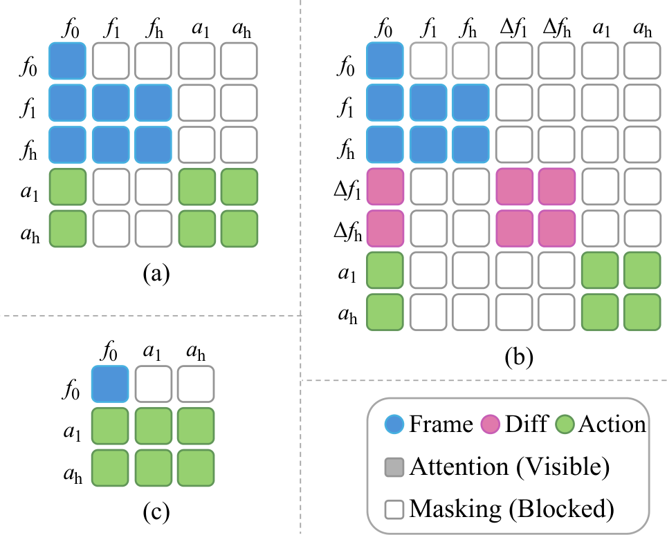
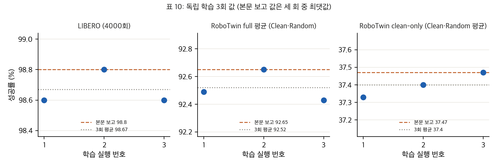
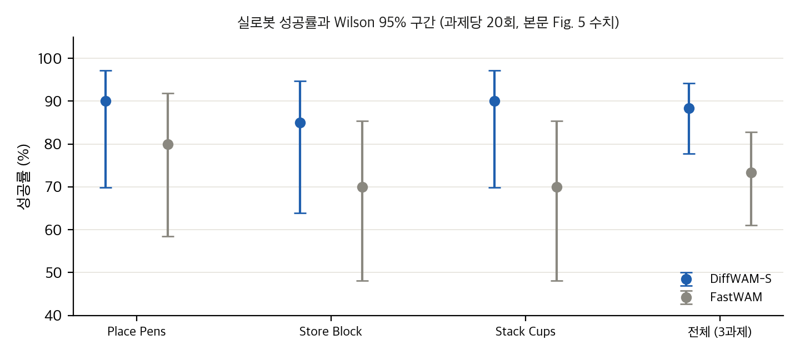
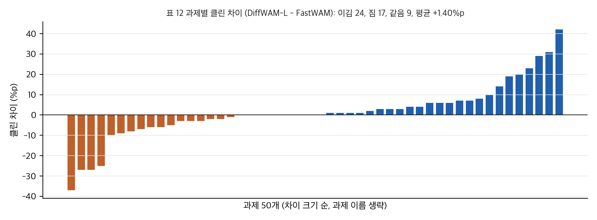
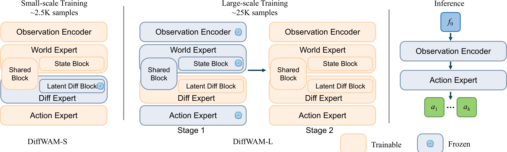

> **논문:** Xinheng Zhang, Haoyu Xiong, Chao Jing, Xiaohan Zhang, Linshan Li, Hongbang Fan, Xingyu Chen. *DiffWAM: Learning World Action Model from Consecutive Visual Difference.* arXiv:2611.19904 (v1, 2026-11-15). 학회 표기 없음.
> 공식 코드 저장소는 있지만 README에 "Code coming soon."만 적혀 있습니다. 이 글의 그림 두 장은 논문 그림이고(출처 표기), 나머지는 우리가 그린 그래프입니다.

## 논문이 묻는 것

세계-행동 모델(WAM)은 미래 장면과 행동을 함께 예측합니다. 그런데 미래 장면에는 배경처럼 과제와 무관한 내용이 많습니다. DiffWAM은 연속한 두 관측의 잠재 표현 차이, 즉 "무엇이 움직였는가"를 따로 예측하는 전문가(Diff Expert)를 추가합니다. 학습 때만 쓰고 추론 때는 떼어 냅니다.

*그림 3 (논문 원문). © 저자, CC BY 4.0, 출처 arXiv:2611.19904 (v1).*

## 이 글에서 확인한 것

**1. 표 값의 계산은 모두 맞습니다.** LIBERO, RoboTwin, 클린→랜덤, 절제 표의 평균과 차이를 다시 계산했습니다. 불일치를 찾지 못했습니다. 논문 안의 숫자끼리도 대부분 맞습니다.

**2. 본문 값은 학습 3회 중 최댓값입니다.** 독립 학습 3회의 결과(표 10)를 보면 LIBERO 98.80은 평균 98.67, RoboTwin 92.65는 평균 92.52입니다. 논문은 "개별 학습 실행"이라고만 적고 선택 기준은 밝히지 않습니다.

*그림: 표 10의 값을 다시 그렸습니다. 본문 보고 값은 세 회 중 최댓값입니다.*

**3. 실로봇 +15.0 pp는 방향만 확인됩니다.** 과제당 20회, 세 과제 60회에서 DiffWAM-S는 53/60, FastWAM은 44/60입니다. 차이의 95% 구간은 +0.8에서 +28.7 pp이고 Fisher 검정 p = 0.062입니다. 세 과제 모두 방향은 같지만 시도가 적습니다.

*그림: 과제별과 전체 성공률, Wilson 95% 구간. 과제당 20회입니다.*

**4. RoboTwin 평균 +1.55는 맞지만 "모든 과제에서 일관된 개선"은 과장입니다.** 50개 과제 중 클린 조건에서 DiffWAM-L이 이긴 과제는 24개, 진 과제는 17개입니다. 부호 검정 p = 0.35이고 과제 차이의 중앙값은 0입니다. Lift Pot 한 과제(+42)를 빼면 평균 차이는 +1.40에서 +0.57로 줄어듭니다.

*그림: 과제 50개의 클린 차이를 크기 순으로 정렬했습니다.*

**5. 기준선 재현 값이 원 보고 값보다 낮습니다.** 논문의 FastWAM은 LIBERO 97.05, RoboTwin 91.10입니다. 원 Fast-WAM 논문 보고 값은 97.6과 91.8입니다. RoboTwin에서 원 보고 값과 비교하면 DiffWAM-L의 이득은 +1.55가 아니라 +0.85입니다.

**6. 같은 숫자가 두 가지 프로토콜에 나옵니다.** 표 8의 "체크포인트에서 1 epoch 추가 학습" 결과(93.13 대 88.47)는 표 4의 "소규모 RoboTwin-Clean 학습" 결과와 같습니다. 두 설정의 출발점이 다른데 같은 값을 쓴 이유가 설명되어 있지 않습니다.

**7. 절제와 예측 품질은 근거가 얇습니다.** 차이 손실 추가 +0.70 pp, Diff Expert 추가 +1.05 pp는 모두 학습 1회에서 나왔습니다. 차이 예측의 PSNR과 잠재 오차(표 11)는 비교할 기준선이 없습니다.

*그림 4 (논문 원문). © 저자, CC BY 4.0, 출처 arXiv:2611.19904 (v1).*

## 구현 가능성

- **논문 수준의 재현은 이 맥(Apple M4 Pro, 24 GiB, CUDA 없음)에서 불가능합니다.** 모델은 약 7B 파라미터이고 논문 학습 설정은 8장의 A100 기준입니다.
- **공식 코드가 없습니다.** README는 "Code coming soon."입니다. 공개되기 전에는 추론 검증도 할 수 없습니다.
- **가능한 것:** 코드 공개 후 공식 체크포인트의 LIBERO 추론 평가(가중치 다운로드와 설치 필요). 차이 목적의 효과를 보는 작은 규모 비교(데이터 준비 필요).

## 정리

DiffWAM의 아이디어 자체는 깔끔합니다. 학습 때만 쓰는 보조 전문가로 시간 변화 신호를 얻고 추론 비용은 그대로 둡니다. 다만 본문 수치를 그대로 옮기기 전에 확인할 것이 세 가지 있습니다. 최댓값 보고, 과제 단위 일관성, 기준선 재현 차이입니다. 손실 가중치와 공식 코드가 공개되면 다시 볼 가치가 있습니다.

## 자료

- [통합 리포트 PDF](report/report_public.pdf)
- [DiffWAM 논문 분석 (arXiv:2611.19904)](analysis/01_paper_analysis.md)
- [DiffWAM 선행연구와 관련 자료](analysis/02_prior_work.md)
- [DiffWAM 재계산과 일관성 검사](analysis/03_analysis.md)
- [DiffWAM 주장 대조와 구현 가능성 (C1–C18)](analysis/04_claim_verification.md)
