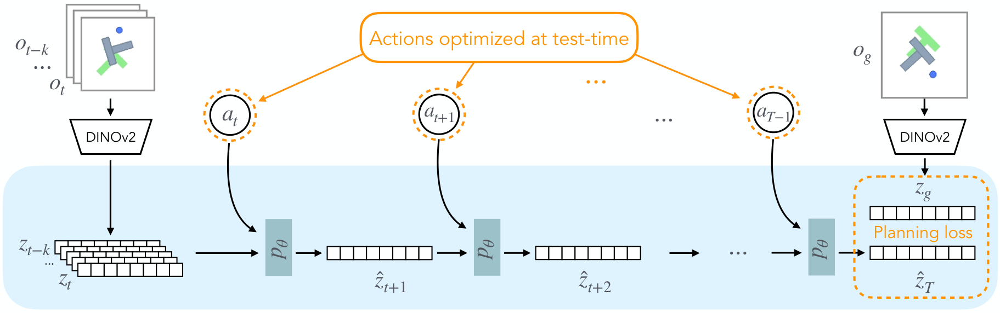
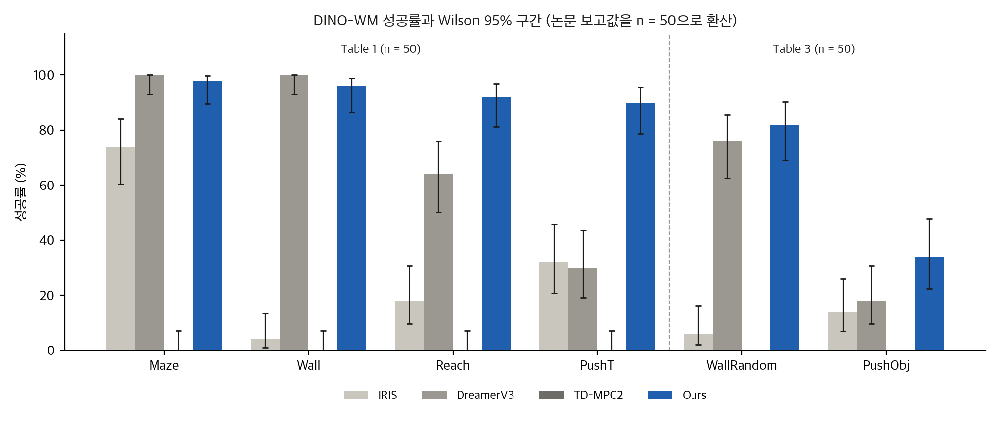
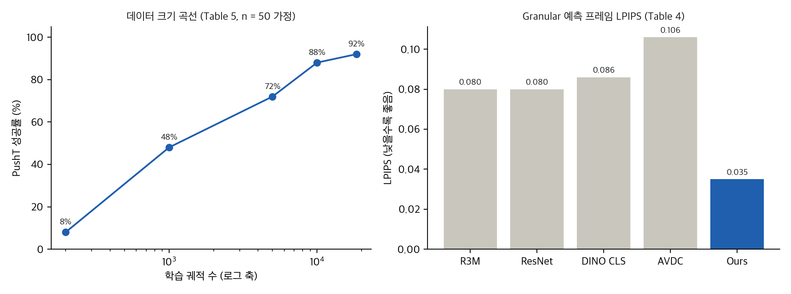

> **논문:** Gaoyue Zhou, Hengkai Pan, Yann LeCun, Lerrel Pinto. *DINO-WM: World Models on Pre-trained Visual Features enable Zero-shot Planning.* ICML 2025 (PMLR v267), arXiv:2411.04983 (v2, 2025-02-01).
> 공식 코드는 GitHub gaoyuezhou/dino_wm(MIT)에 있습니다. 이 글의 그림은 논문 그림 한 장(출처 표기)과 우리가 그린 그래프 두 장입니다.

## 논문이 묻는 것

세계 모델은 보통 특정 과제를 위해 온라인으로 학습합니다. 이 논문은 세 가지를 요구합니다. 오프라인 궤적으로 학습할 것, 테스트 시 행동을 최적화할 것, 작업에 무관할 것입니다. 방법은 픽셀을 재구성하지 않습니다. 동결된 DINOv2 패치 특징에서 다음 프레임의 특징을 예측하는 ViT를 학습하고, 목표 이미지의 특징을 향해 행동열을 CEM으로 최적화합니다.

*그림 2 (논문 원문). © 저자, CC BY 4.0, 출처 arXiv:2411.04983 (v2). 그림 속 작은 프레임은 저자의 시뮬레이터 장면입니다.*

## 이 글에서 확인한 것

**1. 조작 환경의 우위는 통계적으로 확실합니다.** 표 1에서 Reach(0.92)와 PushT(0.90)의 성공률은 DreamerV3(0.64, 0.30)와 IRIS(0.18, 0.32)보다 높습니다. 시도 50회로 Fisher 양측 검정을 해도 p < 0.002입니다. Maze와 Wall에서는 DreamerV3와 같습니다(p = 0.49–1.0).

*그래프: 우리가 그린 그래프. 표 1과 표 3의 성공률을 n = 50 가정으로 환산하고 Wilson 95% 구간을 표시했습니다. 논문 값을 다시 그렸습니다.*

**2. 과장된 주장이 두 곳 있습니다.** 분포 밖 구성에서 "significantly better"라고 쓴 WallRandom은 DreamerV3 대비 0.82 대 0.76, p = 0.62입니다. 통계적으로 구분되지 않습니다. 초록의 "과제 성공 45% 평균 개선"은 어떤 정의로도 정확히 나오지 않습니다. 가장 가까운 Rope, Granular CD 감소율 평균이 46.4%입니다.

**3. LPIPS 56% 개선은 맞습니다.** Granular에서 최선 기준선 0.080에 대해 이 방법이 0.035를 기록해 56.2% 낮습니다.

*그래프: 우리가 그린 그래프. 왼쪽은 표 5의 PushT 데이터 크기 곡선, 오른쪽은 표 4의 Granular LPIPS 비교입니다. 논문 값을 다시 그렸습니다.*

**4. 시드 반복과 분산이 없습니다.** 표준편차, 오차 막대, 학습 반복이 본문과 부록 어디에도 없습니다. CD는 10회 평균만 있어 검정할 수 없습니다. 데이터 크기 곡선과 절제 실험도 한 번씩 실행한 값입니다.

**5. 공식 코드의 학습 설정이 논문과 다릅니다.** 전이 학습률이 논문 표 12에서 5e-5인데 저장소 설정은 5e-4입니다. CEM은 논문 시간 측정에 100 샘플 10 반복을 썼고, 저장소 기본값은 300 샘플입니다. 디코더 기본값도 논문의 전치 합성곱이 아니라 VQ-VAE입니다. 공식 코드의 인과 마스크는 CUDA로 고정되어 있습니다.

## 구현할 수 있는지

- **전체 재현은 이 맥에서 불가능합니다.** 학습은 GPU와 SLURM을 전제하고, Rope, Granular 시뮬레이션은 Docker와 CUDA를 씁니다.
- **공식 체크포인트로 PushT 계획을 확인하는 것은 조건부입니다.** 체크포인트 다운로드, 환경 설치, CUDA 한 곳 수정이 필요합니다. 추정 3–5일입니다.
- **작은 PyTorch 축소판은 가능합니다.** 추정 1–2주입니다. 측정 전 추정입니다.

## 한계

- 시드 반복이 없어서 "학습 간 변동"을 알 수 없습니다.
- 분포 밖 구성과 Reach의 공식 코드와 설정이 저장소에 없습니다.
- 행동 라벨이 필요하고, 행동 공간에서만 계획합니다. 저자도 이 두 가지를 한계로 적었습니다.

## 링크

- 논문: [arXiv:2411.04983](https://arxiv.org/abs/2411.04983)
- 공식 코드: [gaoyuezhou/dino_wm](https://github.com/gaoyuezhou/dino_wm) (MIT)
- 프로젝트 페이지: [dino-wm.github.io](https://dino-wm.github.io/)

## 자료

- [통합 리포트 PDF](report/report_public.pdf)
- [01. 논문 분석: DINO-WM](analysis/01_paper_analysis.md)
- [02. 선행연구와 관련 저장소](analysis/02_prior_work.md)
- [03. 재계산, 통계 검정, 일관성 검사](analysis/03_analysis.md)
- [04. 공식 코드 대조와 구현 가능성](analysis/04_code_verification.md)
