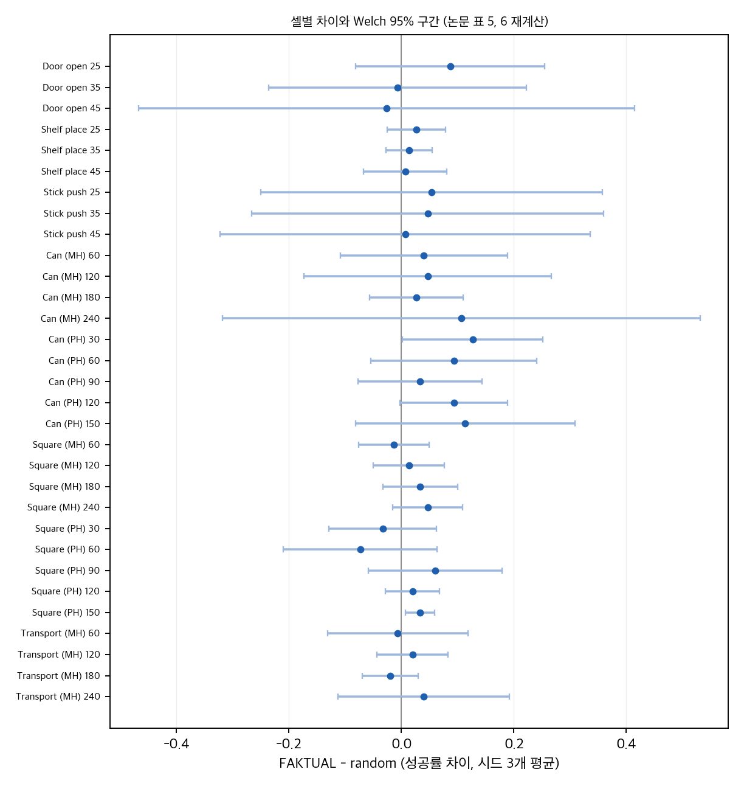
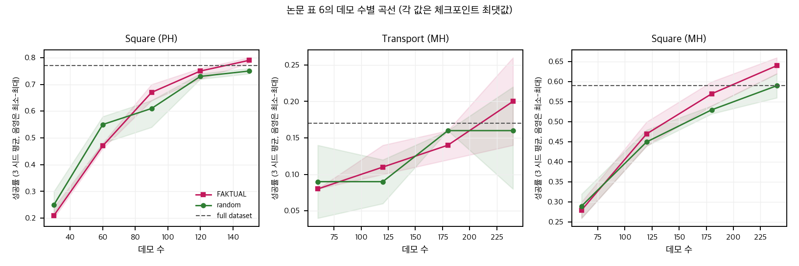

> **논문:** Sreevardhan Sirigiri, Nathan Samuel de Lara, Christopher Agia, Florian Shkurti, Fabio Ramos. *Diversity You Can Actually Measure: A Fast, Model-Free Diversity Metric for Robotics Datasets.* CoRL 2026 구두 발표, arXiv:2603.11634 (v2, 2026-10-13).
> 공식 코드는 GitHub S-sirigiri/FAKTUAL에 있습니다(라이선스 파일 없음). 이 글의 그래프는 논문 표 수치로 우리가 다시 그렸고, 논문 그림은 쓰지 않았습니다.

## 논문이 묻는 것

로봇 모방학습은 데이터 양보다 다양성이 중요하다는 말이 많지만, 다양성을 재는 표준 지표가 없습니다. 시연은 길이가 다르고, 상태, 행동, 영상이 섞인 긴 궤적입니다. 분포를 추정하기 어렵고, 샘플 사이의 거리도 궤적의 모양을 놓칩니다.

저자들은 **시그니처 커널**을 씁니다. 각 시연을 경로로 보고 시그니처 커널의 Gram 행렬 K를 만든 뒤, K/n의 고유값으로 Shannon 엔트로피를 정의합니다. 이 값은 von Neumann 엔트로피와 같습니다. 엔트로피를 최대화하는 부분집합을 탐욕으로 고르면 정책 학습 없이 데이터를 줄일 수 있습니다. 이것이 FAKTUAL입니다.

## 이 글에서 확인한 것

**1. 정의는 일관됩니다.** 고유값으로 쓴 Shannon 엔트로피가 von Neumann과 같다는 것은 부록 I의 증명으로 맞습니다. 공식 코드도 von Neumann을 Shannon 함수로 계산합니다. 같은 식이라서 두 값이 항상 같습니다.

**2. 개선은 대체로 작습니다.** 표 5, 6의 31쌍(데모 수 조건 기준)에서 FAKTUAL 평균이 무작위보다 높은 쌍은 24개입니다. 차이의 중앙값은 +3.3%p입니다. 낮은 쌍이 7개 있고, 최악은 Square PH 60회의 −7.3%p입니다. 초록의 "일관되게 개선한다"는 표현은 낮은 쌍이 7개 있는 이 결과와 맞지 않습니다.

*그래프 1. 셀별 FAKTUAL과 무작위의 차이(%p)와 Welch 95% 구간. 시드 3개라 구간이 넓습니다. 우리가 논문 표 5, 6의 값으로 그렸습니다.*

**3. 쉬운 과제에서는 분명히 낫습니다.** RoboMimic Can의 9쌍(MH 4, PH 5)은 모두 FAKTUAL이 높고 차이는 +2.7에서 +12.7%p입니다. 어려운 Square PH에서는 적은 예산에서 무작위보다 낮습니다.

*그래프 2. 논문 표 6의 데모 수별 평균과 최소-최대 음영(Square PH, Transport MH, Square MH). 점선은 전체 데이터 행입니다.*

**4. 표에 어긋나는 값이 있습니다.** MetaWorld Stick push 여섯 행의 평균 또는 최솟값이 같은 행의 시드 값으로 계산되지 않습니다. 25회 FAKTUAL 평균은 표에 0.29이고 시드로 계산하면 0.31입니다. MH 전체 데이터 행은 280회인데, 부록은 학습 데모를 270회라고 적습니다.

**5. 검증할 수 없는 주장이 있습니다.** 엔트로피와 성공률의 상관(r 0.74–1.00, 그림 4), 엔트로피 포화(그림 2), 계산 비용이 기존 방법보다 훨씬 작다는 주장(초록), 실로봇 과제에서 세 과제가 개선된다는 주장(그림 6)은 표 수치로 확인할 수 없습니다. 엔트로피 값이나 실로봇 수치가 공개되지 않았습니다.

## 공식 코드를 읽으면서 본 차이

- **CUDA 전제.** 최상위 모듈이 CuPy를 가져옵니다. 이 맥에서는 공식 라이브러리를 실행할 수 없습니다.
- **대역폭.** 논문에 규칙이 없습니다. 코드는 데이터 원소 값의 중앙값을 로그 n으로 나눈 값을 씁니다. 쌍별 거리를 쓰지 않습니다.
- **혼합 목적의 기본값.** 논문은 엔트로피와 행렬식을 섞고 p를 0.5에서 0.9로 권합니다. 코드의 기본값은 p 0.3과 shannon입니다.
- **정규화.** 엔트로피 정의는 K_ii = 1을 가정합니다. 기본 무작위 푸리에 경로는 이를 명시적으로 맞추지 않아서, KSig 구현을 확인해야 합니다. 이 글에서는 확인하지 못했습니다.
- **정책 학습 코드 누락.** MetaWorld, SmolVLA, 실로봇 설정이 저장소에 없습니다. 표 5, 6은 코드만으로 재현할 수 없습니다.

## 맥에서 구현할 수 있는가

- **공식 코드 실행: 불가.** CUDA가 필요합니다.
- **엔트로피를 numpy로 다시 구현: 가능(추정 2–4일).** 상태와 행동만 쓰고 시그니처 레벨을 낮추면 CPU로 돌아갈 것으로 보입니다. 측정은 하지 않았습니다.
- **정책 학습과 실로봇 재현: 불가.** GPU와 로봇이 필요합니다.

## 정리

FAKTUAL의 정의는 깔끔하고, 샘플 사이 유사도만으로 다양성을 재는 방식은 쓸 만합니다. 하지만 논문의 실험 결과는 "일관된 개선"이라고 말하기에는 약합니다. 시드 3개, 체크포인트 최댓값, 표 값의 불일치를 고려하면 방향만 믿을 수 있습니다. 다양성은 품질을 대신하지 못한다는 것을 저자들도 한계로 인정합니다.

## 자료

- [통합 리포트 PDF](report/report_public.pdf)
- [01. 논문 분석: Diversity You Can Actually Measure (arXiv:2603.11634)](analysis/01_paper_analysis.md)
- [02. 선행연구와 관련 저장소](analysis/02_prior_work.md)
- [03. 수치 재계산, 일관성 검사, 주장 판정](analysis/03_analysis.md)
- [04. 공식 코드 대조와 구현 가능성](analysis/04_code_verification.md)
