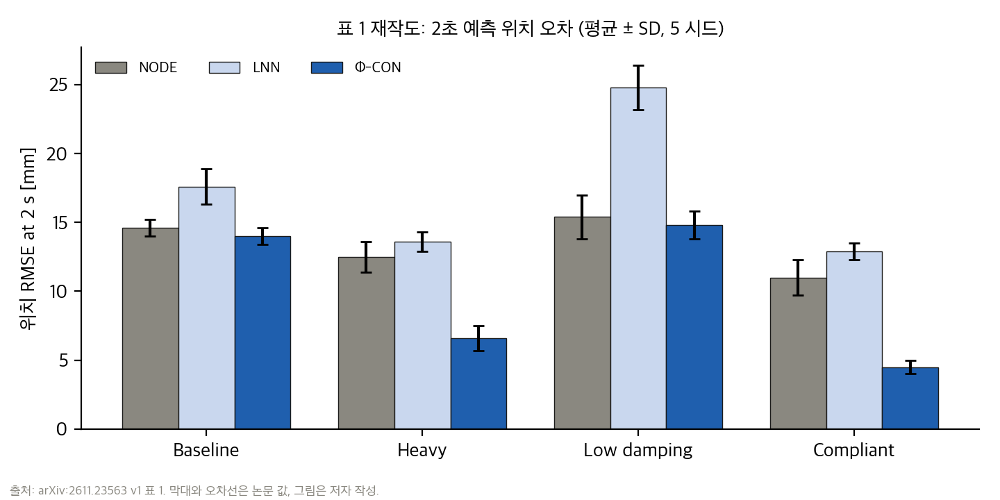
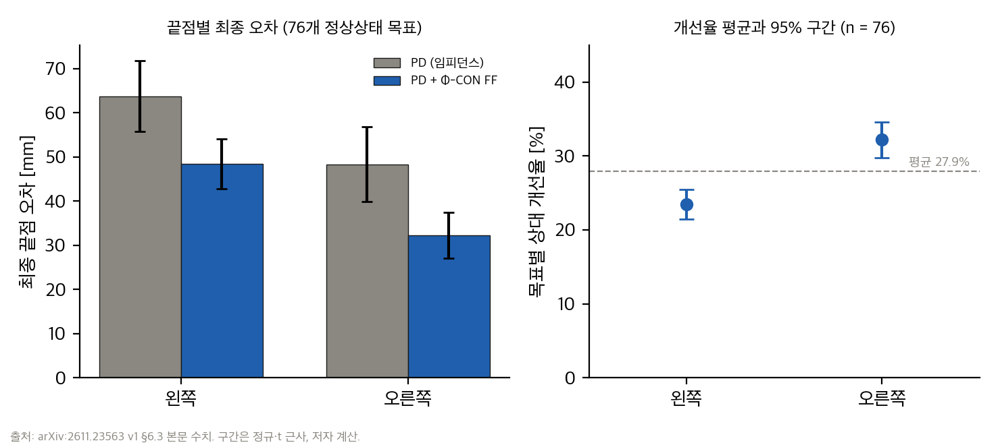
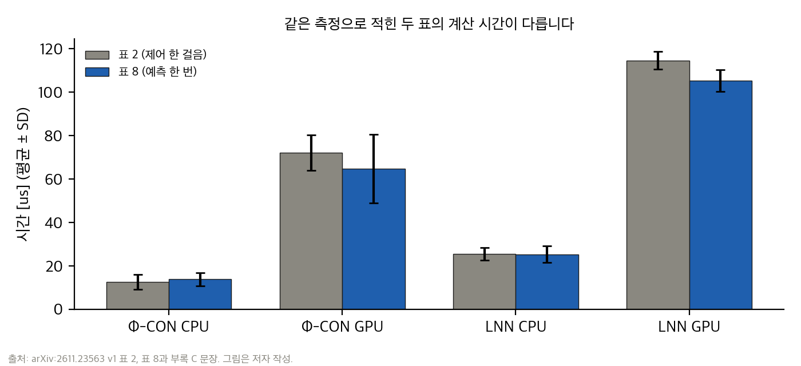

> **논문:** Iván López-Broceño, Maximilian Stölzle, Daniel Feliu-Talegon, Daniela Rus, Cosimo Della Santina. *Learning the Dynamics of Deformable Linear Objects Through Coupled Oscillators for Bimanual Robotic Manipulation.* arXiv:2611.23563 (v1, 2026-11-17). 학회 표기 없음 (PDF 머리글 "Preprint. Under review.").
> 공식 코드는 공개되어 있지 않습니다. 논문 그림은 싣지 않고, 우리가 그린 그래프만 씁니다.

## 논문이 묻는 것

케이블이나 전선을 두 손으로 잡고 원하는 모양으로 맞추려면, 케이블이 어떻게 움직일지 알아야 합니다. 많은 학습 기반 방법은 동역학을 무시하고 형상 변화만 봅니다. 이 방법은 케이블이 가볍고 느리게 움직일 때는 괜찮지만, 무겁고 뻣뻣한 케이블에서는 자기 무게와 탄성이 끝점 힘을 만들어 냅니다. 정상상태에서 그 힘을 빼 주지 않으면 목표 형상에서 오차가 남습니다.

논문은 이 문제를 **힘 기반 동역학 학습**으로 다룹니다. 케이블 마커의 위치에서 떠 있는 기준점(평행이동)과 상대 형상을 나누고, 상대 형상에만 퍼텐셜을 두는 결합 진동자 네트워크를 학습합니다. 학습 가능한 아핀 사상 Φ가 관측 좌표와 잠재 좌표를 잇고, 가상일 원리로 힘도 같이 바꿉니다.

## 방법의 핵심

- **떠 있는 기준점.** 잠재 퍼텐셜이 상대 형상에만 의존하므로, 케이블 전체가 평행이동해도 복원력이 생기지 않습니다. 이 구조에서 안정성 증명이 나옵니다(Prop. 1).
- **학습된 정적 힘을 피드포워드로.** 제어식은 학습된 정적 힘 g_a(x_d)를 목표에서 미리 더하고, 나머지 오차는 PD로 줄입니다. 최적화를 실행 시간에 하지 않아도 됩니다.
- **전역 안정성의 범위.** 논문은 닫힌 루프의 전역 점근 안정성을 증명합니다. 다만 보장은 학습된 모형에 대해서이고, 실제 케이블이 그 모형과 같다는 가정이 필요합니다.

## 우리가 확인한 것

논문 표의 수치를 다시 계산했습니다. 학습은 하지 않았습니다.

*그림 1. 표 1(2초 위치 RMSE, 평균 ± SD, 5 시드)을 저자가 다시 그렸습니다. 값은 arXiv:2611.23563 v1 표 1.*

**맞는 것.** 파라미터 감소 97.2%(NODE 대비)와 90.2%(LNN 대비), 시뮬 끝점 오차 감소 97.5–99.7%는 표 값에서 그대로 나옵니다. 증명의 흐름도 맞습니다. 잠재 에너지 V의 감소, 강볼록 Hessian, 극한 식까지 확인했습니다.

**약한 것.** 표 1에서 Φ-CON의 평균 오차가 모든 조건에서 가장 낮습니다. 그러나 기준 DLO에서 NODE와의 차이는 5 시드 기준으로 구별되지 않습니다(Welch p = 0.15). 감쇠가 낮은 DLO도 마찬가지입니다(p = 0.50). 무거움과 유연한 DLO에서만 차이가 확실합니다.

*그림 2. 실로봇 끝점 오차(PD 대 PD+FF)와 목표별 개선율의 95% 구간(n = 76). 값은 논문 6.3절, 구간은 저자 계산.*

**실로봇 결과.** 목표별 평균 개선 27.9%는 맞습니다. 다만 76개 정상상태 목표는 학습과 검증 궤적에서 뽑았습니다. 본 적 없는 목표 4개의 결과는 개별 값으로 보고되지 않았습니다.

**시뮬 기준선.** 시뮬의 PD는 적분 항이 없어서 정상상태 오차가 1/K_p에 비례합니다. 이 오차는 정적 힘과 같은 크기입니다. 그러므로 감소율 대부분은 "정적 힘을 더해 주는 것"에서 올 수 있습니다. 논문에는 정적 피드포워드만 쓴 기준선이 없어서, 학습 구조의 기여를 따로 보기 어렵습니다.

*그림 3. 표 2와 표 8의 계산 시간을 나란히 그렸습니다. 같은 측정이라는 본문과 값이 다릅니다. 값은 논문, 그림은 저자 작성.*

**논문 내부의 불일치.** 표 2와 표 8의 계산 시간이 "같은 방식"으로 측정했다고 적혀 있는데 값이 다릅니다(Φ-CON GPU 72.1 대 64.8 µs). 결론은 바뀌지 않지만 인용할 때 주의할 부분입니다. 파라미터 수도 한 가지가 맞지 않습니다. NODE와 LNN은 표 구조대로 정확히 나오지만, FBCON과 Φ-CON은 모두 9N(시뮬 270개)만큼 많습니다. 논문에 설명이 없습니다.

## 이 맥에서 구현할 수 있는가

- **실로봇 검증은 불가능합니다.** 두 대의 로봇, 힘 센서, 모션캡처가 필요합니다.
- **시뮬 재구현은 조건부로 가능합니다.** 모형이 2만 파라미터 안팎이라 CPU나 MPS 학습이 가능할 가능성이 큽니다. 다만 공식 코드가 없어서, τ̄와 α를 정하는 방법, 행렬의 양의정부호 파라미터화, 시뮬 설정을 직접 정해야 합니다. 노력은 1–2주로 추정합니다(측정 전).

## 읽고 난 생각

이 논문의 좋은 점은 **구조가 증명과 제어식을 같이 준다**는 것입니다. 학습 모형이 라그랑주 구조를 가지므로 제어 법칙을 닫힌 형태로 쓸 수 있습니다. 대신 기준선을 더 엄격하게 짜야 합니다. 정적 힘 보상만으로도 큰 감소가 나온다는 점을 먼저 보여 주어야, 구조 학습의 기여가 드러납니다. 실로봇 실험도 본 적 없는 목표에서 더 많이 확인해야 합니다.

## 참고

- 원문: arXiv:2611.23563 (v1). 공식 코드와 프로젝트 페이지는 찾지 못했습니다.
- 선행 연구: Stölzle & Della Santina (NeurIPS 2024)의 결합 진동자 네트워크. 이 논문의 전신입니다.

## 자료

- [통합 리포트 PDF](report/report_public.pdf)
- [01. 논문 분석: Φ-CON (arXiv:2611.23563)](analysis/01_paper_analysis.md)
- [02. 선행연구, 공식 코드, 이 저장소의 관련 분석](analysis/02_prior_work.md)
- [03. 재계산과 일관성 검사](analysis/03_analysis.md)
- [04. 주장 대조 (공식 코드 없음): C1–C12, 구현 가능성, 라이선스](analysis/04_claim_verification.md)
