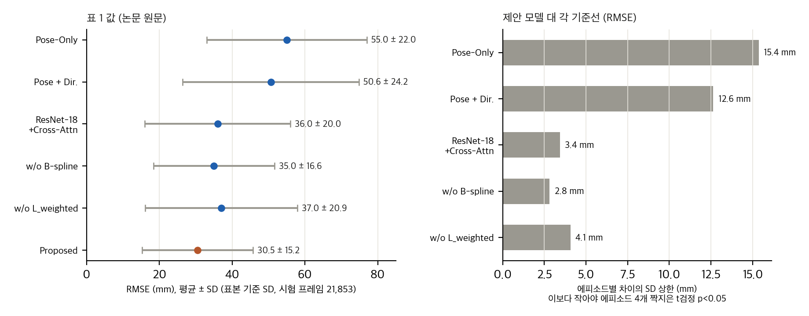
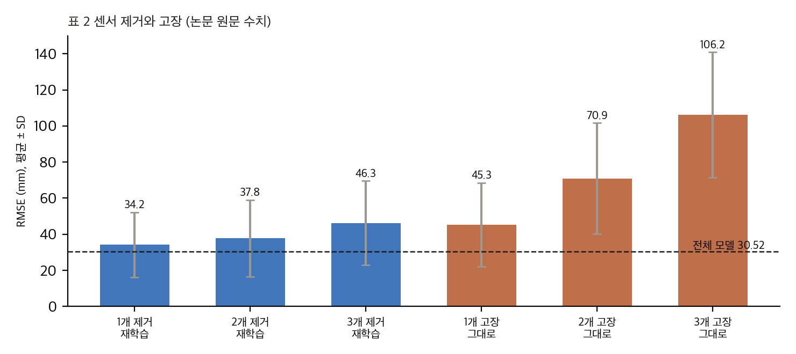
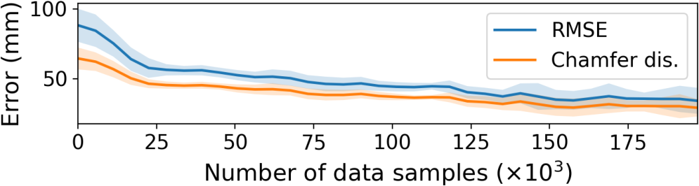
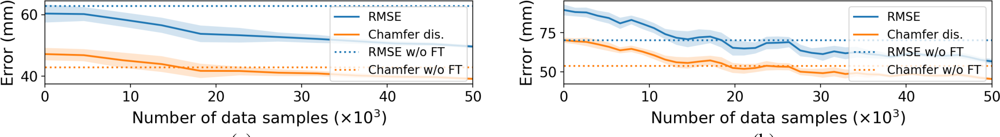
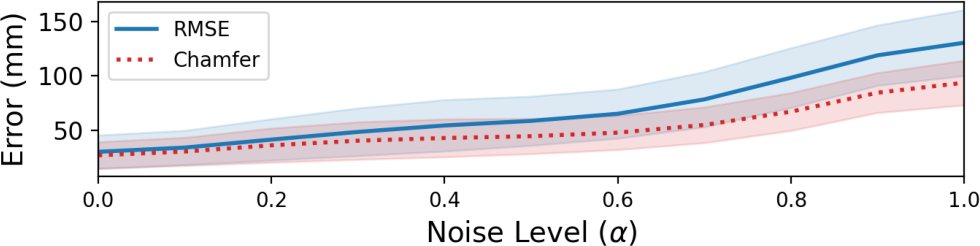

> **논문:** Rotem Atari, Stav Ashur, Avishai Sintov. *Physics-Informed Tactile-based Shape Estimation of Deformable Linear Objects.* arXiv:2611.22990 (v1, 2026-11-17). 학회 표기 없음.
> 공식 코드는 GitHub rotematari/dlofeel-state(MIT)에 있습니다. 이 글의 그림 네 장은 논문 그림(© 저자, CC BY 4.0)이고, 두 장은 우리가 그린 그래프입니다.

## 논문이 묻는 것

케이블을 로봇이 잡았을 때 모양을 알려면 보통 카메라를 씁니다. 그런데 손과 그리퍼가 케이블을 가리거나 케이블 묶음이 복잡하면 카메라가 실패합니다. 이 논문은 카메라를 아예 쓰지 않습니다. 그리퍼 손가락에 붙은 광학 촉각 센서 DIGIT 네 개의 이미지와 손목 자세만으로 케이블 전체의 3D 정점 사슬을 추정합니다.

핵심 구성은 세 가지입니다. 사전학습된 촉각 인코더 Sparsh(ViT-S)의 중간 층을 가중 합으로 쓰고, 교차 주의 디코더가 자세 질의로 촉각 토큰을 읽고, 마지막에 B-spline 층이 곡선을 매끄럽게 만듭니다. 학습 손실에는 이산 탄성 막대(DER)에서 가져온 접선, 길이, 곡률 항을 넣었습니다.

## 표로 본 결과

표 1에서 자세만 쓴 모델의 RMSE는 55.0 mm, 촉각을 쓴 제안 모델은 30.5 mm입니다. 이 차이는 시험 에피소드 4개로 봐도 큽니다. 반면 물리 손실을 빼면 37.0 mm, B-spline 층을 빼면 35.0 mm입니다. 방향은 맞지만 에피소드 4개로는 이 차이가 유의하려면 에피소드 간 차이의 표준편차가 2.8–4.1 mm보다 작아야 합니다. 논문은 에피소드별 값을 주지 않습니다.

그래프: 왼쪽은 표 1의 RMSE 평균과 SD(논문 값). 오른쪽은 에피소드 4개로 p < 0.05가 되는 에피소드 차이 SD의 상한. 우리가 그린 그래프입니다.

센서를 빼는 실험(표 2)은 재학습 시 한 개 제거에 34.2 mm, 두 개 제거에 37.8 mm입니다. 재학습 없이 센서가 고장 나면 한 개 45.3 mm, 세 개 106.2 mm로 급격히 나빠집니다.

그래프: 표 2의 센서 제거(재학습)와 고장(재학습 없음) 조건과 전체 모델 기준선. 우리가 그린 그래프입니다.

## 데이터와 전이

학습은 케이블 하나(1.5 mm 강철 와이어)의 에피소드 36개, 약 19만 6천 프레임으로 했습니다. 시험은 에피소드 4개입니다. 논문은 에피소드 15개(약 42%)면 충분하다고 주장하지만, 이를 뒷받침하는 수치 표는 없습니다. 그림 4의 x축은 에피소드가 아니라 샘플 수입니다.

그림 4: 학습 샘플 수에 따른 RMSE와 Chamfer 거리. © 저자, CC BY 4.0, 출처 arXiv:2611.22990.

새 케이블(USB 4.5 mm, 강철 2 mm)에 대한 미세 조정은 처음부터 학습한 모델보다 낫다고 그림 5에서 보입니다. 수치는 그림에서만 확인할 수 있습니다.

그림 5: 새 케이블 두 종류에 대한 미세 조정 샘플 수별 오차, 점선은 처음부터 학습. © 저자, CC BY 4.0, 출처 arXiv:2611.22990.

그림 6: 촉각 이미지 잡음 강도 α에 따른 RMSE와 Chamfer 거리. © 저자, CC BY 4.0, 출처 arXiv:2611.22990.

## 코드와 맞지 않는 곳

공식 코드를 정적으로만 읽었습니다(실행하지 않았습니다).

- **입력 자세.** 논문은 자세를 로봇 순기구학으로 계산하고 모션캡처는 라벨링에만 쓴다고 합니다. 저장소의 학습 입력은 모션캡처로 측정한 EE 포즈입니다. 실시간 배포 코드도 없습니다.
- **파라미터 수.** 표 1의 제안 모델 값(6.38 M 학습)은 K = 32 구성과 맞고, 본문의 K = 16(릴리스 체크포인트 5.33 M)과 맞지 않습니다.
- **학습 설정.** 융합 층이 논문 {3, 6, 9, 12}인데 릴리스는 {9, 10, 11, 12}입니다. 학습률도 논문 본문 두 곳의 값이 서로 다릅니다.
- **지표 이름.** 논문과 저장소 README가 "RMSE"라고 부르는 값은 점별 거리의 평균입니다.

## 정리

- 촉각을 쓰면 자세만 쓸 때보다 확실히 낫습니다.
- 물리 손실과 B-spline 층의 기여는 방향은 맞지만 에피소드 수준 근거가 부족합니다.
- 실시간성, 캘리브레이션 불필요, 모션캡처 역할에 대한 주장은 코드와 맞지 않아 추가 확인이 필요합니다.
- 이 맥에서 공식 학습은 어렵습니다. 체크포인트 추론 점검과 손실 함수 단위 검증은 가능합니다.

자세한 근거는 analysis 문서 01–04에 있습니다.

## 자료

- [통합 리포트 PDF](report/report_public.pdf)
- [01. 논문 분석: Physics-Informed Tactile-based Shape Estimation of DLOs](analysis/01_paper_analysis.md)
- [02. 선행연구, 공식 코드, 이 저장소의 관련 분석](analysis/02_prior_work.md)
- [03. 수치 재계산, 일관성 검사, 주장 판정](analysis/03_analysis.md)
- [04. 공식 코드 대조 (정적 읽기), 라이선스, 구현 가능성](analysis/04_code_verification.md)
