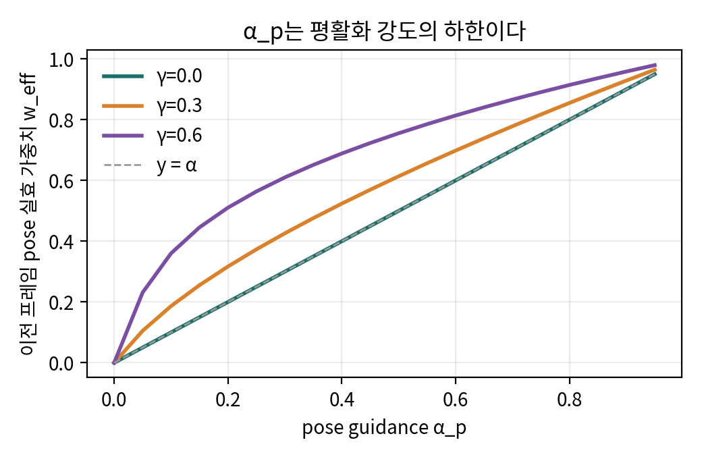
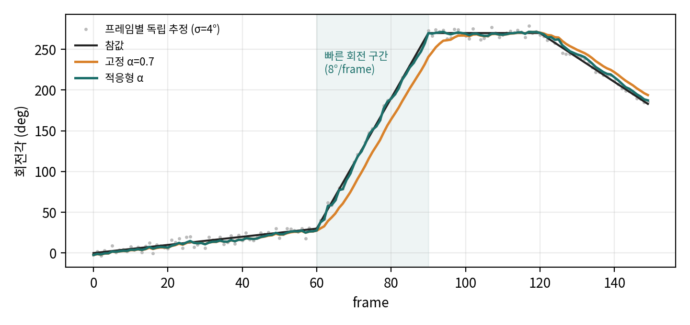

# 03. 유도와 해석

논문에 명시되지 않았지만 코드와 수식에서 직접 따라 나오는 성질을 정리했습니다. 수치 확인은 `analysis/guidance_toy.py`로 했고(CPU, 약 1초), 결과는 `analysis/guidance_toy_results.json`에 있습니다.

---

## 1. Eq. 1의 guided flow matching은 사실상 "지수이동평균(EMA) 필터"다

### 1.1 마지막 스텝 항등식

- **표기:** flow matching 경로는 x_t = (1−t)ε + t·x_1이고, t=0이 노이즈, t=1이 데이터입니다. 코드의 `_prepare_t_and_d`는 `t_seq = linspace(0, 1, steps+1)`이고, `reversed_timestamp=False`가 기본값입니다(HF `pipeline.yaml` 값은 가중치 접근 권한이 필요해 직접 확인하지 못했지만, blending 식 자체가 t=1을 데이터로 가정하고 있습니다).
- **정의:** 어떤 velocity v든 "x1-예측" x̂_1 := x_t + (1−t)·v 로 다시 쓸 수 있습니다.
- **마지막 Euler 스텝:** t' = 1−Δ에서 t = 1로 가는 스텝을 보면 다음과 같습니다.

```
x̂_t   = x_{t'} + Δ·v(x_{t'}, t')
      = x_{t'} + (1−t')·v          (Δ = 1−t')
      = x̂_1(x_{t'})                 ← 네트워크의 x1-예측 그 자체

blending: z_ref(1) = (1−1)ε + 1·x_ref = x_ref
x_1 = (1−α)·x̂_1 + α·x_ref                                    (★)
```

**결론:** 노이즈 ε와 적분 경로, Taylor cache 근사(Fast-SAM3D)와 상관없이, 최종 pose latent는 **"마지막 스텝의 네트워크 예측"과 "이전 프레임 pose" 사이의 볼록결합**입니다. α_s = 1이면 shape는 정확히 x̄^s로 끝납니다.

- **수치 확인:** 13차원(6D rot + t3 + s3 + translation_scale 1, 코드의 `_POSE_LATENT_KEYS`) 비선형·상태 의존 velocity를 200번 무작위로 뽑아 확인했습니다. 최대 절대오차는 **0.0**이었습니다.

### 1.2 α_p는 평활화 강도의 "하한"이다

(★)의 x̂_1 자체도 앞선 24번의 blending으로 x_ref 쪽으로 끌려간 상태 x_{t'}를 입력받아 계산됩니다. 그래서 네트워크 예측이 현재 상태에 의존하는 정도(γ)만큼 이전 pose의 실효 가중치 w_eff가 α보다 커집니다.

toy 모델은 x̂_1 = (1−γ)·y_obs + γ·(x_t에서 외삽한 x_1)이고, T=25입니다.

| α_p | γ=0 | γ=0.3 | γ=0.6 |
|---|---|---|---|
| 0.1 | 0.10 | 0.19 | 0.36 |
| 0.5 | 0.50 | 0.61 | 0.76 |
| 0.7 | 0.70 | 0.78 | 0.87 |



**함의:** 논문 Table 5의 "고정 α_p"(코드 기본값 0.5)는 실제로는 그보다 강한 평활화입니다. SAM 3D 백본이 현재 latent에 얼마나 의존하는지(γ)는 모델 고유의 성질이므로, 같은 α_p라도 물체나 장면에 따라 평활화 강도가 달라집니다.

### 1.3 프레임 단위로 보면 EMA, 적응형 α는 One-Euro 필터와 같은 발상

프레임 k의 출력을 pose_k라 하면 pose_k ≈ (1−w_k)·obs_k + w_k·pose_{k−1}입니다. 1차 저역통과(EMA) 필터이고, 정상상태 지연은 약 w/(1−w) 프레임입니다. 예를 들어 w=0.78이면 약 3.5프레임입니다.

적응형 규칙 α_p = max(0.1, 0.7 − 0.09|Δθ|)는 "움직임이 빠르면 평활화를 줄인다"는 규칙입니다. HCI 분야의 One-Euro 필터(Casiez, Roussel, Vogel, CHI 2012, "1€ Filter")가 속도에 따라 차단 주파수를 올리는 것과 같은 구조입니다. **논문은 이 연결을 언급하지 않았습니다.**

toy 실험 조건은 1D 회전, 프레임별 독립 추정 잡음 σ=4°, 0.5→8→0→−3 °/frame 구간입니다.

| 방식 | 전체 RMSE (°) | 빠른 구간 RMSE | 빠른 구간 최대 지연 | 지터 |
|---|---|---|---|---|
| 가이던스 없음 (α=0) | 3.99 | 3.65 | 7.8 | 5.98 |
| 고정 α=0.5 | 6.28 | 12.27 | 16.3 | 1.91 |
| 고정 α=0.7 | 12.75 | 25.13 | 30.5 | 1.50 |
| **적응형 α** | **2.93** | 3.73 | 7.5 | 2.04 |



**해석:** 고정 α는 지터를 줄이는 대가로 빠른 구간에서 큰 지연을 만듭니다. 적응형 α는 정지 구간에서는 평활화하고 빠른 구간에서는 풀어 주므로 두 장점을 함께 얻습니다. 이 결과는 Table 5에서 적응형이 고정보다 나았던 이유를 정성적으로 설명합니다.

**주의:** 이 toy 실험은 가우시안 잡음만 넣었고, SAM 3D 특유의 이상치(대칭 물체의 180° 플립)는 모델링하지 않았습니다. 플립은 N=25 클러스터링이 담당합니다.

### 1.4 이 관점에서 나오는 개선 아이디어 (검증되지 않은 가설)
- **(a) 속도 추정을 3D로 확장:** 2D Δθ 대신 이전 두 프레임 pose의 SE(3) 차분이나 3D point track을 쓰면 out-of-plane 회전과 병진 속도도 반영할 수 있습니다.
- **(b) EMA를 상수속도 예측(α-β 필터나 Kalman)으로 교체:** x_ref를 pose_{k−1} 대신 pose_{k−1} ⊕ (pose_{k−1} ⊖ pose_{k−2})로 바꾸면 정상상태 지연이 사라집니다. 코드에서는 `pose_target`만 바꾸면 되므로 구현 비용이 낮습니다.
- **(c) 블렌딩을 SO(3) 위에서 수행:** latent를 선형 보간하는 대신 회전 블록을 slerp으로 처리합니다.

---

## 2. Replacement 방식 조건부 생성의 편향

- α_s = 1의 shape 치환은 p(x^p | x^s = x̄^s, c)에서 정확히 샘플링하는 방법이 아닙니다. 매 스텝 shape 블록을 "같은 ε로 보간한 정답"으로 덮어쓰면, 네트워크가 보는 shape-pose 결합 상태는 학습 분포의 경로와 다를 수 있습니다.
- 이런 replacement 방식이 근사라는 점은 RePaint[65] 이후 inpainting 문헌에서 잘 알려져 있습니다. RePaint가 resampling을 도입한 이유도 이것입니다.
- 논문은 RePaint와 Song et al.[66]을 인용하면서도 이 편향은 논의하지 않습니다. 실무적으로는 N=25 샘플링과 클러스터링, 그리고 post-optimization(렌더 마스크 정렬, 본문에는 없음)이 이 편향을 덮어 주는 역할을 하는 것으로 보입니다.

---

## 3. 손-물체 정렬의 닫힌 해

- **목적함수:** min_s ‖c_mesh + s·t − obj_target‖²
- **미분해서 0으로 두면:** tᵀ(c_mesh + s·t − obj_target) = 0, 따라서 s* = tᵀ(obj_target − c_mesh) / tᵀt 입니다. 부록 식과 일치합니다.
- **기하학적 의미:** 물체를 카메라 원점에서 나가는 광선(방향 t)을 따라 미끄러뜨려, 손 기준으로 예측한 위치에 가장 가까운 깊이를 찾는 것입니다. 회전은 바뀌지 않습니다. 물체가 광선 방향과 직교하게 이동해야 할 오차(측면 오차)는 고칠 수 없습니다.
- **스케일:** k = z^H/z^M은 손 중심의 깊이 비율 하나만 씁니다. MoGe 깊이 오차가 손 주변에 국소적으로 몰려 있으면 그 오차가 물체 위치 전체에 비례해서 전파됩니다.

---

## 4. 리타겟팅 최적화기의 실제 형태 (코드 기준)

논문은 이 최적화기를 "MPPI-style, kernel annealed across iterations and horizon"이라고만 설명합니다. 코드(`retargeting/utils/sampling.py`)가 실제로 하는 일은 다음과 같습니다.

```
보상 R_i = −‖W ⊙ Δqpos‖₂ − 1e−4‖Δqvel‖ − 3000·max(pen − 5mm, 0)² − 0.5·𝟙[전이 불일치] (+ terminal ×10)
가중치: 상위 10% (elite 102개)만 남기고, 그 안에서 z-정규화 후 softmax(·/T), T = 1.0
업데이트: ctrl ← Σ w_i · ctrl_i
노이즈: 반복 i에서 global scale = β^i, β = 0.01^(1/32)  → 마지막 반복에 1% 수준
        horizon 방향으로는 첫 knot 1.0배에서 마지막 knot 4.0배까지 증가 (DIAL-MPC 계열 annealing)
조기 종료: 개선량 < 0.01 이 2회 연속이면 중단
교란: 후보 1개당 K=4개 교란 시드의 평균 보상 (worst-case가 아니라 기댓값)
```

- **순수 MPPI가 아닙니다.** 상위 10%만 남기고 순위를 정규화하는 방식은 MPPI보다 **CEM과 MPPI의 혼합**에 가깝습니다. 보상 스케일과 무관하게 동작하므로, 보상 항을 바꿔도 temperature를 다시 조정할 필요가 적다는 장점이 있습니다.
- **32회 반복은 상한일 뿐입니다.** 공개된 whisking 결과에서는 제어 스텝 16개 중 10개가 2회 반복으로 조기 종료됐습니다(`opt_steps = [2,13,2,8,2,2,6,2,9,2,6,2,2,2,2,2]`).
- **교란 보상을 평균하는 방식은 위험중립적(risk-neutral) 강건화입니다.** 평균 대신 CVaR이나 최소값을 쓰면 더 보수적인 grasp를 얻을 수 있을 것이라는 가설을 세울 수 있습니다(검증되지 않음).
