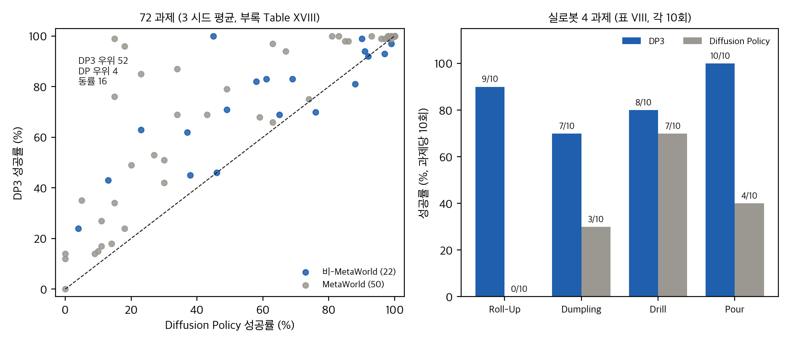
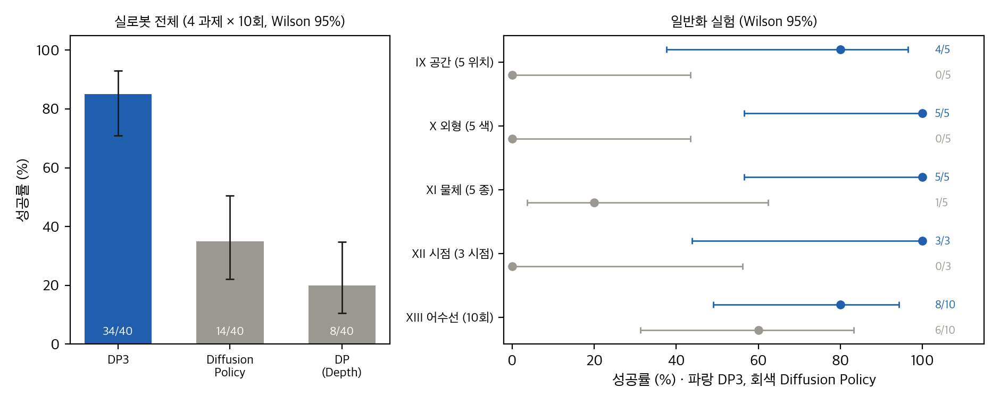

> **논문:** Yanjie Ze, Gu Zhang, Kangning Zhang, Chenyuan Hu, Muhan Wang, Huazhe Xu. *3D Diffusion Policy: Generalizable Visuomotor Policy Learning via Simple 3D Representations.* RSS 2024, arXiv:2403.03954 (v7, 2024-09-27).
> 공식 코드는 GitHub YanjieZe/3D-Diffusion-Policy에 있습니다(MIT). 이 글의 그림은 모두 표 값으로 다시 그린 그래프입니다. 논문 그림은 실로봇 사진을 포함하므로 싣지 않았습니다.

## 논문이 묻는 것

시각 기반 모방학습은 시연이 많이 필요합니다. 2D 이미지 정책은 물체의 3D 위치를 잘 일반화하지 못하고, 3D 정책은 보통 키프레임과 느린 추론에 기댑니다. DP3는 이 둘 사이에서 **단일 시점 깊이 영상을 점군으로 바꾸고, 작은 MLP로 64차원 표현을 만든 뒤, 확산 정책의 조건으로 넣습니다.** 색은 쓰지 않습니다. 외형이 바뀌어도 일반화하도록 하기 위해서입니다.

## 이 글에서 확인한 것

**1. 72 과제 평균 향상 24.2%는 계산과 맞습니다.** DP3 평균 74.36, DP 평균 59.86입니다. 과제 단위 부트스트랩 95% 구간은 15.6–35.3%입니다. 과제별로 보면 DP3가 높은 과제가 52개, DP가 높은 과제가 4개, 동률이 16개입니다(Wilcoxon p = 1.6×10⁻⁹).

*그림 1. 왼쪽: 72 과제의 과제별 성공률 (부록 Table XVIII, 시드 3개 평균). 오른쪽: 실로봇 4 과제의 성공 수 (표 VIII, 과제당 10회). 우리가 논문 표 값으로 다시 그렸습니다.*

**2. 기준선 값이 버전마다 바뀌었습니다.** v1의 초록은 55.3%였고 v7은 24.2%입니다. DP의 MetaWorld Easy 평균이 59.7에서 83.6으로 올랐습니다. 논문에는 이유가 없습니다. 표의 "±"는 시드 분산이 아니라 과제 간 표준편차입니다.

**3. 본문 주장 두 개가 표와 맞지 않습니다.** 본문은 DP3가 90% 이상 성공하는 과제가 "거의 30개"이고 DP는 15개 미만이라고 씁니다. 표로 세면 DP3는 35개, DP는 26개입니다. 또 "DP3에는 10% 미만 과제가 없다"는데, Push Back에서 0%입니다.

**4. 같은 DP 기준선이 두 값을 가집니다.** 표 II의 10 과제 DP 평균은 44.0인데, 부록 표 XVIII의 값으로 계산하면 38.2입니다. Adroit 세 과제(Hammer, Door, Pen)에서 값이 다릅니다. 기준선을 인용할 때 표 번호를 밝혀야 합니다.

**5. 실로봇 전체 차이는 확실하지만 과제별로는 아닙니다.** 과제당 10회 기준으로 DP3는 34/40 (85%), 기준선은 14/40 (35%)입니다. 전체 Fisher p = 9×10⁻⁶입니다. Dumpling(7 대 3)과 Drill(8 대 7)은 유의하지 않습니다.

*그림 2. 왼쪽: 실로봇 4 과제 전체 성공률 (40회)과 Wilson 95% 구간. 오른쪽: 일반화 실험 (공간, 외형, 물체, 시점, 어수선한 장면)과 Wilson 95% 구간. 시도 수가 3–10회라 구간이 넓습니다.*

**6. 저장소 기본 설정은 논문 본문과 다릅니다.** 논문 부록은 예측 지평 4와 실행 3을 쓴다고 하지만, 저장소의 기본은 16과 8입니다. 이 기본값은 논문의 긴 지평 실험 설정입니다. 그 밖에 MetaWorld의 에폭(논문 1000, 코드 3000)과 옵티마이저(논문에 없음)가 맞지 않거나 빠져 있습니다.

## 구현 가능성

이 맥(M4 Pro, 24 GiB, MPS, CUDA 없음)에서 논문 표를 재현하는 것은 불가능합니다. 시뮬 72 과제의 학습은 GPU 전제이고, 실로봇은 장비가 없습니다. 점 샘플링도 CUDA에 고정되어 있습니다. 인코더와 결정부를 PyTorch로 다시 구현하는 것은 가능합니다(노력 3–5일, 측정 전 추정). 이 글은 설치와 실행 없이 표 재계산과 정적 코드 대조만 했습니다.

## 남은 질문

- 표 II와 표 XVIII의 DP 값 중 어느 실행이 맞는가
- v1에서 v7로 기준선이 바뀐 이유
- 저장소 기본 설정으로 표 I을 냈는가, 논문 설정으로 냈는가
- 실로봇 일반화 실험을 더 많은 시도로 다시 하면 결론이 유지되는가

## 자료

- [통합 리포트 PDF](report/report_public.pdf)
- [01. 논문 분석: 3D Diffusion Policy (DP3)](analysis/01_paper_analysis.md)
- [02. 선행연구, 대안, 공식 저장소](analysis/02_prior_work.md)
- [03. 수치 재계산, 일관성 검사, 주장 판정](analysis/03_analysis.md)
- [04. 공식 코드 대조와 구현 가능성](analysis/04_code_verification.md)
