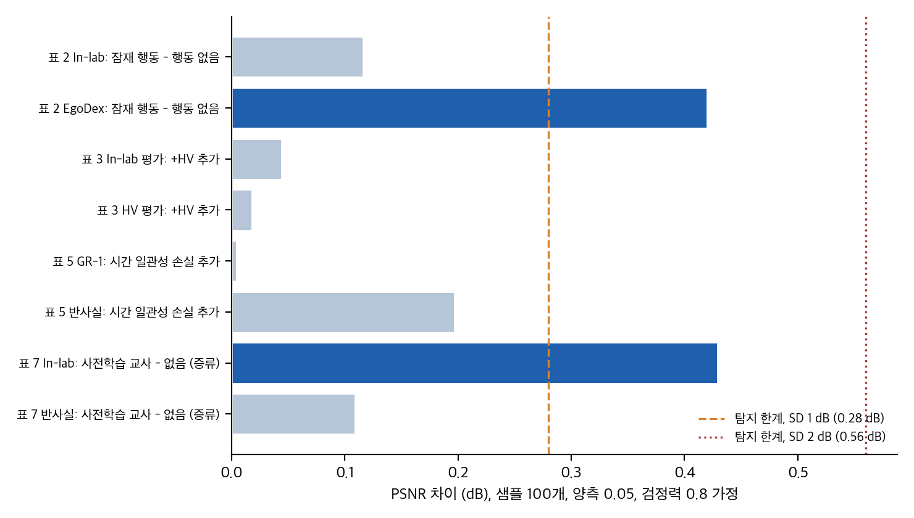
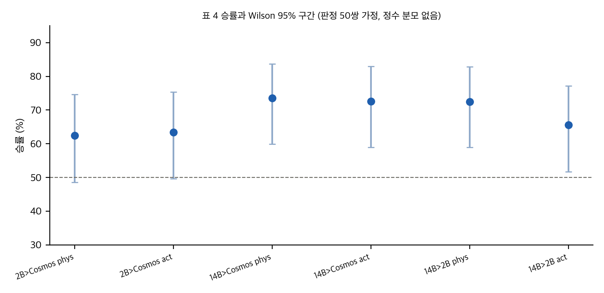
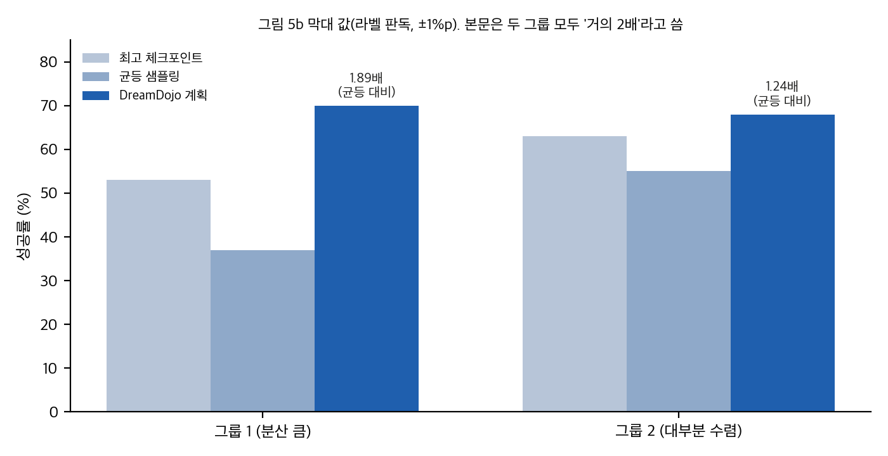

> **논문:** Shenyuan Gao, William Liang 외. *DreamDojo: A Generalist Robot World Model from Large-Scale Human Videos.* arXiv:2602.06949 (v1, 2026-02-06). ICML 2026 공식 목록에 제목이 다른 포스터가 있습니다.
> **라이선스:** arXiv 라이선스는 CC BY 4.0입니다. 그러나 논문 PDF 1쪽에 "© 2026 NVIDIA. All rights reserved." 표시가 있어서, 이 글에는 논문 그림을 싣지 않았습니다. 그래프는 저자가 표 값으로 다시 그린 것입니다.
> **코드:** 공식 저장소(Apache-2.0)는 정적으로만 읽었고 실행하지 않았습니다.

## 한 줄 요약

DreamDojo는 행동 라벨이 없는 사람 영상 44k 시간에서 **잠재 행동**을 뽑아 로봇 세계 모델을 사전학습하고, 소량의 로봇 데이터로 사후학습한 뒤, 4 스텝 자기회귀 학생으로 증류해 10.81 FPS로 상호작용합니다. 주장은 설득력이 있지만, 표를 다시 계산하면 몇 군데가 맞지 않습니다.

## 1. 규모 주장이 표와 맞지 않습니다

본문은 "9,869개 장면"이라고 씁니다. 그런데 표 1의 장면 열은 1,135k이고, 이 값은 궤적 수와 같습니다. 표의 값을 쓰면 "2,000배 장면"이 나오지만, 본문 값을 쓰면 17.5배입니다. "96배 기술"도 표의 최대 선행 값(AgiBot 87)으로 나누면 69배입니다. 학습 시간 "15배"는 맞습니다.

## 2. 사전학습 이득: 일관성 주장이 과장되었습니다

표 7은 증류 후에도 사전학습 이득이 남는다고 보입니다. 그런데 반사실 평가에서 SSIM은 0.758에서 0.746으로, LPIPS는 0.232에서 0.234로 나빠졌습니다. 본문은 "모든 평가셋에서 더 낫다"고 씁니다.

샘플 100개에서 차이를 탐지하는 한계는 쌍 차이의 SD 가정에 따라 달라집니다. SD 1 dB 가정이면 0.28 dB입니다. 표 2와 표 3의 대부분 차이는 이보다 작습니다.

그래프: 표 2·3·5·7의 PSNR 차이와 탐지 한계(샘플 100개, 쌍 차이 SD 1 dB와 2 dB 가정). 우리가 그린 그래프입니다.

## 3. 인간 선호도(표 4)는 판정 수를 알 수 없습니다

12명이 50쌍을 판정했다고 하지만, 표 4의 여섯 값은 어떤 정수 분모로도 나오지 않습니다. 50쌍으로 가정하면 2B가 Cosmos보다 낫다는 두 항목의 p 값은 0.06–0.08입니다. 같은 쌍을 여러 명이 판정하므로 독립 가정도 과합니다. 방향(14B가 2B보다 낫다)은 일관되지만, 강도를 말하기는 어렵습니다.

그래프: 표 4 승률과 Wilson 95% 구간(판정 50쌍 가정). 정수 분모가 없어 참고용입니다. 우리가 그린 그래프입니다.

## 4. 계획의 "거의 2배"는 한 그룹에만 맞습니다

그림 5b의 막대 값을 라벨에서 읽었습니다. 첫 번째 그룹은 DreamDojo 계획이 균등 샘플링보다 1.89배 높습니다. 두 번째 그룹은 1.24배입니다. 본문은 두 번째 그룹도 "거의 2배"라고 씁니다. 최저 체크포인트를 기준으로 하면 1.94배가 되는데, 본문이 그 비교를 뜻했는지는 알 수 없습니다. "17%"는 상대 증가가 아니라 절대 %p입니다(70 대 53).

그래프: 그림 5b의 막대 값(라벨 판독, ±1%p)과 본문 '거의 2배' 주장의 대조. 우리가 그린 그래프입니다.

정책 평가 상관 r = 0.995도 같은 맥락입니다. 점은 체크포인트 여섯 개입니다. 장면 20개가 점의 단위가 아닙니다. 구간은 [0.953, 0.999]입니다. 저자도 절대 성공률이 실제보다 높게 나온다고 인정합니다.

## 5. 시간 일관성 손실: 공식 코드의 축 문제

논문 식 (4)는 프레임 간 속도 차분을 씁니다. 공식 코드(`text2world_model_rectified_flow.py` 922–925행)는 `[:, 1:]`로 차분합니다. 변수 이름은 B_C_T_H_W인데, 이 슬라이스는 시간 축이 아니라 채널 축을 자릅니다. 형태 검사로 확인했습니다. 차분 결과의 모양은 (2, 15, 13, 4, 4)이고, 시간 차분이라면 (2, 16, 12, 4, 4)여야 합니다.

표 5의 GR-1 검증 이득은 PSNR 0.004 dB입니다. 반사실 평가에서는 0.197 dB가 올랐습니다. 실험에 쓴 코드가 공개 코드와 같은지는 확인하지 못했습니다. 저자에게 물어볼 항목입니다.

## 6. 속도 단위

본문은 "600 프레임(1분)"을 10.81 FPS로 만들었다고 씁니다. 그런데 600 프레임을 10.81 FPS로 만들면 55.5초입니다. FPS가 픽셀 프레임인지 잠재 프레임인지도 정해져 있지 않습니다. 가속 비율 3.97배(교사 2.72 FPS 대 학생 10.81 FPS)는 맞습니다.

## 7. 재현은 이 맥에서 어렵습니다

- **사전학습, 사후학습, 증류, LAM 학습:** H100 64–256장, 공개되지 않은 사람 영상 데이터. 이 맥에서는 불가능합니다.
- **2B 추론 (49 프레임, 35 스텝):** 저장소는 H100과 CUDA에서 시험되었습니다. MPS 포팅이 필요하고, 메모리와 시간은 측정하지 않았습니다. 3–5일 정도로 추정합니다.
- **14B 추론:** bf16 가중치만 약 28 GB입니다. 24 GiB 메모리에서는 어렵습니다(추정).

공식 저장소는 학습과 증류, LAM의 파이프라인을 공개했습니다. 상대 행동, 청크 주입, 사전학습 혼합 1:2:10, 증류 4 스텝은 설정과 맞습니다. 사람 평가 UI, 정책 평가, 가치 모델, 계획 코드는 없습니다.

## 정리

DreamDojo의 방향(사람 영상에서 잠재 행동을 뽑아 로봇 세계 모델을 키우는 것)은 설득력이 있습니다. 다만 규모 수치, 사전학습 이득의 일관성, 계획 이득, 속도 단위는 본문 그대로 믿기 전에 표로 확인해야 합니다. 이 글의 수치는 모두 논문 표와 그림 라벨에서 옮겼고, 원자료는 공개되지 않았습니다.

## 자료

- [통합 리포트 PDF](report/report_public.pdf)
- [01. 논문 분석: DreamDojo (arXiv:2602.06949)](analysis/01_paper_analysis.md)
- [02. 선행 연구, 구성 요소의 출처, 관련 자료](analysis/02_prior_work.md)
- [03. 수치 재계산과 일관성 검사](analysis/03_analysis.md)
- [04. 코드 대조: 논문 ↔ 공식 저장소 (NVIDIA/DreamDojo)](analysis/04_code_verification.md)
