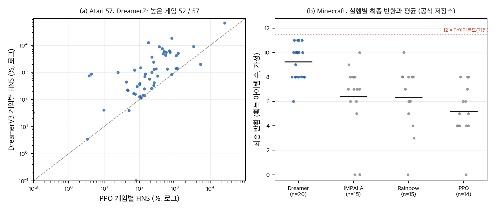
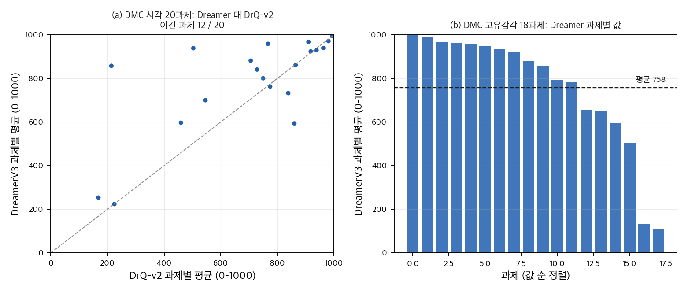

> **논문:** Danijar Hafner, Jurgis Pasukonis, Jimmy Ba, Timothy Lillicrap. *Mastering Diverse Domains through World Models.* arXiv:2301.04104 (v2, 2024-04-17). 저널판은 *Mastering diverse control tasks through world models*, Nature 640, 647–653 (2025).
> 공식 코드는 GitHub danijar/dreamerv3(MIT)에 있습니다. 이 글의 그래프 두 장은 공식 저장소의 점수 파일로 우리가 그렸습니다. 논문 그림은 넣지 않았습니다.

## 논문이 묻는 것

강화학습 알고리즘은 과제마다 손으로 맞춰야 합니다. 보상 크기, 탐색 계수, 학습률이 바뀌면 같은 알고리즘이 실패하기도 합니다. DreamerV3는 **한 가지 설정으로 여러 영역에서 전문가 알고리즘과 맞먹는 성능**을 내는 것을 목표로 합니다. 8개 영역, 150개 넘는 과제가 대상입니다. 가장 어려운 목표는 사람 데이터나 교육 과정 없이 Minecraft에서 다이아몬드를 얻는 것입니다.

방법은 세계 모델 하나와 그 안에서 상상하며 배우는 행위자·비평자로 이뤄집니다. 세계 모델은 관측을 잠재 상태로 압축하고, 행동에 따른 다음 상태와 보상을 예측합니다. 행위자와 비평자는 이 예측 안에서 긴 궤적을 상상하며 배웁니다. 논문의 핵심은 이 학습을 여러 영역에서 안정시키는 **로버스트 기법**입니다. 보상과 재구성 목표에는 symlog 변환과 지수 간격 bin의 twohot 분포를 쓰고, 반환은 5–95 백분위 범위로 나눕니다. 표현 KL에는 1 nat의 free bits를 둡니다.

## 이 글에서 확인한 것

공식 저장소는 실행마다의 점수 곡선을 공개합니다. 논문 표를 그대로 믿지 않고 이 곡선으로 다시 계산했습니다.

**1. Atari 57: PPO에는 확실, MuZero에는 게임 단위로 불확실.** Dreamer는 57게임 중 52게임에서 PPO보다 높습니다(Wilcoxon p ≈ 2×10⁻⁹). MuZero와 비교하면 중앙값과 평균은 앞서지만 게임 단위로는 32 대 24이고 p = 0.26입니다. "MuZero를 넘었다"는 전체 집계의 말이지, 게임마다 이겼다는 뜻이 아닙니다.

**2. 최종 점수 집계 규칙이 논문에 없습니다.** 공식 파일에서 마지막 점 하나만 쓰면 Atari의 중앙값 HNS가 745가 됩니다. 마지막 3–5점 평균을 쓰면 832가 되어 논문 표 값 830과 맞습니다. ProcGen은 마지막 3점 평균으로 16과제 모두 표 값과 같습니다. 벤치마크마다 맞는 창이 다릅니다. 결과가 평가 방식에 따라 바뀌므로 보고 규칙을 적어야 합니다.

**3. Minecraft: 시간 환산이 맞지 않습니다.** 논문은 100M 스텝을 "약 100일"이라고 씁니다. 36,000 스텝이 30분이므로 게임 속도는 20 Hz입니다. 그러면 100M 스텝은 약 58일입니다. 프로젝트 페이지의 "3천만 스텝 = 17일"로 환산해도 57일입니다. 버전 1은 74M 스텝을 42일로 환산했는데, 이는 20 Hz와 맞습니다. 버전 2의 100일은 이 환산과 맞지 않습니다.

**4. Minecraft: 다이아몬드 수가 버전마다 다릅니다.** 버전 1은 40 seed 중 24개가 최고 점수에 도달했다고 합니다. 버전 2는 10 seed 모두라고 씁니다. 공식 파일은 20 seed이고 19개가 도달했습니다. 반환이 12(12개 이정표 전부)라고 가정하면 기준선 0/44와 비교해 Fisher p ≈ 2×10⁻¹⁵입니다. 이 가정은 본문으로 확인하지 못했습니다. 기준선 IMPALA의 평균도 본문 7.1과 달리 6.4로 나옵니다.

**5. DMC: 평균 순위는 맞지만 과제별 우위는 경계선입니다.** 표 11과 12의 평균과 중앙값 행이 뒤바뀐 것으로 보입니다. 재계산한 평균 758(고유감각)과 중앙값 868는 표에서 각각 중앙값과 평균으로 적힌 값과 맞습니다. 과제 단위 우위는 DMPO에 대해 9/18(p = 0.28), DrQ-v2에 대해 12/20(p = 0.09)입니다.

**6. DMLab과 Atari 100k.** DMLab 사람 기준 평균 71.4는 표 8의 값에서 정확히 재현됩니다. IMPALA 1B(66.3)는 실행 하나라서 차이에 불확실성을 줄 수 없습니다. Atari 100k의 평균 125는 공식 데이터에서 123.5로 나옵니다. 본문은 TWM과 IRIS를 넘는다고 쓰지만, 중앙값은 TWM 51, Dreamer 49입니다.

## 공식 코드와 논문의 차이

공식 코드(JAX)를 정적으로 읽었습니다. 실행하지 않았습니다. 핵심 식과 손실, free bits, unimix, 반환 정규화, symexp twohot, 학습률, AGC, 블록 GRU는 논문과 맞습니다. 차이는 주로 제어 과제 설정에 있습니다.

- **LaProp β₂:** 본문은 0.99라고 쓰지만 코드는 0.999입니다.
- **제어 모델 크기:** 논문 표 2는 DMC 두 스위트에 12M 모델을 씁니다. 코드는 고유감각에 약 1M급, 시각에 기본 200M 모델을 씁니다.
- **재생 비율과 action repeat:** Atari 100k(128 대 256), DMC 두 스위트(512 대 1024, 512 대 256)가 다릅니다. DMC의 기본 action repeat도 2가 아니라 1입니다.
- **표 3의 오기:** 12M 모델의 순환 유닛은 8d = 2,048이어야 하는데 표에는 1,024로 적혀 있습니다. 코드는 2,048입니다.

## 구현 가능성 (Apple M4 Pro, 24 GiB, MPS, CUDA 없음)

**논문 전체 재현은 이 맥에서 불가능합니다.** 실험 대부분이 GPU와 수 일에서 수 주 규모이고, 공식 코드는 CUDA 버전의 JAX로 고정되어 있습니다. Minecraft는 Linux와 Java 8, 패치된 MineRL을 가정합니다.

가능한 것은 세 가지입니다. 공식 점수로 표를 다시 계산하는 것은 끝냈습니다(수 초). 공식 코드의 `debug` 설정을 CPU에서 짧게 돌리는 것은 설치를 승인받은 뒤에 가능합니다. 핵심 손실(free bits, symexp twohot, 반환 정규화)을 PyTorch로 작게 옮겨 보상 크기가 다른 토이 과제에서 확인하는 것도 가능합니다. 노력은 1–2주로 추정하지만 아직 재지 않았습니다.

## 한계

- 최종 점수 집계와 seed 수가 본문과 공식 파일에서 일치하지 않습니다. 재현 실험 없이 이 차이의 원인은 확정할 수 없습니다.
- Minecraft 반환 12의 의미(다이아몬드 도달)는 가정입니다. Dreamer 한 실행은 100M 스텝 전에 끝나 그 시점 결과가 없습니다.
- 저널판은 읽지 않았습니다. arXiv v2와 다를 수 있습니다.
- 제어 과제의 공식 설정과 논문 본문 설정이 다르므로, 공식 결과를 "논문 설정 결과"로 옮기면 틀릴 수 있습니다.

## 출처와 라이선스

- 논문: arXiv:2301.04104. arXiv abs 페이지의 라이선스 링크는 `creativecommons.org/licenses/by/4.0/`(CC BY 4.0)입니다. PDF에서 저작권 표시는 찾지 못했습니다. 이 글은 논문 그림을 넣지 않았습니다.
- 그래프 두 장은 공식 저장소의 실행별 점수로 우리가 그렸습니다. 재계산 스크립트와 결과 파일은 공개 폴더에 있습니다.
- 공식 코드: github.com/danijar/dreamerv3 (MIT). 이 글은 코드를 복사하거나 실행하지 않았습니다.
- 저널판: Nature 640, 647–653 (2025), doi 10.1038/s41586-025-08744-2 (CC BY 4.0 오픈 액세스).

## 자료

- [통합 리포트 PDF](report/report_public.pdf)
- [DreamerV3: Mastering Diverse Domains through World Models (arXiv:2301.04104) 논문 분석](analysis/01_paper_analysis.md)
- [DreamerV3 선행연구와 관련 연구 (02)](analysis/02_prior_work.md)
- [DreamerV3 수치 재계산과 일관성 검사 (03)](analysis/03_analysis.md)
- [DreamerV3 공식 코드 대조 (04)](analysis/04_code_verification.md)
