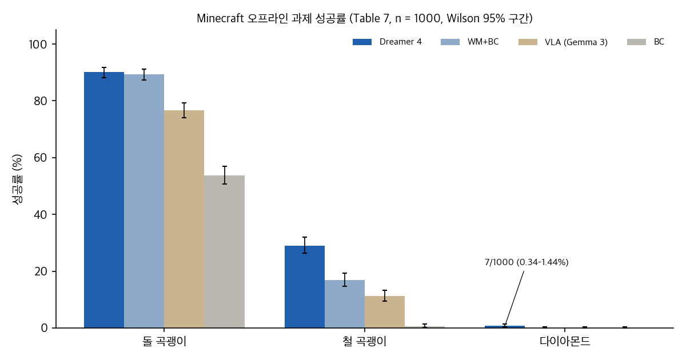
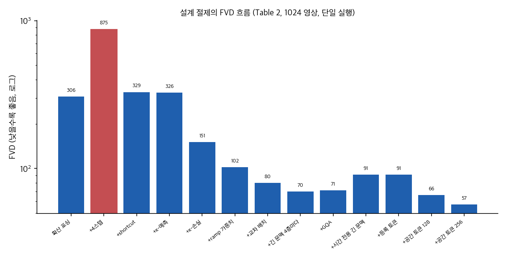

# Dreamer 4 분석: 상상 학습으로 Minecraft 다이아몬드를 얻은 world model 에이전트

*Training Agents Inside of Scalable World Models* (Danijar Hafner, Wilson Yan, Timothy Lillicrap, arXiv:2509.24527 v1, 2025-09-29)를 읽고, 표의 수치를 다시 계산했습니다. 학습이나 재현은 하지 않았습니다.

## 한 줄 요약

Dreamer 4는 Minecraft 계약자 영상 2.5K 시간만으로 world model을 학습하고, 그 안에서 강화학습해 다이아몬드를 얻었습니다. 다만 성공률은 1000 에피소드 중 7회(0.7%)입니다.

## 무엇을 했나

- **토크나이저**: 마스크 오토인코더로 영상 프레임을 연속 잠재로 압축합니다.
- **dynamics 모델**: 행동, 잡음 수준, 스텝 크기를 함께 받아 다음 잠재를 예측합니다. shortcut forcing으로 학습해 프레임당 4번만 계산하면 됩니다.
- **상상 학습**: 정책과 보상 헤드를 붙인 뒤, 모델 안에서 상상한 궤적으로 정책을 개선합니다. 정책 손실은 이득의 부호만 사용합니다.

## 수치 다시 보기

철 곡괭이 성공률은 Dreamer 4가 29.0%, 행동 복제 기준선 WM+BC가 16.9%입니다. 두 비율 차이는 p < 0.001입니다. 돌 곡괭이는 90.1%와 89.4%로 차이가 없습니다. 다이아몬드는 7/1000이며, 95% 구간은 0.34–1.44%입니다.

*그림 1. 논문 Table 7 값으로 그린 성공률 막대그래프입니다. 오차 막대는 Wilson 95% 구간(n = 1000)입니다. 우리가 그렸습니다.*

## 설계 선택의 효과

설계 절제 표(Table 2)는 FVD를 306에서 57까지 낮춘 단계를 보여 줍니다. 샘플링 스텝을 4로 줄이면 품질이 크게 떨어지고(875), shortcut 학습과 x-예측, 손실 가중치가 이를 회복시킵니다.

*그림 2. 논문 Table 2의 FVD를 로그 축으로 그렸습니다. 단일 실행 값이며 신뢰구간은 없습니다. 우리가 그렸습니다.*

## 확인된 것과 확인되지 않은 것

- **지지됨**: 철 곡괭이 향상, 실시간 추론(H100, 21 FPS), 상호작용 평가에서 14/16 대 5/16.
- **조건부**: "100배 적은 데이터"는 VPT의 웹 데이터를 포함할 때만 맞습니다.
- **과장**: 철 곡괭이에서 VLA보다 "거의 3배" 높다는 말은 실제 2.6배입니다.
- **불일치**: 본문에 나오는 v-space FVD 124는 표에 없습니다.
- **빈칸**: 학습률, 옵티마이저, 시드, 공식 코드가 없습니다.

## 재현 가능성

이 논문의 2B 모델은 TPU 수백 대에서 학습했고, 가중치와 설정이 공개되지 않았습니다. 소규모 개개의 아이디어(shortcut 손실, PMPO 손실)는 CPU 토이로 확인할 수 있습니다. 논문 규모의 재현은 일반 노트북으로는 어렵습니다.

## 출처

- 논문: arXiv:2509.24527 v1 (abs 페이지의 라이선스 링크는 `arxiv.org/licenses/nonexclusive-distrib/1.0/`).
- 프로젝트 페이지: https://danijar.com/project/dreamer4/
- 표 값과 본문 수치는 논문에서 그대로 옮겼습니다. 그림 두 장과 재계산 스크립트는 이 글의 작성자가 만들었습니다.
- 논문 그림은 이 글에 싣지 않았습니다(arXiv non-exclusive 라이선스).

## 자료

- [통합 리포트 PDF](report/report_public.pdf)
- [01. 논문 분석: Training Agents Inside of Scalable World Models (Dreamer 4)](analysis/01_paper_analysis.md)
- [02. 선행연구와 관련 분석](analysis/02_prior_work.md)
- [03. 수치 재계산과 일관성 검사](analysis/03_analysis.md)
- [04. 주장 검증 (공식 코드 없음)](analysis/04_claim_verification.md)
