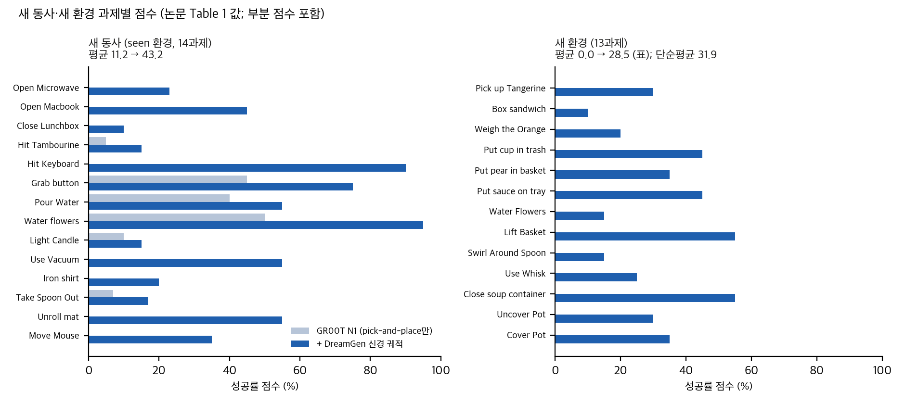
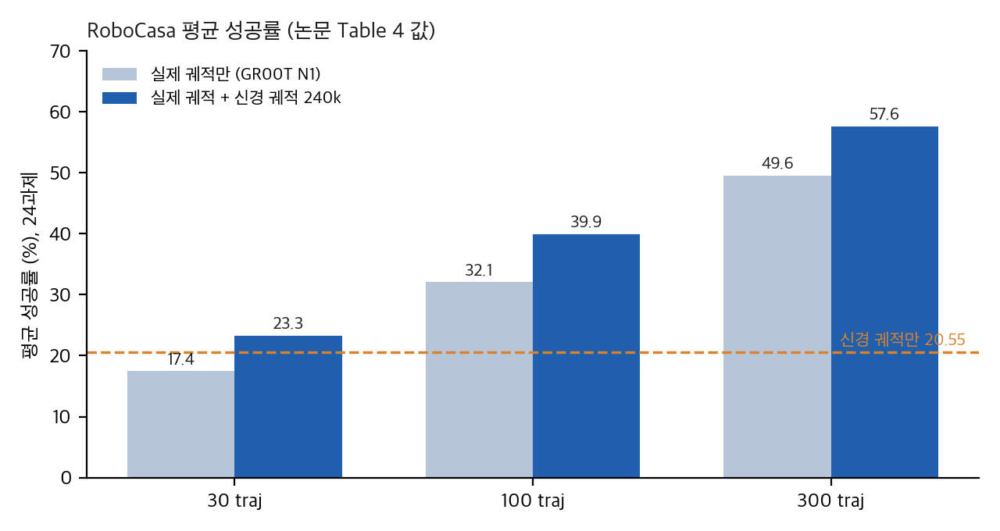
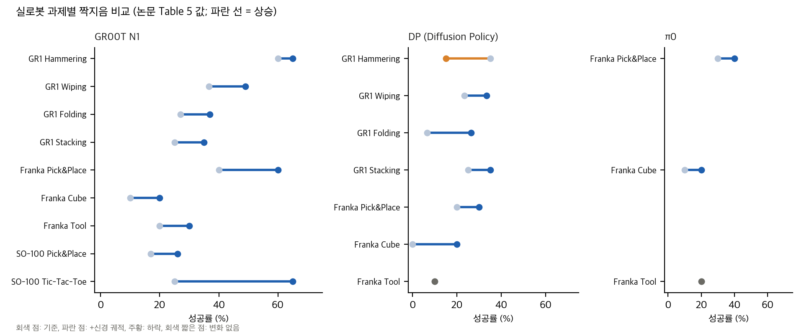

# 03. 수치 재계산과 검정

재현 실험은 하지 않았습니다. 논문 표와 본문에 적힌 숫자로만 다시 계산했습니다. 계산 스크립트는 `analysis/recompute.py`, 결과는 `analysis/recompute_results.json`입니다. 그래프는 `analysis/plot_figures.py`가 논문 표 숫자로 그립니다. 값의 출처는 표 번호와 쪽으로 적었습니다.

핵심: **(1) 시뮬레이션 평균(Table 4)은 전부 맞습니다. (2) 실로봇 평균은 본문, 표 5, 계산값이 서로 다릅니다. (3) 실로봇 향상은 10회 실험에서 통계적으로 확인되지 않습니다. (4) 새 환경 평균 28.5는 표의 값으로 계산되지 않습니다. (5) DreamGen Bench와 정책 성능의 상관은 점 4개의 근사값에 기대고 있어서 근거가 약합니다. (6) 사람 평가 상관 표 두 개가 Table 2와 맞지 않습니다.**

## 1. Table 1 (새 동사 14, 새 환경 13) — p.7

| 항목 | 재계산 | 보고 | 판정 |
|---|---|---|---|
| 새 동사 기준 평균 | 11.21 | 11.2 | 일치 |
| 새 동사 DreamGen 평균 | 43.21 | 43.2 | 일치 |
| 새 환경 기준 평균 | 0.00 | 0.0 | 일치 |
| 새 환경 DreamGen 평균 (13과제, 합 415) | **31.92** | **28.5** | **불일치** |
| 같은 합을 14로 나눈 값 | 29.64 | — | 역시 28.5와 다름 |
| 본문 "GR00T N1 기준 11.8%" (p.7 l.563) | — | 표는 11.2 | **불일치** |

- 본문 "11.2% → 43.2%"(p.7 l.565)와 "11.8%"가 같은 단락에 함께 있습니다.
- 표 1의 값은 부분 점수로 된 과제 점수입니다(예: 집기 0.5점). 궤적별 결과가 없어서 이항 신뢰구간은 만들 수 없습니다. 14개 과제를 짝지은 Wilcoxon 검정(설명용)은 p ≈ 1.2×10⁻⁴입니다. 14개 값의 순위 검정이라 이 값은 참고만 합니다.
- 기준 GR00T N1은 "Water flowers" 50%, "Grab button" 45%를 받았습니다. 부분 점수 때문에 pick-and-place만 학습한 기준선도 0이 아닌 점수를 받습니다. "새 동사를 배웠다"는 주장은 이 부분 점수 체계 위에서 읽어야 합니다.

## 2. Table 2 와 Figure 6 (DreamGen Bench 와 RoboCasa 정책 점수) — p.8

**2.1 Figure 6 의 x축 재현.** 논문은 x축을 "IF(GPT)와 PA의 평균"이라고 씁니다. RoboCasa 열로 계산하면 다음과 같습니다.

| 모델 | 재계산 x | 그림에서 보이는 위치 |
|---|---|---|
| Cosmos-sft | 70.35 | ≈ 70 |
| WAN2.1-sft | 66.2 | ≈ 67 |
| CogVideoX-sft | 58.85 | ≈ 59 |
| Hunyuan-sft | 56.8 | ≈ 57 |
| Cosmos-zero | 13.55 | ≈ 13 |
| 제로샷 3개 | 0–0.5 | ≈ 0 |

x축 정의는 표와 맞습니다.

**2.2 상관계수.** y축(RoboCasa 정책 점수) 값은 표에 없고 그림에서 눈으로 읽었습니다(WAN ≈ 11.5, CogVideoX ≈ 11.0, Hunyuan ≈ 9.7, Cosmos ≈ 21). 이 근사값으로 계산하면:

- 미세조정 4개 점: Pearson r = **0.84** (p = 0.16, n = 4)
- Cosmos를 뺀 3개 점: r = 0.84 (p = 0.36, n = 3)

점이 4개뿐이고 값은 근사치입니다. 4개 모델 중 Cosmos 한 점이 기울기를 거의 정합니다. 본문의 "양의 상관"은 방향만 맞고, 강도는 이 데이터로 말할 수 없습니다. 제로샷 점은 상관 계산에서 뺐습니다.

**2.3 IF·PA의 정의 확인.** RoboCasa 열 중 Hu(사람) 칸은 Cosmos-sft 93.8, 나머지 셋도 모두 주어져 있습니다. PA 열(44.8/44.8/55.3/61.5)은 Table 2에서 "PA"로 적힌 값을 그대로 사용했습니다.

## 3. Table 4 (RoboCasa 24과제, 240k 신경 궤적) — p.17

**3.1 평균 재계산.** 24개 과제 행의 단순평균은 7개 열 모두 보고값과 같습니다(17.44 / 32.07 / 49.59 / 23.32 / 39.94 / 57.61 / 20.55). 표 4의 평균은 원자료를 그대로 평균한 값입니다.

**3.2 쌍체 비교 (과제 단위, 24개).** 과제 내 궤적 수는 표에 없습니다. 과제를 한 단위로 보고 짝지은 t 검정을 했습니다. 시드 하나, 과제 24개입니다.

| 비교 | 평균 차이 (pp) | 95% CI | 상승/하락 과제 | t 검정 p | Wilcoxon p |
|---|---|---|---|---|---|
| 30 traj → +NT | +5.9 | 2.7 – 9.1 | 17 / 1 | 0.0008 | 0.0009 |
| 100 traj → +NT | +7.9 | 3.9 – 11.9 | 21 / 3 | 0.0005 | 0.0004 |
| 300 traj → +NT | +8.0 | 3.4 – 12.6 | 17 / 7 | 0.0015 | 0.0016 |
| 300 traj → 신경 궤적만 | −29.0 | −36.1 – −22.0 | 0 / 24 | <0.0001 | <0.0001 |

- 신경 궤적을 더하면 과제 평균이 오릅니다. 다만 과제 간 독립성과 시드 한 번을 가정한 결과입니다.
- **log-linear 주장은 여기서 확인할 수 없습니다.** Table 4는 240k 한 설정뿐입니다. Fig. 4의 곡선에는 점 값이 없습니다. 기울기를 다시 계산할 수 없습니다.

## 4. Table 5 (실로봇 9과제) — p.18

**4.1 GR1 4과제 평균: 세 개의 값.**

| 정책 | 4과제 단순평균 (재계산) | 표 5 평균 | 본문 (p.2) |
|---|---|---|---|
| DP | 22.47 | 22.0 | — |
| DP + 신경 | 27.42 | 27.0 | — |
| GR00T N1 | 37.15 | 37.0 | 37% |
| GR00T N1 + 신경 | **46.50** | **46.0** | **46.4%** |

표 5의 평균이 칸 값의 단순평균과 맞지 않습니다(DP 0.5, GR00T+NT 0.5 차이). 원자료의 소수점 이하 값이 따로 있을 수 있습니다. 본문 46.4%는 표와도 재계산과도 다릅니다. 차이가 작지만 세 값이 다 다릅니다.

**4.2 "모든 로봇·모든 정책에서 일관되게 향상" 주장 점검.** 짝지은 칸은 19개입니다. 정책별로 보면 GR00T는 9/9, DP는 7칸 중 5칸 상승, π0는 3칸 중 2칸 상승입니다.

- 상승 16, 변화 없음 2 (DP Franka Tool, π0 Franka Tool), 하락 1 (**DP GR1 Hammering: 35.0 → 15.0**).
- DP와 π0는 SO-100에서 실험하지 않았습니다(표 5 "-"). "모든 embodiment"는 과장입니다. 본문 p.6 l.348은 "across all robot embodiments"라고 씁니다.
- "Empricially" 문단(p.6)은 GR00T가 더 크게 오른다고 설명합니다. 이 점은 표와 맞습니다.

**4.3 검정력.** 칸마다 10회 실험입니다(App. I.1–I.3). 칸 값이 10의 배수인 Franka 칸(binary 성공 수로 볼 수 있는 칸)에 Fisher 정확 검정을 했습니다.

| 칸 | 기준 → +NT (성공/10) | Fisher p |
|---|---|---|
| Franka Pick&Place | 4 → 6 | 0.66 |
| Franka Cube | 1 → 2 | 1.00 |
| Franka Tool | 2 → 3 | 1.00 |

- 6/10의 Wilson 95% CI는 [0.31, 0.83]입니다.
- GR1 4과제를 묶은 근사 두 비율 검정(칸 값을 10회 비율로 가정)은 차이 +9.4pp, z = 0.85, p ≈ 0.39입니다. 칸마다 부분 점수가 섞여 있어서 근사치입니다.
- 결론: 이 실험 크기에서는 실로봇 향상이 통계적으로 확인되지 않습니다. "향상이 있었다"는 방향 주장으로만 읽어야 합니다.

## 5. 표 사이의 일관성 점검

| # | 위치 | 내용 | 판정 |
|---|---|---|---|
| C1 | Table 1, p.7 | 새 환경 평균 28.5 vs 13값 평균 31.9 | 불일치 |
| C2 | p.7 l.563 vs Table 1 | 기준 11.8% vs 11.2 | 불일치 |
| C3 | p.2 vs Table 5 | GR1 평균 46.4 vs 46.0 (재계산 46.5) | 불일치 |
| C4 | Table 6 vs Table 2 | GR1-Env 사람 IF 20.0/30.0/43.3/53.3 vs Hu 열 43.2/61.1/67.4/53.3 (3개 모델 불일치) | **불일치** |
| C5 | Table 6 vs Table 7 | WAN2.1 GR1-Behavior 사람 IF: 74.5 (Table 6, Table 2) vs 70.2 (Table 7) | 불일치 |
| C6 | Table 6 GPT 상관 | 재계산 r: RoboCasa 0.88 (보고 0.94), GR1-Object 0.97 (보고 0.93), GR1-Env 0.85 (보고 1.00), GR1-Behavior 0.96 (보고 0.96) | 3개 불일치, 1개 일치 |
| C7 | Table 7 Qwen 상관 | RoboCasa 0.92 (보고 0.92), Object 0.95 (0.95), Env 0.96 (0.96), Behavior 0.95 (보고 0.97) | Behavior 불일치(C5의 70.2 사용 시) |
| C8 | p.8 "평균 상관 > 90%" | 보고값 평균 0.954, 재계산 평균 0.93 | 주장은 두 경우 모두 성립 |
| C9 | Table 2 GR1-Env Hu 열 | Table 6의 "IF-human" 값과 다름 (C4) → 그 열을 쓴 상관 계산 r(GPT, Table 2 Hu) = 0.45 | 주의 |
| C10 | §2.4 vs §3.2 / App. F | 실로봇 학습 궤적: 10개 vs Franka 11·10·8개(App. F) | 소수 불일치 |
| C11 | §3.1 vs App. F | SO-100: 본문 "40·50 궤적 수집", "25%(10·13)"; App. F "10·13 영상 → 68·44 궤적 (자른 뒤)" | 정의 불일치 |
| C12 | §3.2 | 2,884 (영상 모델 학습) vs 2,885 (GR00T pick-and-place) | 한 개 차이, 확인 필요 |
| C13 | p.1 vs Table 1 | "기준 0% on most novel behavior" 주장 vs 기준 0이 아닌 6/14 과제 | 부분 점수 때문에 과장 |
| C14 | §5 | "240k 생성 54시간 on 1500 L40" | 원문 주장, 검증 불가 |

Table 6 의 GPT 상관(C6)은 논문이 계산 방식을 적지 않아서 원인을 알 수 없습니다. 다른 점 집합이나 다른 IF 열을 썼을 가능성이 있습니다. 작성자에게 확인할 항목으로 남깁니다.

## 6. 요약

1. 시뮬레이션 평균(Table 4)은 재계산이 일치합니다. 과제 단위 쌍체 검정은 신경 궤적 추가 효과를 지지합니다(시드 한 번, 과제 24개).
2. 실로봇 향상은 방향은 대부분 맞지만(19칸 중 16 상승), 10회 실험으로는 통계적으로 확인되지 않습니다. 평균 값은 세 가지입니다.
3. 새 환경 28.5%와 새 동사 11.8%는 표와 맞지 않습니다.
4. DreamGen Bench와 정책 성능의 상관은 점 4개, y는 눈으로 읽은 근사값입니다. 근거가 약합니다.
5. 사람 평가 상관 표(Table 6–7)의 일부 값이 Table 2와 다릅니다.
6. 논문 주장의 log-linear 스케일링은 표로 검증할 수 없습니다.
