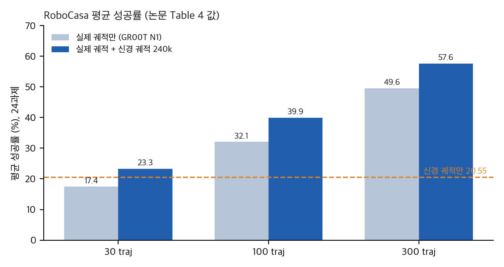
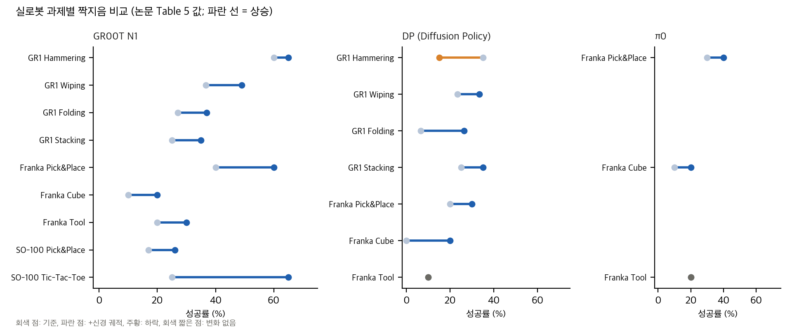
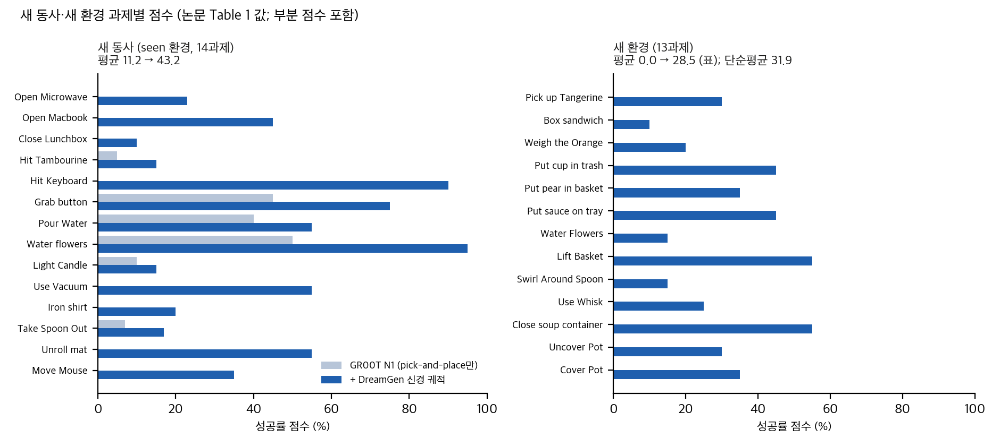

> **논문:** Joel Jang, Seonghyeon Ye, Zongyu Lin, Jiannan Xiang 외 (NVIDIA 등). *DreamGen: Unlocking Generalization in Robot Learning through Video World Models.* CoRL 2025 (PMLR 305), arXiv:2505.12705 (v2, 2025-06-17).
> 공식 코드(Apache-2.0, NVIDIA/GR00T-Dreams)는 정적으로만 읽었고 실행하지 않았습니다. 논문 그림은 싣지 않고, 논문 표 숫자로 우리가 그린 그래프만 씁니다.

## 논문이 묻는 것

로봇 정책을 키우려면 과제와 환경마다 사람이 시연 데이터를 모아야 합니다. 시뮬레이션은 싸지만 sim2real 격차와 액체·관절체 모델링 문제가 있습니다. DreamGen은 질문을 바꿉니다. 영상 생성 모델을 실시간 계획기가 아니라 **합성 데이터 생성기**로 쓰면 어떨까요?

방법은 네 단계입니다. 목표 로봇의 시연 영상으로 영상 세계모델을 LoRA로 미세조정하고, 초기 프레임과 지시문으로 영상을 생성한 뒤, IDM이나 잠재 행동 모델(LAPA)로 행동을 붙입니다. 이렇게 만든 "신경 궤적"으로 정책을 학습합니다. 주장은 세 가지입니다. RoboCasa에서 신경 궤적을 늘리면 성공률이 오르고, 실로봇 9개 과제에서 시연 10–13개와 신경 궤적을 함께 쓰면 성공률이 오르며, 한 환경의 pick-and-place 데이터만으로 새 동사와 새 환경에서도 성공이 나온다는 것입니다.

## 이 글에서 확인한 것

**시뮬레이션 평균은 재계산이 맞습니다.** RoboCasa 24과제 평균 표의 일곱 열은 모두 원자료 평균과 일치합니다. 과제 단위로 짝지어 보면 신경 궤적을 더한 효과는 +5.9–8.0pp이고, 95% 신뢰구간 하한은 2.7–3.9입니다. 시드 한 번과 과제 독립을 가정한 결과입니다. log-linear 곡선은 표에 점 값이 없어서 확인할 수 없었습니다.

*그림 1. RoboCasa 평균 성공률. 실제 궤적만 쓴 기준과 240k 신경 궤적을 더한 값. 점선은 신경 궤적만 쓴 값 20.55%입니다.*

**실로봇 향상은 방향은 맞지만 통계적으로 확인되지 않습니다.** 실로봇 실험은 칸마다 10회입니다. Franka 세 칸의 Fisher 정확 검정 p는 0.66, 1.00, 1.00입니다. GR1 4과제 평균을 묶은 근사 검정도 p ≈ 0.39입니다. 6/10의 95% 신뢰구간은 [0.31, 0.83]으로 넓습니다. 짝지은 19칸 중 16칸이 올랐고, 1칸(DP GR1 Hammering, 35→15)은 떨어졌습니다. "모든 로봇과 모든 정책에서 일관되게 향상"이라는 주장은 이 표와 맞지 않습니다. 떨어진 칸이 있고, DP와 π0는 SO-100에서 실험하지 않았습니다.

*그림 2. 실로봇 9과제 중 짝지은 칸. 회색 점은 기준, 파란 점은 신경 궤적을 더한 값, 주황은 하락입니다.*

**표와 본문의 숫자가 맞지 않는 곳이 있습니다.** GR1 4과제 평균 향상은 본문에서 "37%에서 46.4%"인데, 표 5의 평균은 46.0입니다. 칸 값을 직접 평균하면 46.5가 나옵니다. "새 동사" 기준선은 본문 11.8%, 표 1은 11.2%입니다. 새 환경 13과제의 평균 28.5%는 같은 표의 칸 값을 평균한 31.9와 다릅니다. 사람 평가 상관표 중 GR1-Env 열의 사람 판정 값은 Table 2의 같은 열과 다릅니다.

*그림 3. 새 동사 14과제와 새 환경 13과제의 과제별 점수. 기준선 값은 부분 점수가 섞여 있어 0이 아닌 값이 많습니다.*

**벤치마크 상관은 근거가 약합니다.** DreamGen Bench 점수와 정책 성능의 상관은 모델 4개로 보입니다(r ≈ 0.84, n = 4). 정책 점수 축 값은 그림에서 읽은 근사치라서, 이 상관으로 벤치마크가 정책 성능을 예측한다고 말하기는 어렵습니다.

**공식 코드와 논문의 차이.** 공개 저장소(Apache-2.0)는 영상 모델로 WAN2.1이 아니라 Cosmos-Predict2를 씁니다. 신경 궤적을 실제 데이터와 다른 embodiment로 다룬다는 설명은 공개 경로에서 확인되지 않았습니다. IDM은 겹치는 예측을 평균하는데, 이 세부는 논문에 없습니다. GPT-4o 평가는 API 실패를 0점으로 세는 방식이라 실패가 많으면 점수가 낮아질 수 있습니다. LAPA 라벨러의 모델 코드는 저장소에 없습니다.

## 재현 판정

이 맥(Apple M4 Pro, 24 GiB, CUDA 없음)에서 논문 실험은 재현할 수 없습니다. 영상 세계모델 미세조정, RoboCasa 신경 궤적 생성(L40 1,500장 54시간 규모), IDM 학습, GR00T N1 학습, 실로봇 실험은 모두 GPU나 하드웨어가 필요합니다. 공개 코드 전체를 CUDA 환경에서 돌리는 노력은 환경 설정 1–2주에 GPU 수백 시간 이상을 더한 규모로 추정합니다. 맥에서 할 수 있는 것은 표 재계산과 절차 점검입니다.

## 정리

DreamGen은 "영상 생성으로 로봇 데이터를 늘린다"는 방향을 실제 로봇 여러 대에서 보여 준 논문입니다. 다만 근거의 강도는 주장마다 다릅니다. 시뮬레이션 평균 향상은 재계산과 맞고 신뢰할 만합니다. 실로봇 향상은 방향은 맞지만 실험 크기가 작습니다. 벤치마크와 정책 성능의 상관은 점 4개라서 더 많은 모델로 확인해야 합니다. 표 사이의 불일치는 공식 확인이 필요합니다.

## 자료

- [통합 리포트 PDF](report/report_public.pdf)
- [01. 논문 분석: DreamGen](analysis/01_paper_analysis.md)
- [02. 선행연구와 관련 연구](analysis/02_prior_work.md)
- [03. 수치 재계산과 검정](analysis/03_analysis.md)
- [04. 코드 대조: 논문 ↔ 공식 저장소 (정적 읽기)](analysis/04_code_verification.md)
