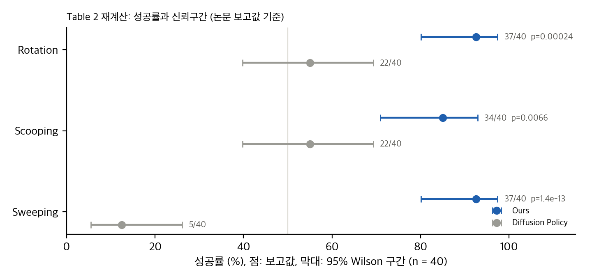

> **논문:** Junbang Liang, Ruoshi Liu, Ege Ozguroglu, Sruthi Sudhakar, Achal Dave, Pavel Tokmakov, Shuran Song, Carl Vondrick. *Dreamitate: Real-World Visuomotor Policy Learning via Video Generation.* CoRL 2024 (PMLR v270), arXiv:2406.16862 (v1).
> 논문 라이선스는 arXiv abs 페이지 기준 CC BY 4.0입니다. 이 글의 그래프는 우리가 그린 것이고, 논문 그림은 싣지 않았습니다. 공식 코드는 CC BY-NC 4.0이며 실행하지 않고 정적으로만 읽었습니다.

## 질문

로봇에게 시연을 보여 주고 정책을 학습시키면, 새 물체와 새 배경에서도 잘 될까요? 이 논문은 다른 길을 택합니다. 사전학습된 영상 확산 모델(Stable Video Diffusion)을 **사람이 도구로 작업하는 영상**으로 미세조정하고, 새 장면에서 작업 수행 영상을 생성한 뒤, 그 영상 속 도구의 6D 궤적을 추적해 로봇이 따라 하게 합니다.

## 방법

핵심은 **도구를 매개로 한 연결**입니다. 사람 손과 로봇 그리퍼는 다르지만, 같은 도구를 들면 도구의 pose만 로봇에 넘기면 됩니다. 행동을 따로 배우지 않고, 생성된 영상이 중간 표현이 됩니다.

1. 사람이 3D 프린트 도구로 작업하는 스테레오 영상을 모읍니다.
2. 영상 모델을 그 영상으로 미세조정합니다. 25프레임 중 13프레임은 한 시점, 12프레임은 다른 시점입니다.
3. 새 장면의 스테레오 이미지로 작업 영상을 생성하고, 도구를 MegaPose로 추적합니다.
4. 추적된 도구 pose를 로봇 end-effector 목표로 씁니다.

## 결과와 재계산

논문의 Table 2 보고값을 옮기고 신뢰구간과 정확 검정을 붙였습니다.

| 과제 | 이 방법 | Diffusion Policy | Fisher 정확 검정 |
|---|---|---|---|
| Rotation | 37/40 (92.5%) | 22/40 (55%) | p = 2.4e-4 |
| Scooping | 34/40 (85%) | 22/40 (55%) | p = 6.6e-3 |
| Sweeping | 37/40 (92.5%) | 5/40 (12.5%) | p = 1.4e-13 |

그래프: Table 2 보고 성공률과 95% Wilson 구간 (우리가 그린 그래프, n = 40). 생성 스크립트는 analysis/plot_figures.py입니다.

차이 자체는 세 과제 모두 뚜렷합니다. 다만 **Scooping은 구간이 겹칩니다** (이 방법의 하한 70.9%, 기준선의 상한 69.3%). 시도를 40번만 했고 물체가 10–17개뿐이라, "크게 낫다"보다는 "방향이 맞다"로 읽는 것이 맞습니다.

Push-Shape는 평균 mIoU 0.731 대 0.550, 회전 오차 8.0° 대 48.2°로 보고됩니다. 시도별 값이 없어서 구간과 검정을 만들 수 없습니다. 본문은 "significantly higher"라고 쓰지만, 근거가 되는 검정이 없습니다.

## 코드에서 확인한 것

공식 저장소는 **Rotation 과제의 SVD 미세조정 설정과 MegaPose 추적 예제**만 담고 있습니다.

- 논문은 4개 과제를 다루지만, 공개 설정은 Rotation 하나입니다.
- 논문 부록은 추론에 30 스텝과 상수 가이던스 1.0을 적었습니다. 설정 파일은 25 스텝과 1.0에서 2.5로 올라가는 가이던스입니다. 실제 추론 설정은 확정하지 못했습니다.
- 스테레오 조건화 코드(13+12 프레임, 시점별 임베딩)가 공개 저장소에 없습니다.

## 재현할 수 있을까

이 맥(Apple M4 Pro, 24 GiB, CUDA 없음)에서는 재현하지 않습니다. 학습에는 다중 GPU가 필요하고, 저장소 README는 추론에 약 70 GB VRAM을 적고 있습니다. 로봇 실험 장비도 필요합니다. 맥에서는 수치 재계산과, 추적 오차가 성공률에 어떻게 전달되는지 보는 2D 장난감 실험 정도가 현실적입니다.

## 남는 질문

- 추적 오차가 행동 오차로 얼마나 전달되는지, 논문에는 분해된 결과가 없습니다.
- 영상 모델 추론이 무거워 실시간 폐루프 제어는 어렵다고 저자도 인정합니다 (§5).
- 스테레오 구현을 공개하지 않아서, 뷰 구성을 바꿔 볼 수 없습니다.

## 자료

- [통합 리포트 PDF](report/report_public.pdf)
- [01 논문 분석: Dreamitate (arXiv:2406.16862)](analysis/01_paper_analysis.md)
- [02 선행연구와 관련 자료](analysis/02_prior_work.md)
- [03 수치 재계산과 일관성 점검](analysis/03_analysis.md)
- [04 논문 ↔ 공식 코드 정적 대조](analysis/04_code_verification.md)
