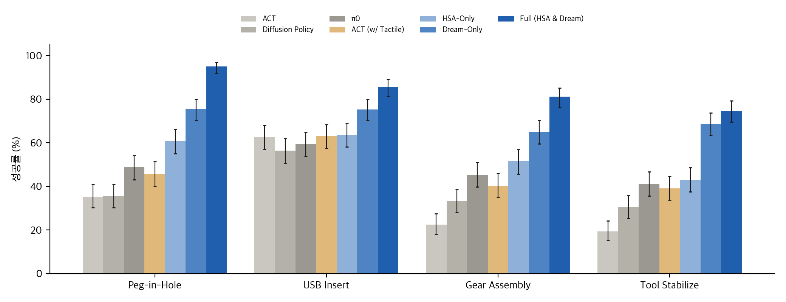
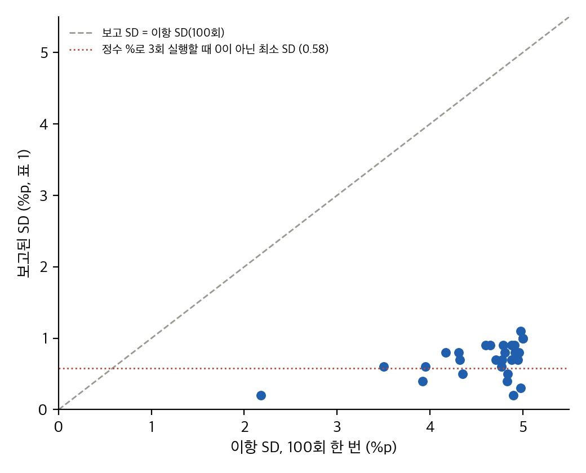
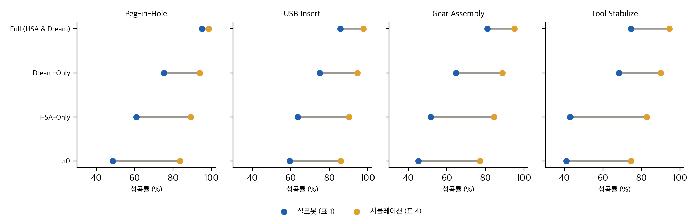
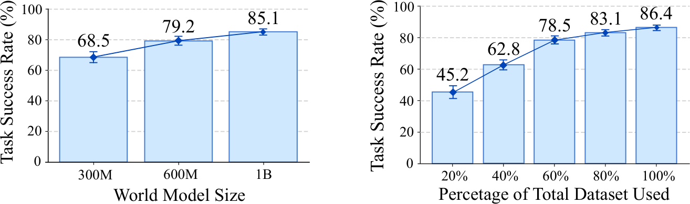

> **논문:** Guo Ye, Zexi Zhang, Xu Zhao, Shang Wu, Haoran Lu, Shihan Lu, Han Liu. *Learning to Feel the Future: DreamTacVLA for Contact-Rich Manipulation.* CoRL 2026 포스터, arXiv:2512.23864 (v5, 2026-10-27).
> 공식 코드는 GitHub에 있습니다(MIT 표기). 이 글의 그림은 논문 그림 한 장(출처 표기)과 우리가 그린 그래프입니다.

## 논문이 묻는 것

촉각 이미지가 있는 로봇이 삽입처럼 접촉이 많은 일을 할 때, 정책이 촉각을 어떻게 쓰면 좋은가를 묻습니다. DreamTacVLA는 두 가지를 제안합니다.

1. **HSA(Hierarchical Spatial Alignment).** 촉각 센서가 손목 카메라와 3인칭 카메라 어디에 보이는지 로봇 기구학과 카메라 보정으로 구하고, 그 영역의 시각 토큰과 촉각 표현을 InfoNCE로 정렬합니다.
2. **Think–Dream–Act.** 정책이 초안 행동을 내고, 사전학습된 촉각 세계 모델(V-JEPA 2 기반)이 그 행동의 결과로 나올 미래 촉각 잠재를 예측하고, 정책이 이를 보고 최종 행동을 냅니다.

실로봇에서 Peg-in-Hole, USB 삽입, 기어 조립, 도구 안정화 네 과제를 평가하고, 평균 84.1%(π0 48.6%)를 보고합니다. 시뮬레이션 약 80%, 실로봇 약 20%의 촉각 데이터로 세계 모델을 사전학습한다고 설명합니다.

## 이 글에서 확인한 것

**1. 표의 산술은 맞고, Full이 기준선보다 낫다는 결론은 시행 수 가정에 흔들리지 않습니다.** 본문의 평균과 차이(84.1, 48.6, +35.5, +46.3 등 열 개)는 모두 표와 맞습니다. 표 1은 "100 trials per run, 3 runs"이므로 과제당 300회(시행 수 300 가정)로 보고 Fisher 검정과 Holm 보정을 하면 Full 대 π0는 네 과제 모두 p < 1e-11입니다. 한 번의 100회만 쓴 보수적 가정에서도 p < 1e-3입니다.

*그래프: 표 1 성공률과 Wilson 95% 구간(과제당 300회 가정). 우리가 그린 그래프이고 값은 논문 표 1입니다.*

**2. 보고된 평균과 SD의 시행 구조는 저자 확인이 필요합니다.** 실행 3회가 각각 100회 시행이고 성공률이 정수 %라면 평균의 소수 첫째 자리는 .0, .3, .7만 가능합니다. 표 1의 28칸 중 21칸이 이 격자 밖입니다. 정수 세 실행에서 0이 아닌 SD의 최솟값은 약 0.47–0.58인데, 보고 SD 중 5칸이 그보다 작습니다. 보고 SD(0.2–1.1)는 100회 시행의 이항 SD(약 2.2–5.0)의 4–22%입니다. 각 실행의 시행 수가 100이 아니거나, 평가가 거의 결정적이거나(부록 E는 고정된 초기 위치라고 씀), SD가 다른 양일 수 있습니다. 논문에서 SD의 정의와 시행 구조를 찾지 못해 이 글의 검정은 SD 없이 성공 횟수만 썼습니다.

*그래프: 표 1의 28칸에서 보고 SD와 이항 SD(100회 한 번). 점선(회색)은 두 값이 같은 경우, 점선(빨강)은 정수 %로 3회 실행할 때 0이 아닌 최소 SD. 우리가 그린 그래프입니다.*

**3. 두 구성 요소의 기여는 과제마다 다릅니다.** 시행 수 300 가정에서 Dream-Only가 HSA-Only보다 낫다는 결과는 네 과제 모두 유의하지만(Holm p ≤ 0.03), 시행 수 100 가정에서는 Tool Stabilize에서만 유의합니다. HSA를 더한 효과(Full 대 Dream-Only)는 Peg-in-Hole에서 어느 가정에서나 유의하고, Tool Stabilize에서는 어느 가정에서도 유의하지 않습니다(Holm p = 0.86, 시행 수 300 가정). HSA 단독은 Peg-in-Hole에서만 π0와 구분되고 USB, 기어, 도구에서는 구분되지 않았습니다. ACT에 촉각을 더하는 효과도 USB에서 +0.5 %p였습니다. 초록의 "complementary"는 Peg-in-Hole과 네 과제 합산에서 뒷받침되고, 과제별로는 균일하지 않습니다.

**4. 시뮬레이션 표(표 4)는 순서는 일관되지만 개별 절제 차이는 구분되지 않습니다.** 모든 과제에서 ACT < Diffusion Policy < π0 < HSA-Only < Dream-Only < Full 순서가 유지됩니다. 다만 표 4는 "100 trials per task"인데 24칸이 모두 소수 첫째 자리 값이라 100회 한 번의 성공률로는 나올 수 없습니다(10회 평균이면 가능). 100회 가정으로 검정하면 Full 대 π0만 유의하고, Full 대 Dream-Only와 Dream-Only 대 HSA-Only는 네 과제 모두 유의하지 않습니다. 본문은 시뮬레이션이 실로봇의 "경향"과 같다고 쓰는데, 순서에는 맞고 개별 쌍의 통계적 구분은 이 표만으로는 확인되지 않습니다. 또 4.1절은 정책이 실로봇 시연만으로 학습된다고 쓰는데, 표 4는 시뮬레이션에서 정책을 평가합니다. 시뮬 평가 정책의 학습 데이터 설명을 찾지 못했습니다.

*그래프: 같은 모델의 실로봇(표 1)과 시뮬레이션(표 4) 성공률. 우리가 그린 그래프입니다.*

**5. 그림 4의 값은 표 1의 같은 구성 값과 연결되어 있지 않습니다.** 본 모델의 세계 모델은 ViT-L(300M)(부록 B.1)인데, 그림 4에서 300M의 값은 68.5이고 표 1 Full의 네 과제 평균은 84.1입니다. 데이터 100%의 값 86.4도 84.1이나 시뮬 평균 96.6과 같지 않습니다. 한 과제의 값이거나 다른 평가 설정일 수 있고, 어떤 설정인지 본문에 없습니다(그림 판독 값). 600M 모델의 구성도 서술이 없고 오차 막대의 정의도 없습니다.

*그림: 논문 그림 4. © 저자, CC BY 4.0, 출처 arXiv:2512.23864 (v5).*

**6. 공개 코드에는 논문의 Dream 단계가 포함되어 있지 않았습니다(정적 읽기).** 공식 저장소(커밋 `efd1f75`)에서 예측 MLP F_η, 미래 촉각 손실 L_W, 미래 프레임을 쓰는 코드를 찾지 못했고, 데이터로더는 현재 시각의 촉각 이미지 한 장만 반환합니다. 대신 `draft-then-refine`이라는 이름으로, 같은 관측에서 만든 초안 행동의 첫 스텝을 선형 변환해 촉각 패치 토큰 앞에 붙이는 구조가 있습니다. 이 구조에서는 이득이 미래 예측에서 오는지 같은 입력을 한 번 더 통과시키는 계산에서 오는지 코드만으로는 구분되지 않습니다. 시뮬레이션 파이프라인(IsaacSim, TacEx, cuRobo), 세계 모델 사전학습, π0 등 기준선 평가, Tool Stabilization 과제 설정도 저장소에 없었습니다. 공개 데이터셋은 세 과제(에피소드 52, 50, 50)입니다.

**7. 공개 코드의 HSA는 기본 설정에서 논문과 일부 다릅니다.** 3인칭 항(`use_third_person`)이 기본 꺼져 있고 학습 설정이 이 값을 넘기지 않으며, 손목 투영 상자는 카메라 내부 행렬이 없으면 손목 토큰 전체 평균으로 대체되고, 음성 샘플은 배치 내 다른 샘플만입니다. 하이퍼파라미터(hidden 512, FF 3200, 4/7층, 학습률 1e-5, 배치 16, KL 10, 청크 45, 어댑터 구조와 5.5M 파라미터)는 논문과 일치했습니다.

## 구현 가능성

- **공식 결과의 재현은 이 맥(Apple M4 Pro, MPS, CUDA 없음)에서 불가능합니다.** 표 1은 Dobot X-Trainer와 DIGIT 센서를 쓰는 실로봇, 표 4는 IsaacSim과 cuRobo(NVIDIA GPU)이고, 세계 모델 사전학습 코드는 저장소에 없습니다.
- **공식 코드 학습은 사실상 불가입니다.** 모델 생성에 `.cuda()`가 하드코딩되어 있고 V-JEPA 2 ViT-L 가중치가 공개 목록에 없습니다.
- **수치 재계산과 정적 코드 대조는 CPU에서 수 초에 끝납니다.** 구조를 작은 규모로 다시 짜는 합성 데이터 실험도 가능합니다(추정 1–2일, 측정 전).

## 한계

- 표 1의 시행 구조가 논문에 없어 시행 수 300 가정과 100 가정을 모두 계산했고, 실제 시행이 독립이 아니면 p 값은 작게 나옵니다. 학습 시드 분산은 반영하지 못했습니다.
- 그림 4는 판독 값이고 시행 수가 없어 검정을 하지 않았습니다.
- 코드는 정적으로만 읽었습니다. 실행하지 않아 학습이 실제로 어떻게 동작하는지, 체크포인트가 어떤 코드 경로로 만들어졌는지는 확인하지 못했습니다.
- 위의 모든 지적은 논문, 표, 코드가 서로 다른 점을 적은 것이고, 시행 구조, SD 정의, 시뮬 정책의 학습 데이터, 그림 4의 설정은 **저자 확인이 필요합니다.**

더 자세한 계산과 코드 대조는 함께 올린 분석 노트(01–04)와 리포트에 있습니다.

## 자료

- [통합 리포트 PDF](report/report_public.pdf)
- [01. 논문 분석: Learning to Feel the Future: DreamTacVLA for Contact-Rich Manipulation](analysis/01_paper_analysis.md)
- [02. 선행연구와 관련 저장소](analysis/02_prior_work.md)
- [03. 수치 재계산과 일관성 검사](analysis/03_analysis.md)
- [04. 공식 코드와 논문 대조](analysis/04_code_verification.md)
