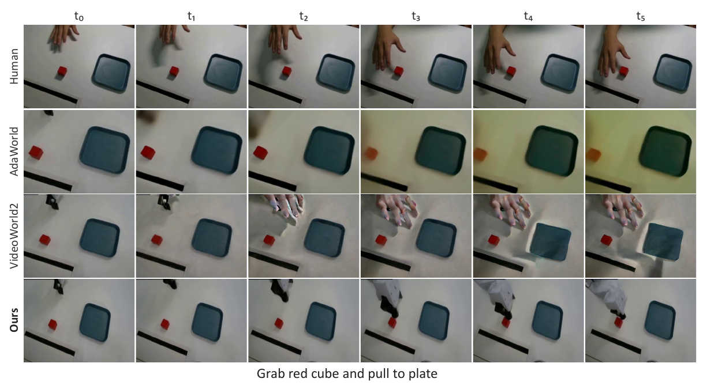

# 01. 논문 분석: DreamX (arXiv:2611.05377)

- **제목:** *DreamX: Video Diffusion Model is a Universal Latent Action Learner*
- **저자:** Jisoo Kim, Chaehyun Kim, Junsu Kim, Jiho Park, Seongchan Kim, Eunbeen Hong, Soowon Son, Fu-En Yang, Seungryong Kim (KAIST, Fu-En Yang은 NVIDIA)
- **공개:** arXiv v1(2026-11-03). 본문 10쪽, 부록 A–D와 참고문헌을 합쳐 25쪽입니다. 프로젝트 페이지는 https://cvlab-kaist.github.io/DreamX/ 입니다.
- **코드·가중치:** 공개되지 않았습니다. 프로젝트 페이지에는 "Code soon"만 있고, `cvlab-kaist/DreamX` 저장소(@ `056bd46`)에는 README와 티저 그림뿐입니다(2026-11-09 확인).
- **라이선스:** arXiv abs 페이지 기준 **CC BY 4.0**입니다. PDF 안에 이와 충돌하는 권리 표기(© 문구 등)는 없습니다. 그래서 출처를 밝히고 게시본에도 논문 그림을 넣었습니다.

**한 줄 요약:** 사전학습된 영상 diffusion 모델(Cosmos-Predict2.5 2B)에 학습 가능한 query 토큰을 붙여 영상 특징에서 **latent frame당 4개의 latent-action 토큰**을 읽어 내고, 같은 백본을 decoder로 써서 첫 프레임과 이 토큰만으로 미래 영상을 재구성하도록 학습합니다. 이렇게 얻은 latent action을 사람·로봇 사이의 공통 행동 인터페이스로 쓰고, 영상 전이, 행동 전이, 정책 학습에 활용합니다.

## 1. Abstract와 문제 설정

**문제.** 사람 영상에는 로봇 행동 레이블이 없고, 로봇끼리도 제어 공간이 다릅니다. 그래서 같은 행동이 embodiment마다 다른 저수준 행동으로 기록됩니다(§1). latent action model(LAM)은 연속 프레임의 변화를 압축한 latent action으로 이 문제를 풀려 하지만, 재구성 정확도만으로는 latent action이 "행동"만 담는다는 보장이 없습니다. 재구성에 도움이 되면 시점이나 장면 외관 같은 도메인 정보도 함께 담깁니다(§1, Nikulin et al. 2025 인용).

**주장.**

1. 영상 diffusion 모델의 시공간 특징은 움직임·대응·기하를 이미 담고 있으므로, 여기서 latent action을 직접 읽으면 좋습니다(§1, §2).
2. 같은 모델의 생성 prior가 외관을 책임지므로, decoder가 첫 프레임과 latent action으로 미래를 재구성하게 하면 latent action은 움직임에 집중하게 됩니다(§3.2).
3. 그 결과 LARYBench에서 LAM 중 최고 성능을 냈고(Table 1), 짝지은 학습 데이터 없이도 임의 embodiment 간 영상 전이와 사람→로봇 zero-shot 행동 전이가 됩니다(§4.2–4.3).
4. 압축 코드를 예측 대상으로 하는 정책은 미래 영상을 생성하는 정책(Mimic-Video)보다 성공률이 높고 19.1배 빠릅니다(Table 3).

**기여(§1).** (i) 영상 diffusion 모델의 시공간 prior와 생성 prior로 범용 latent action을 학습하는 틀, (ii) 짝지은 데이터 없는 영상·행동 전이와 압축 latent 코드를 예측 대상으로 하는 정책.

## 2. Method

### 2.1 백본: Cosmos-Predict2.5 (§3.1, Eq. 1)

causal 영상 autoencoder가 클립을 latent frame N개 V = (V₀, …, V_{N−1})로 압축합니다. V₀는 첫 프레임만 담습니다. 이 latent를 공간 패치 토큰으로 나눠 시공간 attention으로 모델링하고, 첫 프레임과 텍스트 등의 조건 c 아래에서 flow matching으로 학습합니다. x_τ = (1 − τ)x + τε, 손실은 ‖v_θ(x_τ, τ; c) − (ε − x)‖²입니다(Eq. 1).

### 2.2 Encoder: query 토큰으로 latent action 읽기 (§3.2, Eq. 2, Fig. 2)

- 학습 가능한 query 토큰 q를 영상 토큰 열에 이어 붙여, 백본의 시공간 attention을 함께 통과시킵니다.
- latent frame V_g마다 query K = 4개(q_g)를 배정하고, 문맥화된 출력이 latent-action 그룹 Q_g가 됩니다. 모든 그룹을 한 번의 forward로 뽑습니다: **Q = E_φ(q; V, ℓ)** (Eq. 2).
- **ℓ은 언어 지시이고, 백본의 원래 cross-attention으로 encoder에 들어갑니다.** decoder에는 텍스트가 들어가지 않습니다. 이 차이는 §4에서 다시 다룹니다.
- attention 마스크(Fig. 2b): query → 영상은 프레임 causal이라 Q_g는 V_{0:g}만 봅니다. query끼리는 제한이 없습니다.
- encoder는 사전학습 백본에 rank-16 LoRA를 붙여 학습합니다(백본 가중치는 고정, 부록 A.2).

### 2.3 Decoder: 생성 재구성과 보조 행동 손실 (§3.2, Eq. 3–4)

- 같은 백본을 별도 rank-16 LoRA로 decoder로 씁니다. 조건은 V₀와 Q_{0:N−1}이고 텍스트는 넣지 않습니다.
- 행동 레이블이 있는 클립에서는 고유수용 상태 p₀를 받아 행동 chunk도 함께 decode합니다: V̂, Â = D_θ(Q_{0:N−1}, V₀, p₀) (Eq. 3).
- decoder 마스크: query는 조건으로만 쓰이고 아무것도 보지 않습니다. 영상 프레임 V_t는 Q_{0:t}를, 행동 chunk A_m은 Q_{0:m}을 보며, 영상과 행동 스트림은 서로를 보지 않습니다.
- 손실: L = L_video + λ L_action, 행동 레이블이 없는 클립은 λ = 0입니다(Eq. 4). 레이블이 있으면 두 손실의 가중치가 같습니다(부록 A.2).

### 2.4 전이 (§3.3, Eq. 5, Fig. 3a)

원본 영상에서 고정된 encoder로 Q_src = E_φ(q; V_src, ℓ_src)를 뽑고, 두 가지로 씁니다.

- **영상 전이:** V̂_tgt = D_θ(Q_src, V₀^tgt). 대상 장면의 첫 프레임에 원본 움직임을 입힙니다.
- **행동 전이:** Â_tgt = D_θ(Q_src, p₀^tgt). 대상 로봇의 초기 상태에서 실행할 행동을 decode합니다.

논문은 이 전이 능력이 학습 목표에 없던 **창발 성질**이라고 설명합니다(§3.3). 추가 학습은 하지 않습니다.

### 2.5 압축과 정책 (§3.4, Eq. 6–9, 부록 A.3–A.4)

- **압축(FAE):** latent-action 토큰은 개수는 적지만 각 토큰이 백본 폭(2,048차원)을 그대로 가집니다. 논문도 이 때문에 직접 diffusion하기에는 차원이 높다고 적습니다(§3.4). 그래서 encoder를 고정하고 변분 bottleneck으로 토큰마다 2,048 → 32차원으로 줄입니다. 손실은 ‖Q̂ − Q‖² + β KL이고 β = 0.01입니다(Eq. 8–9). encoder는 self-attention 블록 하나, decoder는 6층 transformer, 학습은 50k step입니다. 정책 학습에는 사후 평균 Z = μ_ψ(Q)를 씁니다.
- **정책:** π(Z, A | V₀, ℓ, p₀)(Eq. 6). 같은 영상 백본이 현재 프레임과 지시에서 압축 코드 Z를 생성하고, 별도의 Action DiT가 생성기의 latent-action 특징, 관찰, 지시, 상태를 보고 행동을 생성합니다. 행동 토큰은 latent 특징을 보지만 반대는 아닙니다. 손실은 L_latent + λ L_action이고, 사람 영상은 λ = 0입니다(Eq. 7).
- **생성기 사전학습:** DreamX 사전학습 데이터의 약 1/3로 rank-128 LoRA를 100k step 학습합니다(H200 2장, 배치 60). Action DiT는 따로 사전학습하지 않고 과제별 학습 때 함께 학습합니다(부록 A.4).

### 2.6 학습 설정 (§4 구현 세부, 부록 A.1–A.2)

| 항목 | 값 |
|---|---|
| 백본 | Cosmos-Predict2.5 2B, 480 × 640 |
| 클립 | 5–29프레임(4 간격) = latent frame 2–8개, query 최대 32개 |
| 학습 | encoder·decoder 각각 rank-16 LoRA, 78,000 step, LoRA·query 학습률 1e-4, 나머지 5e-5, warm-up 500 |
| 데이터 | 2.19k시간, 6개 데이터셋(Fig. 9): AgiBot 818.2 h, MolmoAct2-BimanualYAM 502.3 h, DROID 410.1 h, EgoDex 350.5 h, EgoVerse 59.0 h, Bridge 47.9 h. 사람 영상 21.4% |
| 미보고 | GPU 종류·수와 학습 시간(사전학습), 배치 크기, seed, 행동 레이블이 있는 클립의 비율 |

## 3. Experiments

### 3.1 표현 품질: LARYBench (§4.1, Table 1, 부록 B.4)

모든 표현 모델을 고정하고 공통 attentive probe를 학습해, 말단 궤적 회귀(정규화 MSE)와 행동 분류(정확도)를 평가합니다.

| 방법 | 회귀 평균 ↓ | 분류 평균 ↑ |
|---|---|---|
| LAPA / UniVLA / villa-X (프레임 2장) | 0.97 / 0.87 / 0.87 | 20.17 / 18.75 / 20.90 |
| LAPA-DINOv3 (프레임 2장) | 0.60 | 49.17 |
| MoTo / AdaWorld / VideoWorld2 (영상) | 0.44 / 0.69 / 0.70 | 51.01 / 44.29 / 27.37 |
| DiLA (영상, 기존 최고) | 0.38 | 62.25 |
| **DreamX** | **0.17** | **69.67** |
| DreamX + FAE-32 | 0.22 | 67.15 |

- DreamX는 8개 열 모두에서 1위이고, FAE-32 압축 코드도 모든 기준선보다 낫습니다.
- **비교 조건이 같지 않습니다.** 회귀 벤치마크는 원래 표본당 프레임 2장만 주는데, 저자들이 메타데이터로 원본 영상의 중간 프레임까지 복원해 영상 기반 모델에만 넣었습니다(부록 B.4). 표의 위쪽 그룹(프레임 2장)과 아래쪽 그룹(영상)은 입력 정보량부터 다릅니다. 논문도 표를 두 그룹으로 나눠 두었습니다.
- encoder가 언어 지시 ℓ을 받는데(Eq. 2), LARYBench 특징을 뽑을 때 지시를 넣었는지, 넣었다면 무엇을 넣었는지 적혀 있지 않습니다. 분류 과제라면 지시문이 정답 정보를 줄 수 있습니다(`04` C9).
- 평균을 다시 계산하면 DiLA 회귀 평균만 0.3875로 표의 0.38과 경계에 있습니다(나머지는 반올림 안에서 일치, `04` C1).

### 3.2 영상 전이 (§4.2, Table 2, Fig. 4–5, 부록 B.5)

논문 Fig. 5: HumanAndRobot 벤치마크의 사람→로봇 zero-shot 영상 전이. 사람과 로봇이 같은 위쪽 시점에서 찍혀 있습니다.

- **임의 embodiment 간 전이(Fig. 4):** 같은 로봇의 다른 환경, 다른 로봇, 사람→로봇, DAVIS 일반 영상까지 정성 예시만 있습니다.
- **사람→로봇 zero-shot(Table 2):** HumanAndRobot 21개 과제에서 과제당 48클립, 총 1,008클립을 씁니다. 각 방법은 사람 영상과, 짝지은 로봇 녹화의 첫 프레임을 받습니다. 나머지 로봇 프레임은 평가 기준으로만 씁니다. 첫 20프레임에서 조건 프레임을 뺀 19프레임으로 평가합니다.

| 방법 | FVD ↓ | LPIPS ↓ | PSNR ↑ | SSIM ↑ |
|---|---|---|---|---|
| AdaWorld | 170.19 | 0.344 | 22.95 | 0.846 |
| VideoWorld2 | 241.92 | 0.299 | 22.53 | 0.881 |
| **DreamX** | **57.44** | **0.179** | **26.52** | **0.917** |

- 기준선은 전이 과제용으로 학습되지 않았고 학습 데이터도 다릅니다. "첫 프레임을 그대로 복사"하거나 query를 0으로 둔 자명한 기준선은 없습니다. PSNR·SSIM은 정지 배경이 대부분을 차지하므로, 이런 기준선이 있어야 움직임 전이 몫을 가를 수 있습니다(`04` C2).

### 3.3 행동 전이 (§4.3, Fig. 6, 부록 B.2)

사람 시연에서 뽑은 latent action을 로봇 초기 상태와 함께 decode해서 **시각 피드백 없이 open-loop로** 실행합니다. 글자 "N" 쓰기(오른쪽 그리퍼에 마커), 한 팔로 "앞으로 민 뒤 왼쪽으로" 밀기, 양팔로 앞으로 밀기를 보입니다.

- 정량 결과(시행 수, 궤적 오차, 성공률)는 없습니다. 정성 사례만 있습니다.
- Fig. 6의 사람 시연은 로봇 카메라와 **같은 위쪽 시점, 같은 작업대**에서 찍혔습니다. 1인칭 사람 영상에서 3인칭 로봇으로 가는 경우처럼 시점이 다른 전이는 시험하지 않았습니다. 이 차이가 왜 중요한지는 `03` §1의 toy에서 다룹니다.

### 3.4 정책: 실물 서랍 닫기 (§4.4, Table 3, 5, 6, 부록 B.1, B.3, C.1)

- **설정:** 양팔 YAM(팔마다 관절 6개 + 그리퍼 1개, 14차원 절대 명령), 위쪽 시점의 RealSense D405 한 대. 위 서랍만 열림, 아래 서랍만 열림, 둘 다 열림(위 → 아래 순서) 세 설정입니다. 학습 궤적은 45개이고, 설정당 10회 평가합니다. 두 방법 모두 30,000 step 과제별 학습을 했습니다. Mimic-Video는 MolmoAct로 사전학습한 영상 백본에서, DreamX는 사전학습한 latent-action 생성기에서 출발합니다.

| 방법 | 위 R/P | 아래 R/P | 둘 다 R/P | SR(Table 3) | 지연(ms) |
|---|---|---|---|---|---|
| Mimic-Video | 80 / 20 | 100 / 0 | 100 / 0 | 50.0 | 28,226 |
| **DreamX** | 100 / 80 | 100 / 100 | 100 / 100 | **96.7** | **1,474** |

- SR은 설정마다 reach와 push 완료율을 평균하고 세 설정을 같은 가중치로 평균한 값입니다. 다시 계산하면 정확히 맞습니다(`04` C3).
- **차이는 전부 push에서 나옵니다.** Mimic-Video는 30회 중 28회 서랍에 닿지만 2회만 닫습니다. reach는 30/30 대 28/30으로 차이가 없습니다(Fisher p = 0.49).
- **사람 영상만으로 학습(Table 6):** 위 서랍 설정의 로봇 시연을 사람 영상으로 바꿔도 100/100입니다. 로봇 시연 정책의 위 서랍 push 8/10과 비교하면 p = 0.47로 구분되지 않습니다. 사람 영상의 개수는 보고되지 않았습니다(`04` C4).
- 정책 1회 호출이 1.47초라서 실시간 제어 주기와는 거리가 있습니다.

### 3.5 Ablation과 분석 (§4.5–4.6, Table 4, 7, 8, Fig. 7–8, 12–13)

- **행동 보조 손실(Table 4):** MolmoAct2·EgoVerse·EgoDex 일부로 학습했을 때 RGB만은 회귀 0.24 / 분류 65.3, RGB + 행동은 0.23 / 64.8입니다. 논문은 "영상만으로 행동 의미를 잡는다"고 해석합니다. 다만 이 표는 LARYBench 탐침 점수만 재고, **행동 손실이 사람→로봇 전이(정렬)에 미치는 영향은 재지 않았습니다**. seed도 1개입니다.
- **CALVIN(Table 7):** 정책의 action head가 latent-action 특징을 못 보게 막으면 Avg. Len.이 2.643 → 2.378로 줄어듭니다. 평가 시퀀스 수는 적혀 있지 않습니다. 절대 수준도 낮습니다(`04` C5).
- **방향 구조(Fig. 12):** RoboCOIN 로봇 10종, 2,362클립의 말단 이동 방향 6가지에 대해, **로봇별 평균을 뺀 방향별 중심점 60개**를 t-SNE로 그렸습니다. 그림 안에 "개별 클립 군집이 아니라 집계 시각화"라고 적혀 있습니다. 사람 클립은 없습니다. 로봇별 평균을 빼는 단계가 바로 embodiment마다 다른 오프셋을 지우는 조작이므로, 이 그림은 "로봇 간 정렬"의 강한 근거가 되지 못합니다.
- **교란 민감도(Table 8, Eq. 10):** 고움직임 클립 8개를 골라 decoder seed 2개로 평가했습니다. 채널 표준편차 크기의 잡음(α = 1)을 더해도 움직임 크기 비율은 0.946으로 거의 그대로입니다. query를 0으로 바꿔도 움직임이 45.6% 남습니다. latent action이 움직임을 조종하는 것은 맞지만, 첫 프레임과 생성 prior만으로도 움직임의 절반 가까이가 나온다는 뜻입니다(`04` C8).
- **attention(Fig. 8):** query가 손과 그리퍼 같은 움직이는 영역을 봅니다. 정성 결과입니다.

## 4. Limitations

논문에는 한계 절이 따로 없습니다. 윤리 절에서 "평가하지 않은 설정에서는 실패할 수 있다"고만 적었습니다. 아래는 이 분석에서 정리한 한계입니다.

1. **정렬이 왜 생기는지 설명이 없습니다.** 재구성 손실은 embodiment마다 다른 latent 좌표계를 허용합니다. 사람 영상에는 행동 손실이 없으므로(λ = 0), 사람과 로봇의 latent가 같은 좌표에 놓일 압력은 (a) 가중치 공유와 (b) 같은 행동이 이미지에서 비슷하게 움직여 보이는 것뿐입니다. toy(`03` §1)에서 공유 encoder는 이미지 공간의 움직임이 일치할 때(θ ≈ 0)만 정렬되고, 시점 차이로 움직임이 돌아 보이면 전이 오차가 2(1 − cos θ)로 커졌습니다.
2. **전이 증거가 쉬운 경우에 몰려 있습니다.** Fig. 5(HumanAndRobot)와 Fig. 6(실물)의 사람 영상은 로봇 카메라와 같은 위쪽 시점에서 찍었습니다. 학습 데이터의 사람 영상(EgoDex, EgoVerse)은 1인칭인데, 1인칭 → 3인칭 전이의 정량 평가는 없습니다.
3. **텍스트 경로가 통제되지 않았습니다.** encoder는 지시 ℓ을 받고 decoder는 받지 않습니다(Eq. 2, §3.2). 전이할 때 Q_src에는 원본 지시(예: "Grab red cube and pull to plate")의 의미가 들어갈 수 있고, decoder는 그 의미를 대상 장면에서 실현할 수 있습니다. 빈 지시로 encode하는 ablation이 없어서, 전이 중 어디까지가 움직임이고 어디까지가 과제 의미인지 가를 수 없습니다.
4. **"300× 압축"은 토큰 개수 기준입니다.** 각 토큰은 2,048차원이라 프레임당 8,192개 실수이고, VAE latent(프레임당 76,800개로 추정) 대비 9.4배입니다. 진짜 작은 코드는 FAE-32(128개)입니다(`03` §3, `04` C7).
5. **LARYBench 비교 조건이 다릅니다.** 영상 기반 모델만 중간 프레임을 받았고, DreamX 학습 데이터의 37.4%인 AgiBot이 평가셋 AgiBotWorld-Beta와 같은 출처입니다(학습·평가 분리 여부 미보고).
6. **정책 실험의 표본과 기준선이 작습니다.** 과제 하나, 설정당 10회, 체크포인트 1개입니다. 기준선은 Mimic-Video 하나이고 사전학습 출발점이 다릅니다. 차이는 push에서만 나옵니다.
7. **재현 정보가 부족합니다.** 코드·가중치가 없고, 사전학습 연산량·배치·seed, 행동 레이블 클립 비율, 정책에 쓴 사람 영상 수가 빠져 있습니다(`04` §2).
8. **사소한 표기 문제:** VideoWorld2가 참고문헌에 같은 논문으로 두 번(Ren et al. 2026a, 2026b) 들어가 있습니다. LARY-Bench/LARYBench, MolmoAct2-BimanualYAM/MolmoAct-BimanualYAM, reach/approach처럼 같은 대상을 다르게 부릅니다.
