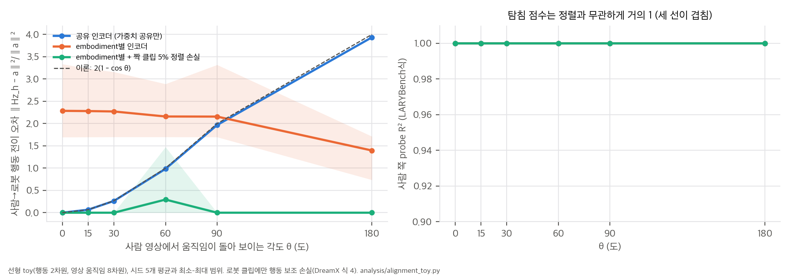
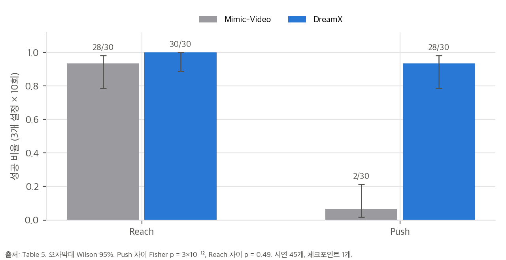

# 03. 분석: 정렬 toy, LARYBench 읽기, 압축 산술, 실험 통계

이 문서의 계산은 `analysis/alignment_toy.py`(numpy, 단일 스레드, 약 20초)와 `analysis/table_check.py`(1초 미만)가 만듭니다. 결과는 `alignment_toy_results.json`, `table_check_results.json`에 있습니다.

## 1. 재구성만으로 사람·로봇 latent action이 정렬되는가 (toy)

### 1.1 질문

DreamX가 내세우는 전이(Eq. 5)는 사람 영상에서 뽑은 Q_src를 로봇의 행동 branch로 decode합니다. 이것이 되려면 **같은 행동이 사람과 로봇에서 같은 latent 좌표**로 가야 합니다. 그런데 학습 손실(Eq. 4)에는 이를 직접 요구하는 항이 없습니다.

- 재구성 손실은 embodiment마다 latent를 가역 변환해도 값이 같습니다. decoder가 첫 프레임 V₀로 embodiment를 알 수 있으므로, 사람용 좌표계와 로봇용 좌표계를 따로 써도 재구성은 똑같이 잘 됩니다.
- 행동 보조 손실은 로봇 클립에만 있습니다(사람은 λ = 0). 그래서 로봇 latent만 행동 좌표에 묶입니다.

남는 정렬 압력은 두 가지입니다. (a) encoder 가중치 공유, (b) 같은 행동이 이미지에서 비슷하게 움직여 보이는 것. toy는 이 둘이 각각 얼마나 일을 하는지 봅니다.

### 1.2 모형

- 행동 a ∈ ℝ², 영상 공간의 움직임 Δo_e = R_e a + 잡음(8차원).
- 로봇 렌더러 R_r은 직교 열 2개입니다. 사람 렌더러는 **R_h = R_r Q(θ) + η R_⊥** 를 열마다 정규화한 것입니다. θ는 시점 차이 때문에 이미지 평면에서 움직임이 돌아 보이는 각도, η = 0.3은 손이 그리퍼와 다르게 보이는 정도입니다.
- encoder z = E_e Δo, decoder Δo ≈ D_e z(embodiment별), 로봇 클립에만 행동 head 손실 ‖H z − a‖²(λ = 1, H 공유)를 둡니다. DreamX의 Eq. 3–4를 선형으로 줄인 구조입니다.
- 조건 세 가지:
  - **S:** 공유 encoder. 가중치 공유가 유일한 정렬 압력입니다.
  - **I:** embodiment별 encoder. 강한 비선형 encoder가 입력만 보고 embodiment를 알아보는 경우를 근사합니다.
  - **P:** embodiment별 encoder에, 짝지은 사람·로봇 클립 5%로 정렬 손실 ‖z_h − z_r‖²(가중치 5)를 더합니다. DreamX가 쓰지 않는 신호입니다.
- 지표: (1) **탐침 R²**: embodiment마다 z → a 선형 회귀를 따로 학습합니다. LARYBench 방식입니다. (2) **전이 오차** ‖H z_h − a‖²/‖a‖²: 사람 latent를 로봇 행동 head로 풀었을 때의 오차입니다. DreamX의 행동 전이(Eq. 5)에 해당합니다.
- Adam(lr 0.02, weight decay 1e-3) 2,500 step, embodiment당 1,000표본, seed 5개.

### 1.3 결과

왼쪽: 시점 회전 θ에 따른 사람→로봇 행동 전이 오차(seed 5개 평균, 음영은 최소–최대). 오른쪽: 사람 쪽 탐침 R²(세 조건이 겹쳐 모두 1).

| θ | 0° | 15° | 30° | 60° | 90° | 180° |
|---|---|---|---|---|---|---|
| S 공유 encoder | 0.0003 | 0.067 | 0.264 | 0.984 | 1.968 | 3.935 |
| 이론 2(1 − cos θ) | 0 | 0.068 | 0.268 | 1.0 | 2.0 | 4.0 |
| I embodiment별 encoder | 2.29 | 2.28 | 2.27 | 2.16 | 2.16 | 1.40 |
| P + 짝 클립 5% | 0.0001 | 0.0002 | 0.0001 | 0.295 | 0.0002 | 0.0002 |
| 탐침 R²(세 조건 모두) | 1.00 | 1.00 | 1.00 | 1.00 | 1.00 | 1.00 |

전이 오차 1은 "아무것도 예측하지 않는 것"(z_h = 0)과 같은 수준입니다. I의 seed별 값은 0.74–3.34 사이에서 흩어집니다. P의 60°는 seed 5개 중 1개가 국소 최소에 걸린 값(1.47)이고 나머지 4개는 0입니다.

### 1.4 읽기

1. **공유 encoder는 이미지 공간의 움직임이 일치할 때만 정렬됩니다.** S의 전이 오차는 이론값 2(1 − cos θ)를 거의 정확히 따릅니다. 행동 head를 로봇에 맞춰 H E R_r = I로 학습하면 사람 쪽은 H E R_h ≈ Q(θ)가 되고, 등방 행동에서 기대 오차가 ‖Q(θ) − I‖²_F / 2 = 2(1 − cos θ)이기 때문입니다. 사람 전용 방향 R_⊥을 써서 회전을 보정하는 해가 선형 encoder에도 존재하지만, 재구성 손실은 그 해를 고를 이유가 없고 weight decay는 오히려 막습니다.
2. **encoder가 embodiment를 알아볼 수 있으면 정렬은 임의적입니다.** I는 θ와 무관하게 오차가 1을 넘습니다. 재구성 손실이 embodiment별 좌표계를 허용한다는 것을 그대로 보여 줍니다. DreamX의 encoder는 2B 백본에 지시문까지 받으므로, 입력만으로 사람인지 로봇인지 쉽게 알 수 있습니다. 실제 모델은 S와 I 사이 어딘가에 있고, 어느 쪽에 가까운지는 사전학습 백본의 귀납 편향에 달려 있습니다.
3. **짝지은 클립이 조금만 있어도 정렬됩니다.** 5%로 θ와 무관하게 전이 오차가 0 근처로 갑니다. 정렬을 만드는 가장 싼 신호입니다.
4. **탐침 점수는 정렬을 재지 못합니다.** 세 조건, 모든 θ에서 사람 쪽 탐침 R²는 1입니다. LARYBench처럼 탐침을 embodiment(벤치마크)마다 따로 학습하면, latent에 정보가 있는지는 재도 같은 좌표에 있는지는 재지 못합니다. Table 1의 높은 점수는 정렬의 근거가 아닙니다.

### 1.5 DreamX 실험에 대입

- Fig. 5(HumanAndRobot)와 Fig. 6(실물 행동 전이)의 사람 영상은 로봇과 **같은 위쪽 시점**에서 찍었습니다. toy로 말하면 θ ≈ 0인 경우입니다. 이 조건에서는 공유 encoder만으로 전이가 되는 것이 자연스럽고, DreamX의 결과와 맞습니다.
- 학습 데이터의 사람 영상(EgoDex, EgoVerse)은 1인칭입니다. 1인칭 손 움직임을 3인칭 로봇 카메라로 옮기는 경우는 θ가 크고, 실제로는 회전이 아니라 투영까지 바뀝니다. 이 경우의 정량 평가는 논문에 없습니다.
- 그래서 "짝 데이터 없이 정렬된다"는 결과는 **"시점이 맞으면 가중치 공유로 정렬된다"** 로 읽는 것이 안전합니다. 시점이 다른 전이에서는 소량의 짝 클립(P)이나 시점 정규화가 필요할 가능성이 큽니다.

### 1.6 toy의 한계

선형 모형이고, 시점 변화를 이미지 평면 회전으로만 근사했습니다. 실제 영상 diffusion 백본의 사전학습 표현은 시점에 어느 정도 불변인 특징(예: 물체 중심 좌표)을 가질 수 있고, 그렇다면 S보다 나은 정렬이 나올 수 있습니다. toy가 보여 주는 것은 "손실이 정렬을 요구하지 않는다"까지입니다. 실제 정렬 정도는 시점이 다른 짝 데이터(예: 1인칭·3인칭 동시 촬영)로 직접 재야 합니다.

## 2. LARYBench가 재는 것과 재지 못하는 것 (Table 1, 부록 B.4)

### 2.1 이득의 크기

기준선 중 열별 최고값 대비 DreamX의 개선입니다(`table_check.py` C1).

| 열 | 최고 기준선 | DreamX | 상대 개선 | FAE-32 상대 개선 |
|---|---|---|---|---|
| CALVIN 회귀 | 0.43 | 0.15 | −65.1% | −46.5% |
| VLABench 회귀 | 0.09 | 0.05 | −44.4% | −22.2% |
| RoboCOIN 회귀 | 0.51 | 0.26 | −49.0% | −39.2% |
| AgiBotWorld-Beta 회귀 | 0.52 | 0.22 | −57.7% | −50.0% |
| Atomic robot 분류 | 58.51 | 68.03 | +9.52%p | +7.39%p |
| Composite human 분류 | 65.47 | 72.72 | +7.25%p | +4.02%p |
| Composite robot 분류 | 62.76 | 68.26 | +5.50%p | +3.30%p |

회귀에서는 이득이 크고 모든 열에서 일관됩니다. 분류 이득은 상대적으로 작습니다.

### 2.2 같은 조건 비교가 아닌 이유

1. **입력 프레임 수:** 회귀 벤치마크는 원래 표본당 프레임 2장입니다. 영상 기반 모델에는 저자들이 원본에서 중간 프레임을 복원해 넣었습니다(부록 B.4). 위 그룹(프레임 2장)과 아래 그룹(영상)의 차이 일부는 입력 정보량 차이입니다.
2. **특징 크기:** DreamX 특징은 latent frame마다 2,048차원 토큰 4개입니다. 탐침은 토큰마다 768차원으로 사영한 뒤 attentive pooling을 하므로, 넓은 특징이 유리할 수 있습니다. 그래서 **토큰당 32차원인 FAE-32가 더 공정한 비교 대상**입니다. FAE-32도 모든 기준선을 이기므로, 결론의 방향은 유지됩니다.
3. **데이터 출처 겹침:** DreamX 사전학습의 37.4%가 AgiBot이고(Fig. 9), 회귀 평가셋 AgiBotWorld-Beta도 같은 출처입니다. 다만 사전학습에 없는 CALVIN에서 상대 개선이 가장 크므로(−65.1%), 겹침만으로 설명되지는 않습니다.
4. **텍스트:** encoder가 지시문 ℓ을 받는데(Eq. 2), 탐침용 특징을 뽑을 때 무엇을 넣었는지 적혀 있지 않습니다(`04` C9).
5. **정렬 미측정:** §1.4대로, 벤치마크마다 따로 학습한 탐침은 embodiment 간 정렬을 재지 못합니다.

## 3. "300× 압축"의 산술 (`table_check.py` C7)

Cosmos-Predict2.5의 VAE를 공간 8배·시간 4배·16채널, patch 2로 두었습니다. 이 사양은 논문에 없어서 사전 지식으로 넣은 가정입니다. 이 가정으로 논문의 "latent frame당 1,200토큰"과 "29프레임 → latent frame 8개"가 그대로 나옵니다.

| 표현 | 프레임당 개수 | 프레임당 실수 개수 | VAE latent 대비 |
|---|---|---|---|
| 백본 토큰 (30 × 40 패치, 폭 2,048) | 1,200 | 2,457,600 | — |
| VAE latent (60 × 80 × 16) | — | 76,800 | 1× |
| DreamX latent action (토큰 4 × 2,048) | 4 | 8,192 | 9.4× 작음 |
| FAE-32 압축 코드 (토큰 4 × 32) | 4 | 128 | 600× 작음 |

- "1,200 → 4토큰, 300×"(초록, §1)는 **토큰 개수의 비**입니다. 실수 개수로는 백본 토큰 대비 300배이지만, 영상 자체(VAE latent) 대비로는 9.4배에 그칩니다.
- 논문도 §3.4에서 "토큰 수는 적지만 각 토큰이 백본 폭을 그대로 가진다"고 인정하고 FAE로 줄입니다. 그러니 초록과 프로젝트 페이지의 "300× fewer tokens"는 정확하지만, "compact"한 행동 코드라고 부를 수 있는 것은 FAE-32입니다.
- 정책 지연 19.1배 단축(Table 3)은 이 압축 덕분이라기보다, 미래 영상(수만 개 실수)을 생성하지 않고 4 × 32 코드만 생성하는 데서 옵니다. 지연 비는 28,226 / 1,474 = 19.15입니다.

## 4. 실물·CALVIN 결과의 통계 (`table_check.py` C3–C5)

Table 5를 세 설정 합산으로 다시 그림. 오차막대는 Wilson 95% 구간.

| 비교 | 성공 수 | Wilson 95% | Fisher p |
|---|---|---|---|
| push 합산: DreamX vs Mimic-Video | 28/30 vs 2/30 | [0.79, 0.98] vs [0.02, 0.21] | 3.2 × 10⁻¹² |
| reach 합산 | 30/30 vs 28/30 | — | 0.49 |
| 위 서랍 push | 8/10 vs 2/10 | — | 0.023 |
| 사람 영상만 vs 로봇 시연 (위 서랍 push, Table 6 vs 5) | 10/10 vs 8/10 | — | 0.47 |

- **DreamX가 push에서 앞선다는 결과는 표본이 작아도 확실합니다.** 다만 Mimic-Video가 30회 중 28회 서랍에 닿고도 2회만 닫는 것은 "덜 학습된 기준선"일 가능성도 시사합니다. 두 방법의 사전학습 출발점(MolmoAct 영상 백본 대 DreamX 생성기)과 사전학습 데이터 규모가 다르고, 기준선 튜닝 절차는 적혀 있지 않습니다.
- **"사람 영상만으로도 100%"** 는 10회 표본에서 로봇 시연(8/10)과 구분되지 않습니다. 정확히 말하면 "사람 영상으로 바꿔도 떨어지지 않았다"입니다.
- **CALVIN(Table 7):** Avg. Len.은 ≥k 열의 합(÷100)으로 정확히 재현됩니다(2.378, 2.643). 평가 시퀀스 수가 없어서, 관례인 1,000개로 가정하면 ≥1 차이는 p = 0.17, ≥5 차이는 p = 0.0057입니다. 긴 과제열로 갈수록 차이가 벌어지는 패턴이라 효과는 있어 보이지만, 같은 정책 안에서 latent 특징 attention을 막는 ablation이라 "latent action 예측이 행동 학습을 돕는다"까지만 말할 수 있습니다. 절대 수준 2.64도 CALVIN의 최근 정책들보다 낮습니다.

## 5. Table 8 읽기: latent action은 움직임을 얼마나 결정하는가 (`table_check.py` C8)

| 조건 | 움직임 비율 | flow 편차 (px/프레임) | RGB L1 | 정지 영역 RGB L1 | 정지/전체 |
|---|---|---|---|---|---|
| α = 0.1 | 1.000 | 0.141 | 0.0054 | 0.0030 | 0.56 |
| α = 0.3 | 0.995 | 0.211 | 0.0077 | 0.0034 | 0.44 |
| α = 1.0 | 0.946 | 0.481 | 0.0215 | 0.0077 | 0.36 |
| query = 0 | 0.456 | 0.866 | 0.0758 | 0.0227 | 0.30 |

1. 교란이 커질수록 flow 편차가 단조 증가하고, 정지 영역의 변화는 전체보다 작습니다. "latent action이 외관보다 움직임을 조종한다"는 해석과 맞습니다.
2. 그러나 **채널 표준편차만큼의 잡음(α = 1)에도 움직임 크기는 94.6% 유지됩니다.** decoder가 latent의 세부 값에 둔감하다는 뜻입니다. 행동 전이처럼 latent의 세부가 궤적을 결정해야 하는 용도에서는 이 둔감함이 정밀도의 상한이 될 수 있습니다.
3. **query를 0으로 바꿔도 움직임이 45.6% 남습니다.** 첫 프레임과 생성 prior만으로도 "그럴듯한 움직임"이 상당히 나옵니다. Table 2의 영상 전이 점수에도 이 몫이 섞여 있을 수 있으므로, query = 0 기준선의 FVD·PSNR이 함께 있어야 합니다(`04` C2).
4. 표본은 **골라 낸 고움직임 클립 8개 × seed 2개**입니다. 분포를 대표하지 않습니다.

## 추가 검증 (2026-11-11)

스크립트: `analysis/extra_alignment_nonlinear.py` → `analysis/extra_alignment_nonlinear_results.json` (PyTorch CPU, 4 스레드, 실행 57초). 선형 정렬 toy(§1)를 비선형으로 바꾼 실험입니다.

### 추가 검증 1: 비선형 encoder·decoder에서도 공유 encoder의 정렬이 시점 각도에 따라 깨지는가

**목적.** §1의 선형 결론 세 가지(공유 encoder는 θ ≈ 0에서만 정렬, embodiment별 encoder는 임의적, 짝 클립 5%면 정렬)가 비선형 encoder와 행동 손실에서도 유지되는지 봅니다. 탐침 R²가 정렬을 재지 못한다는 결론도 함께 봅니다.

**설정(가정).**
- 행동 a ∈ R², 관측 Δo_e = tanh(R_e φ(a) W + 잡음) ∈ R⁸, φ(a) = [a₁, a₂, a₁a₂, sin a₁]. 로봇 R_r은 직교 열 2개, 사람 R_h = R_r Q(θ) + 0.3 R_⊥(열 정규화).
- encoder MLP 8→64→2, embodiment별 decoder MLP 2→64→8(재구성). 로봇 클립에만 행동 head 손실 ‖Hz − a‖²(H 선형, 공유).
- 조건: S 공유 encoder, I embodiment별 encoder, P embodiment별 encoder + 짝 클립 5%에 가중치 5의 ‖z_h − z_r‖².
- 지표: 탐침 R²(사람 latent → 행동, 선형), 전이 오차 ‖Hz_h − a_h‖²/‖a_h‖². embodiment당 1000표본, Adam 2000 step, θ ∈ {0, 30, 60, 90}°, 시드 3개.
- 첫 프레임 조건 decoder는 두지 않았습니다(embodiment별 decoder로 대신). CNN 대신 MLP.
- 장치: CPU. 패키지: torch 2.15.0, numpy 1.26.4, Python 3.12.7.

**결과 (시드 3개 평균).**

| θ | 0° | 30° | 60° | 90° |
|---|---|---|---|---|
| S 전이 오차 | 0.21 | 1.09 | 2.79 | 2.84 |
| I 전이 오차 | 1.64 | 1.33 | 1.40 | 1.23 |
| P 전이 오차 | 0.22 | 0.28 | 0.27 | 0.25 |
| S 사람 탐침 R² | 0.80 | 0.59 | 0.40 | 0.41 |
| I 사람 탐침 R² | 0.65 | 0.61 | 0.60 | 0.61 |
| P 사람 탐침 R² | 0.78 | 0.73 | 0.74 | 0.75 |

(전이 오차 1은 대략 "행동을 예측하지 않는" 수준입니다. 시드별 값은 결과 JSON에 있습니다.)

**결론.**
- 공유 encoder의 정렬은 θ에 따라 깨집니다. 전이 오차가 0.21(θ = 0)에서 2.8(θ ≥ 60°)로 올라갑니다. 선형 toy의 결론과 같은 방향입니다.
- 짝 클립 5%를 넣은 P는 θ와 무관하게 0.25–0.28로 정렬됩니다. 선형 toy와 같은 결과입니다.
- embodiment별 encoder(I)는 θ와 무관하게 1.2–1.6으로 정렬되지 않습니다. 선형 toy와 같은 방향입니다.
- **탐침 점수에 대한 결론은 이 비선형 설정에서 유지되지 않습니다.** 선형 toy에서는 탐침 R²가 세 조건과 모든 θ에서 1이었지만, 비선형에서는 S의 탐침 R²가 θ에 따라 0.80에서 0.41로 떨어지며 전이 오차와 같이 움직입니다. 반면 P는 탐침 R²가 0.75 근처이면서 전이 오차는 가장 작습니다. 따라서 탐침 점수 하나로 정렬을 판단할 수 없다는 주장은 맞지만, 탐침이 정렬과 무관하다는 강한 주장은 이 실험에서 지지되지 않습니다.

**한계.** 영상 대신 8차원 움직임 벡터, CNN 대신 MLP, 첫 프레임 조건 없음, 시드 3개입니다. 전이 오차의 S와 I 값은 시드 간 편차가 큽니다(S, θ = 90°: 2.46–3.33). 논문의 DreamX 백본과 직접 비교할 수 없습니다.
