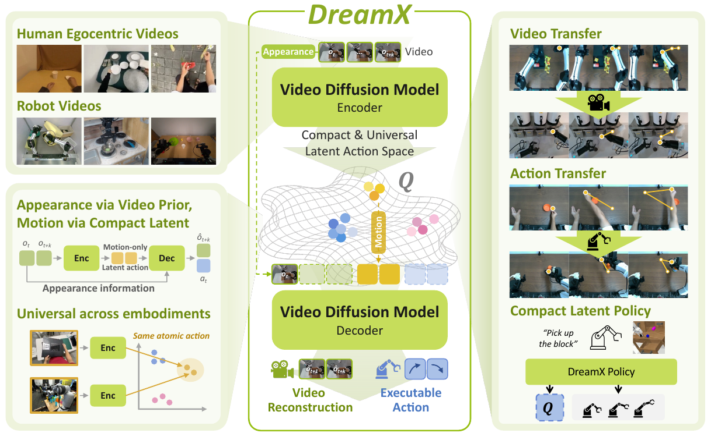
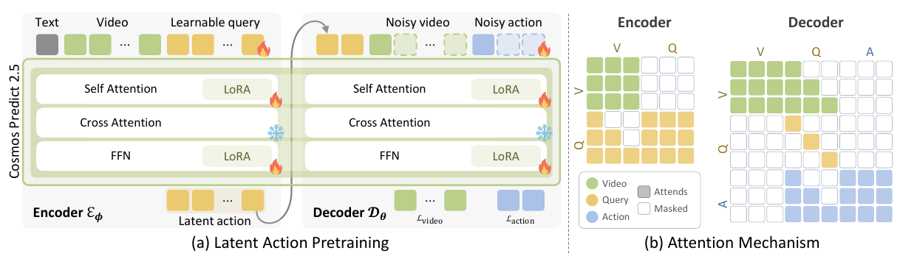
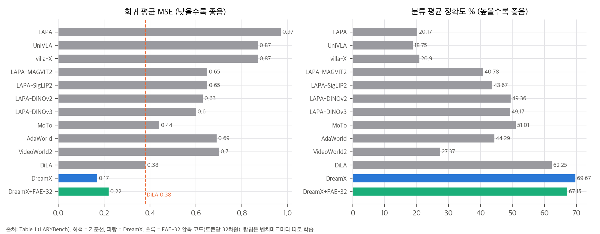
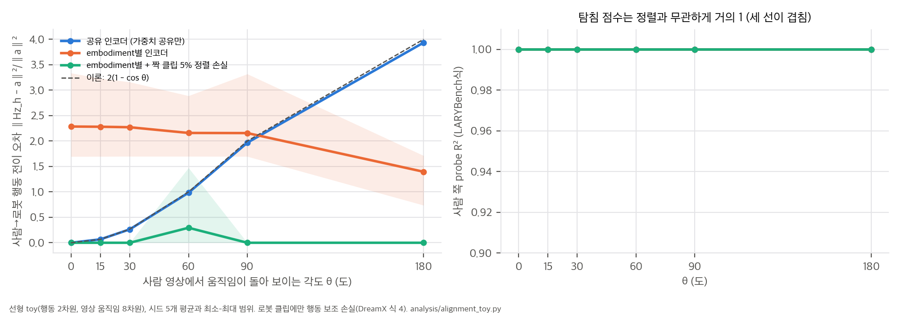
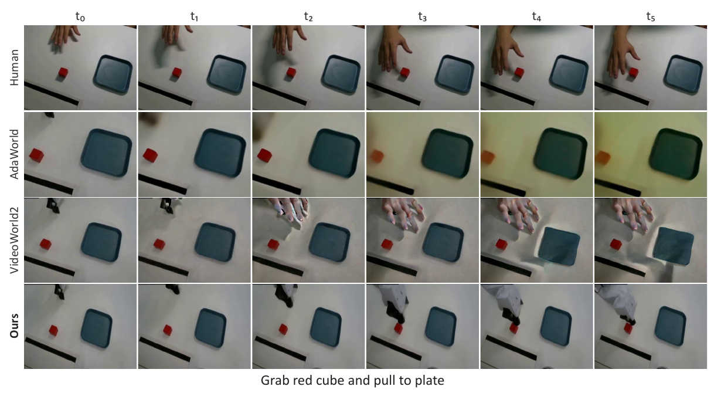
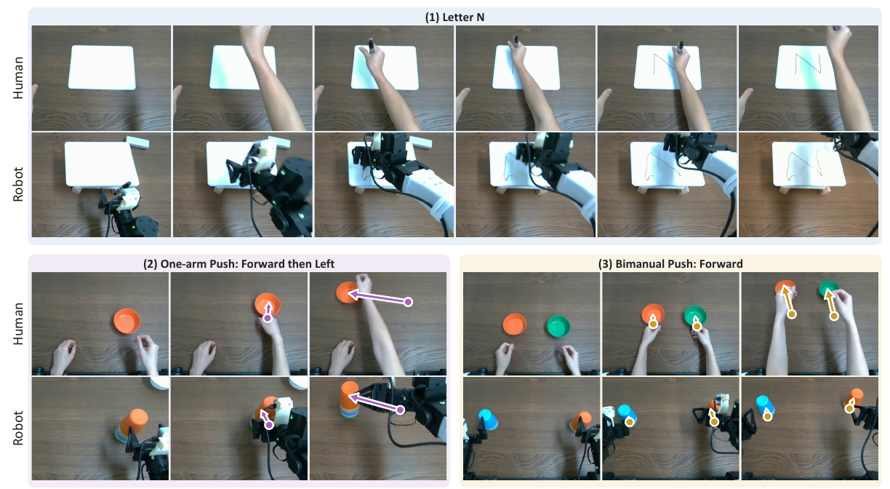
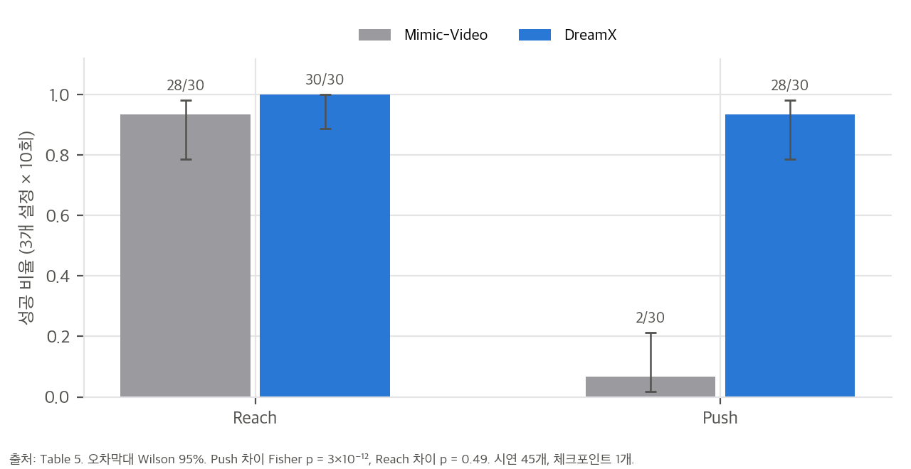

> **논문:** Jisoo Kim, Chaehyun Kim, Junsu Kim, Jiho Park, Seongchan Kim, Eunbeen Hong, Soowon Son, Fu-En Yang, Seungryong Kim. *DreamX: Video Diffusion Model is a Universal Latent Action Learner.* arXiv:2611.05377v1 (2026). KAIST, NVIDIA.
> 논문 그림은 CC BY 4.0에 따라 출처를 밝히고 실었습니다(© 저자). 나머지 그래프는 논문 수치와 직접 만든 toy 결과로 그렸습니다. 공식 코드는 아직 공개되지 않았습니다(2026-11-09 확인).

## 한 줄 요약

사전학습된 영상 diffusion 모델(Cosmos-Predict2.5 2B)에 학습 가능한 query 토큰을 붙여, 영상 특징에서 latent frame당 4개의 latent-action 토큰을 읽어 냅니다. 같은 백본을 decoder로 써서 첫 프레임과 이 토큰만으로 미래 영상을 재구성하게 학습합니다. 이렇게 얻은 latent를 사람과 로봇의 공통 행동 인터페이스로 써서, 영상 전이, 사람 시연 → 로봇 명령 전이, 압축 latent 정책을 보입니다.

## 1. 구조

- **Encoder (Eq. 2):** Q = E(q; V, ℓ). query를 영상 토큰 열에 붙여 백본의 시공간 attention을 함께 통과시킵니다. query → 영상 attention은 프레임 causal입니다. 지시문 ℓ은 백본의 원래 cross-attention으로 들어갑니다.
- **Decoder (Eq. 3):** 같은 백본(별도 LoRA)이 첫 프레임 V₀와 Q로 미래를 재구성합니다. 텍스트는 넣지 않습니다. 행동 레이블이 있으면 고유수용 상태로 행동 chunk도 decode합니다.
- **손실 (Eq. 4):** L = L_video + λ L_action. 사람 영상(전체 2.19k시간의 21.4%)은 λ = 0입니다.
- **전이 (Eq. 5):** 사람 영상에서 뽑은 Q를 대상 첫 프레임과 넣으면 영상 전이, 대상 로봇 상태와 넣으면 행동 전이입니다. 짝지은 사람·로봇 데이터는 쓰지 않습니다.
- **정책 (Eq. 6–7):** latent를 토큰당 2,048 → 32차원으로 압축(FAE-32)하고, 같은 영상 백본이 미래 영상 대신 이 코드를 생성합니다. 별도 Action DiT가 행동을 냅니다.

## 2. 표 수치는 맞다

`table_check.py`로 다시 계산했습니다.

- **LARYBench(Table 1):** 13개 방법의 분류 평균은 모두 맞고, 회귀 평균은 DiLA 하나만 0.3875 → 0.38로 경계에 있습니다. DreamX는 8개 열 모두 1위이고, 회귀 오차는 열별 최고 기준선 대비 44–65% 낮습니다. 토큰당 32차원으로 줄인 FAE-32도 모든 기준선을 이깁니다.
- **실물 정책(Table 3, 5):** 설정별 SR 90/100/100과 평균 96.7%가 정확히 나옵니다. 지연 비는 19.15배입니다.
- **CALVIN(Table 7):** Avg. Len. 2.378, 2.643이 ≥k 열에서 그대로 나옵니다.
- **데이터(Fig. 9):** 합계 2,188.0시간, 사람 469.1시간입니다.

다만 LARYBench 비교는 같은 조건이 아닙니다. 회귀 벤치마크는 원래 프레임 2장을 주는데, 저자들이 영상 기반 모델에만 원본의 중간 프레임을 복원해 넣었습니다(부록 B.4). DreamX 학습 데이터의 37.4%인 AgiBot이 평가셋 AgiBotWorld-Beta와 같은 출처라는 점도 있습니다. 사전학습에 없는 CALVIN에서 개선이 가장 크므로(−65%) 겹침만으로 설명되지는 않습니다.

## 3. 핵심 질문: 사람과 로봇의 latent는 왜 같은 좌표에 놓일까

행동 전이는 사람 latent를 로봇 행동 branch로 decode합니다. 그러려면 같은 행동이 사람과 로봇에서 같은 latent 좌표로 가야 합니다. 그런데 손실에는 그것을 요구하는 항이 없습니다.

- 재구성 손실은 embodiment마다 latent를 가역 변환해도 값이 같습니다. decoder는 첫 프레임으로 embodiment를 알 수 있으므로, 사람용 좌표계와 로봇용 좌표계를 따로 써도 재구성은 똑같이 잘 됩니다.
- 행동 손실은 로봇 클립에만 있어서 로봇 latent만 행동 좌표에 묶습니다.

남는 정렬 압력은 encoder 가중치 공유와, 같은 행동이 이미지에서 비슷하게 움직여 보인다는 사실뿐입니다. 이것을 선형 toy로 확인했습니다. 행동 2차원, 영상 움직임 8차원, 사람 렌더러는 로봇 렌더러를 각도 θ만큼 돌린 것(시점 차이)에 손 모양 차이를 더한 것입니다. DreamX처럼 로봇 클립에만 행동 손실을 둡니다.

| θ | 0° | 30° | 60° | 90° | 180° |
|---|---|---|---|---|---|
| 공유 encoder | 0.0003 | 0.264 | 0.984 | 1.968 | 3.935 |
| 이론 2(1 − cos θ) | 0 | 0.268 | 1.0 | 2.0 | 4.0 |
| embodiment별 encoder | 2.29 | 2.27 | 2.16 | 2.16 | 1.40 |
| + 짝 클립 5% 정렬 손실 | 0.0001 | 0.0001 | 0.295 | 0.0002 | 0.0002 |

(사람 latent를 로봇 행동 head로 풀었을 때의 상대 오차, seed 5개 평균. 60°의 0.295는 seed 하나가 국소 최소에 걸린 값입니다.)

1. **공유 encoder는 이미지 움직임이 일치할 때만 정렬됩니다.** 전이 오차가 이론값 2(1 − cos θ)를 거의 그대로 따릅니다. 회전을 보정하는 해가 존재해도, 재구성 손실은 그 해를 고를 이유가 없습니다.
2. **encoder가 embodiment를 알아볼 수 있으면 정렬은 임의적입니다.** 2B 백본에 지시문까지 받는 실제 encoder는 사람인지 로봇인지 쉽게 압니다.
3. **짝지은 클립 5%면 θ와 무관하게 정렬됩니다.**
4. **탐침 점수는 정렬을 재지 못합니다.** 세 조건, 모든 θ에서 embodiment별 탐침 R²는 1입니다. LARYBench처럼 탐침을 따로 학습하면, latent에 정보가 있는지는 재도 같은 좌표에 있는지는 재지 못합니다. 다만 비선형 encoder·MLP로 바꾼 추가 toy에서는 공유 encoder의 탐침 R²가 θ에 따라 0.80에서 0.41로 떨어져 전이 오차와 함께 움직였습니다. 그래서 탐침 점수 하나가 정렬과 무관하다고 단정하기는 어렵습니다.

이제 DreamX의 전이 증거를 다시 봅니다.

HumanAndRobot 영상 전이(Fig. 5)와 실물 행동 전이(Fig. 6) 모두 사람이 로봇 카메라와 **같은 위쪽 시점, 같은 작업대**에서 찍혔습니다. toy로 말하면 θ ≈ 0이고, 공유 encoder만으로 전이가 되는 조건입니다. 학습 데이터의 사람 영상(EgoDex, EgoVerse)은 1인칭인데, 1인칭 → 3인칭 전이는 평가되지 않았습니다. 행동 전이는 정성 사례만 있고 시행 수나 오차가 없습니다.

통제되지 않은 경로도 하나 있습니다. encoder는 지시문을 받고 decoder는 받지 않습니다. 전이할 때 latent에 원본 지시문(예: "Grab red cube and pull to plate")의 의미가 실릴 수 있고, decoder는 그 의미를 대상 장면에서 실현할 수 있습니다. 빈 지시문으로 encode하는 ablation이 없어서, 전이의 어디까지가 움직임이고 어디까지가 과제 의미인지 가를 수 없습니다.

그래서 "짝 데이터 없이 정렬된다"는 결과는 **"시점이 맞으면 가중치 공유로 정렬된다"** 정도로 읽는 것이 안전합니다.

## 4. "300×"와 Table 8

- **300×는 토큰 개수입니다.** latent frame당 1,200토큰을 4토큰으로 줄였지만 각 토큰이 2,048차원이라 프레임당 8,192개 실수입니다. VAE latent(60 × 80 × 16 = 76,800, Cosmos VAE 사양을 가정)와 비교하면 9.4배입니다. 논문도 §3.4에서 이를 인정하고 FAE로 줄입니다. "작은 코드"라고 부를 수 있는 것은 FAE-32(프레임당 128개)입니다.
- **Table 8:** latent에 채널 표준편차만큼의 잡음(α = 1)을 넣어도 움직임 크기가 94.6% 유지되고, query를 0으로 바꿔도 45.6%가 남습니다. latent가 움직임을 조종하는 것은 맞지만, 첫 프레임과 생성 prior만으로도 움직임의 절반 가까이가 나옵니다. 영상 전이 점수(Table 2)에 이 몫이 섞여 있을 수 있는데, 첫 프레임 복사나 query = 0 기준선은 보고되지 않았습니다.

## 5. 실물 정책: push에서 확실히 앞서고 reach는 같다

| 비교 | 성공 | Fisher p |
|---|---|---|
| push 합산 (DreamX vs Mimic-Video) | 28/30 vs 2/30 | 3 × 10⁻¹² |
| reach 합산 | 30/30 vs 28/30 | 0.49 |
| 사람 영상만 vs 로봇 시연 (위 서랍 push) | 10/10 vs 8/10 | 0.47 |

DreamX가 앞선다는 결과는 표본이 작아도 확실합니다. 차이는 전부 push에서 나옵니다. Mimic-Video는 30번 중 28번 서랍에 닿고도 2번만 닫았습니다. 두 방법의 사전학습 출발점이 다르고(MolmoAct 영상 백본 대 DreamX 생성기) 기준선 튜닝 절차가 없어서, "latent 예측이 영상 예측보다 낫다"로 일반화하기는 어렵습니다. "사람 영상만으로 100%"는 10회 표본에서 로봇 시연(8/10)과 구분되지 않습니다. 정책 1회 호출 1.47초도 반응형 제어에는 깁니다.

## 6. 구현할 수 있는가

- **공식 재현: 불가능합니다.** 코드와 가중치가 없고("Code soon"), 사전학습 연산량이 적혀 있지 않습니다. 데이터 6종은 모두 공개지만 합치면 2.19k시간입니다.
- **Apple Silicon 맥(24 GiB, MPS):** 백본 bf16 4.12 GB와 VAE 0.51 GB는 메모리에 들어갑니다. 하지만 공식 Cosmos 스택은 NVIDIA GPU, CUDA 12.8, Linux를 전제합니다. 백본 단독 추론은 수정하면 가능할 수 있지만 검증하지 않았습니다. 학습은 불가능합니다.
- **아이디어 재구현: 중간 난이도.** 공개 백본에 query, LoRA 두 벌, attention 마스크를 붙이는 구조라 코드량은 적습니다. 다만 행동 branch 구조와, 로봇 데이터 4종의 서로 다른 행동 공간을 어떻게 통일했는지가 빠져 있고 CUDA GPU 여러 장이 필요합니다.

## 정리

DreamX는 영상 diffusion 백본의 내부 표현을 query로 읽어 LAM 벤치마크에서 큰 폭으로 앞섰고, 주석 없이 사람 시연을 로봇 명령으로 옮기는 실물 사례를 보였습니다. 표의 수치는 맞습니다. 다만 "범용" latent action이라는 주장의 핵심인 사람·로봇 정렬은 손실이 요구하지 않는 성질이고, 근거는 시점이 같은 조건에 몰려 있습니다. 다음에 필요한 실험은 성능 표가 아니라, 시점이 다른 사람→로봇 전이에서 정렬이 유지되는지, 그리고 짝 클립이 몇 퍼센트 필요한지를 재는 것입니다.

*검증 스크립트(`table_check.py`, `alignment_toy.py`)는 CPU 단일 스레드로 1분 안에 돌아갑니다.*

## 자료

- [통합 리포트 PDF](report/report_public.pdf)
- [01. 논문 분석: DreamX (arXiv:2611.05377)](analysis/01_paper_analysis.md)
- [02. 선행연구와 위치](analysis/02_prior_work.md)
- [03. 분석: 정렬 toy, LARYBench 읽기, 압축 산술, 실험 통계](analysis/03_analysis.md)
- [04. 주장 검증: 수치 재계산, 공개 자료 대조, 구현 가능성](analysis/04_claim_verification.md)
