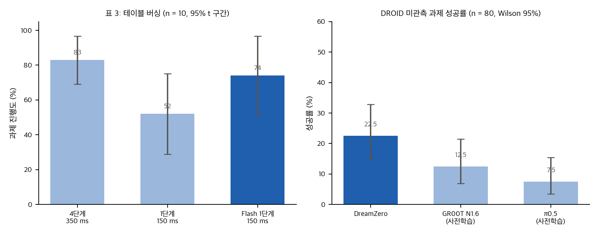
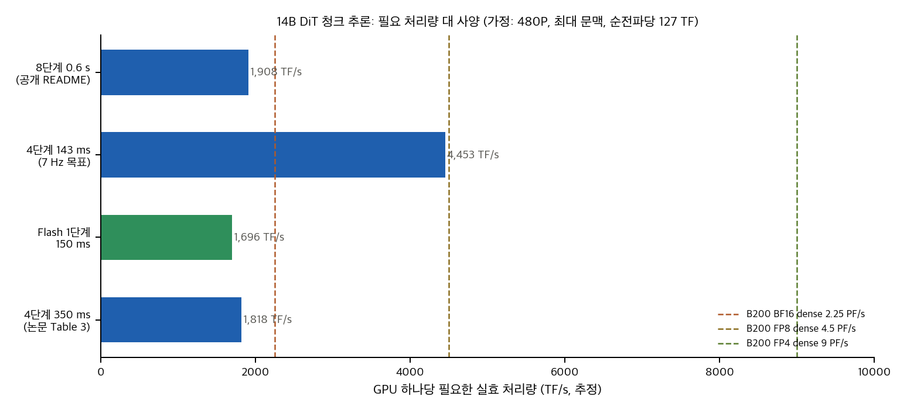
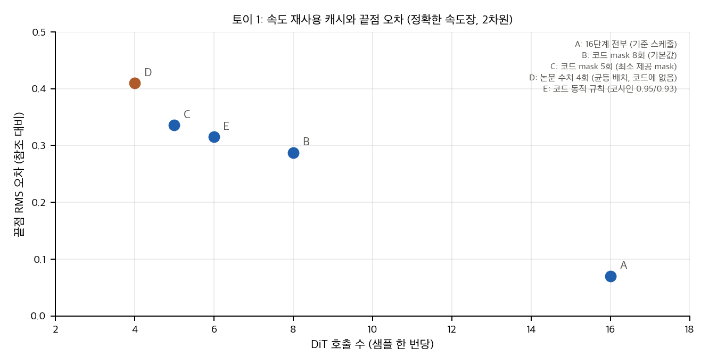
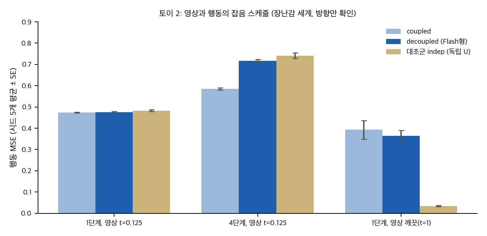

> **논문:** Seonghyeon Ye 외 35인 (NVIDIA). *World Action Models are Zero-shot Policies.* CoRL 2026 구두 발표, arXiv:2602.15922 (v1, 2026-02-17. 최신 버전이며 v2는 없습니다).
> 논문 배포 조건은 arXiv abs 페이지에서 CC BY 4.0이지만, 원문 PDF에는 "© 2026 NVIDIA. All rights reserved." 표기가 있습니다. 그래서 이 글에는 논문 그림을 싣지 않았습니다. 아래 그래프는 논문 막대 라벨이나 우리가 직접 만든 토이의 결과입니다. 공식 코드는 Apache-2.0이며, 정적으로 읽기만 했습니다.

---

## 논문이 하려는 것

VLA는 말로 된 지시를 잘 따르지만, 처음 보는 **동작**(예: 신발 끈 풀기)에서는 약합니다. DreamZero는 질문을 바꿉니다. 행동만 예측하지 말고, 미래 영상과 행동을 **같은 모델에서 함께** 예측하면 어떨까?

백본은 Wan2.1-I2V-14B 영상 확산 모델입니다. 영상 프레임 덩어리(청크)를 자기회귀로 생성하고, 청크 안에서 영상과 행동을 함께 흐름 정합으로 denoise합니다. 추론에서는 실제 관측을 KV 캐시에 넣어 생성 오차가 쌓이지 않게 합니다. 학습 데이터는 AgiBot G1 로봇의 약 500시간 원격조작입니다. 반복 시연 대신 22개 환경에서 다양한 과제를 모았습니다.

## 숫자를 다시 세 보기

논문 표 1–4와 그림 8–10의 값을 옮겨 다시 계산했습니다. 주요 결과는 이렇습니다.

| 주장 | 재계산 | 판정 |
|---|---|---|
| 관측 과제 2배 (62.2% 대 27.4%) | 과제 수 가중 평균과 일치. 단순 범주 평균은 63.7 | 일치 |
| 미관측 과제 2배 (39.5% 대 16.3%) | 10과제 평균 일치 | 일치 |
| 후학습 +10% (90.5% 대 79.8%) | +10.7 pp | 일치 |
| 교차 embodiment 상대 42% 이상 | 사람 영상 41.8%, 로봇 영상 44.6% | 사람 쪽 미달 |
| Flash로 1단계, 손실 9%로 제한 | 차이 −9, 95% 구간 −34 ~ +16 | 동등성 미검정 |

*그래프: 논문 막대 라벨과 롤아웃 수를 옮긴 그래프입니다. 우리가 그렸고, 논문 그림은 넣지 않았습니다. 구간이 많이 겹쳐서 작은 차이를 가리기 어렵습니다.*

**교차 embodiment 결과는 짝지음 가정에 따라 달라집니다.** 같은 9과제를 조건마다 썼다면 과제 상관이 있을 것입니다. 상관을 0으로 두면 p = 0.18–0.24, 0.5이면 0.07–0.11, 0.8이면 0.008–0.02입니다. 논문은 짝지음이나 롤아웃 수를 밝히지 않았습니다. 방향은 일관되지만 "42%"를 확정하기는 어렵습니다.

## 7 Hz는 어떤 조건에서 맞는가

논문은 청크를 약 7 Hz로 만든다고 하고, 최적화 전 5.7 s에서 38배 빠른 150 ms가 된다고 씁니다. 청크 하나는 14B DiT 순전파를 여러 번 돌립니다. 480P와 최대 문맥 8 잠재 프레임 기준으로 순전파 한 번은 약 127 TFLOPs입니다. 4단계 denoise에 캐시 갱신 한 번을 더하면 GPU 한 장당 필요한 실효 처리량이 약 1.8 PF/s입니다.

*그래프: 필요 처리량은 산술 추정이며 측정이 아닙니다. 장비 사양은 NVIDIA 공개 값의 기억값이라 확인이 필요합니다.*

- **BF16으로는 불가능합니다.** 4단계 350 ms는 B200 BF16 피크의 81%이고, 143 ms 청크 주기는 198%입니다. 실제 효율이 50–70%라면 BF16 경로로는 맞지 않습니다.
- **FP8이나 FP4가 필요합니다.** 논문이 NVFP4를 강조한 이유입니다. 350 ms는 FP8 피크의 40%, FP4 피크의 20%입니다.
- **공개 README 수치도 같은 문제를 보입니다.** GB200에서 0.6 s는 8단계 기준으로 BF16 피크의 85%입니다. 공개 경로가 저정밀이라면 맞고, 아니라면 토큰 수나 FLOPs 추정이 과대일 수 있습니다. 확정하지 못했습니다.

## 공개 코드는 논문과 같은가

공식 저장소를 얕게 복제해 읽었습니다(HEAD `ab790c1`, 실행하지 않음). 주요 차이는 아래와 같습니다.

| 항목 | 논문 | 공개 코드·자료 |
|---|---|---|
| DiT 캐시 단계 수 | 16 → 4 | 기본 8회. 제공 마스크는 5–8회 |
| 캐시 플래그 | 옵션으로 소개 | `--enable-dit-cache`는 행동 헤드에서 읽히지 않음 (정적 확인) |
| Flash (영상 잡음 편향) | Beta(7,1), 4 → 1단계 | 기본 꺼짐, 기본 α = 3 |
| AgiBot 행동 길이 | 48 (1.6 s) | 후처리 스크립트 24, 체크포인트 config 48 |
| 후학습 | 전 파라미터 50K 스텝 | 새 embodiment 스크립트는 LoRA |
| 행동 매끄럽게 하기 (Savitzky–Golay) | 있음 | 저장소에서 찾지 못함 |

공개 체크포인트는 DROID용 DreamZero-DROID(cc-by-nc-4.0, 비상업)와 AgiBot용 DreamZero-AgiBot(apache-2.0)입니다. AgiBot 사전학습 데이터와 YAM 데이터는 공개되지 않았습니다.

## 토이 두 개

논문의 두 설계 선택을 장난감 세계에서 확인했습니다. 논문 수치의 검증이 아니라 **방향 확인**입니다.

*그래프: 4회 호출은 16회 호출보다 끝점 오차가 약 6배 큽니다(0.07 대 0.41). 모드는 모두 맞았습니다. 실제 DiT에서 행동 지표로 어떻게 번지는지는 모릅니다.*

*그래프: 1단계에서는 세 조건이 같았습니다. 4단계에서는 coupled가 가장 나았습니다. 깨끗한 영상 상태는 Flash형과 coupled가 거의 학습하지 않아 오차가 컸습니다. 이 토이는 Flash의 이득을 지지하지도 반박하지도 않습니다.*

## 이 맥에서 할 수 있는 것

**14B 추론과 학습은 이 맥(Apple M4 Pro, 통합 메모리 약 24 GiB, CUDA 없음)에서 불가능합니다.** BF16 가중치만 약 26 GiB이고, int4로 줄여도 KV 캐시를 더하면 메모리를 넘습니다. 속도 추정은 청크당 수십 초에서 수 분입니다.

할 수 있는 것은 **구조 축소 재구현**입니다. 2–4 M 파라미터 DiT와 합성 로봇 데이터로 영상·행동 공동 흐름 정합, 청크 단위 블록 마스크, KV 캐시 추론을 구현합니다. 노력은 3–5일로 추정합니다. 논문 수치는 재현되지 않고 설계 논리만 검증됩니다.

## 자료와 한계

- 논문 수치는 막대 라벨을 읽은 값입니다. 공식 표와 달라질 수 있습니다.
- 학습 GPU 수, 시드 수, 롤아웃 수, 교차 embodiment의 과제 짝지음은 논문에 없습니다.
- few-shot 적응(YAM 30분)은 정성 결과만 있습니다.
- 이 글의 판단은 정적 읽기와 산술, 토이에 근거합니다. 공식 코드를 실행하거나 가중치를 받아 확인하지 않았습니다.

이 글에서 쓴 계산 스크립트와 결과 파일, 공개 리포트는 이 게시본 패키지의 `git/` 폴더에 있습니다.

## 자료

- [통합 리포트 PDF](report/report_public.pdf)
- [01. 논문 분석: World Action Models are Zero-shot Policies (DreamZero)](analysis/01_paper_analysis.md)
- [02. 선행연구, 가까운 대안, 공개 자료](analysis/02_prior_work.md)
- [03. 수치 재계산, 검정, 정합성 점검, 산술, 토이](analysis/03_analysis.md)
- [04. 코드 대조와 구현 가능성 (DreamZero)](analysis/04_code_verification.md)
