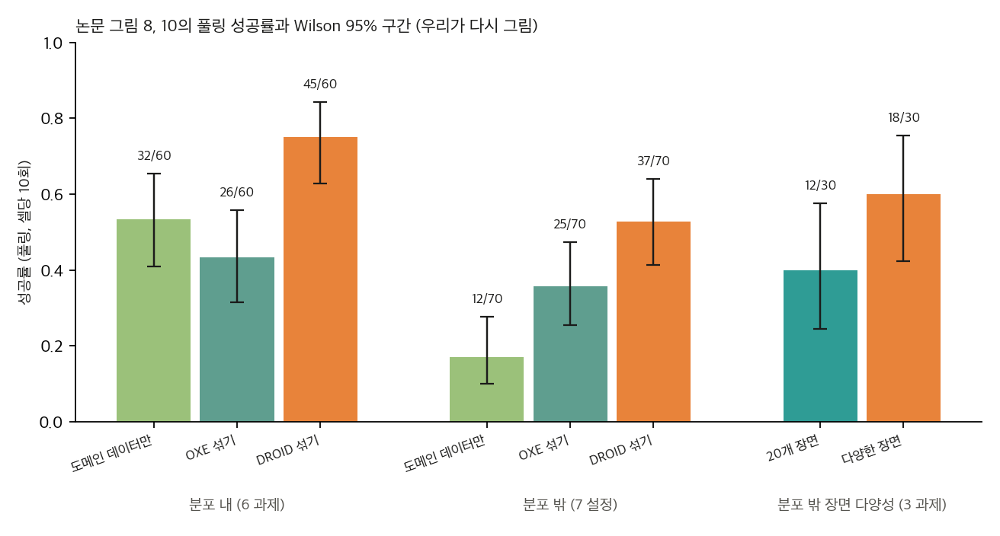
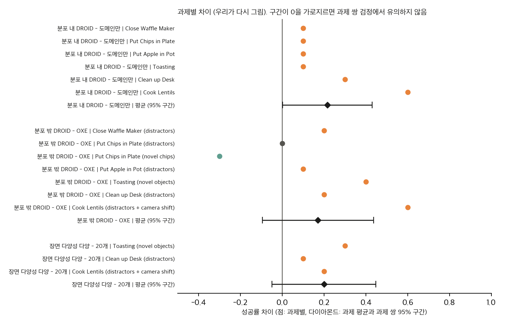

> **논문:** Khazatsky, Pertsch 외 (여러 기관 공동 저자). *DROID: A Large-Scale In-The-Wild Robot Manipulation Dataset.* RSS 2024, arXiv:2403.12945 (v2, 2025-04-22).
> 공식 코드는 `droid-dataset/droid`(수집 스택, 라이선스 파일 없음)와 `droid-dataset/droid_policy_learning`(정책 학습, MIT)에 있습니다. 이 글의 그래프는 우리가 다시 그린 것입니다. 논문 그림은 쓰지 않았습니다.

## 논문이 주장하는 것

로봇 조작 데이터는 대부분 연구실 몇 곳에서 모입니다. 그래서 정책이 익숙한 장면에서만 잘 돕니다. DROID는 Franka Panda 한 종류의 하드웨어를 18벌 복제해 13개 기관에서 12개월 동안 모았습니다. 수집자 50명이 장면을 옮겨 가며 작업을 고르고, 성공 76k 궤적(약 350시간)과 실패 약 16k 궤적을 공개합니다.

논문의 주장은 두 가지입니다. 첫째, 장면, 과제, 물체, 시점, 상호작용 위치가 기존 대형 데이터셋보다 넓습니다. 둘째, 확산 정책에 DROID를 절반씩 섞어 학습하면 6개 과제와 4개 장소에서 분포 내와 분포 밖 성공률이 오릅니다.

## 이 글에서 확인한 것

**1. 장면 수 비교는 어떤 기준인지 확인해야 합니다.** 그림 4 캡션은 "한 자릿수 많다"고 씁니다. 그러나 그림 4는 Bridge V2, RT-1, RH20T와만 비교합니다. 표 I에 있는 집계 데이터셋 OXE(311 장면)와 비교하면 약 1.8배입니다. 장면 수는 로봇별로 같은 장면을 따로 셀 수 있어 과대 집계일 수 있습니다.

**2. 정책 실험은 방향이 맞지만 검정으로는 약합니다.** 과제마다 롤아웃은 10회입니다. 분포 내에서 DROID와 도메인 데이터만의 차이 0.22는 풀링 Fisher 검정 p = 0.02, 과제 쌍 t 검정 p = 0.05입니다. 분포 밖에서 OXE 대비 17점은 p = 0.06(풀링), p = 0.17(과제 쌍)입니다. 논문 그림 캡션은 "significantly"라고 쓰지만, 이 차이는 검정으로 뒷받침되지 않습니다.

*그래프 1. 논문 그림 8과 10의 막대 값을 옮겨 다시 그렸습니다. 셀당 10회라 구간이 넓습니다.*

*그래프 2. 과제별 차이(점)와 과제 쌍 평균의 95% 구간(다이아몬드). 구간이 0을 가로지르면 과제 쌍 검정에서 유의하지 않습니다.*

**3. 검출 가능한 차이가 큽니다.** 셀당 10회로는 차이가 0.63 이상이어야 80% 검정력으로 잡힙니다. 풀링해도 0.24–0.26입니다. 논문이 보고한 17–22점은 이 한계 근처입니다. 방향을 보여 주는 실험이지, 차이 크기를 정확히 말하는 실험은 아닙니다.

**4. 본문과 부록, 그림이 서로 다른 곳이 여럿입니다.** 정책 학습에 쓴 DROID 양이 본문에서는 "전체 DROID"이지만 부록에서는 "처음 40K 성공 궤적"입니다. 장면 유형은 본문 10종, 그림 캡션 9종, 부록 프롬프트 12개 범주입니다. Clean up Desk의 지우개 위치는 본문에서 고정, 부록에서는 일정에 따라 바뀝니다.

**5. 공식 코드는 대부분 맞지만 학습 설정은 다릅니다.** 15 Hz 제어, 128×128 입력, 자르기 116, ImageNet ResNet-50, 배치 128, 학습률 1e-4, 관측 2와 예측 16과 실행 8, EMA 0.75는 코드와 논문이 같습니다. 반면 논문의 학습률 스케줄은 "Linear"인데 코드 기본값은 상수입니다. 총 학습 스텝과 50/50 혼합 설정은 저장소에 고정되어 있지 않습니다. 정책 학습 코드는 언어 모델을 `cuda`로 바로 올리므로 CUDA가 없는 환경에서는 수정이 필요합니다.

## 이 맥에서 재현할 수 있을까

- **데이터 수집과 실로봇 평가는 불가능합니다.** Franka 팔, 카메라, 텔레오퍼레이션 장비가 필요합니다.
- **정책 학습 코드는 조건부로 가능합니다.** 예제 데이터 100궤적(약 2 GB)으로 파이프라인이 돌아가는지 정도는 확인할 수 있습니다. 25,000 스텝 학습과 전체 데이터는 GPU가 필요합니다.
- **장면 수와 에피소드 집계는 CPU로 검산할 수 있습니다.** 장면 중복 제거 규칙은 논문 부록에 있지만 공식 저장소에는 구현이 없습니다. 메타데이터를 받는다면 직접 구현해 볼 만합니다.

## 읽고 나서 남는 질문

DROID의 가치는 규모와 다양성에 있습니다. 그런데 정책 실험은 그 가치를 검정 가능한 크기로 보이지 못했습니다. 다양성 효과를 확실히 보려면 장면 수를 고정하고 물체나 조명만 바꾸는 통제 실험이 필요합니다. 시행도 셀당 수십 회 이상이어야 합니다.

데이터셋을 쓰는 쪽이라면 라이선스도 나눠 봐야 합니다. 논문은 데이터를 CC BY 4.0으로 공개한다고 씁니다. 수집 스택 저장소에는 라이선스 파일이 없습니다. DROID를 학습 데이터로 쓴 다른 체크포인트는 라이선스가 다를 수 있으니 따로 확인해야 합니다.

## 출처

- 논문: arXiv:2403.12945 (v2, CC BY 4.0), RSS 2024 공식 proceedings 목록.
- 코드: `droid-dataset/droid` (@ 33ae6a6), `droid-dataset/droid_policy_learning` (@ 9a29c83). 얕은 복제로 정적으로만 읽었습니다. 실행하지 않았습니다.
- 그래프: 논문 그림 8, 10의 막대 값을 옮겨 우리가 다시 그렸습니다. 그래프와 검정 스크립트는 공개 자료에 있습니다.

## 자료

- [통합 리포트 PDF](report/report_public.pdf)
- [01. 논문 분석: DROID (arXiv:2403.12945)](analysis/01_paper_analysis.md)
- [02. 선행연구와 관련 저장소](analysis/02_prior_work.md)
- [03. 재계산과 일관성 검사](analysis/03_analysis.md)
- [04. 공식 코드 대조 (논문 ↔ 저장소)](analysis/04_code_verification.md)
