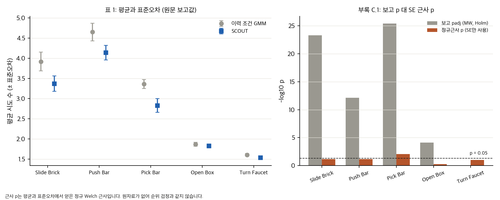
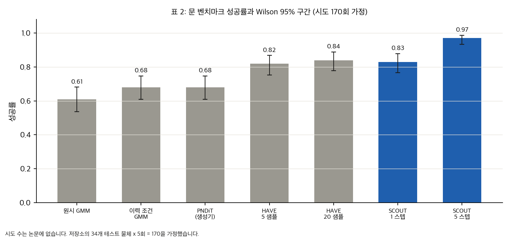
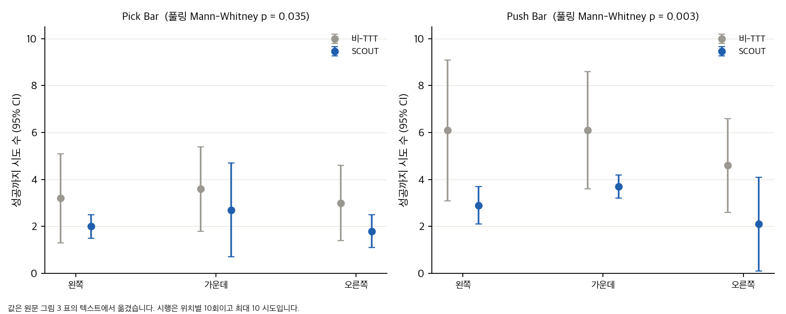

> **논문:** Yishu Li, Liyuan Geng, Xinyi Mao, Amber Li, David Held. *Scouting the Dynamics Gap: Test-Time Policy Adaptation via Action-Outcome Feedback.* CoRL 2026 포스터, arXiv:2609.36107 (v1, 2026-09-28).
> 공식 코드는 GitHub liy1shu/SCOUT에 있고 루트 LICENSE 파일이 없습니다. 이 글의 그림은 우리가 그린 그래프뿐입니다. 논문 그림은 arXiv 비독점 라이선스라서 쓰지 않았습니다.

## 논문이 묻는 것

정책은 물체의 숨은 물리량을 모른 채 행동합니다. 실패하면 보통 스칼라 보상으로 고치는데, 보상 한 숫자는 "어느 쪽으로 얼마나 틀렸는가"를 버립니다. SCOUT는 다른 길을 씁니다. 정책과 순방향 동역학 모델이 **같은 잠재 신념 q**를 공유하고, 배포 중에는 q만 갱신합니다. 갱신 목표는 "예측한 결과 잠재"와 "관측한 결과 잠재"의 차이입니다. 메타학습은 이 갱신이 한두 번만으로도 행동을 바꾸도록 가중치와 초기 q0를 학습합니다.

## 주장이 맞는 곳

*그래프 1. 원문 표 1의 평균 ± 표준오차와 부록 C.1의 보고 p 값. 왼쪽은 원문 값 그대로입니다. 오른쪽의 근사 p는 평균과 표준오차에서 얻은 정규 근사입니다. 우리가 그렸습니다.*

- 다섯 ISE 과제에서 SCOUT의 평균 시도 수가 가장 낮습니다. 그러나 Turn Faucet은 PEARL 계열과 1.54로 같고, Open Box는 이력 조건 GMM과 0.04 차이입니다. "모든 과제에서 최고"는 Turn Faucet의 동률과 맞지 않습니다.
- 정규화 점수는 재계산과 맞습니다.
- 실로봇 위치별 평균의 풀링과 Mann–Whitney p 값(0.041, 0.0032 재계산 대 0.035, 0.003 보고)은 방향이 맞습니다.

## 주장이 약한 곳

**통계 근거.** 부록 C.1은 이력 조건 GMM 대비 차이를 p = 10^-24 수준으로 보고합니다. 그런데 평균 차이 0.5 시도와 원문 표준오차에서 정규 근사를 하면 연속 과제 셋에서 p는 0.009–0.07입니다. 순위 검정은 근사와 다를 수 있습니다. 그러나 원자료 없이 이 차이를 설명할 수 없으므로 시도별 횟수를 요청해야 확인할 수 있습니다.

**문 벤치마크.** 1 스텝 SCOUT (성공률 0.83)는 HAVE 20 샘플 (0.84)과 같은 수준입니다(p ≈ 0.77, 시도 170회 가정). 5 스텝 SCOUT (0.97)만 모든 기준선보다 확실히 높습니다.

*그래프 2. 원문 표 2의 성공률과 Wilson 95% 구간. 시도 170회는 저장소 설정(34 물체 × 5회)에서 가정한 값입니다. 논문에는 시도 수가 없습니다. 우리가 그렸습니다.*

**실로봇.** 상자 대신 긴 빈 상자의 무게중심을 바꾼 한 물체, 두 과제, 위치마다 10회입니다. 방향은 맞지만 효과 크기는 불안정합니다. 보고된 U의 정의 문장도 뒤집혀 있습니다. 수치가 SCOUT의 우위를 보여도 "적응 효과"로 분리되지 않습니다. 원문의 "w/o TTT"는 독립 학습 정책이고, 저장소의 "w/o TTT"는 같은 가중치에 q0를 쓴 것이기 때문입니다.

*그래프 3. 원문 그림 3의 위치별 시도 수. 95% CI는 원문 텍스트 값에서 옮겼습니다. 우리가 그렸습니다.*

## 공식 코드와 원문의 차이

공식 저장소를 실행하지 않고 읽기만 했습니다. 다음 차이가 수치에 들어갑니다.

| 항목 | 원문 | 공식 코드 |
|---|---|---|
| ISE 에피소드 수 | 400 | pick, push, brick은 800 |
| 실패 처리 | 기재 없음 | 14 시도 상한, 실패는 14로 셈 |
| 문 최대 시도 | 20 | 30 |
| 문 평균 스텝 | 성공 시도만 | 모든 시도 평균 |
| 문 행동 선택 | 가중치 최대 제안 | 접촉 가능한 첫 후보 |

또 원문에 없는 학습 설정이 있습니다. 이력 드롭아웃, 학습 이력에 정답 상호작용을 확률 0.1로 덧붙이는 증강, 내부 기울기의 노름 정규화입니다. 증강은 학습 이력과 테스트 이력의 분포를 다르게 만듭니다.

## 이 맥에서 할 수 있는 것

- **구조 재구현은 가능합니다.** 점군 FiLM 트랜스포머, GMM 헤드, 동역학과 내부 루프는 작은 규모로 CPU나 MPS에서 돌릴 수 있습니다.
- **학습 재현은 하지 않습니다.** CUDA GPU가 필요하고, 과제 다섯 개의 메타학습은 GPU 기준 1–2주로 추정합니다.
- **공식 체크포인트 평가는 조건부입니다.** Linux 환경과 MuJoCo 3 포크가 필요하고, 맥에서는 렌더러 설정을 바꿔야 합니다.
- **실로봇 재현은 불가합니다.** 코드와 제어 설정이 없습니다.

## 남은 질문

시도별 원자료가 있으면 통계 주장을 확인할 수 있습니다. 평가 정의(상한, 평균 스텝, 후보 선택)를 맞춘 뒤에 수치를 비교해야 합니다. 저장소에는 LICENSE가 없어서, 코드를 가져오기 전에 저자의 확인이 필요합니다.

## 자료

- [통합 리포트 PDF](report/report_public.pdf)
- [01. 논문 분석: Scouting the Dynamics Gap (arXiv:2609.36107)](analysis/01_paper_analysis.md)
- [02. 선행연구와 관련 저장소](analysis/02_prior_work.md)
- [03. 재계산과 일관성 검사](analysis/03_analysis.md)
- [04. 공식 코드 대조 (정적 읽기)](analysis/04_code_verification.md)
