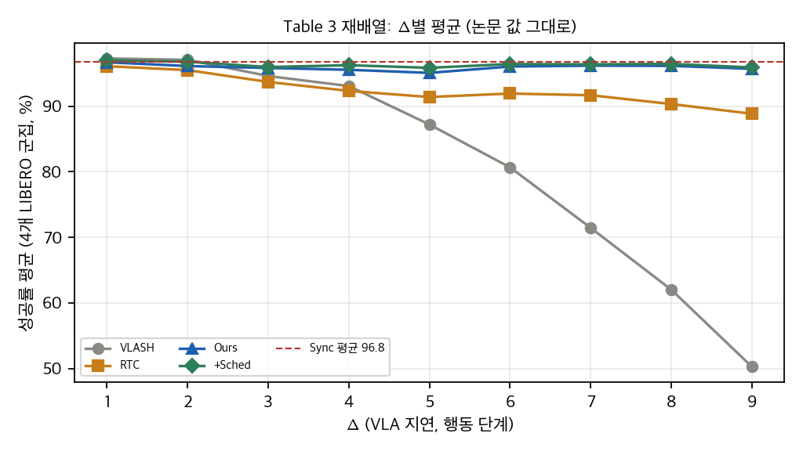
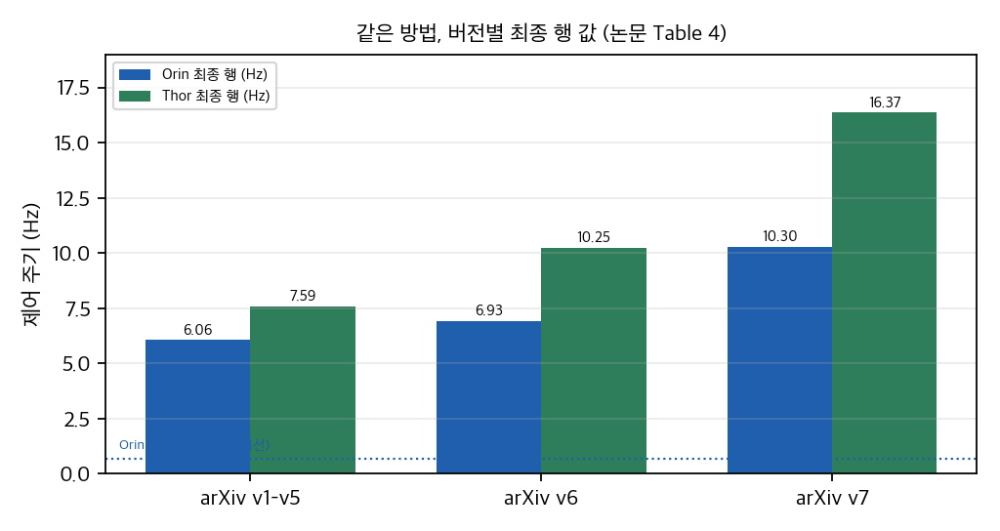
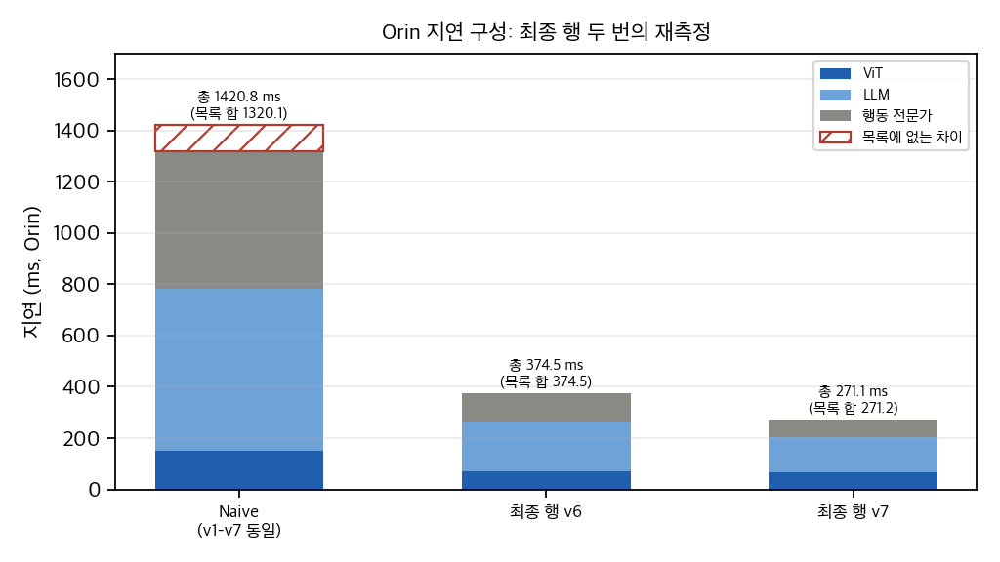

> **논문:** Zebin Yang 외 8인. *EagleVLA: Towards Onboard Real-Time Robot Control via Foresight-Aligned Asynchronous Inference.* CoRL 2026 스포트라이트, arXiv:2607.12659 (v7, 2026-10-23; v1 제목은 Jetson-PI).
> **공식 저장소:** `PKU-SEC-Lab/EagleVLA` (Apache-2.0, LIBERO 학습과 평가), `PKU-SEC-Lab/EagleVLA-Edge` (MIT, llama.cpp 기반 온보드 엔진).
> 논문 라이선스는 CC BY 4.0입니다. 이 글에는 논문 그림을 싣지 않았습니다. 아래 그래프는 논문 수치로 직접 그렸습니다.

---

## 논문이 묻는 것

Jetson Orin에서 π0.5는 약 1.4초가 걸리고 제어 주기는 0.7 Hz입니다. 비동기 추론은 이 지연을 가리지만, 두 문제를 새로 만듭니다. 추론이 끝났을 때 환경이 이미 바뀌어 있고(지각-실행 불일치), 환경 변화에서 로봇이 반응하기까지 시간이 청크 길이와 지연에 묶입니다.

EagleVLA는 세 가지로 답합니다. 첫째, 작은 보정 모듈이 VLM 표현의 미래 시점 값을 예측해 행동 전문가에게 넣습니다. 둘째, 같은 모듈의 신뢰도로 VLM을 건너뛸지 정합니다. 셋째, llama.cpp 기반 엔진에서 CUDA 그래프를 재사용하고 중간 버퍼를 GPU에 둡니다.

## 숫자를 다시 계산해 보기

LIBERO 표(Table 3)의 평균과 본문 차이는 대부분 맞습니다. 본문의 "VLASH보다 14.8%"는 **%p**이고, 네 군집과 ∆ = 1..9 평균에서 +Sched 열로 계산한 값입니다. 공식 README의 표 복사본과도 144개 값 모두 같습니다.

*그래프: 논문 Table 3의 네 군집 평균을 ∆별로 옮긴 것입니다. 재계산은 하지 않았습니다. 우리가 그린 그래프입니다.*

그런데 보고된 값 148개 가운데 85개는 군집당 500회 단일 집계의 격자(0.2%p 단위)와 맞지 않습니다. 시드 평균이나 다른 분모를 썼을 가능성이 있는데, 논문에는 시행 수와 시드가 없습니다. 칸별로 보면 +Sched가 Ours보다 나은 칸은 없고(36칸 모두 유의하지 않음), 평균 차이는 0.4%p입니다. 스케줄링의 정확도 효과는 작습니다.

## 헤드라인 배율은 세 번 바뀌었습니다

같은 논문의 Orin 배율은 v1 8.66×, v6 9.85×, v7 14.71×로 바뀌었습니다. 나이브 행과 "+Schedule" 행은 모든 버전에서 같습니다. 바뀐 것은 그래프 재사용 행과 최종 행입니다. 최종 행 Orin 제어 주기는 6.06 → 6.93 → 10.30 Hz입니다.

*그래프: 최종 행의 제어 주기를 arXiv 버전별로 옮긴 것입니다. 같은 방법의 값이 바뀌었습니다. 우리가 그린 그래프입니다.*

v7 제출일(2026-10-23)은 공식 엔진 저장소에서 FP16 GEMM 튜닝, 시간 변조 캐시, 새 FP16 모델을 포함한 최적화 PR이 병합된 날과 같습니다. 논문 Table 4의 최종 행 라벨은 "+Intermediate Buffer & Unroll"인데, 같은 수치는 엔진 저장소에서 "+ time cache, and GEMM tuning (PR #6)"으로 적혀 있습니다. 저장소는 이 행이 같은 체크포인트에서 통제된 절제 실험이 아니라고 명시합니다. 그래서 §5.2의 "버퍼·unroll 1.89×, 2.20×"는 단계별 효과로 읽으면 안 됩니다.

*그래프: Orin 지연의 구성 요소. Naive 행에는 목록에 없는 100.7 ms가 있고, 설명은 없습니다. 우리가 그린 그래프입니다.*

## Thor 헤드라인에는 단서가 필요합니다

Thor 최종 구성(132.8 ms, 16.37 Hz, 7.51×)은 엔진 저장소에서 "정확도 게이트(cosine > 0.9994) 미통과, 최소 0.999075, 정확도 승인 기본값 아님"이라고 적힌 구성입니다. 논문은 "negligible success rate loss"만 씁니다. Orin 최종 구성은 같은 게이트를 통과했습니다.

## 공식 코드는 논문과 다른 점이 있습니다

공식 저장소는 논문의 구조(보정 모듈, 신뢰도, 두 가지 스케줄, LIBERO 네 군집 평가)를 대부분 가지고 있습니다. 다만 다음 다섯 가지가 논문과 다릅니다. (1) 보정 손실은 논문 식 (1)의 MSE와 신뢰도 회귀가 아니라 이분산 가우시안 음의 로그우도(NLL)입니다. (2) 신뢰도는 κ = −mean(log σ²)입니다. (3) 논문 Alg. 1의 VLM 재호출은 코드에서 "초기값 대비 0.4 하락 시 두 단계 full π0 폴백"으로 바뀌어 있습니다. (4) 행동 전문가의 고유감각 입력이 기본값으로 VLASH식 전진 값입니다. (5) 학습은 논문 Table 6(두 단계, 배치 32)과 달리 세 단계(30k·15k·55k, 배치 16)입니다.

## 실로봇 결과는 나이브 대비만 확실합니다

실로봇(X2-W, 옷 개기)은 과제당 10회, 세 과제 합계 30회입니다. Orin 나이브 비동기는 11/30, EagleVLA는 27/30, RTX 4090은 27/30입니다. 나이브 대비 차이는 뚜렷합니다(Fisher p ≈ 3×10⁻⁵). 4090과의 차이는 p = 1.0이지만, 이 표본으로는 같다고 말할 수 없습니다. 실로봇 모델은 XR-1이고 실행 주기는 15 Hz라서, 표 4의 π0.5 실험과도 다릅니다.

## 이 맥(또는 일반 워크스테이션)에서 할 수 있는 것

구조를 PyTorch로 옮기는 일은 가능합니다(추정 1–2주, 학습 제외). 손실 두 가지를 작은 합성 시스템에서 비교하는 토이는 하루 이틀이면 가능합니다. 반면 공식 학습(A100급, 30k 스텝)과 LIBERO 평가(CUDA 환경, 체크포인트 다운로드)는 CUDA 머신이 필요하고, Orin 지연 재측정과 실로봇 재현은 장비와 데이터가 필요합니다.

## 정리

- 방법의 아이디어(미래 조건 보정과 신뢰도 기반 VLM 생략)는 짧고 명확합니다.
- 헤드라인 배율 14.71×는 최적화 구성 전체의 측정값입니다. 방법의 효과로 인용하기 전에 버전과 구성을 확인해야 합니다.
- Thor 최종 구성은 정확도 승인 전 값입니다.
- 실로봇의 동등성 주장은 과제당 10회로 판정할 수 없습니다.

---

*이 글은 논문 본문과 부록, 공식 저장소의 정적 읽기, arXiv 버전 비교를 바탕으로 합니다. 재현 실험과 가중치·데이터 다운로드는 하지 않았습니다. 논문 그림과 원문 PDF는 싣지 않았습니다.*

## 자료

- [통합 리포트 PDF](report/report_public.pdf)
- [01. 논문 분석: EagleVLA (arXiv:2607.12659 v7)](analysis/01_paper_analysis.md)
- [02. 선행연구와 관련 자료](analysis/02_prior_work.md)
- [03. 수치 재계산, 일관성, 검정, 버전 차이](analysis/03_analysis.md)
- [04. 논문 ↔ 코드 대조 (정적 읽기)](analysis/04_code_verification.md)
