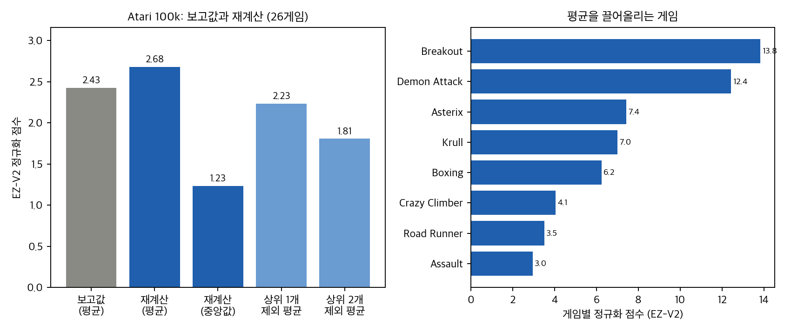
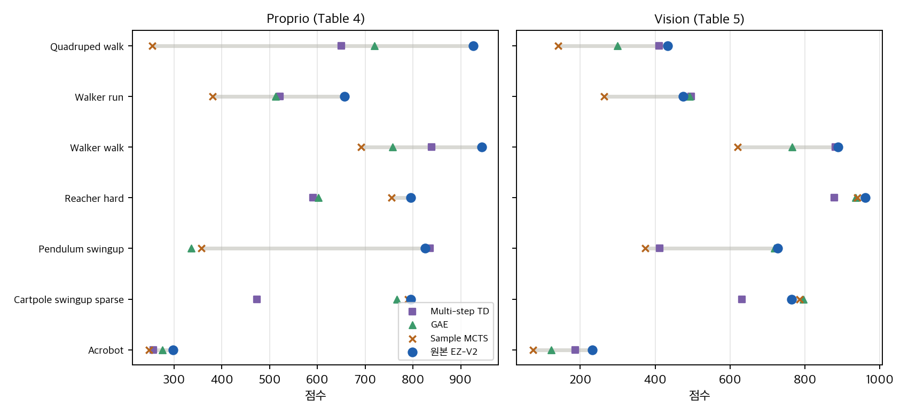
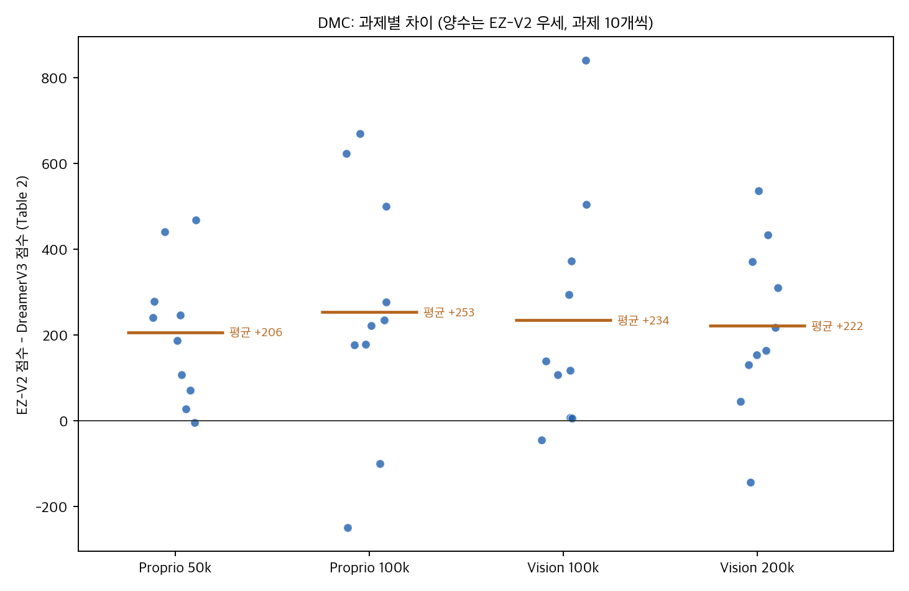

# 03. 수치 재계산과 일관성 검사

이 문서는 논문 표의 값을 다시 계산하고, 본문 주장과 맞는지 봅니다. **재현(학습, 실행)은 하지 않았습니다.** 모든 계산은 `analysis/recompute.py`에 있고(numpy, scipy, 수 초), 결과는 `analysis/recompute_results.json`입니다. 그래프는 `analysis/plot_figures.py`가 만듭니다.

**중요한 한계.** 논문은 시드별 점수, 표준편차, 신뢰구간을 내지 않습니다. Table 2 캡션만 "3 seeds"라고 합니다. 그래서 여기서 계산한 구간과 검정은 **과제(task) 사이의 변동**만 반영합니다. 같은 과제를 여러 번 돌릴 때의 잡음은 계산할 수 없습니다. 이 점 때문에 "p값이 작다"는 말은 "과제 단위로 일관되게 차이가 난다"는 뜻으로만 읽어야 합니다.

검증 라벨: V = 표 재계산 검증, C = 본문 주장 대조.

---

## 1. 데이터와 방법

- **Table 1 (Atari 100k).** 26게임, 열은 Random, Human, SimPLe, CURL, DrQ, SPR, MuZero, EfficientZero, DreamerV3, BBF, EZ-V2. DreamerV3의 Up N Down은 "-"(값 없음)입니다.
- **Table 2 (DMC).** 과제 10개씩 두 블록(쉬움: Proprio 50k·Vision 100k, 어려움: Proprio 100k·Vision 200k). 열은 SAC·TD-MPC2·DreamerV3·EZ-V2 (Proprio), CURL·DrQ-v2·DreamerV3·EZ-V2 (Vision).
- **정규화.** (점수 − 무작위) / (인간 − 무작위). 이 정의로 EfficientZero와 BBF의 정규화 평균을 다시 구하면 논문 값(1.945, 2.247)과 맞습니다. 따라서 정규화 정의 자체는 논문과 같습니다.
- **입력 확인.** 스크립트에 옮겨 적은 값을 `paper/paper.txt` 레이아웃 텍스트와 자동으로 대조했습니다. Table 1 26행과 Table 2 20행이 모두 일치했습니다.

---

## 2. Atari 정규화 점수 (V1–V2)

| 항목 | 재계산 | 논문 보고값 | 판정 |
|---|---|---|---|
| EfficientZero 평균 | 1.943 | 1.945 | 근사 일치 (반올림 차이 수준) |
| EfficientZero 중앙값 | 1.090 | 1.090 | 일치 |
| BBF 평균 / 중앙값 | 2.247 / 0.917 | 2.247 / 0.917 | 일치 |
| **EZ-V2 평균** | **2.680** | **2.428** | **불일치 (차이 0.252, 약 10%)** |
| **EZ-V2 중앙값** | **1.235** | **1.286** | **불일치 (차이 0.051)** |
| DreamerV3 평균 / 중앙값 (25게임) | 1.059 / 0.340 | 1.120 / 0.490 | 불일치 (Up N Down 값 없음이 원인인지 확인 못 함) |

**V1 해석.** EZ-V2 열의 값에서 직접 계산하면 평균과 중앙값 모두 논문 보고값보다 큽니다. Table 1 안의 EZ-V2 점수 자체가 틀렸는지, 보고된 정규화 값이 다른 값 집합에서 왔는지는 표만으로 구분할 수 없습니다. 원인을 확정하지 못했으므로 "정규화 평균이 재현되지 않는다"까지만 말합니다.

**V2 민감도.** 평균은 소수 게임에 많이 끌려갑니다.
- 정규화 점수 상위 게임: Breakout 13.8, Demon Attack 12.4, Asterix 7.4, Krull 7.0.
- 상위 1개(Breakout)를 빼면 평균 2.23, 상위 2개를 빼면 **1.81**입니다.
- 중앙값은 1.235로 비교적 안정적입니다.
- 결론: 논문이 강조하는 Atari "평균 2.428"은 게임 몇 개에 크게 기대고 있습니다. 중앙값으로 보는 것이 안전합니다.



<p class="cap">그래프 1: 우리가 그린 그래프. 왼쪽은 보고값과 재계산값, 오른쪽은 EZ-V2 게임별 정규화 점수 상위 8개입니다.</p>

---

## 3. 승패 집계와 "66개 중 50개" 주장 (V3, C1)

| 항목 | 재계산 | 논문 |
|---|---|---|
| Atari 26게임 중 EZ-V2 > DreamerV3 | 21승 1무 3패 (Up N Down 제외, 25게임 비교) | — |
| DMC 40과제 중 EZ-V2 > DreamerV3 | 35승 5패 | — |
| 전체 | **56 / 65** (Up N Down 제외) | **50 / 66** (Abstract, §1) |

- Atari 3패: Hero, Kangaroo, Private Eye.
- 논문의 "66"은 Atari 26 + DMC 40입니다. 표에서 셀 수 있는 승패는 DreamerV3 값이 없는 Up N Down을 빼고 65입니다.
- **재계산 결과는 논문의 50보다 높습니다.** 어떤 규칙(무승부 처리, 기준선 선택, 다른 버전의 표)에서 50이 나왔는지 본문에는 없습니다. 이 불일치는 보고만 하고 원인은 확정하지 않습니다.
- 대응 검정: Atari 정규화 점수 차이의 Wilcoxon 부호순위 검정 p = 0.0002(25게임), 부호 검정 21/24 p = 0.0003. DMC 40쌍 Wilcoxon p = 9×10⁻⁸, 부호 검정 35/40 p = 1.4×10⁻⁶.
- 해석: **DreamerV3보다 낫다는 방향은 표에서 강하게 지지됩니다.** 다만 "50/66"이라는 숫자는 재현되지 않습니다.

C1 판정: 방향은 맞습니다(강하게 지지). 숫자 "50/66"은 표에서 재현되지 않습니다(56/65).

---

## 4. DMC 블록 평균과 중앙값 (V4–V5, C2–C4)

### 4.1 블록별 평균 재계산

| 블록 (10과제) | 기준선 1 | 기준선 2 | DreamerV3 | EZ-V2 |
|---|---|---|---|---|
| Proprio 50k (SAC, TD-MPC2, DreamerV3, EZ-V2) | 793.5 | 861.8 | 695.6 | 901.8 |
| Vision 100k (CURL, DrQ-v2, DreamerV3, EZ-V2) | 650.8 | 591.5 | 661.7 | 896.2 |
| Proprio 100k (SAC, TD-MPC2, DreamerV3, EZ-V2) | 304.3 | 600.6 | 300.1 | 553.1 |
| Vision 200k (CURL, DrQ-v2, DreamerV3, EZ-V2) | 231.8 | 239.7 | 331.0 | 552.6 |

50k 블록에는 평균 행이 없습니다.

Table 2의 평균 행은 Proprio 100k 블록과 Vision 200k 블록 아래에 한 번 있습니다(열 8개). 평균 행을 **10과제 블록**으로 맞추면 위 표의 어려운 블록 값(553.1, 552.6)과 같아지지 않습니다. 보고된 평균 행과 맞추려면 **20과제 전체**로 평균을 내야 합니다.

| 열 | 보고 평균 행 | 20과제 평균 (재계산) | 차이 |
|---|---|---|---|
| Proprio SAC | 552.0 | 548.9 | −0.6% |
| Proprio TD-MPC2 | 740.9 | 731.2 | −1.3% |
| Proprio DreamerV3 | 517.1 | 497.8 | −3.7% |
| **Proprio EZ-V2** | **723.2** | **727.4** | +0.6% |
| Vision CURL | 437.3 | 441.3 | +0.9% |
| Vision DrQ-v2 | 410.3 | 415.6 | +1.3% |
| Vision DreamerV3 | 498.5 | 496.3 | −0.4% |
| **Vision EZ-V2** | **726.1** | **724.4** | −0.2% |

- 평균 행은 **20과제 평균에 근접하지만 정확히 일치하지는 않습니다**(차이 0.2–3.7%). 집계 방식이 적혀 있지 않습니다.
- 중앙값 행도 같은 식입니다. 예: Proprio EZ-V2 중앙값 행 800.4는 20과제 중앙값 800.4와 일치하지만, Vision EZ-V2 788.1은 20과제 중앙값 796.9와 다릅니다.

### 4.2 본문 주장

- **C2 "Proprio 평균 723.2 across 20 tasks".** 표의 평균 행과 숫자는 같지만, 20과제 재계산값은 727.4입니다. 10과제 블록 평균은 553.1입니다. 즉 **본문의 "20 tasks" 표현은 재계산과 0.6% 어긋나고, 표의 평균 행이 어떤 집합으로 계산됐는지 논문에 없습니다.** 판정: 근사적으로 맞음, 정확히는 재현되지 않음.
- **C3 "Vision 평균 726.1, DreamerV3보다 45% 높음".** 726.1 / 498.5 = 1.457, 즉 **+45.7%**. 20과제 재계산(724.4 / 496.3)으로는 +45.9%입니다. 판정: 맞음(반올림은 내림 쪽).
- **C4 "Vision 20개 중 16개에서 새 기록".** 기준선 CURL, DrQ-v2, DreamerV3 중 최고보다 높은 과제를 세면 **16/20**입니다. 판정: 맞음. 다만 SAC·TD-MPC2는 Vision 표에 없어서 비교에서 빠졌고, 이것은 기준선 선택에 따른 것입니다.

### 4.3 과제 사이 변동 (task-level)

| 비교 | 평균 차이 | 과제 부트스트랩 95% 구간 | Wilcoxon p |
|---|---|---|---|
| Proprio 100k: EZ-V2 − DreamerV3 | +253.0 | [79.7, 421.9] | 0.037 |
| Vision 200k: EZ-V2 − DreamerV3 | +221.7 | [103.3, 338.0] | 0.0098 |
| 두 블록 40과제 합 | 중앙값 차이 +201.6 | — | 9×10⁻⁸ |

- 부트스트랩은 과제를 다시 뽑아서 계산했습니다(10,000회, 시드 0).
- Atari 정규화 평균의 과제 사이 부트스트랩 95% 구간은 [1.37, 4.23]로 매우 넓습니다. 이는 소수 게임이 평균을 끌어올리기 때문입니다(V2).

---

## 5. 계산량 주장 (V6, C5)

| 항목 | 재계산 | 본문 |
|---|---|---|
| FLOPs 비율 (TD-MPC2 / EZ-V2) | 3.6×10¹⁰ / 4.7×10⁷ = **766배** | "1000 times fewer FLOPs" (부록 J.3) |
| 파라미터 비율 | 4.9×10⁶ / 1.3×10⁶ = **3.8배** | "almost 4 times" (부록 J.3) |
| 10만 스텝 학습 시간 | 3.3 h / 2.7 h = **1.22배** | "similar amount of time" |

C5 판정: **FLOPs "1000배"는 과장입니다.** 표 7 값으로는 약 770배입니다. 파라미터 "약 4배"는 맞습니다. 학습 시간은 본문이 "비슷하다"고 한 것과 맞습니다. 다만 FLOPs와 시간 측정 조건(배치, 하드웨어, 프레임워크)은 적혀 있지 않습니다. 이 수치들은 한 과제(Walker Run)만 대상입니다.

---

## 6. 절제 실험 (V7, C6)

Table 4(Proprio 7과제)와 Table 5(Vision 7과제)를 원본과 변형 사이에서 짝지어 봅니다. 시드 정보가 없으므로 과제 7개만 씁니다.

| 비교 | 원본 승 / 변형 승 | 평균 (원본 → 변형) | Wilcoxon p |
|---|---|---|---|
| Proprio: 다단계 TD | 6 / 1 | 748.7 → 595.4 | 0.031 |
| Proprio: GAE | 7 / 0 | 748.7 → 567.0 | 0.016 |
| Proprio: 샘플 MCTS | 7 / 0 | 748.7 → 496.7 | 0.016 |
| Vision: 다단계 TD | 6 / 1 | 640.1 → 556.4 | 0.047 |
| Vision: GAE | 5 / 2 | 640.1 → 589.6 | 0.22 |
| Vision: 샘플 MCTS | 6 / 1 | 640.1 → 456.7 | 0.031 |

- Atari 3게임(Table 6, Asterix·Up N Down·Qbert): 원본은 다단계 TD에 3/3, GAE에 2/3 승.
- Table 4·5의 원본 열은 Table 2 값과 모두 일치했습니다.
- C6 판정: 본문 "샘플 MCTS보다 낫다"는 표 4·5에서 맞습니다. "GAE보다 낫다"는 Proprio에서는 맞고 Vision에서는 약합니다(p=0.22). Atari 3게임은 근거가 거의 없습니다. 과제 7개에서 양측 정확 Wilcoxon의 최소 p는 0.016이므로, 7/7 승은 이 설계에서 얻을 수 있는 가장 강한 증거입니다. 그래도 과제 수가 적어 효과 크기 추정 범위는 넓습니다.



<p class="cap">그래프 2: 우리가 그린 그래프. Table 4와 5의 과제별 점수입니다. 원본 EZ-V2와 세 변형을 보여 줍니다.</p>

---

## 7. 그래프: DMC 과제별 차이



<p class="cap">그래프 3: 우리가 그린 그래프. 블록별 과제 10개씩 EZ-V2 − DreamerV3 차이(Table 2)입니다. 가로 막대는 평균입니다.</p>

---

## 8. 확인하지 못한 것

- **시드별 값.** 없습니다. 따라서 "3 seeds" 조건에서 신뢰구간을 만들 수 없습니다.
- **Atari 시드 수.** 적혀 있지 않습니다.
- **Table 1의 EZ-V2 열 원자료.** 레이아웃으로 옮긴 값이 맞는지는 레이아웃 텍스트와 대조했지만, 원본 로그와 대조하지는 않았습니다.
- **Table 2의 평균 행 집계 규칙.** 확정하지 못했습니다.
- **Up N Down DreamerV3 값.** 없으므로 DreamerV3 정규화 평균 1.120이 어떤 집합에서 나왔는지 알 수 없습니다.

## 9. v1과 v2의 표 차이 (V8)

- 두 버전의 Table 1 EfficientZero 열은 Qbert만 다릅니다. v1은 14448.5, v2는 13781.9입니다.
- 그 결과: v1 정규화 중앙값(보고 1.116, 재계산 1.115)은 v1 값과 맞고, v2 정규화 중앙값(보고 1.090, 재계산 1.090)은 v2 값과 맞습니다. 그런데 **정규화 평균은 v2에서도 1.945를 그대로 두었습니다.** 이 평균은 14448.5(v1 값)로 계산한 결과입니다. v2 값(13781.9)으로 계산하면 1.943입니다.
- 판정: **v2 표 안에서 EfficientZero 평균과 Qbert 값이 서로 맞지 않습니다.** 차이는 0.002라서 결과에는 작은 영향이지만, 개정 과정에서 한 열만 고쳐졌다는 흔적입니다.
- 다른 표(Table 2, Table 4–6)의 값은 v1과 v2가 같았습니다.

## 10. 요약 판정

| 주장 | 판정 | 근거 |
|---|---|---|
| EZ-V2가 DreamerV3보다 낫다 (방향) | **지지됨** | V3: 56/65, 부호 검정 p < 10⁻⁵ (DMC), 0.0003 (Atari) |
| "66개 중 50개" | **재현되지 않음** | V3: 56/65 |
| Atari 정규화 평균 2.428 | **재현되지 않음** | V1: 2.680 (중앙값 1.235 vs 1.286) |
| Atari 정규화 중앙값 1.286 | **재현되지 않음** | V1 |
| Proprio 평균 723.2 "20 tasks" | **근사적으로만 맞음** | C2: 20과제 727.4 |
| Vision 평균 726.1, DreamerV3 대비 45% | **맞음** | C3: +45.7% |
| Vision 16/20 새 기록 | **맞음** | C4 |
| FLOPs 1000배 | **과장** | C5: 766배 |
| 파라미터 약 4배 | **맞음** | C5: 3.8배 |
| 샘플 MCTS보다 낫다 | **맞음 (강함)** | C6: 7/7 과제 |
| GAE, 다단계 TD보다 낫다 | **부분적** | C6: 6/7, 5/7 (Vision은 p=0.22) |

## 11. 재실행 방법

```bash
python3 analysis/recompute.py      # 표 재계산, recompute_results.json 갱신
python3 analysis/plot_figures.py   # report/figures/own_*.png 세 장 생성
```
