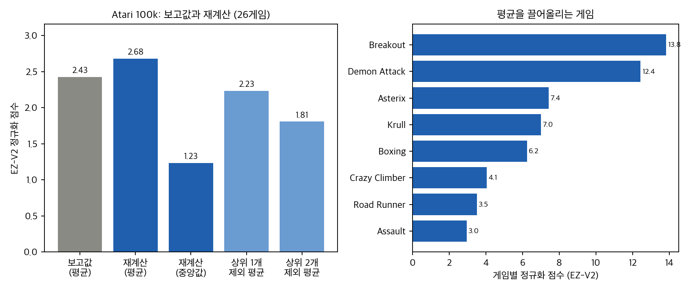
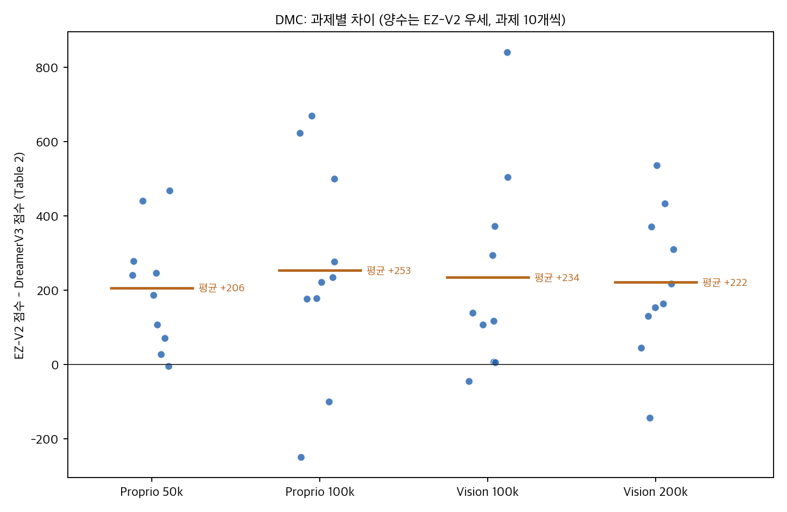
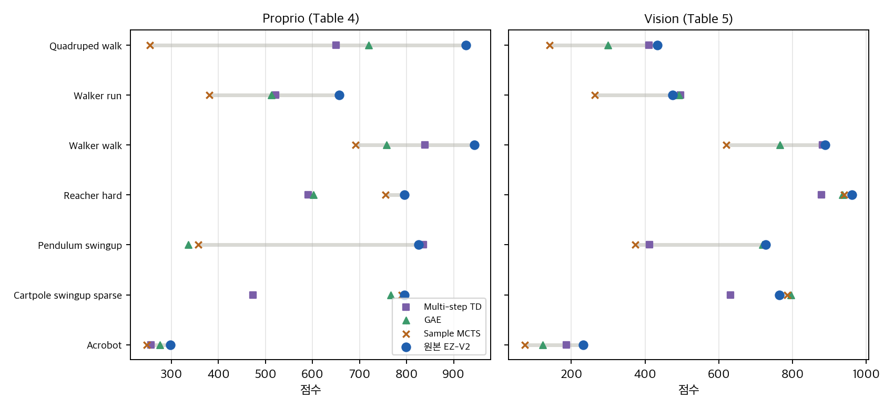

> **논문:** Shengjie Wang, Shaohuai Liu, Weirui Ye, Jiacheng You, Yang Gao. *EfficientZero V2: Mastering Discrete and Continuous Control with Limited Data.* ICML 2024 (PMLR 235), arXiv:2403.00564 (v2, 2024-09-12).
> 공식 코드는 GitHub에 있고 GPL-3.0입니다. 이 글은 코드를 실행하지 않았고, 논문 수치를 표에서 다시 계산하고 공식 코드를 정적으로 읽었습니다.
> 라이선스: 논문은 arXiv non-exclusive distribution license입니다(CC BY가 아닙니다). 그래서 이 글에는 논문 그림을 넣지 않고, 우리가 그린 그래프만 씁니다.

## 논문이 묻는 것

모델 기반 RL은 데이터가 적을 때 강합니다. 하지만 EfficientZero는 MCTS를 쓰므로 이산 행동에만 맞았습니다. 연속 제어에서는 행동 공간을 샘플로 줄여야 하는데, 샘플이 적으면 탐색이 흔들립니다. 이 논문은 두 가지를 고칩니다.

첫째, **샘플링 기반 Gumbel 탐색**입니다. 현재 정책에서 뽑은 행동과 평평하게 만든 분포에서 뽑은 행동을 합쳐 K=16개를 만들고, Sequential Halving으로 가장 높은 Q 행동을 고릅니다. 이 선택은 정책 개선 조건을 만족한다고 주장합니다(식 (6)–(7)).

둘째, **탐색 기반 가치 추정과 혼합 목표**입니다. 오래된 전이에는 탐색 결과로 만든 가치를 쓰고, 최근 전이에는 다단계 TD 목표를 씁니다. 모델이 부정확한 초기에는 TD 쪽을 씁니다(식 (16)).

논문은 Atari 100k, DMC 저차원 상태, DMC 이미지에서 DreamerV3를 이겼다고 보고합니다. Vision 평균은 726.1 대 498.5입니다.

## 표에서 다시 센 것

**1. DreamerV3보다 낫다는 방향은 강하게 지지됩니다.** Atari 25게임에서 21승 1무 3패입니다. DMC 40과제에서는 35승 5패입니다. DMC의 부호 검정 p는 1.4×10⁻⁶입니다. 과제 사이 변동만 보면 그렇습니다. 시드별 점수가 없으므로 시드 간 잡음은 계산할 수 없습니다.

**2. Atari 정규화 평균은 표 1로 다시 계산한 값과 다릅니다.** 표 1의 EZ-V2 열에서 계산하면 평균 2.680이고 중앙값은 1.235입니다. 논문 보고값은 2.428과 1.286입니다. EfficientZero와 BBF 열은 같은 정의로 논문 값과 맞으므로 정의 문제는 아닙니다. 원인은 표만으로 확정하지 못했습니다.

*그래프 1: 우리가 그린 그래프. 평균은 Breakout(13.8)과 Demon Attack(12.4)에 많이 기댑니다. 두 게임을 빼면 평균은 1.81입니다.*

**3. "66개 중 50개"는 56/65로 나옵니다.** 표에서 세면 Atari 21, DMC 35로 합이 56입니다. Up N Down은 DreamerV3 값이 없어서 뺐습니다. 논문이 50을 어떻게 셌는지는 본문에 없습니다.

**4. 한 표 안에 어긋남이 있습니다.** v1과 v2를 비교하면 EfficientZero의 Qbert 값이 바뀌었습니다. 정규화 중앙값은 바뀌었지만 정규화 평균 1.945는 옛 값에서 계산한 그대로입니다.

**5. DMC 차이는 블록마다 양수입니다.** 과제 10개씩 보면 평균 차이는 +206(Proprio 50k), +253(Proprio 100k), +234(Vision 100k), +222(Vision 200k)입니다. 두 어려운 블록의 과제 부트스트랩 구간은 0을 넘습니다.

*그래프 2: 우리가 그린 그래프. Table 2의 과제별 차이와 블록 평균입니다.*

**6. 계산량 "1000배"는 Table 7 값과 다릅니다.** Table 7 값으로 FLOPs 비율은 약 770배입니다. 파라미터는 3.8배입니다. "1000배"는 표 값보다 큰 어림입니다.

**7. 절제 실험은 대체로 일관됩니다.** 샘플 MCTS에는 Proprio와 Vision 모두에서 거의 이깁니다. GAE에는 Proprio에서 7/7이고 Vision에서는 5/7이며 p=0.22입니다. 과제는 7개뿐이고 Atari는 3게임뿐입니다.

*그래프 3: 우리가 그린 그래프. 과제 7개의 점수입니다. 원본은 파란 점이고 변형은 표식으로 구분했습니다.*

## 공식 코드와 논문의 차이

공식 저장소는 2024년 8월 이후 바뀌지 않았습니다. 설정 파일은 논문 Table 3과 여러 곳에서 다릅니다. 가치 손실 계수는 0.25 대신 0.5입니다. DMC 이미지의 할인율은 0.99입니다. 버퍼 크기와 Atari 혼합 목표 스케줄도 다릅니다. README는 Atari 성능이 논문과 맞지 않는다고 적어 두었습니다.

또 하나 짚을 것이 있습니다. 연속 행동의 정책 손실은 논문이 식 (8)과 식 (9)를 함께 쓰는 것처럼 읽힙니다. 코드는 행동 차원이 1이면 식 (8)형만, 2 이상이면 식 (9)형만 씁니다. 논문은 이 선택을 밝히지 않습니다.

## 이 노트북에서 돌릴 수 있는가

- **공식 코드 그대로: 불가입니다.** `.cuda()` 호출이 77곳에 있고, 환경은 Python 3.8과 gym 0.22 같은 오래된 패키지입니다.
- **CPU에서 가능한 것:** 재계산은 이미 끝냈습니다. 1차원 장난감 실험은 아직 하지 않았고, 식 (6)–(7)의 정책 개선이 샘플 수에 따라 어떻게 나타나는지 보는 것이 다음 단계입니다.
- **조건부:** 공식 코드를 MPS로 옮겨 DMC 과제 하나를 10만 스텝 학습하는 것입니다. 수 시간 이상이 걸릴 것으로 추정합니다.
- **불가:** 이미지 DMC와 논문 전체 재현은 GPU 수백 시간 이상이 필요합니다. 실로봇 실험은 논문에도 없습니다.

## 정리

EfficientZero V2는 연속 제어에서 DreamerV3보다 낫다는 방향을 잘 보여 줍니다. 다만 정규화 평균과 승패 숫자는 표로 다시 계산한 값과 다릅니다. 그래서 "평균 2.428"보다는 중앙값과 과제별 차이를 함께 보는 것을 권합니다. 재현은 GPU 없이는 어렵고, 설정 파일 차이와 연속 정책 손실의 결합 방식부터 확인하는 것이 순서입니다.

*분석 파일과 재계산 스크립트는 `publish/git/`에 있습니다. 원문 PDF는 arXiv에서 받을 수 있습니다.*

## 자료

- [통합 리포트 PDF](report/report_public.pdf)
- [01. 논문 분석: EfficientZero V2](analysis/01_paper_analysis.md)
- [02. 선행 연구와 관련 자료](analysis/02_prior_work.md)
- [03. 수치 재계산과 일관성 검사](analysis/03_analysis.md)
- [04. 공식 코드 대조와 구현 가능성](analysis/04_code_verification.md)
