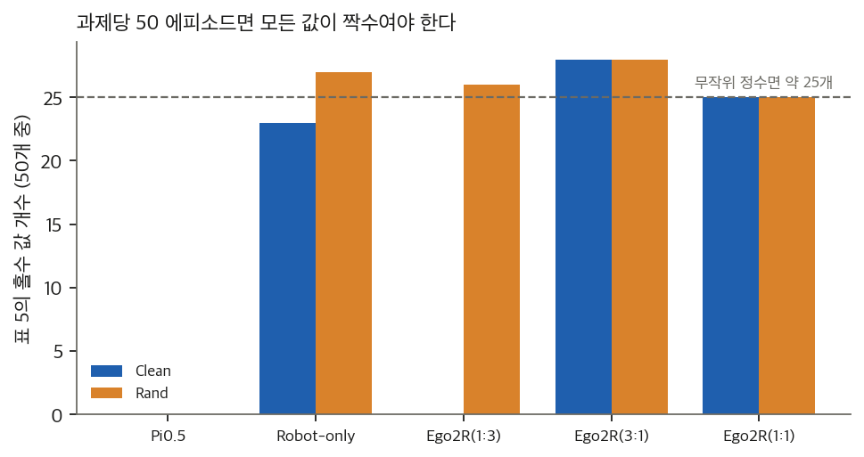
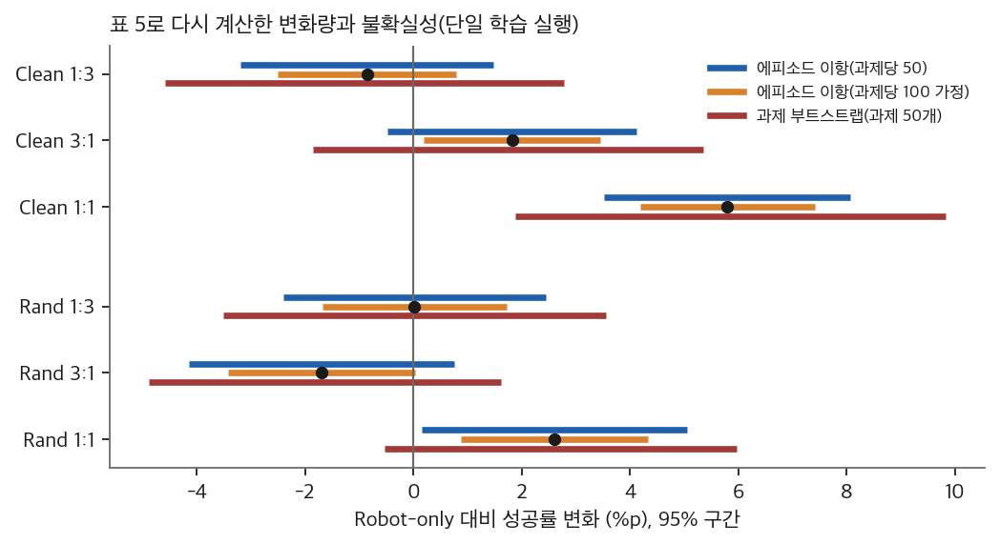
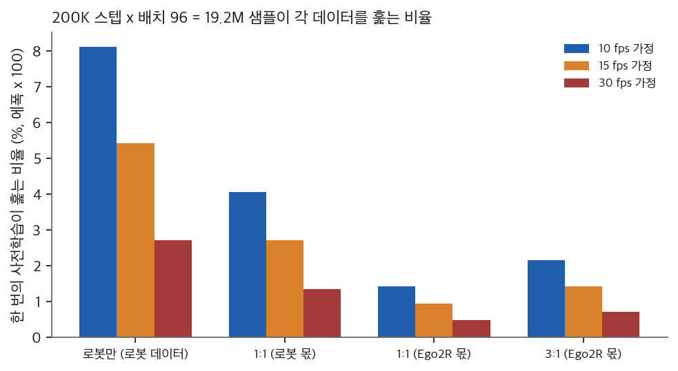
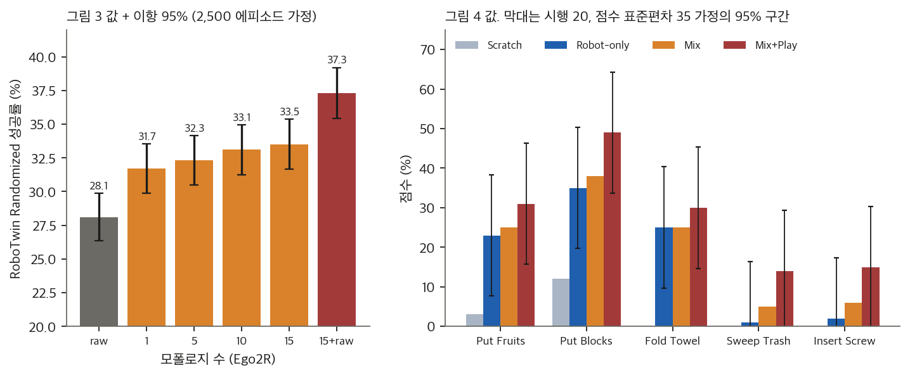

# 03. 수치 재계산과 일관성 검사 (Ego2Robot v1)

논문 표 1, 2, 4, 5와 그림 3, 4의 값을 다시 계산하고, 표끼리·본문과의 일관성, 단일 학습 실행이 허용하는 불확실성을 점검했습니다. 학습·평가·로봇 실행은 하지 않았습니다. 스크립트는 `recompute.py`(numpy, scipy, 약 1초)와 `toy_camera_frame.py`(numpy, 1초 미만)이고 결과는 `recompute_results.json`, `toy_camera_frame_results.json`입니다. 라벨은 검사 V1–V15와 토이 K1–K3입니다. 코드 대조의 D 항목은 `04`에 있습니다.

**전제.** 유의성은 (a) 한 번의 학습·미세조정 실행 결과가 에피소드 표집 오차만 가진다고 보고 계산한 것이고, (b) 표 1·2의 셀은 50과제 x 50 에피소드 = 2,500회로 가정했습니다. 학습 시드 간 변동은 논문에 없어서 어떤 검정에도 들어가 있지 않습니다. 실제 분산은 이보다 큽니다(V6, V8).

## 1. 정합성 검사 요약

| 라벨 | 검사 | 결과 |
|---|---|---|
| V1 | 표 5 열 평균 대 표 5 Average 행, 표 1의 Clean·Rand | 표 1의 Clean·Rand 8개는 Average 행과 모두 일치. 그러나 과제별 표시값의 평균과 Average 행은 최대 0.08 어긋남(세 열이 반올림 규칙과 안 맞음, §2) |
| V2 | 표 5 값의 정수·짝수 가능성(과제당 50 에피소드) | **500개 중 182개가 홀수.** 열 10개 중 3개(π0.5 둘, Ego2R 1:3 Clean)만 모두 짝수 |
| V3 | 표 1·2의 변화량 = 표값 − Robot-only | 불일치 0개 (±0.05 허용, 7열 x 3행 + 11열 x 3행) |
| V4 | 표 2 → 표 1 차원 평균(B.3 정의) | 불일치 0개 (12셀) |
| V5 | 본문 문장 대 표 | 수치는 맞음. "시각이 가장 이득"은 표 1과 맞지 않음(§4) |
| V6 | 표 2 셀의 단순 이항 검정 | 33개 비교 중 17개 p < 0.05, Benjamini–Hochberg 후 16개, Bonferroni 후 11개 |
| V7 | 표 5 과제 단위 쌍체 비교 | 1:1 Clean +5.8 (p = 0.007), Rand +2.6 (p = 0.13) |
| V8 | 이항 표준오차로 본 평균 차이 | 1:1 Rand z = 2.1 (과제당 50) 또는 2.9 (100 가정) |
| V9 | Clean 대 Rand 과제별 역전 | Robot-only 13과제에서 Rand가 Clean보다 높음 |
| V10 | 혼합 비율 대 성능 | 7열 중 5열이 1:1에서 최대(비단조) |
| V11 | 데이터 양, 노출 | 샘플 19.2M이 훑는 비율 1% 안팎(fps 가정 0.5–1.4%) |
| V12 | 그림 3 절제 | 형태 1 → 15는 +1.8 (p = 0.17) |
| V13 | 그림 4 실로봇 | Put Fruits Mix+Play 31은 점수 방식으로 불가능한 값 |
| V14 | 기타 산수 | 합계·배수·에피소드 길이 일치(§11) |
| V15 | 평가 형태와 Ego2R 형태의 겹침 | UR5, ARX, Franka 계열이 모두 15개 형태 안에 있음 |

## 2. 표 5와 분모 (V1, V2)

표 5는 50과제의 Clean/Rand 성공률(%)입니다. 모든 값이 소수점 아래 0입니다. 과제당 50 에피소드(§5.1, B.3)의 이진 성공이면 성공률은 2의 배수여야 합니다.

| 열 | 홀수 개수 (50개 중) |
|---|---|
| π0.5 Clean / Rand | 0 / 0 |
| Robot-only Clean / Rand | 23 / 27 |
| Ego2R 1:3 Clean / Rand | **0** / 26 |
| Ego2R 3:1 Clean / Rand | 28 / 28 |
| Ego2R 1:1 Clean / Rand | 25 / 25 |

그래프: 표 5의 홀수 값 개수. 과제당 50 에피소드면 모두 0이어야 합니다. 우리가 그린 그래프입니다.

- 읽는 법: 3개 열은 50 에피소드와 맞지만, 나머지 7개 열은 홀수가 절반 가까이입니다. 분모가 100이거나 여러 시드·실행의 평균을 정수로 반올림한 값일 수 있습니다. 논문은 "50 에피소드"라고만 씁니다.
- 반올림 증거: Average 행(표 1에 그대로 옮겨짐)과 과제별 표시값의 평균이 최대 0.08 어긋납니다. Ego2R 1:3 Rand는 평균 50.92인데 표에는 51.0, 3:1 Clean은 64.04인데 64.1, 1:1 Clean은 68.02인데 68.1입니다. 정수로 반올림된 값의 평균이면 1.0 단위의 반올림 오차가 평균에 이렇게 남을 수 있어서, 표시값은 정수가 아닌 값에서 반올림된 것으로 보입니다(나머지 7개 열은 0.02–0.06 이내).
- 영향: 분모가 50보다 크면 에피소드 표집 오차는 작아집니다. 아래 V8은 50과 100 두 경우를 모두 계산합니다.

## 3. 표의 산수 (V3, V4)

- **V3.** 표 1의 변화량 21개와 표 2의 변화량 33개가 모두 표값 − Robot-only와 ±0.05 안에서 일치합니다(예: 1:1 Clean 68.1 − 62.2 = +5.9).
- **V4.** 표 2에서 B.3의 정의(Visual = BG·Light·Color의 평균, Scene = Height·Clutter·Camera, Embodiment = ARX·UR5·Franka, Task = Obj·Lang)로 만든 12개 차원 평균이 표 1과 ±0.05 안에서 일치합니다. 예: Robot-only Embodiment (44.1 + 20.2 + 7.0)/3 = 23.77 → 23.8.

## 4. 본문 문장 검사 (V5)

| 문장 (§5.2) | 재계산 | 판정 |
|---|---|---|
| "1:1이 7열 중 5열에서 선두" | Clean, Rand, Visual, Scene, Task가 1:1. Embody와 EBench는 3:1(28.2, 51.7) | 맞음 |
| "Rand 53.5 (+2.6)", "Clean 68.1" | 53.5, +2.6, 68.1(+5.9) | 맞음 |
| 배경 +4, 조명 +8, 로봇 색 +6 | +3.7, +7.6, +6.4 | 맞음(반올림) |
| 카메라 오프셋 +6 | +5.9 | 맞음 |
| ARX 44 → 51, UR5 3:1에서 31 | 44.1 → 51.2, 31.4 | 맞음 |
| "Franka는 7% 미만" | Robot-only 7.0, 나머지 4.5·5.6·5.3 | Robot-only는 같음(7.0), 나머지는 미만 |
| 미지 물체 29 → 40 (3:1 +11) | 29.3 → 40.0, +10.7 | 맞음 |
| 의역 지시문 1:1에서 69 | 68.5 | 반올림 위로 |
| EBench 3:1 51.7 (+12.1) | 51.7, +12.1 | 맞음 |
| **"Visual appearance benefits most"** | 1:1 변화량: Task +7.9, Visual +5.9, Scene +4.0, Embody +3.4 (표 1). 3:1에서는 Embody +4.4, Task +5.4, Visual +1.3 | **표 1과 맞지 않음.** 세 시각 요소가 모두 오른다는 뜻의 "일관성"이라면 맞지만 크기는 Task가 큼 |
| 초록 "consistently improves OOD" | 표 2 11설정 중 1:1은 10곳에서 오름(Franka −1.7), 3:1은 8곳, 1:3은 4곳 | 1:1에서만 성립 |

## 5. 단일 실행의 불확실성 (V6–V8)

**V6. 표 2 셀의 단순 이항 검정 (셀당 2,500회, 두 비율의 차).** 같은 분모를 가정하면 기준값 20%, 50%, 65% 부근에서 두 셀 차이의 표준오차는 각각 1.1, 1.4, 1.4 %p입니다. 그래서 논문의 "Green = gain > 5%"(표 1·2 캡션)는 에피소드 표집 오차만으로도 1.1–1.4 %p x 1.96 = 약 2.2–2.8 %p를 넘으면 유의한 수준입니다. 5 %p 문턱은 표집 오차보다 훨씬 거칩니다. 1:1에서는 11개 중 10개가 p < 0.05(예외 Height p = 0.095)이고 Franka는 유의하게 **내려갑니다**(−1.7, p = 0.012). 33개 비교(3개 혼합 x 11 설정)로 보정하면 BH 후 16개, Bonferroni 후 11개가 남습니다. 가장 견고한 효과는 **Obj(미지 물체)** 로, 세 혼합 모두에서 +7.5, +10.7, +10.3이고 z가 5.6–8.0입니다(`03` V10과 함께).

**V7. 과제 50개를 표본으로 본 쌍체 비교 (표 5).** 과제별 차이를 쓰면 과제 이질성이 들어가서 더 보수적입니다.

| 비교 | 평균 차 | 과제별 SD | t 검정 p | Wilcoxon p | 부트스트랩 95% | 오른 / 내린 / 같은 |
|---|---|---|---|---|---|---|
| 1:1 Clean | +5.8 | 14.4 | **0.007** | 0.011 | [+1.9, +9.8] | 29 / 17 / 4 |
| 1:1 Rand | +2.6 | 11.9 | 0.13 | 0.12 | [−0.5, +6.0] | 26 / 21 / 3 |
| 3:1 Clean | +1.8 | 13.1 | 0.33 | 0.24 | [−1.9, +5.4] | 28 / 21 / 1 |
| 3:1 Rand | −1.7 | 11.8 | 0.31 | 0.19 | [−4.9, +1.6] | 19 / 30 / 1 |
| 1:3 Clean | −0.9 | 13.6 | 0.66 | 0.95 | [−4.6, +2.8] | 23 / 22 / 5 |
| 1:3 Rand | 0.0 | 13.0 | 0.99 | 0.90 | [−3.5, +3.6] | 24 / 23 / 3 |

**V8. 이항 표준오차.** 과제별 p_i로 평균의 표준오차를 계산하면 한 열의 평균 SE는 약 0.8–0.9 %p(과제당 50)입니다. 두 모델 차이의 z는 1:1 Clean 5.0(p < 10⁻⁶), 1:1 Rand 2.08(p = 0.037)이고, 분모가 100이면 7.1과 2.95(p = 0.003)입니다.

그래프: 표 5로 다시 계산한 Robot-only 대비 변화량. 세 가지 불확실성 구간(에피소드 이항 두 가지, 과제 부트스트랩)입니다. 학습 시드 변동은 어느 구간에도 없습니다. 우리가 그린 그래프입니다.

**읽는 법.**
- **Clean +5.9**는 에피소드 오차에도, 과제를 다시 뽑아도(p = 0.007) 살아남습니다. 단일 학습 실행이라는 점만 남습니다.
- **Rand +2.6**은 "이 50과제에서"라면 유의(p = 0.037 또는 0.003)하지만 과제를 표본으로 보면 유의하지 않습니다(p = 0.13). 논문의 "OOD 일반화 향상"의 핵심 수치가 가장 약한 쪽입니다.
- **학습 변동이 더 큽니다.** UR5의 세 혼합 값(17.6, 31.4, 25.0)은 이항 오차(셀당 약 0.8 %p)로 설명할 수 없는 차이입니다. 3:1과 1:1 사이 6.4 %p는 z = 5.0입니다. 두 혼합은 둘 다 "다형태" 데이터이므로 비슷할 것이라 기대되는데 차이가 큽니다. 학습 실행 사이의 변동(또는 비선형 효과)이 에피소드 표집 오차보다 훨씬 크다는 신호입니다. 코드는 체크포인트·시드 평균과 표준편차를 내는 집계 스크립트를 제공하는데(`04` D16), 논문 표는 단일 값입니다.

## 6. Clean 대 Rand 과제별 역전과 과제 이질성 (V9)

무작위화(Rand)는 Clean보다 어려워야 하는데 과제별로는 자주 뒤집힙니다: Rand가 Clean보다 높은 과제가 Robot-only 13개, Ego2R 1:3은 13개, 3:1은 5개, 1:1은 8개입니다. π0.5는 2개뿐입니다. 극단 예: 3:1 `move can pot`은 Clean 42, Rand 85(+43). 과제당 50회에서는 한 과제의 이항 표준오차가 최대 7 %p라서 이런 역전은 표집 잡음과 일치합니다(분모가 100이어도 5 %p).

1:1의 Rand 변화(+2.6)는 소수 과제가 만듭니다. 상위 5과제(`beat block hammer` +44, `move pillbottle pad` +22, `rotate qrcode` +20, `put bottles dustbin` +19, `lift pot` +16)를 빼면 평균 변화는 +0.2이고, 과제별 중앙값은 +2.5입니다. 반대로 `open microwave`는 −34(59 → 25)입니다.

## 7. 혼합 비율 대 성능 (V10)

Ego2R 비중 0, 25, 50, 75%의 순서로(1:3, 1:1, 3:1) 표 1:

| 열 | 0% | 25% | 50% | 75% |
|---|---|---|---|---|
| Clean | 62.2 | 61.4 | **68.1** | 64.1 |
| Rand | 50.9 | 51.0 | **53.5** | 49.2 |
| Visual | 61.4 | 61.2 | **67.3** | 62.7 |
| Scene | 52.9 | 52.5 | **56.9** | 54.3 |
| Embody | 23.8 | 21.9 | 27.2 | **28.2** |
| Task | 46.2 | 49.5 | **54.1** | 51.6 |
| EBench | 39.6 | 47.4 | 49.8 | **51.7** |

7열 중 5열이 50%에서 최대입니다. 25%와 75%가 모두 50%보다 낮은 형태는 "적정 비율"이 있다는 해석도 가능하지만, V8의 학습 변동 수준을 생각하면 1:1 한 번의 실행이 높게 나왔을 가능성도 같은 정도로 있습니다. **EBench는 1:3(25%)에서 이미 +7.8**이고 비율에 거의 무관합니다(+7.8, +10.2, +12.1). 논문의 "카메라가 높을 때(자기 중심 시점에 가까움) 이득이 증폭된다"는 해석(§5.2)은 25% 혼합에서도 같은 크기의 이득이 나오는 것과 맞지 않고, 7개 과제의 평가 에피소드 수도 쓰여 있지 않습니다. 사전학습에 무엇이든 섞는 효과(데이터 다양성 또는 다른 샘플링 일정)와 구분되지 않습니다.

## 8. 데이터 양과 노출 (V11)

그래프: 200K 스텝 x 배치 96 = 19.2M 샘플이 각 데이터를 훑는 비율. 프레임률은 10, 15, 30 fps를 가정(논문에 없음). 우리가 그린 그래프입니다.

- **산수.** 원천 7 + 732 + 249 + 954 = 1,942 h(논문 약 1,940), 로봇 511 + 2,404 + 3,650 = 6,565 h(일치), 200,000 x 12 x 8 = 19.2M(일치), 18,561 / 1,942 = 9.56배(그림 1의 "약 9.6배" 일치).
- **15형태 이상값.** 이상적으로는 1,942 x 15 = 29,130 h이므로 18,561 h는 63.7%입니다. 36%가 선별에서 빠졌다는 뜻이고, 형태별 보존율은 논문에 없습니다.
- **형태별 시간이 선형.** 부록 D.4의 절제 시간 1,237 / 6,187 / 12,374 / 18,561 h는 18,561/15 = 1,237.4의 정확한 배수입니다. 로봇마다 IK 가능성이 다르므로(도달 반경 0.79–1.63 m, `04` D5) 형태마다 보존 시간이 같다는 것은 측정이 아니라 균등 분할로 보입니다.
- **원본 1,940 h의 서술 충돌.** D.4는 "원본(raw ego) 1,940 h는 파이프라인 품질 선별을 거친 것"이라고 쓰지만 같은 부록 D.2는 1,940 h를 "처리 전" 합계로 씁니다.
- **노출 비율.** 한 번의 사전학습은 19.2M 샘플을 보는데, 로봇 데이터를 15 fps로 보면 6,565 h = 3.5억 프레임이므로 로봇 전용은 5.4%만 훑습니다(10 fps 8.1%, 30 fps 2.7%). 1:1의 Ego2R 몫은 9.6M 샘플이고 18,561 h를 15 fps로 보면 10억 프레임의 0.96%(0.5–1.4%)로, 18,561 h 중 약 90–270 h 분량을 봅니다.
- **의미.** "가장 큰 ego-to-robot 데이터셋"의 규모 효과를 시험한 설계가 아니라, 같은 계산량에서 **데이터 구성**을 바꾼 설계입니다. 합성 데이터 100–300 h로도 같은 결과일 수 있고 18,561 h가 필요한지는 논문에서 확인할 수 없습니다. 시간 대 성능 곡선이 없습니다.

## 9. 절제 실험 (V12)

그림 3의 값(그림 안 숫자): 원본 28.1, Ego2R(1) 31.7, (5) 32.3, (10) 33.1, (15) 33.5, (15) + 원본 37.3.

그래프: 왼쪽은 그림 3 값에 이항 95% 구간(2,500 에피소드 가정), 오른쪽은 그림 4 실로봇 값과 시행 20회, 점수 표준편차 35 가정의 95% 구간(Robot-only와 Mix+Play만 표시). 우리가 그린 그래프입니다.

- **파이프라인 가치 +3.6** (31.7 − 28.1)은 맞고 z = 2.8(p = 0.005)입니다. 단 "원본 자기 중심 영상 대비"입니다. 사전학습 **없음** 기준선(VLM 초기화만으로 RoboTwin에 미세조정한 모델)이 그림 3에도 표 1에도 없어서, 이 절제의 값(28–37%)이 그런 모델보다 높은지는 알 수 없습니다. 비교용으로 Robot-only(Rand 50.9)가 있을 뿐이고, 자기 중심만 사전학습한 모델은 모두 그보다 낮습니다.
- **형태 수 1 → 15는 +1.8**(z = 1.4, p = 0.17), 5 → 15는 +1.2(p = 0.37)입니다. 증분은 +0.6, +0.8, +0.4이고 선형 기울기는 형태당 0.13 %p입니다. 본문의 "steadily improves"는 방향만 지지되고 크기는 잡음과 구분되지 않습니다.
- **원본을 더하면 +3.8**(33.5 → 37.3, p = 0.005)입니다. 14개 형태를 더한 효과(+1.8)보다 큽니다. 본문은 이를 "16번째 형태"로 해석합니다(§5.3). 그러나 "원본이 가장 큰 단일 이득"이라면, 정렬(렌더링)의 핵심성(제목 "Pipeline alignment is essential")과 같은 표에서 긴장합니다. 렌더링이 없는 원본이 렌더링된 15형태 위에서도 가장 크게 오릅니다.
- **교락.** 형태 수가 늘면 고유 프레임 수도 같이 늘어납니다(고정 19.2M 샘플 대비 고유 프레임: Ego2R(1) 약 1,237 h 대 Ego2R(15) 약 18,561 h). 형태 다양성과 고유 샘플의 증가를 분리할 수 없습니다.

## 10. 실로봇 (V13)

그림 4 값(그림 안 숫자, Scratch / Robot-only / Mix / Mix+Play, 점수 %):

| 과제 | Scratch | Robot-only | Mix | Mix+Play |
|---|---|---|---|---|
| Put Fruits | 3 | 23 | 25 | 31 |
| Put Blocks | 12 | 35 | 38 | 49 |
| Fold Towel | 0 | 25 | 25 | 30 |
| Sweep Trash | 0 | 1 | 5 | 14 |
| Insert Screw | 0 | 2 | 6 | 15 |
| 평균 | 3.0 | 17.2 | 19.8 | 27.8 |

- **본문 일치.** Put Blocks +14(49 − 35), Insert Screw +13(15 − 2)가 맞습니다. Sweep Trash도 +13(14 − 1)이라 "가장 큰 이득"은 동률이고 본문이 Sweep Trash를 빼고 있습니다.
- **점수 가능성.** 시행 20회, 단계 점수(표 4)로 평균은 Put Blocks·Sweep Trash·Insert Screw에서 1.25의 배수, Fold Towel에서 2.5의 배수, Put Fruits에서 33.3/20 = 1.665의 배수입니다. 20개 셀 중 **Put Fruits Mix+Play = 31만 불가능**합니다(가능한 값 30.0 또는 31.6 → 32). 다른 셀은 반올림(짝수 쪽) 규칙으로 가능합니다. 또 그림 4의 범례에는 **Scratch**가 있는데 본문은 "세 가지 구성을 비교"한다고 쓰고 Scratch를 정의하지 않습니다.
- **불확실성.** 시행 20회에서 점수 표준편차를 30–50으로 두면 한 과제의 두 구성 차이의 표준오차는 9.5–15.8 %p입니다. 과제별 차이 5–14 %p는 어느 것도 개별로는 구분되지 않습니다. 5과제를 합치면 Mix+Play − Robot-only는 평균 +10.6, z = 1.5–2.5(p = 0.13–0.013)이고, 5과제 모두 양수(부호 검정 한쪽 p = 0.031)입니다. **Mix − Robot-only(사전학습 효과)는 평균 +2.6 %p, z = 0.4–0.6**이고 Fold Towel은 동률입니다. 본문의 "Mix pretraining alone already improves over Robot-only"는 방향만 말할 수 있는 수준입니다.
- **교락.** Mix+Play는 같은 장면에서 찍은 사람 놀이 영상 약 35분에서 만든 675개의 합성 에피소드를 추가로 받습니다(E.2). 원격 조작 20회(과제당) 대비 같은 과제의 데이터가 훨씬 많아져서, "사람 영상에서 만든 데이터가 효과적"이라기보다 **도메인 안 데이터를 더 준 효과**일 수 있습니다. 합성을 거치지 않은 사람 영상(손 포즈 학습)이나 같은 양의 원격 조작을 더 주는 대조군은 없습니다.
- 675 에피소드 / 35분 = 에피소드당 평균 3.1초(하위 과제 단위로 잘린 것으로 보입니다).

## 11. 기타 산수 (V14)

- 속도 정렬 배수: 60% → 1.67배, 45% → 2.22배, 25% → 4.0배(본문 "약 1.7, 2.2, 4배" 일치).
- RoboTwin 미세조정 50 x 50 = 2,500 에피소드, EBench 7 x 400 = 2,800 에피소드(부록 D.3 일치), 사전학습 유효 배치 12 x 8 = 96.
- 표 3의 Panda와 FR3 도달 반경이 1.272로 같고, 이 값은 코드의 `ARM_REACH`와 일치합니다(`04` D5의 YAM 누락 제외).
- 표 4 단계 점수 합: Put Fruits 3 x 33.3 = 99.9(나머지 100). 표 4는 반올림된 값입니다.
- π0.5(표 5, F.1): Clean 54.9, Rand 27.7. Robot-only(62.2, 50.9)보다 낮고 Rand에서 격차가 큽니다(−23.2 %p). π0.5의 모든 값이 짝수라서 표 5에서 분모 50과 맞는 유일한 모델입니다. 다른 백본에서 Ego2R 효과가 재현되는지는 시험되지 않았습니다(그림 9는 π0.5, Robot-only, 1:1만 비교).

## 12. 평가 형태와 Ego2R 형태의 겹침 (V15)

표 2의 "zero-shot" 형태 평가는 ARX-X5, UR5-WSG, Franka Panda입니다. 표 3의 Ego2R 15형태에는 ARX-L5, UR5e, Panda, FR3가 있고, 평가의 기본 형태인 Aloha-Agilex도 15형태에 들어 있습니다(D.4의 5·10형태 절제도 Aloha-Agilex와 ARX-L5를 포함). 평가 로봇은 같은 계열의 팔(그리퍼와 장착이 다른 변형)입니다. 따라서 (1) Embodiment 이득이 "미지의 형태로의 전이"인지 "같은 팔 계열 노출"인지 구분되지 않고, (2) 본문의 "Franka는 큰 운동학 격차 때문에 7% 미만"은 Panda·FR3가 Ego2R에 들어 있다는 점과 어긋납니다(격차의 원인이 다른 곳, 예컨대 그리퍼·장착 위치·작업 공간일 가능성). 공개 평가 코드의 `embodiment_alignment/apply.py`는 세 형태의 EEF 프레임과 손목 카메라 위치(공통 자세)를 Aloha-Agilex 규약에 맞추고 그리퍼 명령을 매핑합니다(부록 B.1의 정렬 서술과 일치). 즉 평가 형태는 정렬되어 있어서 "미지의 형태"라기보다 "정렬된 같은 계열"에 가깝습니다.

## 13. 토이: 식 (10)의 카메라 프레임 행동 (K1–K3)

`toy_camera_frame.py`(numpy, 무작위 회전 20,000개). 가정은 코드에 있고 속도 값은 우리가 둔 것입니다. 훈련 코드가 공개되지 않아(`04` D11) 논문 식의 해석만 점검합니다.

| 라벨 | 질문 | 결과 |
|---|---|---|
| K1 | 식 (10) Δp_cc = R_ce Δp_ee를 "base-frame deltas"에 적용하면 맞는가 | **아님.** 월드 프레임 Δ에 R_ce를 곱하면 올바른 값(R_wcᵀ Δ)과 평균 90°(90분위 143°) 어긋납니다. Δ가 EEF(몸체) 프레임일 때는 오차 3e-17(일치) |
| K2 | 카메라 프레임 행동이 월드 좌표계 선택에 불변인가 | 불변(오차 3e-17). 그러나 카메라 자세에는 의존: 같은 동작도 카메라 요가 다르면 평균 45° 다르게 보임 |
| K3 | 머리가 움직이면 손 움직임에 섞이는가 | 손 0.3 m/s, 카메라 앞 0.4 m, 15 Hz(가정)에서 한 스텝 실제 이동 2.0 cm. 머리 각속도 10, 30, 60 deg/s면 회전이 만드는 겉보기 이동이 0.47, 1.4, 2.8 cm(실제 이동의 0.2배, 0.7배, 1.4배) |

- **해석 (K1).** 식 (10)의 기호는 "Δp_ee"가 EEF 프레임 변위일 때만 올바릅니다. 본문(C.2)은 "base-frame deltas"라고 쓰므로 기호와 서술이 서로 맞지 않습니다. 공개 코드의 LeRobot 변환은 "월드 좌표의 자세를 데이터 로더에서 변환하라"고 쓰고 있어(`04` D11), 실제 변환 구현은 확인할 수 없습니다.
- **해석 (K2).** "카메라 프레임 상대 EEF가 보정 없이 서로 다른 카메라 설정을 통일한다"는 주장(§3, C.2)은 월드 좌표 선택에 대해서만 참이고, 카메라 자세 차이는 남습니다. 그래서 논문이 카메라 내외부 파라미터를 mRoPE로 주입하는 것(부록 C)이 필요합니다.
- **해석 (K3).** "카메라 프레임 변위"를 시각 t의 카메라 고정 프레임으로 표현하면 머리 운동이 섞이지 않지만, 프레임마다 카메라를 갱신해 상대 변화를 계산하면 머리 회전이 손 이동에 섞입니다. 논문은 어느 쪽인지 쓰지 않습니다. 자기 중심 영상은 머리 운동이 있어서 이 구분이 데이터 품질에 직접 영향을 줍니다.

## 14. 이 문서가 확인하지 못한 것

- 분모(과제당 에피소드 수)와 시드 수. 표 5의 정수와 평균 행 불일치가 가리키는 평균 방식은 논문에서 확인할 수 없습니다.
- 그림 3·4의 정확한 값. 그림 안 숫자를 읽었고 원자료가 없습니다.
- 소스별 샘플링 가중치(그림 7), EBench 에피소드 수.
- 합성 데이터의 해상도와 프레임률(`04` D12). V11의 노출 비율은 fps 가정에 의존합니다.
