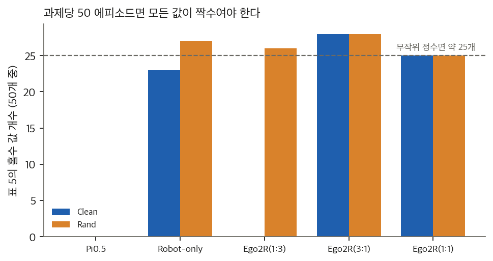
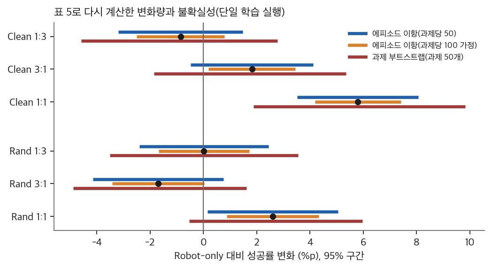
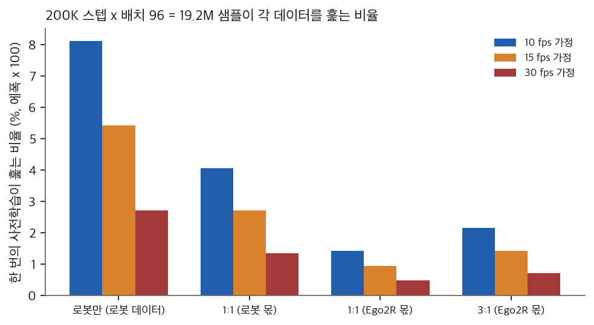
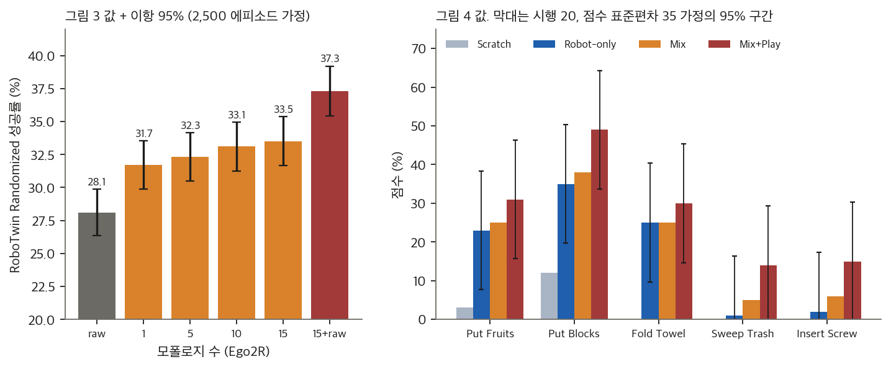

> **논문:** Ye Wang, Pei Lin, Xiong-Hui Chen 외. *Ego2Robot: Scalable Robot Data Synthesis from Egocentric Human Data.* CoRL 2026 스포트라이트, arXiv:2608.02580 (v1, 2026-08-03).
> 공식 코드(www-Ye/ego2robot_blog)는 정적으로만 읽었고 실행하지 않았습니다. 논문 그림은 싣지 않고, 우리가 만든 그래프만 씁니다.

## 논문이 묻는 것

사람의 1인칭 조작 영상은 로봇 시연보다 싸게 많이 모입니다. 손 동작을 평행 그리퍼의 목표 자세로 바꾸고, 영상 속 사람 팔을 지운 뒤 같은 장면에 로봇 팔을 그려 넣으면 "로봇이 한 것처럼 보이는" 학습 데이터가 됩니다. 이 방법은 과제 하나, 소규모에서는 이미 보여 있었습니다(Phantom, EgoMimic). 이 논문이 묻는 것은 **VLA 사전학습 규모(18,561 시간, 로봇 15종)로 키워도 도움이 되는가**입니다.

방법은 세 단계입니다. 손 키포인트를 그리퍼 TCP·폭·자세로 바꾸는 행동 정렬, SAM 3와 ProPainter로 팔을 분할·제거하고 로봇 베이스를 격자 탐색해 MuJoCo IK로 푼 뒤 깊이 순서로 합성하는 시각 정렬, 세 단계 품질 선별(L1 파이프라인, L2 통계, L3 VLM)입니다. 평가는 RoboTwin 2.0을 시각, 장면, 형태, 의미 네 축의 독립 변형 11개와 EBench로 쪼갠 틀입니다. 로봇 데이터(약 6,565 시간)에 합성 데이터를 1:3, 3:1, 1:1로 섞어 사전학습했을 때 1:1이 Clean 62.2 → 68.1, Randomized 50.9 → 53.5입니다.

## 이 글에서 확인한 것

**표 5가 "과제당 50 에피소드"와 맞지 않습니다.** 과제당 50회의 이진 성공이면 성공률은 모두 짝수여야 합니다. 부록 표 5의 500개 값 중 182개가 홀수이고, 열 10개 중 7개가 해당합니다. π0.5 두 열과 Ego2R 1:3의 Clean 열만 모두 짝수입니다. 평균 행도 표시된 과제별 값의 평균과 최대 0.08 어긋납니다. 분모가 100이거나 여러 실행의 평균이 정수로 반올림된 것일 수 있지만, 논문에는 시드 수와 평균 방식이 없습니다.

그래프: 표 5의 모델·설정별 홀수 값 개수. 과제당 50 에피소드면 모두 0이어야 합니다. 우리가 그린 그래프입니다.

**Clean +5.9는 견고하고, Randomized +2.6은 약합니다.** 표 5의 과제 50개를 표본으로 쌍체 비교하면 1:1의 Clean은 +5.8(p = 0.007)이고 Randomized는 +2.6(p = 0.13)입니다. 에피소드 표집만 보면 Randomized도 p = 0.037(과제당 50) 또는 0.003(100 가정)로 유의하지만, 이는 "이 50과제에서"의 진술입니다. 어느 쪽 구간에도 학습 시드 변동은 들어 있지 않습니다. 1:3과 3:1의 변화는 모두 0과 구분되지 않습니다.

그래프: 표 5로 다시 계산한 Clean·Rand 변화량. 세 구간은 에피소드 이항(과제당 50), 에피소드 이항(과제당 100 가정), 과제 부트스트랩입니다. 우리가 그린 그래프입니다.

**혼합 비율에 대해 비단조이고 학습 변동이 커 보입니다.** 표 1의 7열 중 5열이 1:1(Ego2R 50%)에서 최대이고 25%와 75%는 모두 그보다 낮습니다. UR5는 세 혼합에서 17.6, 31.4, 25.0이어서, 3:1과 1:1 사이 6.4 %p는 이항 표준오차(셀당 2,500회 가정, 약 1.3 %p)의 5배입니다. 에피소드 표집 오차로는 설명되지 않고, 학습 실행 사이의 변동이 클 가능성을 시사합니다. 가장 견고한 효과는 미지 물체(Obj)로, 세 혼합 모두 +7.5, +10.7, +10.3입니다. 본문의 "시각이 가장 이득"은 표 1과 맞지 않습니다: 1:1에서 Task +7.9가 Visual +5.9보다 큽니다.

**"가장 큰 데이터셋"은 그만큼 쓰이지 않았습니다.** 모든 사전학습은 200K 스텝 x 배치 96 = 19.2M 샘플로 같습니다. 프레임률을 10–30 fps로 가정하면 1:1의 합성 데이터 몫은 18,561 시간의 0.5–1.4%, 약 90–270 시간 분량입니다. 시간 대 성능 곡선도, 사전학습 없음 기준선도 없습니다. 절제 실험의 형태별 데이터 시간(1,237 / 6,187 / 12,374 / 18,561 시간)은 18,561/15의 정확한 배수입니다. 형태별로 잰 값이 아니라 균등 분할한 값일 가능성이 있습니다.

그래프: 19.2M 샘플이 로봇 데이터와 합성 데이터를 훑는 비율(프레임률 10, 15, 30 fps 가정, 논문에는 없음). 우리가 그린 그래프입니다.

**절제는 방향만 지지되고, 실로봇은 교락이 큽니다.** 형태 1 → 15개는 +1.8(p = 0.17, 2,500 에피소드 가정)이고, 원본 영상을 더하는 쪽이 +3.8로 더 큽니다. 실로봇 그림 4의 Put Fruits Mix+Play 31은 시행 20회와 단계 점수 33.3으로는 만들 수 없는 값(30.0 또는 31.6)입니다. 사전학습 효과(Mix − Robot-only)는 다섯 과제 평균 +2.6점으로 구분되지 않고(시행 20회, 점수 표준편차 30–50 가정), 가장 좋은 구성(Mix + Ego2R Play)은 같은 장면에서 찍은 합성 에피소드 675개를 추가로 받습니다.

그래프: 왼쪽은 그림 3의 값에 이항 95% 구간(2,500 에피소드 가정), 오른쪽은 그림 4의 값에 시행 20회·점수 표준편차 35 가정의 95% 구간(Robot-only와 Mix+Play만). 우리가 그린 그래프입니다.

## 공식 코드와 논문은 어디가 다른가

공개 코드는 합성 파이프라인과 평가 틀만 있고(커밋 1개), 훈련 코드, 모델, 합성 데이터, L2·L3 선별은 없습니다. 임계값, 격자, 필터 같은 숫자는 대부분 논문과 일치하지만 몇 곳이 다릅니다.

- **베이스 선택 기준.** 논문은 IK 가능 비율을 최대화한다고 쓰지만 코드는 키프레임 IK의 최대 추적 오차를 최소화합니다. 영상 중심 페널티, 무작위 국소 정제 같은 논문에 없는 단계도 있습니다.
- **실로봇 설정.** 공개된 설정은 보정된 고정 베이스를 쓰고 베이스 탐색을 건너뛰며 DynHaMR 시간 최적화를 끕니다.
- **평가 변형.** 책상 높이는 ±4 cm가 아니라 [−3, 0] cm의 단방향이고, 카메라 오프셋은 축별 5 cm가 아니라 크기 ≤ 5 cm의 무작위 방향이며, 방해물은 3–5개가 아니라 기본 10개입니다.
- **한 형태의 누락.** YAM의 도달 반경이 코드에 없어 1.0 m가 쓰입니다(논문 0.866 m).

식 (10)의 카메라 프레임 변환도 하나 걸립니다. 본문은 "base-frame deltas"에 R_ce를 곱한다고 쓰지만, 이는 Δ가 EEF 프레임일 때만 맞습니다. 무작위 회전 20,000개로 확인하면 월드 프레임 Δ에 곱할 때 평균 90° 어긋납니다. 머리가 움직이는 1인칭 영상에서는 카메라를 프레임마다 갱신하면 머리 회전이 손 이동에 섞입니다(머리 30도/초, 손 0.3 m/s 가정에서 겉보기 이동이 실제의 0.7배).

## 재현할 수 있나

이 맥(Apple M4 Pro, 24 GiB, MPS, CUDA 없음)에서 **논문의 수치(표 1, 2, 5, 그림 3, 4)는 재현할 수 없습니다.** 8 x A100 사전학습이 필요하고, 학습 코드·체크포인트·합성 데이터가 공개되지 않았고, 실로봇이 필요합니다. 합성 파이프라인의 순수 기하와 신호처리(행동 정렬, 필터, 베이스 후보 점수)는 CPU에서 구현·검증할 수 있고, IK와 렌더링은 설치 뒤 조건부이며, SAM 3와 ProPainter 같은 끝 단계는 CUDA가 필요합니다. 이 글의 수치는 논문 표를 다시 계산한 것이고 어떤 학습이나 평가도 하지 않았습니다.

## 한계와 가정

- 유의성은 한 번의 학습 실행에서 에피소드 표집 오차만 가정한 것입니다. 분모(50 또는 100)는 논문에 없어 두 경우를 모두 계산했습니다.
- 그림 3과 그림 4의 값은 그림 안 숫자를 읽었습니다. 프레임률(노출 비율), 점수 표준편차(실로봇), 손·머리 속도(토이)는 우리의 가정입니다.
- 코드 대조는 정적 읽기입니다. 어느 데이터 소스가 어느 변환 경로를 쓰는지는 따라가지 않았습니다.

## 자료

- [통합 리포트 PDF](report/report_public.pdf)
- [01. 논문 분석: Ego2Robot (arXiv:2608.02580)](analysis/01_paper_analysis.md)
- [02. 선행연구와 자료 (Ego2Robot)](analysis/02_prior_work.md)
- [03. 수치 재계산과 일관성 검사 (Ego2Robot v1)](analysis/03_analysis.md)
- [04. 논문 ↔ 공식 코드 대조와 구현 가능성 (Ego2Robot)](analysis/04_code_verification.md)
