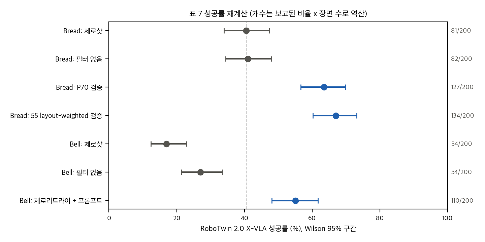
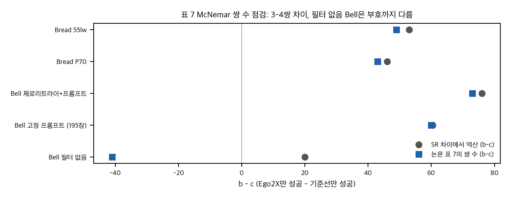

> **논문:** Xinke Lyu, Bowen Yang, Zhicheng Wang. *Ego2X: Contact-aware Transfer from Egocentric Human Data to Any Robot.* arXiv:2611.24138 (v2, 2026-11-19).
> 학회 표기는 확인되지 않았습니다. 공식 코드와 프로젝트 페이지도 확인되지 않았습니다. 논문은 코드와 데이터를 "공개할 것"이라고만 적었습니다.

## 논문이 묻는 것

사람 영상을 로봇 데이터로 바꾸는 기존 방법은 주로 손의 3D 궤적을 로봇 관절로 옮깁니다. 단안 영상에서 손의 깊이는 시선 방향으로 cm 단위로 흔들리고, 파지에는 mm 단위의 표면 접촉이 필요합니다. 그래서 리타게팅된 손가락이 물체 옆에 뜨고, 평행 그리퍼가 빈 공간을 닫는 결과가 나옵니다.

Ego2X는 전달 단위를 바꿉니다. 손 궤적이 아니라 **물체 좌표계의 접촉 기록**을 옮깁니다. 접촉 한 개는 물체 표면 앵커, 외향 법선, 상대 부하 비율, 파지 모드, 상호작용 상태로 적습니다. 이 기록(CORE)을 깊이 보정, 로봇별 IK, 가림 제거, 시뮬 검증이 공유합니다.

## 무엇이 새로운가

- **접촉 기록 CORE.** 식으로 적으면 `(앵커, 법선, 부하, 모드, 상태)`와 근거 등급입니다. 힘은 뉴턴이 아니라 시각과 운동학에서 온 사전분포라고 저자가 명시합니다.
- **깊이 보정의 분리.** 물체 자세로 손 깊이를 고치고, 손 스케일로 물체를 고치면 오차가 순환합니다. 논문은 두 경로를 나누고, 물체 자세의 신뢰도를 29개 특징의 GBDT로 판정합니다.
- **교차 형태 IK.** 손가락 종류와 평행 그리퍼가 같은 CORE 기록을 씁니다. 로봇 충돌 메시를 패드 후보로 바꾸는 URDF 컴파일러가 있습니다.

*그래프: 우리가 그렸습니다. 논문 표 7의 성공률을 장면 수 200으로 역산해 Wilson 95% 구간을 붙였습니다.*

## 숫자를 다시 세어 보면

- **시연 수율은 크고 확실합니다.** RoboTwin 2.0 Bread에서 31/52(59.6%)대 1/52(1.9%), Bell에서 45/53(84.9%)대 0/53입니다. 구간이 겹치지 않습니다.
- **VLA 향상은 방향이 맞지만 조건이 좁습니다.** 제로샷 40.5%에서 검증된 55개 에피소드로 67.0%입니다. 에피소드는 시뮬 물리 재생으로 고른 뒤, 같은 시뮬에서 평가합니다. "시뮬 시연 없이"는 교사 시연이 없다는 뜻이지, 시뮬 피드백이 없다는 뜻이 아닙니다.
- **쌍 수가 어긋나는 곳이 있습니다.** 표 7의 McNemar 쌍 수 중 Bell 필터 없음 행은 17:58입니다. 이는 Ego2X가 기준선보다 나쁘다는 뜻인데, 보고된 성공률은 17%에서 27%로 올랐습니다. 다른 세 행은 쌍 수가 SR 차이보다 3–4개 적습니다.

*그래프: 우리가 그렸습니다. 보고된 쌍 수(사각)와 성공률 차이에서 역산한 값(원형)을 비교했습니다.*

- **초록의 33.7%는 6클립 결과입니다.** 같은 깊이 보정의 EgoHand 10클립 결과는 14.1%입니다. "26.5%"는 상대 향상이 아니라 percentage point입니다.

## 이 맥에서 할 수 있는 것

- **전체 재현은 불가능합니다.** 단안 영상 파이프라인은 여러 GPU 모델이 필요하고, X-VLA 학습과 RoboTwin 2.0 검증도 GPU와 시뮬레이터를 전제합니다.
- **표현과 검사는 가능합니다.** 접촉 기록 스키마, 깊이 보정 식의 합성 데이터 검사, 2–3링크 토이의 접촉 IK는 CPU로 할 수 있습니다.
- **판단.** 이 논문은 접촉 표현과 파이프라인 설계로 읽을 가치가 큽니다. 실험 수치는 원자료가 공개되기 전까지 방향만 믿을 수 있습니다.

## 다음에 확인할 것

1. 공식 코드와 CORE 데이터의 공개 여부
2. 쌍 수 불일치(Bell 필터 없음 행)의 원인, 장면별 성공 기록
3. 평행 그리퍼 비교에서 Ego2Robot의 입력 조건(장치 추적 3D 손)

재계산 스크립트와 분석 노트는 `publish/git/`에 있습니다.

## 자료

- [통합 리포트 PDF](report/report_public.pdf)
- [Ego2X (arXiv:2611.24138) 논문 분석](analysis/01_paper_analysis.md)
- [Ego2X 선행연구와 자료](analysis/02_prior_work.md)
- [Ego2X 수치 재계산과 일관성 검사](analysis/03_analysis.md)
- [Ego2X 주장 검증 (공식 코드 없음)](analysis/04_claim_verification.md)
