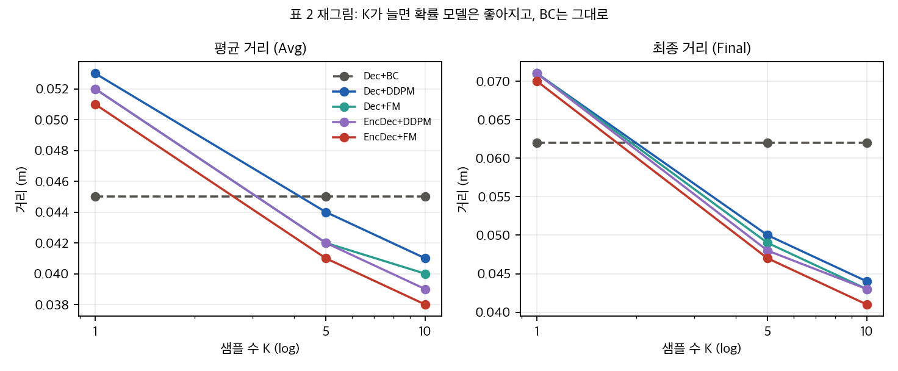
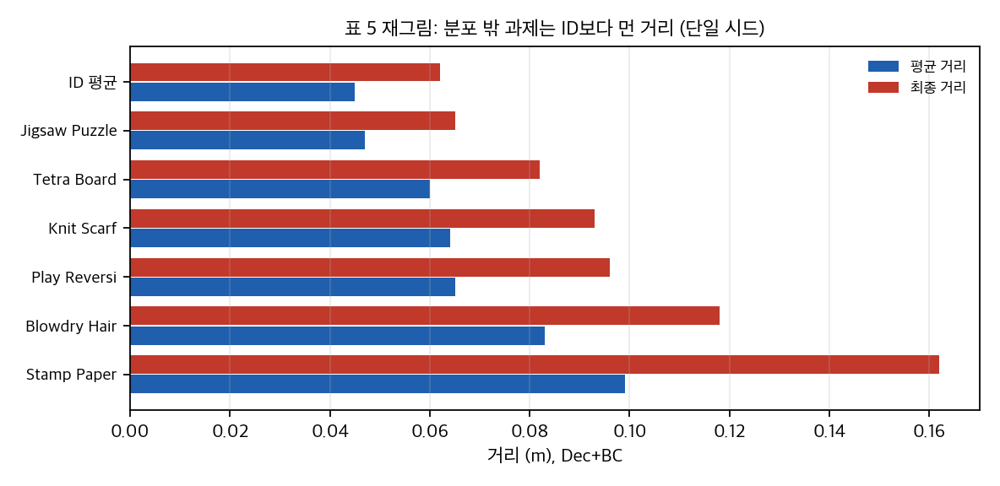

> **논문:** Ryan Hoque, Peide Huang, David J. Yoon, Mouli Sivapurapu, Jian Zhang (Apple). *EgoDex: Learning Dexterous Manipulation from Large-Scale Egocentric Video.* ICLR 2026 포스터, arXiv:2505.11709 (v3, 2026-03-09).
> 공식 코드 저장소는 평가 지표와 데이터 로더만 담고 있습니다. 이 글의 그래프는 논문 표 값을 우리가 다시 그린 것입니다. 논문 그림은 싣지 않았습니다(arXiv 라이선스가 CC BY가 아닙니다).

---

## 논문이 묻는 것

로봇 모방학습에는 데이터가 부족합니다. 텔레오퍼레이션은 물리 로봇에 묶여 있습니다. 이 논문은 다른 길을 택합니다. 사람이 맨손으로 물건을 다루는 1인칭 영상을, 손가락까지 추적한 3D 포즈와 함께 모읍니다. 사람 손을 공통 몸으로 보고, 로봇 없이 데이터를 쌓자는 것입니다.

데이터는 829시간, 338,000 에피소드, 194개 과제입니다. 저자들은 이 데이터로 손 궤적을 예측하는 벤치마크를 만들고, 확률 모델을 평가할 수 있도록 best-of-K 지표를 정의합니다.

## 지표: 샘플 K개 중 가장 가까운 것

손 궤적은 여러 가능성을 가집니다. 물건을 집는 방법은 여러 가지입니다. 그래서 논문은 모델이 K개 샘플을 낸 뒤, 정답에 가장 가까운 샘플의 거리를 씁니다. 거리는 양 손목과 손가락 끝 5개씩, 총 12개 점의 3D 거리입니다. 전체 시점에 대한 평균(Avg)과 마지막 시점(Final)을 함께 봅니다.

이 정의에서 중요한 것은 K입니다. 결정론적 모델은 K와 무관합니다. 확률 모델은 K가 커질수록 거리가 줄어듭니다.

<figure>

<figcaption>그래프: 논문 표 2 값을 K에 따라 다시 그린 것. 확률 모델은 K가 늘면 좋아지고, BC는 그대로입니다. 우리가 그린 그래프입니다.</figcaption>
</figure>

## 이 글에서 확인한 것

- **퍼센트 주장 대부분은 맞습니다.** 예측 horizon을 2초에서 1초로 줄이면 평균 거리가 31% 줄고, 최종 거리가 21% 줄어듭니다. 목표 이미지를 주면 평균 22%, 최종 53% 줄어듭니다. 표의 값에서 다시 계산해도 같습니다.
- **"최대 34%"는 한 조합에만 맞습니다.** 최종 거리에서 인코더-디코더 흐름 매칭 모델의 K=10 값을 결정론적 BC의 K=1 값과 비교한 경우입니다. 평균 거리로 비교하면 15.6%이고, 다른 기준의 최대값은 42%입니다. 본문은 기준을 밝히지 않았습니다.
- **목표 이미지 개선은 다른 문제의 비교입니다.** 예측 벤치마크의 기준 모델과, 끝 이미지를 보는 역동역학 모델을 비교합니다. 추가 정보가 들어간 것입니다.
- **단일 학습 실행입니다.** 시드 수, 표준편차, 신뢰구간이 없습니다. 표의 격차 0.003 m가 학습 잡음보다 큰지 판단할 수 없습니다. 이 점이 가장 큰 한계입니다.
- **라이선스 문장이 바뀌었습니다.** 첫 두 버전은 데이터를 CC-BY-NC-ND로 공개한다고 적었습니다. 최신 버전에는 그 문장이 없습니다. 저장소 README에는 아직 있습니다. 재사용하기 전에 확인이 필요합니다.

## 공식 코드로 확인할 수 있는 것

저장소의 지표 코드는 논문의 48차원 행동 배치, 12점 선택, 평균과 최종 거리, best-of-K 정의와 맞습니다. 다만 몇 가지가 빠져 있습니다.

- 학습 코드와 모델 설정이 없습니다. 학습은 외부 코드베이스(X-IL)에 의존합니다.
- 논문 행동을 만드는 코드가 없습니다. 6D 회전, 손가락 끝 위치, 카메라 프레임 변환, 청크 상대화를 직접 짜야 합니다.
- 지표는 패딩이 있는 청크를 뺍니다. 본문에는 이 규칙이 없습니다.

## 구현할 수 있는가

**학습 재현은 할 수 없습니다.** 14개 모델을 모델당 A100 8장으로 약 72시간씩 학습해야 합니다. 데이터는 1.7 TB입니다. 개인 장비로는 맞지 않습니다.

**지표와 입력 파이프라인은 할 수 있습니다.** 지표를 독립 구현해 합성 데이터로 검사할 수 있습니다. 테스트 세트 일부로 작은 모델을 학습해 시드 잡음을 재는 것도 가능합니다. 이때는 16 GB 다운로드가 필요합니다.

## 정리

EgoDex는 사람 손 데이터의 규모와 지표 정의가 쓸 만한 자료입니다. 논문 숫자는 대체로 맞습니다. 다만 "최대 34%" 같은 문장은 기준을 함께 봐야 하고, 단일 실행이라는 사실을 기억해야 합니다. 로봇 정책 성능에 대한 주장은 이 논문에서 검증되지 않았습니다.

*그래프: 논문 표 2 값을 K에 따라 다시 그린 것. 우리가 그린 그래프입니다.*

*그래프: 논문 표 5 분포 밖 과제(OOD)와 분포 안 평균의 비교. 단일 시드, Dec+BC. 우리가 그린 그래프입니다.*

## 자료

- [통합 리포트 PDF](report/report_public.pdf)
- [01. EgoDex 논문 분석](analysis/01_paper_analysis.md)
- [02. 선행 연구, 대안, 자료 계보](analysis/02_prior_work.md)
- [03. 보고 수치 재계산과 일관성 검사](analysis/03_analysis.md)
- [04. 논문 ↔ 공식 코드 대조](analysis/04_code_verification.md)
