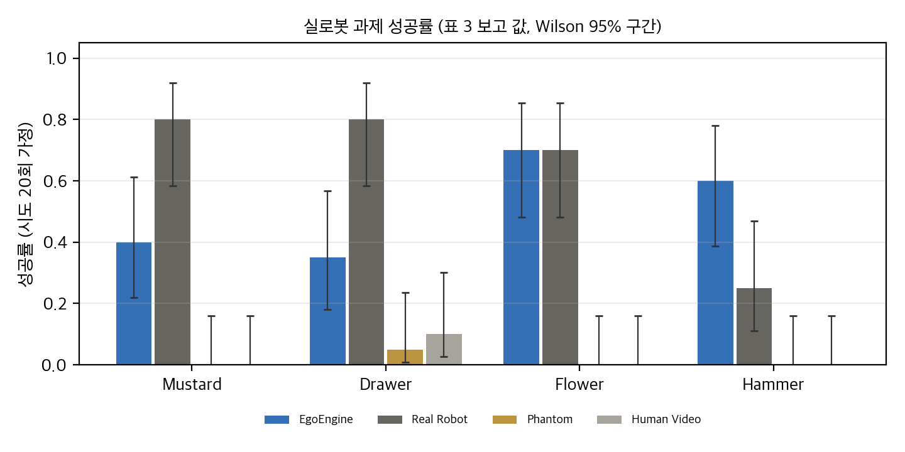
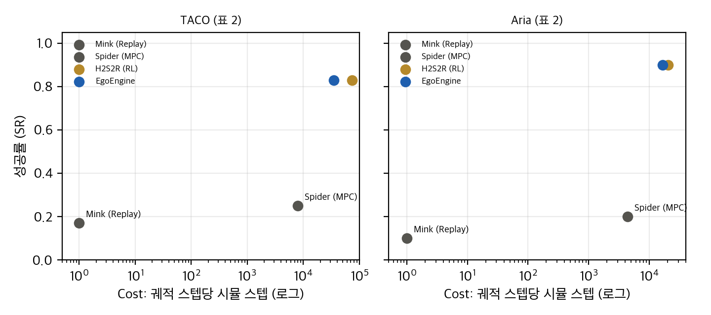
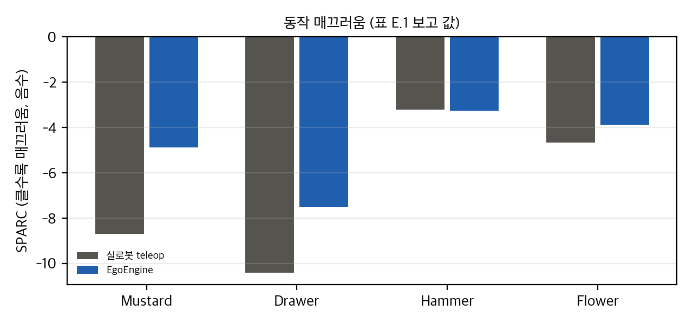

> **논문:** Yangcen Liu, Shuo Cheng, Xinchen Yin, Woo Chul Shin, Alfred Cueva, Yiran Yang, Zhenyang Chen, Chuye Zhang, Danfei Xu. *EgoEngine: From Egocentric Human Videos to High-Fidelity Dexterous Robot Demonstrations.* CoRL 2026 포스터, arXiv:2606.12604 (v1, 2026-06-10).
> 공식 코드는 GitHub GaTech-RL2/EgoEngine-CoRL2026에 있습니다(라이선스 혼합: 일부 CC BY-NC 4.0). 이 글의 그래프는 우리가 논문의 표 수치로 그린 것입니다. 논문 그림은 넣지 않았습니다(논문 라이선스가 arXiv 비독점 1.0이라 CC BY가 아닙니다).

## 논문이 묻는 것

사람의 egocentric 영상은 많고 손재주가 풍부합니다. 하지만 로봇 학습에 바로 쓰기는 어렵습니다. 두 간극이 있습니다. 시각적으로는 사람 팔과 손이 장면을 가리고 로봇과 모양이 다릅니다. 행동적으로는 사람 손 움직임을 그대로 옮긴 궤적이 로봇 동역학에서 실행되지 않습니다.

EgoEngine은 사람 영상 한 편을 두 가지로 바꿉니다. 로봇이 같은 장면에 들어간 **관측 영상**과, 실행 가능한 **행동 궤적**입니다. 두 결과는 같은 물체 중심 디지털 트윈에서 나옵니다. 논문의 헤드라인은 실로봇 teleoperation 데이터 없이 사람 영상만으로 zero-shot 정책을 얻었다는 것입니다.

*그래프: 논문 표 3의 실로봇 성공률과 Wilson 95% 구간. 시도 수는 논문에 없어서 20회로 가정했습니다 (우리가 그린 그래프).*

## 행동 분기: 세 해결기를 chunk마다 고르기

사람 손에서 얻은 기준 궤적은 대개 실행되지 않습니다. 그래서 논문은 물체 자세 추적 오차를 보상으로 쓰는 시뮬 정제를 붙입니다. 세 해결기가 있습니다. Replay는 기준 궤적을 그대로 따릅니다. MPC는 짧은 구간에서 샘플링으로 보정합니다. RL은 잔차 정책을 학습합니다.

핵심은 **쓰는 순서**입니다. 20 스텝 chunk마다 Replay를 먼저 시도하고, 실패하면 MPC, 그다음 RL로 올라갑니다. 현재 chunk와 다음 chunk를 같은 상태에서 함께 풀어 통과해야 현재 chunk를 커밋합니다. 실패하면 다음 chunk는 다시 Replay에서 시작합니다. 논문은 이것을 MCTS 방식이라고 부르지만, 학습된 가치 함수 없이 휴리스틱으로 고르는 탐색이라고 스스로 적었습니다.

## 실험에서 확인한 것

**1. 사람 영상만으로 된다는 방향은 확실합니다.** 실로봇 네 과제 합계에서 EgoEngine은 41/80 (0.51), 사람 영상은 2/80, Phantom은 1/80입니다. 차이는 매우 큽니다 (Fisher p < 10⁻¹²).

**2. 행동 정제가 핵심입니다.** 시각 분기만 쓰면 0.05입니다. 행동 분기만 쓰면 0.43이고, 전체는 0.51입니다. 그래서 논문의 "행동 간극이 성능을 좌우한다"는 주장은 표로 뒷받침됩니다.

**3. 과제별 우위는 엇갈립니다.** Mustard와 Drawer에서는 실로봇 teleoperation이 0.80이고 EgoEngine은 0.40, 0.35입니다 (p = 0.02, 0.01). Flower는 둘 다 0.70입니다. Hammer에서는 EgoEngine이 0.60, 실로봇이 0.25입니다. 하지만 p = 0.054로 경계입니다. 과제당 시도가 20회 정도이면 차이 0.3 수준은 잘 잡히지 않습니다. 논문 본문의 "2 of 4 과제에서 같거나 더 낫다"는 방향만 말할 수 있습니다.

**4. 비용 절감은 스텝 기준으로 맞습니다.** 같은 성공률에서 RL 기준선보다 시뮬 스텝이 적습니다. TACO는 73,675에서 34,842로 53% 줄고, Aria는 20,237에서 16,560으로 18% 줄입니다. 처리량 22%는 RTX 4090 한 대에서 한 번 측정한 벽시계 값입니다.

*그래프: 논문 표 2의 성공률과 궤적 스텝당 시뮬 스텝 (로그 축). 같은 성공률에서 EgoEngine이 RL보다 싸게 생성합니다 (우리가 그린 그래프).*

**5. 동작 매끄러움은 대체로 좋습니다.** 사람에서 나온 궤적은 원격 조작보다 매끄럽습니다 (SPARC). 다만 Hammer는 같고, 논문의 "전체" 값은 과제 평균과 맞지 않습니다.

*그래프: 논문 표 E.1의 과제별 SPARC. 클수록 매끄럽습니다 (우리가 그린 그래프).*

## 공식 코드와 논문의 차이

공식 코드(2026-10-16 기준)는 정적으로만 읽었습니다. 실행하지 않았습니다. 다음 차이를 확인했습니다.

- **종료 규칙:** 논문은 위치와 회전을 합친 단일 경계로 종료합니다. 코드는 두 경계를 따로 두고 하나라도 넘으면 종료합니다.
- **과제별 설정:** 논문은 TACO와 Aria의 과제별 경계와 실로봇 잡음 설정을 설명합니다. 코드의 실로봇 설정은 해머 과제에서만 논문과 같고, 나머지 과제는 값이 다릅니다. 통합 CLI는 과제별 경계를 넘기지 않습니다.
- **범위:** 릴리스는 사전 처리된 입력 여섯 사례만 담습니다 (Aria 3, TACO 3). 디지털 트윈 인식 단계, 사람 제거 모델, 정책 학습 코드는 없습니다.
- **비용:** 릴리스는 "검증된 스텝 절감을 주장하지 않는다"고 적었습니다.

## 이 맥에서 재현할 수 있는가

**전체 결과는 재현할 수 없습니다.** 행동 분기는 CUDA 환경을 요구합니다. 디지털 트윈과 정책 학습 코드는 릴리스에 없습니다. 실로봇도 필요합니다.

**시각 분기 일부는 가능합니다.** 릴리스는 macOS에서 OpenGL 기반 렌더링과 합성을 지원합니다. 다만 설치 전 확인이 필요하고, 행동 분기와 연결하려면 GPU가 있는 Linux 기기가 필요합니다. 논문 처리량을 기준으로 하면 Aria 200편에 GPU 기준 약 70시간이 걸립니다 (측정하지 않은 추정입니다).

## 정리

EgoEngine의 설계 교훈은 분명합니다. 사람 영상은 시각 변환만으로는 부족하고, 실행 가능한 행동 정제가 핵심입니다. 그 정제를 저렴한 해결기부터 chunk 단위로 고르는 방식은 다른 접촉 작업에도 옮길 만합니다.

다만 실험 설계는 아쉽습니다. 실로봇 시도 수와 시드가 없고, 비용 지표는 릴리스에서 확인되지 않았습니다. 논문을 인용할 때는 방향과 상대 크기를 중심으로 읽는 것이 안전합니다.

## 자료

- [통합 리포트 PDF](report/report_public.pdf)
- [01. 논문 분석: EgoEngine](analysis/01_paper_analysis.md)
- [02. 선행연구, 공식 저장소, 관련 분석](analysis/02_prior_work.md)
- [03. 재계산과 일관성 검사](analysis/03_analysis.md)
- [04. 공식 코드 대조와 구현 가능성](analysis/04_code_verification.md)
