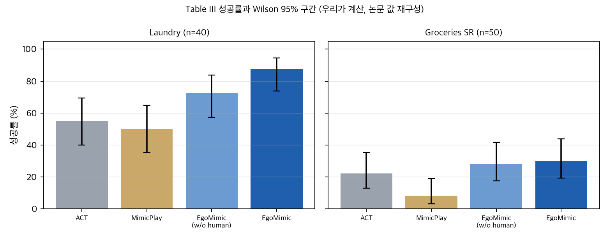
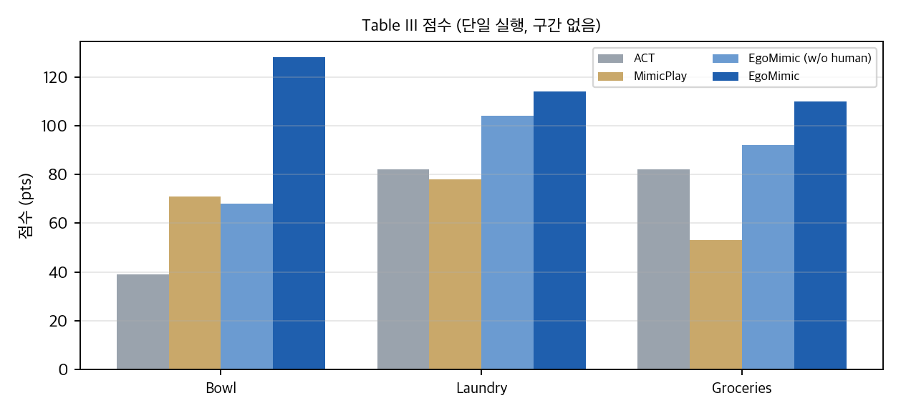

> **논문:** Simar Kareer, Dhruv Patel, Ryan Punamiya, Pranay Mathur, Shuo Cheng, Chen Wang, Judy Hoffman, Danfei Xu. *EgoMimic: Scaling Imitation Learning via Egocentric Video.* arXiv:2410.24221 (v1, 2024-10-31).
> 공식 코드는 GitHub SimarKareer/EgoMimic (MIT)에 있습니다. 이 글의 그림은 우리가 그린 그래프 두 장입니다. 논문 그림은 arXiv 라이선스가 CC BY가 아니어서 싣지 않았습니다.

## 논문이 묻는 것

로봇 데모는 비싸고 느리게 모입니다. 저자들은 사람이 맨손으로 작업하는 장면을 Project Aria 안경으로 찍고, 3D 손 추적을 얻어 로봇 데모와 같은 학습 데이터로 씁니다. 기존 연구는 사람 영상에서 고수준 의도만 뽑아 저수준 정책을 따로 학습했습니다. EgoMimic는 사람과 로봇 데이터를 **같은 행동 공간에 맞춘 뒤 한 정책으로 함께 학습**합니다.

핵심 설계는 네 가지입니다.

1. **로봇에도 같은 안경을 달아** 카메라 차이를 줄입니다.
2. **사람 손 궤적을 현재 카메라 좌표계로 옮겨** 움직이는 1인칭 카메라에서도 행동을 예측하게 합니다.
3. **사람과 로봇 데이터의 행동과 자세를 각각 Z-score로 정규화합니다.** 분포 차이가 크면 정책이 두 데이터를 따로 배우기 때문입니다.
4. **SAM2로 사람 손과 로봇 팔을 가리고 빨간 선을 그려** 외형 차이를 줄입니다.

## 이 글에서 확인한 것

**1. Laundry에서는 효과가 확실합니다.** 40회 평가에서 EgoMimic는 35회 성공 (88%, Wilson 95% [74, 95])이고, ACT는 22회 (55%, [40, 69])입니다. Fisher 정확 검정 p = 0.003입니다. Mimicplay 대비 p = 0.0006입니다.

**2. Groceries에서는 차이가 유의하지 않습니다.** EgoMimic 성공 15회 (30%), ACT 11회 (22%)입니다. 차이 8%p의 Fisher p = 0.49입니다. 시행 50회로는 이 정도 차이를 가리기 어렵습니다. Mimicplay 대비는 p = 0.01로 유의합니다.

*그림: Table III 성공률과 Wilson 95% 구간 (우리가 계산, 시행 40회와 50회). 출처: arXiv:2410.24221 Table III의 값.*

**3. 사람 데이터를 뺀 같은 구조와 비교하면 효과가 줄어듭니다.** Object-in-Bowl 점수는 128 대 68입니다 (+88%). 단일 실행이고 시도별 값이 없어 검정은 하지 못했습니다. Laundry 성공률 차이 15%p는 p = 0.16입니다.

*그림: Table III 점수 (단일 실행, 구간 없음). 우리가 그렸습니다. 출처: arXiv:2410.24221 Table III.*

**4. 일반화와 확장 주장은 검증하지 못했습니다.** 새 색 셔츠와 새 장면 (Fig. 7), 로봇 데이터 3시간 대 "로봇 2시간 + 사람 1시간" (Fig. 8)은 시행 수와 반복이 없습니다. 방향만 보입니다.

**5. 공식 코드와 논문 설정이 여러 곳에서 다릅니다.** 논문 Alg. 1은 MSE, 본문과 부록은 L1을 쓰고 코드는 L1입니다. 논문 배치는 128이고 120,000 반복이지만, 공식 설정 파일은 배치 16입니다. 손 행동은 SE(3) 자세가 아니라 손목의 3차원 위치뿐입니다. 정규화를 빼면 점수가 38% 떨어졌습니다 (단일 실행).

## 재현할 수 있을까

- **학습 재현은 이 맥에서 불가능합니다.** 공식 코드가 `model.cuda()`와 CUDA 전용 마스킹 경로를 고정합니다. 샘플 데이터는 약 243 GB입니다.
- **정규화 통계와 작은 정책 실험은 가능합니다.** 승인과 직접 짠 코드가 전제입니다.
- 실로봇 평가는 Eve 하드웨어가 필요합니다.

## 정리

사람 데이터는 장기 과제의 성공률을 올릴 가능성이 있습니다. 다만 이 논문의 증거는 Laundry 한 과제에서만 통계적으로 뚜렷하고, 나머지는 시행 수가 부족합니다. 같은 질문을 던지려면 시행 수를 늘리고 여러 시드로 반복해야 합니다.

*산출물: 분석 01–04, 재계산 스크립트와 결과 (`recompute.py`, `recompute_results.json`), 공개 리포트 (`report_public.pdf`).*

## 자료

- [통합 리포트 PDF](report/report_public.pdf)
- [EgoMimic: Scaling Imitation Learning via Egocentric Video 분석](analysis/01_paper_analysis.md)
- [EgoMimic 선행연구와 공식 저장소](analysis/02_prior_work.md)
- [EgoMimic 재계산과 일관성 검사 (03)](analysis/03_analysis.md)
- [EgoMimic: 논문 ↔ 공식 코드 대조 (04)](analysis/04_code_verification.md)
